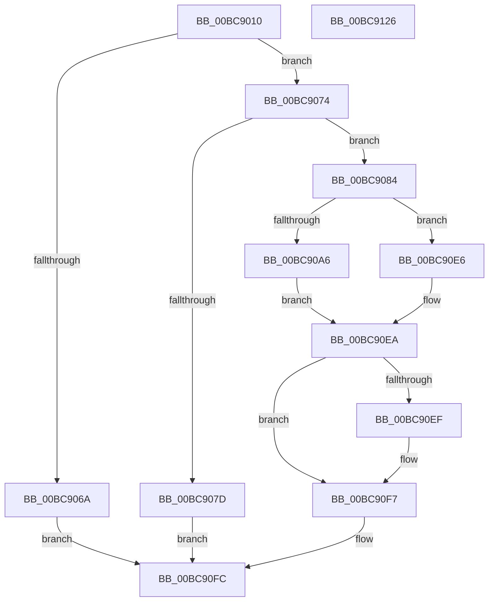

# CmSaveKeyToBuffer

- RVA: `0x00BC9010`–`0x00BC9127` (길이 `279` bytes)
- VA: `0x0000000140BC9010`
- 실행 섹션: `PAGECMRC`
- PDB 이름 있음: `예`; PDB Function 태그: `아니요`
- unwind 정보 RVA: `0x000D662C`
- 디코드: `77`개 명령, `279/279` bytes 표시
- 미해석 바이트: `0` (있으면 어셈블리에 `.byte`로 보존)

> 이 문서는 커널 이미지의 기계어와 PDB 기호를 분석해 생성했습니다. 4번과 5번은 함수 원형과 자료형을 바이너리 사용 방식에서 추정한 C 해석이며 원본 소스 복구 결과는 아닙니다.

## 1. Dependencies

- 직접 호출 지점: **11**; 고유 호출 대상: **11**
- 직접 호출자로 확인된 함수: **0**
- RIP 상대 이미지 참조: **1**

### Outgoing calls
- `0x00BC905F` → [CmpInitializeThreadInfo](../../text/3F/CmpInitializeThreadInfo_function_003FBE70.md) (function, `0x003FBE70`)
- `0x00BC9074` → [CmpAcquireShutdownRundown](CmpAcquireShutdownRundown_function_00BC9400.md) (function, `0x00BC9400`)
- `0x00BC909B` → [CmObReferenceObjectByHandle](CmObReferenceObjectByHandle_function_00BC9350.md) (function, `0x00BC9350`)
- `0x00BC90BB` → [CmpAttachToRegistryProcess](CmpAttachToRegistryProcess_function_00BC98E0.md) (function, `0x00BC98E0`)
- `0x00BC90CD` → [CmpDumpKeyToBuffer](CmpDumpKeyToBuffer_function_00BC9130.md) (function, `0x00BC9130`)
- `0x00BC90DA` → [KiUnstackDetachProcess](../../text/21/KiUnstackDetachProcess_function_00217D30.md) (function, `0x00217D30`)
- `0x00BC90DF` → [KeLeaveCriticalRegion](../../text/25/KeLeaveCriticalRegion_function_0025D8B0.md) (function, `0x0025D8B0`)
- `0x00BC90F2` → [ObfDereferenceObject](../../text/2F/ObfDereferenceObject_function_002F9350.md) (function, `0x002F9350`)
- `0x00BC90F7` → [CmpReleaseShutdownRundown](CmpReleaseShutdownRundown_function_00BC9880.md) (function, `0x00BC9880`)
- `0x00BC9100` → [CmCleanupThreadInfo](../../text/41/CmCleanupThreadInfo_function_0041FD50.md) (function, `0x0041FD50`)
- `0x00BC910E` → [_security_check_cookie](../../text/6A/_security_check_cookie_function_006AC640.md) (function, `0x006AC640`)

### Direct callers
- 이 함수 시작 RVA로 연결되는 직접 call은 확인되지 않았습니다. 간접 호출은 완전히 역산할 수 없습니다.

### Static image references
- `0x00BC9024` → RVA `0x00E0A740` (`.data`; read)

## 2. Other-region calls and transfers

- 다른 실행 섹션으로 향하는 call: **6**
  - `0x00BC905F` → [CmpInitializeThreadInfo](../../text/3F/CmpInitializeThreadInfo_function_003FBE70.md) (`PAGECMRC` → `.text`)
  - `0x00BC90DA` → [KiUnstackDetachProcess](../../text/21/KiUnstackDetachProcess_function_00217D30.md) (`PAGECMRC` → `.text`)
  - `0x00BC90DF` → [KeLeaveCriticalRegion](../../text/25/KeLeaveCriticalRegion_function_0025D8B0.md) (`PAGECMRC` → `.text`)
  - `0x00BC90F2` → [ObfDereferenceObject](../../text/2F/ObfDereferenceObject_function_002F9350.md) (`PAGECMRC` → `.text`)
  - `0x00BC9100` → [CmCleanupThreadInfo](../../text/41/CmCleanupThreadInfo_function_0041FD50.md) (`PAGECMRC` → `.text`)
  - `0x00BC910E` → [_security_check_cookie](../../text/6A/_security_check_cookie_function_006AC640.md) (`PAGECMRC` → `.text`)
- 별도 외부 분기/꼬리 이동을 확인하지 못했습니다.

## 3. Assembly (complete function range)

```asm
00BC9010  48 89 5C 24 20                  mov qword ptr [rsp + 0x20], rbx
00BC9015  55                              push rbp
00BC9016  56                              push rsi
00BC9017  57                              push rdi
00BC9018  48 8D 6C 24 B9                  lea rbp, [rsp - 0x47]
00BC901D  48 81 EC 90 00 00 00            sub rsp, 0x90
00BC9024  48 8B 05 15 17 24 00            mov rax, qword ptr [rip + 0x241715]
00BC902B  48 33 C4                        xor rax, rsp
00BC902E  48 89 45 37                     mov qword ptr [rbp + 0x37], rax
00BC9032  0F 57 C9                        xorps xmm1, xmm1
00BC9035  33 C0                           xor eax, eax
00BC9037  48 21 45 E7                     and qword ptr [rbp - 0x19], rax
00BC903B  0F 57 C0                        xorps xmm0, xmm0
00BC903E  48 8B D9                        mov rbx, rcx
00BC9041  48 89 45 FF                     mov qword ptr [rbp - 1], rax
00BC9045  48 8D 4D EF                     lea rcx, [rbp - 0x11]
00BC9049  49 8B F0                        mov rsi, r8
00BC904C  0F 11 45 EF                     movups xmmword ptr [rbp - 0x11], xmm0
00BC9050  48 8B FA                        mov rdi, rdx
00BC9053  0F 11 4D 07                     movups xmmword ptr [rbp + 7], xmm1
00BC9057  0F 11 4D 17                     movups xmmword ptr [rbp + 0x17], xmm1
00BC905B  0F 11 4D 27                     movups xmmword ptr [rbp + 0x27], xmm1
00BC905F  E8 0C 2E 83 FF                  call 0x1403fbe70
00BC9064  41 83 F9 04                     cmp r9d, 4
00BC9068  74 0A                           je 0x140bc9074
00BC906A  BB BB 00 00 C0                  mov ebx, 0xc00000bb
00BC906F  E9 88 00 00 00                  jmp 0x140bc90fc
00BC9074  E8 87 03 00 00                  call 0x140bc9400
00BC9079  84 C0                           test al, al
00BC907B  75 07                           jne 0x140bc9084
00BC907D  BB 89 01 00 C0                  mov ebx, 0xc0000189
00BC9082  EB 78                           jmp 0x140bc90fc
00BC9084  48 83 64 24 28 00               and qword ptr [rsp + 0x28], 0
00BC908A  48 8D 45 E7                     lea rax, [rbp - 0x19]
00BC908E  45 33 C9                        xor r9d, r9d
00BC9091  48 89 44 24 20                  mov qword ptr [rsp + 0x20], rax
00BC9096  33 D2                           xor edx, edx
00BC9098  48 8B CB                        mov rcx, rbx
00BC909B  E8 B0 02 00 00                  call 0x140bc9350
00BC90A0  8B D8                           mov ebx, eax
00BC90A2  85 C0                           test eax, eax
00BC90A4  78 40                           js 0x140bc90e6
00BC90A6  65 48 8B 04 25 88 01 00 00      mov rax, qword ptr gs:[0x188]
00BC90AF  48 8D 4D 07                     lea rcx, [rbp + 7]
00BC90B3  66 FF 88 E4 01 00 00            dec word ptr [rax + 0x1e4]
00BC90BA  90                              nop
00BC90BB  E8 20 08 00 00                  call 0x140bc98e0
00BC90C0  4C 8B C7                        mov r8, rdi
00BC90C3  4C 8B CE                        mov r9, rsi
00BC90C6  48 8B 7D E7                     mov rdi, qword ptr [rbp - 0x19]
00BC90CA  48 8B CF                        mov rcx, rdi
00BC90CD  E8 5E 00 00 00                  call 0x140bc9130
00BC90D2  33 D2                           xor edx, edx
00BC90D4  48 8D 4D 07                     lea rcx, [rbp + 7]
00BC90D8  8B D8                           mov ebx, eax
00BC90DA  E8 51 EC 64 FF                  call 0x140217d30
00BC90DF  E8 CC 47 69 FF                  call 0x14025d8b0
00BC90E4  EB 04                           jmp 0x140bc90ea
00BC90E6  48 8B 7D E7                     mov rdi, qword ptr [rbp - 0x19]
00BC90EA  48 85 FF                        test rdi, rdi
00BC90ED  74 08                           je 0x140bc90f7
00BC90EF  48 8B CF                        mov rcx, rdi
00BC90F2  E8 59 02 73 FF                  call 0x1402f9350
00BC90F7  E8 84 07 00 00                  call 0x140bc9880
00BC90FC  48 8D 4D EF                     lea rcx, [rbp - 0x11]
00BC9100  E8 4B 6C 85 FF                  call 0x14041fd50
00BC9105  8B C3                           mov eax, ebx
00BC9107  48 8B 4D 37                     mov rcx, qword ptr [rbp + 0x37]
00BC910B  48 33 CC                        xor rcx, rsp
00BC910E  E8 2D 35 AE FF                  call 0x1406ac640
00BC9113  48 8B 9C 24 C8 00 00 00         mov rbx, qword ptr [rsp + 0xc8]
00BC911B  48 81 C4 90 00 00 00            add rsp, 0x90
00BC9122  5F                              pop rdi
00BC9123  5E                              pop rsi
00BC9124  5D                              pop rbp
00BC9125  C3                              ret
00BC9126  CC                              int3
```

## 4. C-style interpretation (structured pseudocode)

```c
__int64 __fastcall CmSaveKeyToBuffer(__int64 a1, __int64 a2, __int64 a3, int a4)
{
    __int64 result;
    __int64 v_rsp;
    unsigned __int64 v_stack_m28;
    unsigned __int64 v_stack_m38;
    unsigned __int64 v_stack_m48;
    unsigned __int64 v_stack_m58;
    unsigned __int64 v_stack_m5F;
    unsigned __int64 v_stack_m60;
    unsigned __int64 v_stack_m70;
    unsigned __int64 v_stack_m78;
    unsigned __int64 v_stack_m80;
    unsigned __int64 v_stack_m88;
    unsigned __int64 v_stack_p20;

    v_stack_p20 = v_rbx;
    v_rsp = (v_rsp) - (144);
    result = (*(unsigned __int64 *)(v_rip + 2365205)) ^ (v_rsp);
    v_stack_m28 = result;
    result = 0;
    v_stack_m60 = 0;
    v_stack_m70 = v_xmm0;
    v_stack_m58 = v_xmm1;
    v_stack_m48 = v_xmm1;
    v_stack_m38 = v_xmm1;
    result = CmpInitializeThreadInfo(v_stack_m70, a2, a3, a4);
    if (a4 == 4) goto loc_00BC9074;
    goto loc_00BC90FC;
loc_00BC9074:
    result = CmpAcquireShutdownRundown(v_stack_m70, a2, a3, a4);
    if ((unsigned __int8)(result) != 0) goto loc_00BC9084;
    goto loc_00BC90FC;
loc_00BC9084:
    a4 = 0;
    v_stack_m88 = v_stack_m78;
    a2 = 0;
    result = CmObReferenceObjectByHandle((unsigned int)(0xC0000189ULL), a2, a3, a4);
    if (sign_flag) goto loc_00BC90E6;
    result = CmpAttachToRegistryProcess(v_stack_m58, a2, a3, a4);
    result = CmpDumpKeyToBuffer(v_stack_m78, a2, 0, a3);
    a2 = 0;
    result = KiUnstackDetachProcess(v_stack_m58, a2, 0, a3);
    result = KeLeaveCriticalRegion(v_stack_m58, a2, 0, a3);
    goto loc_00BC90EA;
loc_00BC90E6:
loc_00BC90EA:
    if (v_stack_m78 != 0) {
        a1 = v_stack_m78;
        result = ObfDereferenceObject(a1, a2, 0, a3);
    }
    result = CmpReleaseShutdownRundown(a1, a2, 0, a3);
loc_00BC90FC:
    result = CmCleanupThreadInfo(v_stack_m70, a2, 0, a3);
    a1 = (v_stack_m28) ^ (v_rsp);
    result = _security_check_cookie(a1, a2, 0, a3);
    v_rsp = (v_rsp) + (144);
    return result;
}
```

## 5. (Beta) C Style

```c
int64_t CmSaveKeyToBuffer(int64_t Arg1, int64_t Arg2, int64_t Arg3, int32_t Arg4)
{
    int64_t result;
    int64_t local_rsp;
    uint64_t v_stack_m28;
    uint64_t v_stack_m38;
    uint64_t v_stack_m48;
    uint64_t v_stack_m58;
    uint64_t v_stack_m5F;
    uint64_t v_stack_m60;
    uint64_t v_stack_m70;
    uint64_t v_stack_m78;
    uint64_t v_stack_m80;
    uint64_t v_stack_m88;
    uint64_t v_stack_p20;

    v_stack_p20 = local_rbx;
    local_rsp = (local_rsp) - (144);
    result = (*(uint64_t *)(v_rip + 0x241715)) ^ (local_rsp);
    v_stack_m28 = result;
    result = 0;
    v_stack_m60 = 0;
    v_stack_m70 = v_xmm0;
    v_stack_m58 = v_xmm1;
    v_stack_m48 = v_xmm1;
    v_stack_m38 = v_xmm1;
    result = CmpInitializeThreadInfo(v_stack_m70, Arg2, Arg3, Arg4);
    if (Arg4 == 4) goto loc_00BC9074;
    goto loc_00BC90FC;
loc_00BC9074:
    result = CmpAcquireShutdownRundown(v_stack_m70, Arg2, Arg3, Arg4);
    if ((uint8_t)(result) != 0) goto loc_00BC9084;
    goto loc_00BC90FC;
loc_00BC9084:
    Arg4 = 0;
    v_stack_m88 = v_stack_m78;
    Arg2 = 0;
    result = CmObReferenceObjectByHandle((uint32_t)(0xC0000189ULL), Arg2, Arg3, Arg4);
    if (sign_flag) goto loc_00BC90E6;
    result = CmpAttachToRegistryProcess(v_stack_m58, Arg2, Arg3, Arg4);
    result = CmpDumpKeyToBuffer(v_stack_m78, Arg2, 0, Arg3);
    Arg2 = 0;
    result = KiUnstackDetachProcess(v_stack_m58, Arg2, 0, Arg3);
    result = KeLeaveCriticalRegion(v_stack_m58, Arg2, 0, Arg3);
    goto loc_00BC90EA;
loc_00BC90E6:
loc_00BC90EA:
    if (v_stack_m78 != 0) {
        Arg1 = v_stack_m78;
        result = ObfDereferenceObject(Arg1, Arg2, 0, Arg3);
    }
    result = CmpReleaseShutdownRundown(Arg1, Arg2, 0, Arg3);
loc_00BC90FC:
    result = CmCleanupThreadInfo(v_stack_m70, Arg2, 0, Arg3);
    Arg1 = (v_stack_m28) ^ (local_rsp);
    result = _security_check_cookie(Arg1, Arg2, 0, Arg3);
    local_rsp = (local_rsp) + (144);
    return result;
}
```

## 6. Execution-region graph

[열기: 2D/3D 그래프와 함수 탐색 컨트롤 패널](../../../control-panel.html?section=pagecmrc&rva=0x00BC9010&view=graph)

- 2D 그래프는 위에서 아래로 흐르고, 3D 그래프는 빈 공간을 드래그해 회전합니다. Shift+드래그는 이동, 휠은 확대·축소, 함수 노드 선택은 대상 보고서 이동입니다.

### Static fallback


