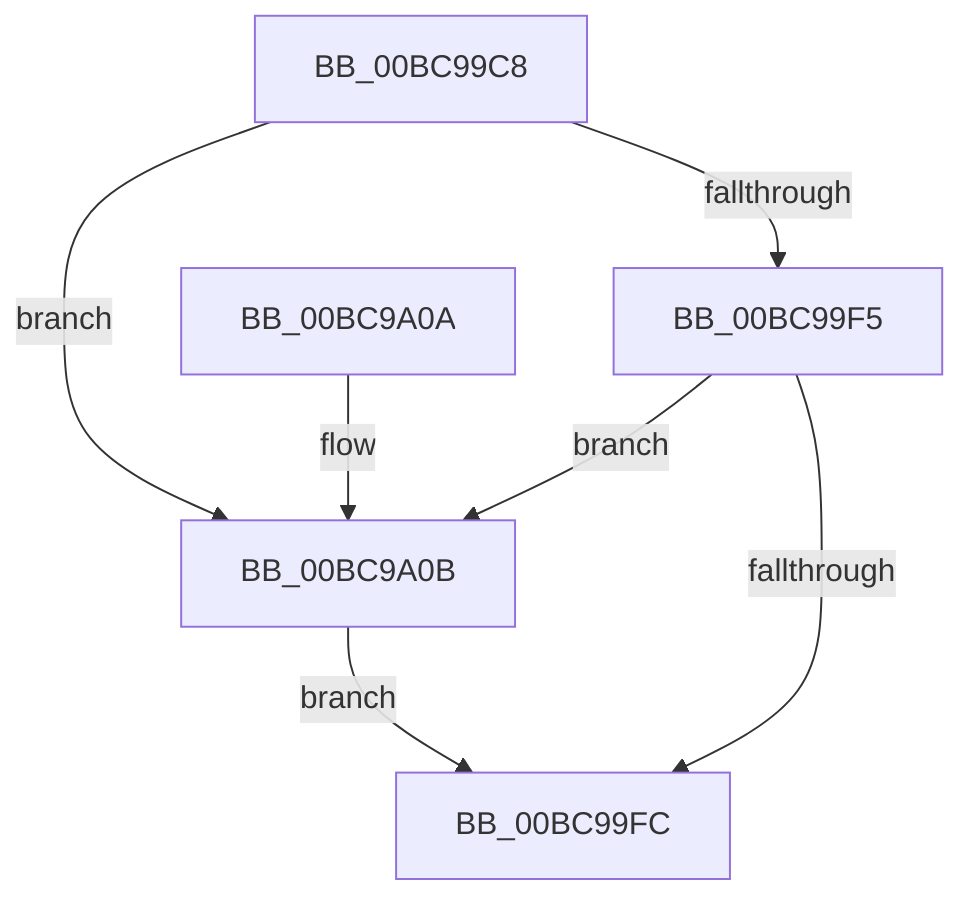

# CmUnlockHiveSecurity

- RVA: `0x00BC99C8`–`0x00BC9A15` (길이 `77` bytes)
- VA: `0x0000000140BC99C8`
- 실행 섹션: `PAGECMRC`
- PDB 이름 있음: `예`; PDB Function 태그: `아니요`
- unwind 정보 RVA: `0x00064CA8`
- 디코드: `24`개 명령, `77/77` bytes 표시
- 미해석 바이트: `0` (있으면 어셈블리에 `.byte`로 보존)

> 이 문서는 커널 이미지의 기계어와 PDB 기호를 분석해 생성했습니다. 4번과 5번은 함수 원형과 자료형을 바이너리 사용 방식에서 추정한 C 해석이며 원본 소스 복구 결과는 아닙니다.

## 1. Dependencies

- 직접 호출 지점: **2**; 고유 호출 대상: **2**
- 직접 호출자로 확인된 함수: **17**
- RIP 상대 이미지 참조: **0**

### Outgoing calls
- `0x00BC99FF` → [KeAbPostRelease](../../text/2E/KeAbPostRelease_function_002E1600.md) (function, `0x002E1600`)
- `0x00BC9A0E` → [ExfReleasePushLock](../../text/26/ExfReleasePushLock_function_002638D0.md) (function, `0x002638D0`)

### Direct callers
- [CmpCreateTombstone](../../text/66/CmpCreateTombstone_function_0066AF50.md) at `0x0066B0E5`
- [CmDumpKeyToFile](../../page/7D/CmDumpKeyToFile_function_007DCD64.md) at `0x007DCE25`
- [CmSaveMergedKeys](../../page/7D/CmSaveMergedKeys_function_007DE040.md) at `0x007DE1FD`
- [CmSaveMergedKeys](../../page/7D/CmSaveMergedKeys_function_007DE040.md) at `0x007DE234`
- [CmpAssignKeySecurity](../../page/7E/CmpAssignKeySecurity_function_007EC8B0.md) at `0x007ECA17`
- [CmpFreeKeyByCell](../../page/84/CmpFreeKeyByCell_function_0084AD70.md) at `0x0084AEAC`
- [CmpRebuildKcbCacheFromNode](../../page/84/CmpRebuildKcbCacheFromNode_function_0084C5A8.md) at `0x0084C6AD`
- [CmpCreateKeyControlBlock](../../page/85/CmpCreateKeyControlBlock_function_00851DB0.md) at `0x00852279`
- [CmpCreateKeyControlBlock](../../page/85/CmpCreateKeyControlBlock_function_00851DB0.md) at `0x00852501`
- [CmpCopyMergeOfLayeredKeyNode](../../page/94/CmpCopyMergeOfLayeredKeyNode_function_00945A78.md) at `0x00945C32`
- [CmpCreateChild](../../page/94/CmpCreateChild_function_0094817C.md) at `0x009485B7`
- [CmpCreateChild](../../page/94/CmpCreateChild_function_0094817C.md) at `0x009486CE`
- [CmpCreateChild](../../page/94/CmpCreateChild_function_0094817C.md) at `0x00948D2F`
- [CmpCreateChild](../../page/94/CmpCreateChild_function_0094817C.md) at `0x00949111`
- [CmpSetKeySecurity](../../page/94/CmpSetKeySecurity_function_0094A124.md) at `0x0094A38E`
- [CmpSetKeySecurity](../../page/94/CmpSetKeySecurity_function_0094A124.md) at `0x0094A6F0`
- [CmpUndoDeleteKeyForTrans](../../page/94/CmpUndoDeleteKeyForTrans_function_0094A728.md) at `0x0094AA9F`
- [CmpLightWeightCommitSetSecDescUoW](../../page/94/CmpLightWeightCommitSetSecDescUoW_function_0094B4AC.md) at `0x0094B5AB`
- [sub_009DA74E](../../page/9D/Unknown_function_009DA74E.md) at `0x009DA79C`
- [CmpUnlockTwoSecurityCaches](../../page/A4/CmpUnlockTwoSecurityCaches_function_00A4ACD8.md) at `0x00A4ACE6`
- [CmpUnlockTwoSecurityCaches](../../page/A4/CmpUnlockTwoSecurityCaches_function_00A4ACD8.md) at `0x00A4ACEE`
- [CmpLightWeightCommitAddKeyUoW](../../page/A5/CmpLightWeightCommitAddKeyUoW_function_00A54CA8.md) at `0x00A54D63`
- [CmpCreateHiveRootCell](../../page/AB/CmpCreateHiveRootCell_function_00ABF568.md) at `0x00ABF727`
- [CmpDumpKeyToBuffer](CmpDumpKeyToBuffer_function_00BC9130.md) at `0x00BC9212`

### Static image references
- 디코드된 RIP-relative 메모리 참조가 없습니다.

## 2. Other-region calls and transfers

- 다른 실행 섹션으로 향하는 call: **2**
  - `0x00BC99FF` → [KeAbPostRelease](../../text/2E/KeAbPostRelease_function_002E1600.md) (`PAGECMRC` → `.text`)
  - `0x00BC9A0E` → [ExfReleasePushLock](../../text/26/ExfReleasePushLock_function_002638D0.md) (`PAGECMRC` → `.text`)
- 별도 외부 분기/꼬리 이동을 확인하지 못했습니다.

## 3. Assembly (complete function range)

```asm
00BC99C8  40 53                           push rbx
00BC99CA  48 83 EC 20                     sub rsp, 0x20
00BC99CE  48 8D 99 F8 06 00 00            lea rbx, [rcx + 0x6f8]
00BC99D5  0F 0D 0B                        prefetchw byte ptr [rbx]
00BC99D8  48 8B 03                        mov rax, qword ptr [rbx]
00BC99DB  45 33 C0                        xor r8d, r8d
00BC99DE  48 8B C8                        mov rcx, rax
00BC99E1  48 83 E1 F0                     and rcx, 0xfffffffffffffff0
00BC99E5  48 83 F9 10                     cmp rcx, 0x10
00BC99E9  48 8D 50 F0                     lea rdx, [rax - 0x10]
00BC99ED  49 0F 46 D0                     cmovbe rdx, r8
00BC99F1  A8 02                           test al, 2
00BC99F3  75 16                           jne 0x140bc9a0b
00BC99F5  F0 48 0F B1 13                  lock cmpxchg qword ptr [rbx], rdx
00BC99FA  75 0F                           jne 0x140bc9a0b
00BC99FC  48 8B CB                        mov rcx, rbx
00BC99FF  E8 FC 7B 71 FF                  call 0x1402e1600
00BC9A04  48 83 C4 20                     add rsp, 0x20
00BC9A08  5B                              pop rbx
00BC9A09  C3                              ret
00BC9A0A  CC                              int3
00BC9A0B  48 8B CB                        mov rcx, rbx
00BC9A0E  E8 BD 9E 69 FF                  call 0x1402638d0
00BC9A13  EB E7                           jmp 0x140bc99fc
```

## 4. C-style interpretation (structured pseudocode)

```c
__int64 __fastcall CmUnlockHiveSecurity(__int64 a1, __int64 a2, int a3)
{
    __int64 result;
    __int64 v_rsp;

    v_rsp = (v_rsp) - (32);
    a3 = 0;
    a1 = (*(unsigned __int64 *)(a1 + 1784)) & (-16);
    a2 = *(unsigned __int64 *)(a1 + 1784) - 16;
    if (a1 <= 16) { a2 = 0; }
    if ((((unsigned __int8)(*(unsigned __int64 *)(a1 + 1784))) & (2)) != 0) goto loc_00BC9A0B;
    if ((((unsigned __int8)(*(unsigned __int64 *)(a1 + 1784))) & (2)) != 0) goto loc_00BC9A0B;
loc_00BC99FC:
    result = KeAbPostRelease(a1 + 1784, a2, a3, a4);
    v_rsp = (v_rsp) + (32);
    return result;
loc_00BC9A0B:
    result = ExfReleasePushLock(a1 + 1784, a2, a3, a4);
    goto loc_00BC99FC;
}
```

## 5. (Beta) C Style

```c
int64_t CmUnlockHiveSecurity(void *Arg1, int64_t Arg2, int32_t Arg3)
{
    uint8_t *arg1 = (uint8_t *)Arg1;

    int64_t result;
    int64_t local_rsp;

    local_rsp = (local_rsp) - (32);
    Arg3 = 0;
    Arg1 = (*(uint64_t *)(arg1 + 0x6F8)) & (-16);
    Arg2 = *(uint64_t *)(arg1 + 0x6F8) - 16;
    if (Arg1 <= 16) { Arg2 = 0; }
    if ((((uint8_t)(*(uint64_t *)(arg1 + 0x6F8))) & (2)) != 0) goto loc_00BC9A0B;
    if ((((uint8_t)(*(uint64_t *)(arg1 + 0x6F8))) & (2)) != 0) goto loc_00BC9A0B;
loc_00BC99FC:
    result = KeAbPostRelease(Arg1 + 1784, Arg2, Arg3, a4);
    local_rsp = (local_rsp) + (32);
    return result;
loc_00BC9A0B:
    result = ExfReleasePushLock(Arg1 + 1784, Arg2, Arg3, a4);
    goto loc_00BC99FC;
}
```

### 관측된 메모리 오프셋

구조체 형식이 확인되지 않은 접근은 인자 기준의 오프셋으로만 기록했습니다.

| 기준 인자 | 오프셋 표현 | 폭 (bit) | 접근 |
|---|---:|---:|---|
| `Arg1` | `+ 0x0` | `8` | `R` |
| `Arg1` | `+ 0x0` | `64` | `R` |
| `Arg1` | `+ 0x6F8` | `64` | `R` |

## 6. Execution-region graph

[열기: 2D/3D 그래프와 함수 탐색 컨트롤 패널](../../../control-panel.html?section=pagecmrc&rva=0x00BC99C8&view=graph)

- 2D 그래프는 위에서 아래로 흐르고, 3D 그래프는 빈 공간을 드래그해 회전합니다. Shift+드래그는 이동, 휠은 확대·축소, 함수 노드 선택은 대상 보고서 이동입니다.

### Static fallback


