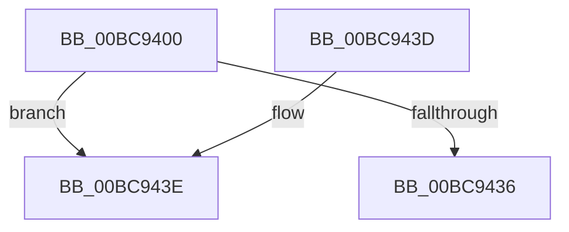

# CmpAcquireShutdownRundown

- RVA: `0x00BC9400`–`0x00BC9445` (길이 `69` bytes)
- VA: `0x0000000140BC9400`
- 실행 섹션: `PAGECMRC`
- PDB 이름 있음: `예`; PDB Function 태그: `아니요`
- unwind 정보 RVA: `0x00097394`
- 디코드: `15`개 명령, `69/69` bytes 표시
- 미해석 바이트: `0` (있으면 어셈블리에 `.byte`로 보존)

> 이 문서는 커널 이미지의 기계어와 PDB 기호를 분석해 생성했습니다. 4번과 5번은 함수 원형과 자료형을 바이너리 사용 방식에서 추정한 C 해석이며 원본 소스 복구 결과는 아닙니다.

## 1. Dependencies

- 직접 호출 지점: **0**; 고유 호출 대상: **0**
- 직접 호출자로 확인된 함수: **49**
- RIP 상대 이미지 참조: **1**

### Outgoing calls
- 직접 디코드된 call 명령이 없습니다.

### Direct callers
- [CmpLoadHiveThread](../../page/7D/CmpLoadHiveThread_function_007DB040.md) at `0x007DBB29`
- [CmpSaveBootControlSet](../../page/7D/CmpSaveBootControlSet_function_007DC744.md) at `0x007DC7E7`
- [CmOpenKeyForBugCheckRecovery](../../page/7D/CmOpenKeyForBugCheckRecovery_function_007DF3C0.md) at `0x007DF42C`
- [CmpAcceptBoot](../../page/7D/CmpAcceptBoot_function_007DF574.md) at `0x007DF5F0`
- [CmpHandlePageFileOpenNotification](../../page/7D/CmpHandlePageFileOpenNotification_function_007DF640.md) at `0x007DF688`
- [NtCompactKeys](../../page/7D/NtCompactKeys_function_007DF730.md) at `0x007DF878`
- [NtCompressKey](../../page/7D/NtCompressKey_function_007DF9D0.md) at `0x007DFA92`
- [NtLockRegistryKey](../../page/7D/NtLockRegistryKey_function_007DFD60.md) at `0x007DFDA6`
- [NtOpenRegistryTransaction](../../page/7D/NtOpenRegistryTransaction_function_007DFE40.md) at `0x007DFE7D`
- [NtQueryOpenSubKeys](../../page/7D/NtQueryOpenSubKeys_function_007DFF80.md) at `0x007E0014`
- [NtQueryOpenSubKeysEx](../../page/7E/NtQueryOpenSubKeysEx_function_007E0190.md) at `0x007E0241`
- [NtRenameKey](../../page/7E/NtRenameKey_function_007E04B0.md) at `0x007E0589`
- [NtRestoreKey](../../page/7E/NtRestoreKey_function_007E0CC0.md) at `0x007E0D4F`
- [NtRollbackRegistryTransaction](../../page/7E/NtRollbackRegistryTransaction_function_007E0F30.md) at `0x007E0F83`
- [NtSaveMergedKeys](../../page/7E/NtSaveMergedKeys_function_007E1070.md) at `0x007E1106`
- [CmReconcileAndValidateAllHives](../../page/7E/CmReconcileAndValidateAllHives_function_007E7D90.md) at `0x007E7DCE`
- [CmFreezeRegistry](../../page/7E/CmFreezeRegistry_function_007E834C.md) at `0x007E835F`
- [CmThawRegistry](../../page/7E/CmThawRegistry_function_007E8510.md) at `0x007E852D`
- [CmpAssignKeySecurity](../../page/7E/CmpAssignKeySecurity_function_007EC8B0.md) at `0x007EC8F0`
- [NtSetInformationKey](../../page/84/NtSetInformationKey_function_00843720.md) at `0x00843819`
- [NtSetValueKey](../../page/84/NtSetValueKey_function_00844EA0.md) at `0x00844FE9`
- [NtDeleteValueKey](../../page/84/NtDeleteValueKey_function_00848770.md) at `0x00848869`
- [NtDeleteKey](../../page/84/NtDeleteKey_function_00849920.md) at `0x008499E5`
- [sub_0084D18D](../../page/84/Unknown_function_0084D18D.md) at `0x0084D202`
- [CmpConstructNameWithStatus](../../page/85/CmpConstructNameWithStatus_function_008562A0.md) at `0x008562D8`
- [CmpConstructName](../../page/85/CmpConstructName_function_00856BE0.md) at `0x00856C13`
- [NtQueryKey](../../page/86/NtQueryKey_function_008676E0.md) at `0x00867827`
- [CmpSecurityMethod](../../page/87/CmpSecurityMethod_function_00870CC0.md) at `0x00870DD8`
- [NtOpenKeyTransactedEx](../../page/87/NtOpenKeyTransactedEx_function_00874EC0.md) at `0x00874EFB`
- [CmCreateKey](../../page/87/CmCreateKey_function_00875020.md) at `0x008750E9`
- [CmOpenKey](../../page/87/CmOpenKey_function_00876350.md) at `0x008763F5`
- [CmpCreateHive](../../page/87/CmpCreateHive_function_00879DF0.md) at `0x00879F2D`
- [CmpReorganizeHive](../../page/87/CmpReorganizeHive_function_0087B92C.md) at `0x0087B9C8`
- [NtQueryMultipleValueKey](../../page/8B/NtQueryMultipleValueKey_function_008B13B0.md) at `0x008B14EE`
- [NtEnumerateKey](../../page/8B/NtEnumerateKey_function_008B1F70.md) at `0x008B2099`
- [NtQueryValueKey](../../page/8B/NtQueryValueKey_function_008B2A00.md) at `0x008B2B3D`
- [NtEnumerateValueKey](../../page/8B/NtEnumerateValueKey_function_008B3B50.md) at `0x008B3C96`
- [CmpSetKeySecurity](../../page/94/CmpSetKeySecurity_function_0094A124.md) at `0x0094A1E5`
- [NtCommitRegistryTransaction](../../page/9A/NtCommitRegistryTransaction_function_009AEAF0.md) at `0x009AEB43`
- [CmpCloseLightWeightTransaction](../../page/9B/CmpCloseLightWeightTransaction_function_009B1100.md) at `0x009B1139`
- [CmpDoLocalizeNextHive](../../page/9B/CmpDoLocalizeNextHive_function_009B7400.md) at `0x009B7424`
- [NtNotifyChangeMultipleKeys](../../page/9D/NtNotifyChangeMultipleKeys_function_009DC6B0.md) at `0x009DC763`
- [NtCreateRegistryTransaction](../../page/A6/NtCreateRegistryTransaction_function_00A61370.md) at `0x00A613BC`
- [CmpForceFlushWorker](../../page/A6/CmpForceFlushWorker_function_00A6B030.md) at `0x00A6B070`
- [NtSaveKeyEx](../../page/A8/NtSaveKeyEx_function_00A853C0.md) at `0x00A85447`
- [NtFlushKey](../../page/A8/NtFlushKey_function_00A8A030.md) at `0x00A8A0CC`
- [NtCreateKeyTransacted](../../page/AA/NtCreateKeyTransacted_function_00AAF830.md) at `0x00AAF887`
- [CmSaveKeyToBuffer](CmSaveKeyToBuffer_function_00BC9010.md) at `0x00BC9074`
- [CmGetSystemDriverList](../../init/C7/CmGetSystemDriverList_function_00C7380C.md) at `0x00C73A9C`

### Static image references
- `0x00BC9415` → RVA `0x00EF7B20` (`.data`; read)

## 2. Other-region calls and transfers

- 다른 실행 섹션으로 향하는 call: **0**
- 별도 외부 분기/꼬리 이동을 확인하지 못했습니다.

## 3. Assembly (complete function range)

```asm
00BC9400  48 83 EC 28                     sub rsp, 0x28
00BC9404  65 48 8B 04 25 88 01 00 00      mov rax, qword ptr gs:[0x188]
00BC940D  66 FF 88 E4 01 00 00            dec word ptr [rax + 0x1e4]
00BC9414  90                              nop
00BC9415  0F 0D 0D 04 E7 32 00            prefetchw byte ptr [rip + 0x32e704]
00BC941C  48 8B 05 FD E6 32 00            mov rax, qword ptr [rip + 0x32e6fd]
00BC9423  48 83 E0 FE                     and rax, 0xfffffffffffffffe
00BC9427  48 8D 48 02                     lea rcx, [rax + 2]
00BC942B  F0 48 0F B1 0D EC E6 32 00      lock cmpxchg qword ptr [rip + 0x32e6ec], rcx
00BC9434  75 08                           jne 0x140bc943e
00BC9436  B0 01                           mov al, 1
00BC9438  48 83 C4 28                     add rsp, 0x28
00BC943C  C3                              ret
00BC943D  CC                              int3
00BC943E  48 8D 0D DB E6 32 00            lea rcx, [rip + 0x32e6db]
```

## 4. C-style interpretation (structured pseudocode)

```c
__int64 __fastcall CmpAcquireShutdownRundown(void)
{
    __int64 result;
    __int64 v_rsp;

    v_rsp = (v_rsp) - (40);
    result = (*(unsigned __int64 *)(v_rip + 3335933)) & (-2);
    if (condition_is_not_equal) goto loc_00BC943E;
    v_rsp = (v_rsp) + (40);
    return 1;
loc_00BC943E:
    return 1;
}
```

## 5. (Beta) C Style

```c
void CmpAcquireShutdownRundown(void)
{
    int64_t result;
    int64_t local_rsp;

    local_rsp = (local_rsp) - (40);
    result = (*(uint64_t *)(v_rip + 0x32E6FD)) & (-2);
    if (condition_is_not_equal) goto loc_00BC943E;
    local_rsp = (local_rsp) + (40);
    return 1;
loc_00BC943E:
    return 1;
}
```

## 6. Execution-region graph

[열기: 2D/3D 그래프와 함수 탐색 컨트롤 패널](../../../control-panel.html?section=pagecmrc&rva=0x00BC9400&view=graph)

- 2D 그래프는 위에서 아래로 흐르고, 3D 그래프는 빈 공간을 드래그해 회전합니다. Shift+드래그는 이동, 휠은 확대·축소, 함수 노드 선택은 대상 보고서 이동입니다.

### Static fallback


