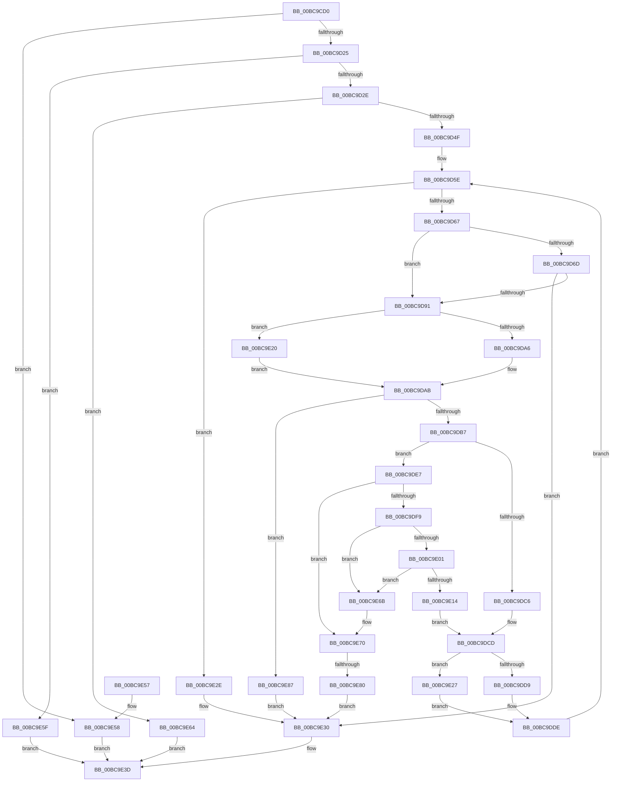

# CmpDoAccessCheckOnSubtree

- RVA: `0x00BC9CD0`–`0x00BC9E8E` (길이 `446` bytes)
- VA: `0x0000000140BC9CD0`
- 실행 섹션: `PAGECMRC`
- PDB 이름 있음: `예`; PDB Function 태그: `예`
- unwind 정보 RVA: `0x000B37F4`
- 디코드: `132`개 명령, `446/446` bytes 표시
- 미해석 바이트: `0` (있으면 어셈블리에 `.byte`로 보존)

> 이 문서는 커널 이미지의 기계어와 PDB 기호를 분석해 생성했습니다. 4번과 5번은 함수 원형과 자료형을 바이너리 사용 방식에서 추정한 C 해석이며 원본 소스 복구 결과는 아닙니다.

## 1. Dependencies

- 직접 호출 지점: **9**; 고유 호출 대상: **8**
- 직접 호출자로 확인된 함수: **4**
- RIP 상대 이미지 참조: **0**

### Outgoing calls
- `0x00BC9D3E` → [CmpAllocatePool](../../text/3C/CmpAllocatePool_function_003CD504.md) (function, `0x003CD504`)
- `0x00BC9D82` → [CmpCheckKeyAccess](../../page/A6/CmpCheckKeyAccess_function_00A6DE7C.md) (function, `0x00A6DE7C`)
- `0x00BC9DA6` → [HvpGetCellFlat](../../page/85/HvpGetCellFlat_function_00854C60.md) (function, `0x00854C60`)
- `0x00BC9DD9` → [HvpReleaseCellPaged](../../page/85/HvpReleaseCellPaged_function_00855F40.md) (function, `0x00855F40`)
- `0x00BC9DEE` → [CmpFindSubKeyByNumber](../../page/85/CmpFindSubKeyByNumber_function_0085C930.md) (function, `0x0085C930`)
- `0x00BC9E20` → [HvpGetCellPaged](../../page/85/HvpGetCellPaged_function_00854CB0.md) (function, `0x00854CB0`)
- `0x00BC9E27` → [HvpReleaseCellFlat](../../page/85/HvpReleaseCellFlat_function_0085CC20.md) (function, `0x0085CC20`)
- `0x00BC9E38` → [CmpFreePoolWithTag](../../text/44/CmpFreePoolWithTag_function_004489E0.md) (function, `0x004489E0`)
- `0x00BC9E80` → [HvpReleaseCellFlat](../../page/85/HvpReleaseCellFlat_function_0085CC20.md) (function, `0x0085CC20`)

### Direct callers
- [CmDumpKeyToFile](../../page/7D/CmDumpKeyToFile_function_007DCD64.md) at `0x007DCE1A`
- [CmRestoreKey](../../page/7D/CmRestoreKey_function_007DCF04.md) at `0x007DD40D`
- [CmSaveMergedKeys](../../page/7D/CmSaveMergedKeys_function_007DE040.md) at `0x007DE1F3`
- [CmSaveMergedKeys](../../page/7D/CmSaveMergedKeys_function_007DE040.md) at `0x007DE22A`
- [CmpDumpKeyToBuffer](CmpDumpKeyToBuffer_function_00BC9130.md) at `0x00BC9207`

### Static image references
- 디코드된 RIP-relative 메모리 참조가 없습니다.

## 2. Other-region calls and transfers

- 다른 실행 섹션으로 향하는 call: **9**
  - `0x00BC9D3E` → [CmpAllocatePool](../../text/3C/CmpAllocatePool_function_003CD504.md) (`PAGECMRC` → `.text`)
  - `0x00BC9D82` → [CmpCheckKeyAccess](../../page/A6/CmpCheckKeyAccess_function_00A6DE7C.md) (`PAGECMRC` → `PAGE`)
  - `0x00BC9DA6` → [HvpGetCellFlat](../../page/85/HvpGetCellFlat_function_00854C60.md) (`PAGECMRC` → `PAGE`)
  - `0x00BC9DD9` → [HvpReleaseCellPaged](../../page/85/HvpReleaseCellPaged_function_00855F40.md) (`PAGECMRC` → `PAGE`)
  - `0x00BC9DEE` → [CmpFindSubKeyByNumber](../../page/85/CmpFindSubKeyByNumber_function_0085C930.md) (`PAGECMRC` → `PAGE`)
  - `0x00BC9E20` → [HvpGetCellPaged](../../page/85/HvpGetCellPaged_function_00854CB0.md) (`PAGECMRC` → `PAGE`)
  - `0x00BC9E27` → [HvpReleaseCellFlat](../../page/85/HvpReleaseCellFlat_function_0085CC20.md) (`PAGECMRC` → `PAGE`)
  - `0x00BC9E38` → [CmpFreePoolWithTag](../../text/44/CmpFreePoolWithTag_function_004489E0.md) (`PAGECMRC` → `.text`)
  - `0x00BC9E80` → [HvpReleaseCellFlat](../../page/85/HvpReleaseCellFlat_function_0085CC20.md) (`PAGECMRC` → `PAGE`)
- call이 아닌 외부 분기/꼬리 이동: **1**
  - `0x00BC9E7A` → [sub_00BCA042](Unknown_function_00BCA042.md) (`tail-transfer`)

## 3. Assembly (complete function range)

```asm
00BC9CD0  48 89 5C 24 08                  mov qword ptr [rsp + 8], rbx
00BC9CD5  44 89 4C 24 20                  mov dword ptr [rsp + 0x20], r9d
00BC9CDA  44 88 44 24 18                  mov byte ptr [rsp + 0x18], r8b
00BC9CDF  55                              push rbp
00BC9CE0  56                              push rsi
00BC9CE1  57                              push rdi
00BC9CE2  41 54                           push r12
00BC9CE4  41 55                           push r13
00BC9CE6  41 56                           push r14
00BC9CE8  41 57                           push r15
00BC9CEA  48 8B EC                        mov rbp, rsp
00BC9CED  48 83 EC 40                     sub rsp, 0x40
00BC9CF1  8B 45 60                        mov eax, dword ptr [rbp + 0x60]
00BC9CF4  45 33 FF                        xor r15d, r15d
00BC9CF7  83 4D F8 FF                     or dword ptr [rbp - 8], 0xffffffff
00BC9CFB  44 8B E8                        mov r13d, eax
00BC9CFE  41 D1 ED                        shr r13d, 1
00BC9D01  8B D8                           mov ebx, eax
00BC9D03  41 80 E5 01                     and r13b, 1
00BC9D07  44 89 7D FC                     mov dword ptr [rbp - 4], r15d
00BC9D0B  83 E3 01                        and ebx, 1
00BC9D0E  44 89 7D F0                     mov dword ptr [rbp - 0x10], r15d
00BC9D12  41 8A F0                        mov sil, r8b
00BC9D15  8B FA                           mov edi, edx
00BC9D17  4C 8B F1                        mov r14, rcx
00BC9D1A  A9 FC FF FF FF                  test eax, 0xfffffffc
00BC9D1F  0F 85 33 01 00 00               jne 0x140bc9e58
00BC9D25  45 84 C0                        test r8b, r8b
00BC9D28  0F 84 31 01 00 00               je 0x140bc9e5f
00BC9D2E  BA 00 28 00 00                  mov edx, 0x2800
00BC9D33  B9 00 01 00 00                  mov ecx, 0x100
00BC9D38  41 B8 43 4D 63 74               mov r8d, 0x74634d43
00BC9D3E  E8 C1 37 80 FF                  call 0x1403cd504
00BC9D43  4C 8B E0                        mov r12, rax
00BC9D46  48 85 C0                        test rax, rax
00BC9D49  0F 84 15 01 00 00               je 0x140bc9e64
00BC9D4F  80 F3 01                        xor bl, 1
00BC9D52  89 38                           mov dword ptr [rax], edi
00BC9D54  88 58 10                        mov byte ptr [rax + 0x10], bl
00BC9D57  48 8B F8                        mov rdi, rax
00BC9D5A  44 89 78 0C                     mov dword ptr [rax + 0xc], r15d
00BC9D5E  4D 85 FF                        test r15, r15
00BC9D61  0F 88 C7 00 00 00               js 0x140bc9e2e
00BC9D67  80 7F 10 00                     cmp byte ptr [rdi + 0x10], 0
00BC9D6B  75 24                           jne 0x140bc9d91
00BC9D6D  44 8B 4D 58                     mov r9d, dword ptr [rbp + 0x58]
00BC9D71  44 8A C6                        mov r8b, sil
00BC9D74  8B 17                           mov edx, dword ptr [rdi]
00BC9D76  49 8B CE                        mov rcx, r14
00BC9D79  C6 47 10 01                     mov byte ptr [rdi + 0x10], 1
00BC9D7D  44 88 6C 24 20                  mov byte ptr [rsp + 0x20], r13b
00BC9D82  E8 F5 40 EA FF                  call 0x140a6de7c
00BC9D87  8B D8                           mov ebx, eax
00BC9D89  85 C0                           test eax, eax
00BC9D8B  0F 88 9F 00 00 00               js 0x140bc9e30
00BC9D91  8B 17                           mov edx, dword ptr [rdi]
00BC9D93  49 8D B6 8C 00 00 00            lea rsi, [r14 + 0x8c]
00BC9D9A  F6 06 01                        test byte ptr [rsi], 1
00BC9D9D  4C 8D 45 F8                     lea r8, [rbp - 8]
00BC9DA1  49 8B CE                        mov rcx, r14
00BC9DA4  74 7A                           je 0x140bc9e20
00BC9DA6  E8 B5 AE C8 FF                  call 0x140854c60
00BC9DAB  48 8B D0                        mov rdx, rax
00BC9DAE  48 85 C0                        test rax, rax
00BC9DB1  0F 84 D0 00 00 00               je 0x140bc9e87
00BC9DB7  8B 40 18                        mov eax, dword ptr [rax + 0x18]
00BC9DBA  03 42 14                        add eax, dword ptr [rdx + 0x14]
00BC9DBD  44 8B 47 0C                     mov r8d, dword ptr [rdi + 0xc]
00BC9DC1  44 3B C0                        cmp r8d, eax
00BC9DC4  72 21                           jb 0x140bc9de7
00BC9DC6  49 FF CF                        dec r15
00BC9DC9  48 83 EF 14                     sub rdi, 0x14
00BC9DCD  F6 06 01                        test byte ptr [rsi], 1
00BC9DD0  48 8D 55 F8                     lea rdx, [rbp - 8]
00BC9DD4  49 8B CE                        mov rcx, r14
00BC9DD7  75 4E                           jne 0x140bc9e27
00BC9DD9  E8 62 C1 C8 FF                  call 0x140855f40
00BC9DDE  40 8A 75 50                     mov sil, byte ptr [rbp + 0x50]
00BC9DE2  E9 77 FF FF FF                  jmp 0x140bc9d5e
00BC9DE7  4C 8D 4D F0                     lea r9, [rbp - 0x10]
00BC9DEB  49 8B CE                        mov rcx, r14
00BC9DEE  E8 3D 2B C9 FF                  call 0x14085c930
00BC9DF3  8B D8                           mov ebx, eax
00BC9DF5  85 C0                           test eax, eax
00BC9DF7  78 77                           js 0x140bc9e70
00BC9DF9  8B 45 F0                        mov eax, dword ptr [rbp - 0x10]
00BC9DFC  83 F8 FF                        cmp eax, -1
00BC9DFF  74 6A                           je 0x140bc9e6b
00BC9E01  FF 47 0C                        inc dword ptr [rdi + 0xc]
00BC9E04  49 FF C7                        inc r15
00BC9E07  48 83 C7 14                     add rdi, 0x14
00BC9E0B  49 81 FF 00 02 00 00            cmp r15, 0x200
00BC9E12  74 57                           je 0x140bc9e6b
00BC9E14  83 67 0C 00                     and dword ptr [rdi + 0xc], 0
00BC9E18  89 07                           mov dword ptr [rdi], eax
00BC9E1A  C6 47 10 00                     mov byte ptr [rdi + 0x10], 0
00BC9E1E  EB AD                           jmp 0x140bc9dcd
00BC9E20  E8 8B AE C8 FF                  call 0x140854cb0
00BC9E25  EB 84                           jmp 0x140bc9dab
00BC9E27  E8 F4 2D C9 FF                  call 0x14085cc20
00BC9E2C  EB B0                           jmp 0x140bc9dde
00BC9E2E  33 DB                           xor ebx, ebx
00BC9E30  BA 43 4D 63 74                  mov edx, 0x74634d43
00BC9E35  49 8B CC                        mov rcx, r12
00BC9E38  E8 A3 EB 87 FF                  call 0x1404489e0
00BC9E3D  8B C3                           mov eax, ebx
00BC9E3F  48 8B 9C 24 80 00 00 00         mov rbx, qword ptr [rsp + 0x80]
00BC9E47  48 83 C4 40                     add rsp, 0x40
00BC9E4B  41 5F                           pop r15
00BC9E4D  41 5E                           pop r14
00BC9E4F  41 5D                           pop r13
00BC9E51  41 5C                           pop r12
00BC9E53  5F                              pop rdi
00BC9E54  5E                              pop rsi
00BC9E55  5D                              pop rbp
00BC9E56  C3                              ret
00BC9E57  CC                              int3
00BC9E58  BB 0D 00 00 C0                  mov ebx, 0xc000000d
00BC9E5D  EB DE                           jmp 0x140bc9e3d
00BC9E5F  41 8B DF                        mov ebx, r15d
00BC9E62  EB D9                           jmp 0x140bc9e3d
00BC9E64  BB 9A 00 00 C0                  mov ebx, 0xc000009a
00BC9E69  EB D2                           jmp 0x140bc9e3d
00BC9E6B  BB 9A 00 00 C0                  mov ebx, 0xc000009a
00BC9E70  F6 06 01                        test byte ptr [rsi], 1
00BC9E73  48 8D 55 F8                     lea rdx, [rbp - 8]
00BC9E77  49 8B CE                        mov rcx, r14
00BC9E7A  0F 84 C2 01 00 00               je 0x140bca042
00BC9E80  E8 9B 2D C9 FF                  call 0x14085cc20
00BC9E85  EB A9                           jmp 0x140bc9e30
00BC9E87  BB 9A 00 00 C0                  mov ebx, 0xc000009a
00BC9E8C  EB A2                           jmp 0x140bc9e30
```

## 4. C-style interpretation (structured pseudocode)

```c
__int64 __fastcall CmpDoAccessCheckOnSubtree(__int64 a1, int a2, unsigned __int8 a3, int a4, unsigned int a5)
{
    __int64 result;
    __int64 v_r13;
    __int64 v_r15;
    __int64 v_rbx;
    __int64 v_rdi;
    __int64 v_rsp;
    unsigned int v_stack_m3C;
    unsigned int v_stack_m40;
    unsigned int v_stack_m48;
    unsigned __int8 v_stack_m58;
    unsigned __int8 v_stack_p18;
    unsigned int v_stack_p20;
    unsigned __int64 v_stack_p8;

    v_stack_p8 = v_rbx;
    v_stack_p20 = a4;
    v_stack_p18 = a3;
    v_rsp = (v_rsp) - (64);
    v_r15 = 0;
    v_r13 = (unsigned int)(((unsigned int)((unsigned int)((unsigned int)(a5)))) >> (1));
    v_r13 = (unsigned __int8)((v_r13) & (1));
    v_stack_m3C = 0;
    v_rbx = (unsigned int)(((unsigned int)((unsigned int)((unsigned int)(a5)))) & (1));
    v_stack_m48 = 0;
    if ((((unsigned int)((unsigned int)(a5))) & (0xFFFFFFFCULL)) != 0) goto loc_00BC9E58;
    if (a3 == 0) goto loc_00BC9E5F;
    result = CmpAllocatePool(256, (unsigned int)(0x2800ULL), (unsigned int)(0x74634D43ULL), a4);
    if (result == 0) goto loc_00BC9E64;
    v_rbx = (unsigned __int8)((v_rbx) ^ (1));
    *(unsigned int *)(result) = (unsigned int)((unsigned int)(a2));
    *(unsigned __int8 *)(result + 16) = (unsigned __int8)(v_rbx);
    *(unsigned int *)(result + 12) = 0;
loc_00BC9D5E:
    if (sign_flag) goto loc_00BC9E2E;
    if ((*(unsigned __int8 *)(result + 16)) != 0) goto loc_00BC9D91;
    *(unsigned __int8 *)(result + 16) = 1;
    v_stack_m58 = (unsigned __int8)(v_r13);
    result = CmpCheckKeyAccess(a1, (unsigned int)(*(unsigned int *)(result)), a3, (unsigned int)(v_stack_p20));
    if (sign_flag) goto loc_00BC9E30;
loc_00BC9D91:
    if (((*(unsigned __int8 *)(a1 + 140)) & (1)) == 0) goto loc_00BC9E20;
    result = HvpGetCellFlat(a1, (unsigned int)(*(unsigned int *)(result)), v_stack_m40, (unsigned int)(v_stack_p20));
loc_00BC9DAB:
    if (result == 0) goto loc_00BC9E87;
    result = (unsigned int)(((unsigned int)(*(unsigned int *)(result + 24))) + (*(unsigned int *)(result + 20)));
    if (((unsigned int)((unsigned int)(*(unsigned int *)(result + 12)))) < ((unsigned int)(result))) goto loc_00BC9DE7;
    v_r15 = (v_r15) - 1;
    v_rdi = (result) - (20);
loc_00BC9DCD:
    if (((*(unsigned __int8 *)(a1 + 140)) & (1)) != 0) goto loc_00BC9E27;
    result = HvpReleaseCellPaged(a1, v_stack_m40, (unsigned int)(*(unsigned int *)(result + 12)), (unsigned int)(v_stack_p20));
loc_00BC9DDE:
    goto loc_00BC9D5E;
loc_00BC9DE7:
    result = CmpFindSubKeyByNumber(a1, v_stack_m40, (unsigned int)(*(unsigned int *)(result + 12)), v_stack_m48);
    if (sign_flag) goto loc_00BC9E70;
    if (((unsigned int)((unsigned int)(v_stack_m48))) == -1) goto loc_00BC9E6B;
    v_r15 = (v_r15) + 1;
    v_rdi = (v_rdi) + (20);
    if (v_r15 == 512) goto loc_00BC9E6B;
    *(unsigned int *)(v_rdi) = (unsigned int)((unsigned int)(v_stack_m48));
    *(unsigned __int8 *)(v_rdi + 16) = 0;
    goto loc_00BC9DCD;
loc_00BC9E20:
    result = HvpGetCellPaged(a1, v_stack_m40, (unsigned int)(*(unsigned int *)(result + 12)), v_stack_m48);
    goto loc_00BC9DAB;
loc_00BC9E27:
    result = HvpReleaseCellFlat(a1, v_stack_m40, (unsigned int)(*(unsigned int *)(result + 12)), v_stack_m48);
    goto loc_00BC9DDE;
loc_00BC9E2E:
    v_rbx = 0;
loc_00BC9E30:
    result = CmpFreePoolWithTag(result, (unsigned int)(0x74634D43ULL), (unsigned int)(*(unsigned int *)(result + 12)), v_stack_m48);
loc_00BC9E3D:
    v_rsp = (v_rsp) + (64);
    return 0;
loc_00BC9E58:
    goto loc_00BC9E3D;
loc_00BC9E5F:
    goto loc_00BC9E3D;
loc_00BC9E64:
    goto loc_00BC9E3D;
loc_00BC9E6B:
loc_00BC9E70:
    result = HvpReleaseCellFlat(a1, v_stack_m40, (unsigned int)(*(unsigned int *)(result + 12)), v_stack_m48);
    goto loc_00BC9E30;
loc_00BC9E87:
    goto loc_00BC9E30;
}
```

## 5. (Beta) C Style

```c
int64_t CmpDoAccessCheckOnSubtree(void *Arg1, int32_t Arg2, uint8_t Arg3, int32_t Arg4, uint32_t Arg5)
{
    uint8_t *arg1 = (uint8_t *)Arg1;

    int64_t result;
    int64_t local_r13;
    int64_t local_r15;
    int64_t local_rbx;
    int64_t local_rdi;
    int64_t local_rsp;
    uint32_t v_stack_m3C;
    uint32_t v_stack_m40;
    uint32_t v_stack_m48;
    uint8_t v_stack_m58;
    uint8_t v_stack_p18;
    uint32_t v_stack_p20;
    uint64_t v_stack_p8;

    v_stack_p8 = local_rbx;
    v_stack_p20 = Arg4;
    v_stack_p18 = Arg3;
    local_rsp = (local_rsp) - (64);
    local_r15 = 0;
    local_r13 = (uint32_t)(((uint32_t)((uint32_t)((uint32_t)(Arg5)))) >> (1));
    local_r13 = (uint8_t)((local_r13) & (1));
    v_stack_m3C = 0;
    local_rbx = (uint32_t)(((uint32_t)((uint32_t)((uint32_t)(Arg5)))) & (1));
    v_stack_m48 = 0;
    if ((((uint32_t)((uint32_t)(Arg5))) & (0xFFFFFFFCULL)) != 0) goto loc_00BC9E58;
    if (Arg3 == 0) goto loc_00BC9E5F;
    result = CmpAllocatePool(256, (uint32_t)(0x2800ULL), (uint32_t)(0x74634D43ULL), Arg4);
    if (result == 0) goto loc_00BC9E64;
    local_rbx = (uint8_t)((local_rbx) ^ (1));
    *(uint32_t *)(result) = (uint32_t)((uint32_t)(Arg2));
    *(uint8_t *)(result + 0x10) = (uint8_t)(local_rbx);
    *(uint32_t *)(result + 0xC) = 0;
loc_00BC9D5E:
    if (sign_flag) goto loc_00BC9E2E;
    if ((*(uint8_t *)(result + 0x10)) != 0) goto loc_00BC9D91;
    *(uint8_t *)(result + 0x10) = 1;
    v_stack_m58 = (uint8_t)(local_r13);
    result = CmpCheckKeyAccess(Arg1, (uint32_t)(*(uint32_t *)(result)), Arg3, (uint32_t)(v_stack_p20));
    if (sign_flag) goto loc_00BC9E30;
loc_00BC9D91:
    if (((*(uint8_t *)(arg1 + 0x8C)) & (1)) == 0) goto loc_00BC9E20;
    result = HvpGetCellFlat(Arg1, (uint32_t)(*(uint32_t *)(result)), v_stack_m40, (uint32_t)(v_stack_p20));
loc_00BC9DAB:
    if (result == 0) goto loc_00BC9E87;
    result = (uint32_t)(((uint32_t)(*(uint32_t *)(result + 0x18))) + (*(uint32_t *)(result + 0x14)));
    if (((uint32_t)((uint32_t)(*(uint32_t *)(result + 0xC)))) < ((uint32_t)(result))) goto loc_00BC9DE7;
    local_r15 = (local_r15) - 1;
    local_rdi = (result) - (20);
loc_00BC9DCD:
    if (((*(uint8_t *)(arg1 + 0x8C)) & (1)) != 0) goto loc_00BC9E27;
    result = HvpReleaseCellPaged(Arg1, v_stack_m40, (uint32_t)(*(uint32_t *)(result + 0xC)), (uint32_t)(v_stack_p20));
loc_00BC9DDE:
    goto loc_00BC9D5E;
loc_00BC9DE7:
    result = CmpFindSubKeyByNumber(Arg1, v_stack_m40, (uint32_t)(*(uint32_t *)(result + 0xC)), v_stack_m48);
    if (sign_flag) goto loc_00BC9E70;
    if (((uint32_t)((uint32_t)(v_stack_m48))) == -1) goto loc_00BC9E6B;
    local_r15 = (local_r15) + 1;
    local_rdi = (local_rdi) + (20);
    if (local_r15 == 512) goto loc_00BC9E6B;
    *(uint32_t *)(local_rdi) = (uint32_t)((uint32_t)(v_stack_m48));
    *(uint8_t *)(local_rdi + 0x10) = 0;
    goto loc_00BC9DCD;
loc_00BC9E20:
    result = HvpGetCellPaged(Arg1, v_stack_m40, (uint32_t)(*(uint32_t *)(result + 0xC)), v_stack_m48);
    goto loc_00BC9DAB;
loc_00BC9E27:
    result = HvpReleaseCellFlat(Arg1, v_stack_m40, (uint32_t)(*(uint32_t *)(result + 0xC)), v_stack_m48);
    goto loc_00BC9DDE;
loc_00BC9E2E:
    local_rbx = 0;
loc_00BC9E30:
    result = CmpFreePoolWithTag(result, (uint32_t)(0x74634D43ULL), (uint32_t)(*(uint32_t *)(result + 0xC)), v_stack_m48);
loc_00BC9E3D:
    local_rsp = (local_rsp) + (64);
    return 0;
loc_00BC9E58:
    goto loc_00BC9E3D;
loc_00BC9E5F:
    goto loc_00BC9E3D;
loc_00BC9E64:
    goto loc_00BC9E3D;
loc_00BC9E6B:
loc_00BC9E70:
    result = HvpReleaseCellFlat(Arg1, v_stack_m40, (uint32_t)(*(uint32_t *)(result + 0xC)), v_stack_m48);
    goto loc_00BC9E30;
loc_00BC9E87:
    goto loc_00BC9E30;
}
```

### 관측된 메모리 오프셋

구조체 형식이 확인되지 않은 접근은 인자 기준의 오프셋으로만 기록했습니다.

| 기준 인자 | 오프셋 표현 | 폭 (bit) | 접근 |
|---|---:|---:|---|
| `Arg1` | `+ 0x0` | `8` | `R` |
| `Arg1` | `+ 0x8C` | `64` | `R` |

## 6. Execution-region graph

[열기: 2D/3D 그래프와 함수 탐색 컨트롤 패널](../../../control-panel.html?section=pagecmrc&rva=0x00BC9CD0&view=graph)

- 2D 그래프는 위에서 아래로 흐르고, 3D 그래프는 빈 공간을 드래그해 회전합니다. Shift+드래그는 이동, 휠은 확대·축소, 함수 노드 선택은 대상 보고서 이동입니다.

### Static fallback


