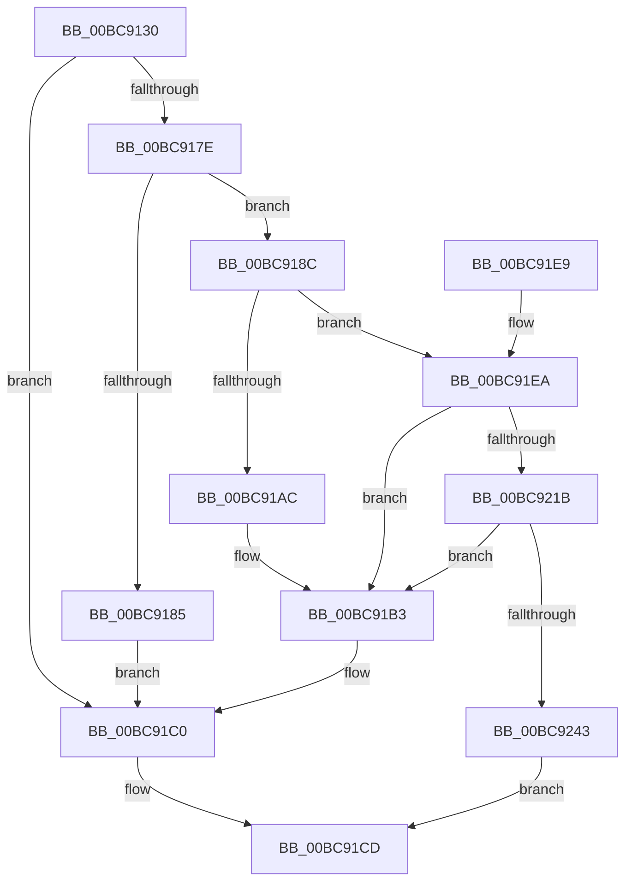

# CmpDumpKeyToBuffer

- RVA: `0x00BC9130`–`0x00BC9265` (길이 `309` bytes)
- VA: `0x0000000140BC9130`
- 실행 섹션: `PAGECMRC`
- PDB 이름 있음: `예`; PDB Function 태그: `아니요`
- unwind 정보 RVA: `0x000D6610`
- 디코드: `85`개 명령, `309/309` bytes 표시
- 미해석 바이트: `0` (있으면 어셈블리에 `.byte`로 보존)

> 이 문서는 커널 이미지의 기계어와 PDB 기호를 분석해 생성했습니다. 4번과 5번은 함수 원형과 자료형을 바이너리 사용 방식에서 추정한 C 해석이며 원본 소스 복구 결과는 아닙니다.

## 1. Dependencies

- 직접 호출 지점: **14**; 고유 호출 대상: **11**
- 직접 호출자로 확인된 함수: **1**
- RIP 상대 이미지 참조: **0**

### Outgoing calls
- `0x00BC915C` → [CmpLockRegistry](CmpLockRegistry_function_00BC9B34.md) (function, `0x00BC9B34`)
- `0x00BC9168` → [CmpLockKcbShared](CmpLockKcbShared_function_00BC9A1C.md) (function, `0x00BC9A1C`)
- `0x00BC9173` → [CmpIsKeyBodyEligibleForDump](CmpIsKeyBodyEligibleForDump_function_00BC926C.md) (function, `0x00BC926C`)
- `0x00BC9194` → [CmSiRWLockAcquireExclusive](../../page/A1/CmSiRWLockAcquireExclusive_function_00A1679C.md) (function, `0x00A1679C`)
- `0x00BC91BB` → [CmSiRWLockReleaseExclusive](../../page/A0/CmSiRWLockReleaseExclusive_function_00A0DAB0.md) (function, `0x00A0DAB0`)
- `0x00BC91C3` → [CmpUnlockKcb](CmpUnlockKcb_function_00BC92C0.md) (function, `0x00BC92C0`)
- `0x00BC91C8` → [CmpUnlockRegistry](CmpUnlockRegistry_function_00BC9A84.md) (function, `0x00BC9A84`)
- `0x00BC91EA` → [CmLockHiveSecurityShared](CmLockHiveSecurityShared_function_00BC996C.md) (function, `0x00BC996C`)
- `0x00BC9207` → [CmpDoAccessCheckOnSubtree](CmpDoAccessCheckOnSubtree_function_00BC9CD0.md) (function, `0x00BC9CD0`)
- `0x00BC9212` → [CmUnlockHiveSecurity](CmUnlockHiveSecurity_function_00BC99C8.md) (function, `0x00BC99C8`)
- `0x00BC9234` → [HvSnapshotHiveToOffsetArray](HvSnapshotHiveToOffsetArray_function_00BC9508.md) (function, `0x00BC9508`)
- `0x00BC924B` → [CmSiRWLockReleaseExclusive](../../page/A0/CmSiRWLockReleaseExclusive_function_00A0DAB0.md) (function, `0x00A0DAB0`)
- `0x00BC9253` → [CmpUnlockKcb](CmpUnlockKcb_function_00BC92C0.md) (function, `0x00BC92C0`)
- `0x00BC9258` → [CmpUnlockRegistry](CmpUnlockRegistry_function_00BC9A84.md) (function, `0x00BC9A84`)

### Direct callers
- [CmSaveKeyToBuffer](CmSaveKeyToBuffer_function_00BC9010.md) at `0x00BC90CD`

### Static image references
- 디코드된 RIP-relative 메모리 참조가 없습니다.

## 2. Other-region calls and transfers

- 다른 실행 섹션으로 향하는 call: **3**
  - `0x00BC9194` → [CmSiRWLockAcquireExclusive](../../page/A1/CmSiRWLockAcquireExclusive_function_00A1679C.md) (`PAGECMRC` → `PAGE`)
  - `0x00BC91BB` → [CmSiRWLockReleaseExclusive](../../page/A0/CmSiRWLockReleaseExclusive_function_00A0DAB0.md) (`PAGECMRC` → `PAGE`)
  - `0x00BC924B` → [CmSiRWLockReleaseExclusive](../../page/A0/CmSiRWLockReleaseExclusive_function_00A0DAB0.md) (`PAGECMRC` → `PAGE`)
- 별도 외부 분기/꼬리 이동을 확인하지 못했습니다.

## 3. Assembly (complete function range)

```asm
00BC9130  48 8B C4                        mov rax, rsp
00BC9133  48 89 58 08                     mov qword ptr [rax + 8], rbx
00BC9137  48 89 68 18                     mov qword ptr [rax + 0x18], rbp
00BC913B  48 89 70 20                     mov qword ptr [rax + 0x20], rsi
00BC913F  57                              push rdi
00BC9140  41 56                           push r14
00BC9142  41 57                           push r15
00BC9144  48 83 EC 50                     sub rsp, 0x50
00BC9148  45 33 F6                        xor r14d, r14d
00BC914B  49 8B F1                        mov rsi, r9
00BC914E  44 89 70 CC                     mov dword ptr [rax - 0x34], r14d
00BC9152  49 8B E8                        mov rbp, r8
00BC9155  44 89 70 DC                     mov dword ptr [rax - 0x24], r14d
00BC9159  48 8B D9                        mov rbx, rcx
00BC915C  E8 D3 09 00 00                  call 0x140bc9b34
00BC9161  48 8B 7B 08                     mov rdi, qword ptr [rbx + 8]
00BC9165  48 8B CF                        mov rcx, rdi
00BC9168  E8 AF 08 00 00                  call 0x140bc9a1c
00BC916D  48 8B D7                        mov rdx, rdi
00BC9170  48 8B CB                        mov rcx, rbx
00BC9173  E8 F4 00 00 00                  call 0x140bc926c
00BC9178  8B D8                           mov ebx, eax
00BC917A  85 C0                           test eax, eax
00BC917C  78 42                           js 0x140bc91c0
00BC917E  66 44 39 77 42                  cmp word ptr [rdi + 0x42], r14w
00BC9183  74 07                           je 0x140bc918c
00BC9185  BB BB 00 00 C0                  mov ebx, 0xc00000bb
00BC918A  EB 34                           jmp 0x140bc91c0
00BC918C  48 8B 4F 20                     mov rcx, qword ptr [rdi + 0x20]
00BC9190  48 83 C1 48                     add rcx, 0x48
00BC9194  E8 03 D6 E4 FF                  call 0x140a1679c
00BC9199  48 8B 4F 20                     mov rcx, qword ptr [rdi + 0x20]
00BC919D  8B 81 18 01 00 00               mov eax, dword ptr [rcx + 0x118]
00BC91A3  05 00 10 00 00                  add eax, 0x1000
00BC91A8  39 06                           cmp dword ptr [rsi], eax
00BC91AA  73 3E                           jae 0x140bc91ea
00BC91AC  89 06                           mov dword ptr [rsi], eax
00BC91AE  BB 23 00 00 C0                  mov ebx, 0xc0000023
00BC91B3  48 8B 4F 20                     mov rcx, qword ptr [rdi + 0x20]
00BC91B7  48 83 C1 48                     add rcx, 0x48
00BC91BB  E8 F0 48 E4 FF                  call 0x140a0dab0
00BC91C0  48 8B CF                        mov rcx, rdi
00BC91C3  E8 F8 00 00 00                  call 0x140bc92c0
00BC91C8  E8 B7 08 00 00                  call 0x140bc9a84
00BC91CD  4C 8D 5C 24 50                  lea r11, [rsp + 0x50]
00BC91D2  8B C3                           mov eax, ebx
00BC91D4  49 8B 5B 20                     mov rbx, qword ptr [r11 + 0x20]
00BC91D8  49 8B 6B 30                     mov rbp, qword ptr [r11 + 0x30]
00BC91DC  49 8B 73 38                     mov rsi, qword ptr [r11 + 0x38]
00BC91E0  49 8B E3                        mov rsp, r11
00BC91E3  41 5F                           pop r15
00BC91E5  41 5E                           pop r14
00BC91E7  5F                              pop rdi
00BC91E8  C3                              ret
00BC91E9  CC                              int3
00BC91EA  E8 7D 07 00 00                  call 0x140bc996c
00BC91EF  8B 57 28                        mov edx, dword ptr [rdi + 0x28]
00BC91F2  41 B9 19 00 02 00               mov r9d, 0x20019
00BC91F8  48 8B 4F 20                     mov rcx, qword ptr [rdi + 0x20]
00BC91FC  45 33 C0                        xor r8d, r8d
00BC91FF  C7 44 24 20 03 00 00 00         mov dword ptr [rsp + 0x20], 3
00BC9207  E8 C4 0A 00 00                  call 0x140bc9cd0
00BC920C  48 8B 4F 20                     mov rcx, qword ptr [rdi + 0x20]
00BC9210  8B D8                           mov ebx, eax
00BC9212  E8 B1 07 00 00                  call 0x140bc99c8
00BC9217  85 DB                           test ebx, ebx
00BC9219  78 98                           js 0x140bc91b3
00BC921B  8B 06                           mov eax, dword ptr [rsi]
00BC921D  4C 8D 44 24 30                  lea r8, [rsp + 0x30]
00BC9222  48 8B 4F 20                     mov rcx, qword ptr [rdi + 0x20]
00BC9226  89 44 24 40                     mov dword ptr [rsp + 0x40], eax
00BC922A  44 89 74 24 30                  mov dword ptr [rsp + 0x30], r14d
00BC922F  48 89 6C 24 38                  mov qword ptr [rsp + 0x38], rbp
00BC9234  E8 CF 02 00 00                  call 0x140bc9508
00BC9239  8B D8                           mov ebx, eax
00BC923B  85 C0                           test eax, eax
00BC923D  0F 88 70 FF FF FF               js 0x140bc91b3
00BC9243  48 8B 4F 20                     mov rcx, qword ptr [rdi + 0x20]
00BC9247  48 83 C1 48                     add rcx, 0x48
00BC924B  E8 60 48 E4 FF                  call 0x140a0dab0
00BC9250  48 8B CF                        mov rcx, rdi
00BC9253  E8 68 00 00 00                  call 0x140bc92c0
00BC9258  E8 27 08 00 00                  call 0x140bc9a84
00BC925D  41 8B DE                        mov ebx, r14d
00BC9260  E9 68 FF FF FF                  jmp 0x140bc91cd
```

## 4. C-style interpretation (structured pseudocode)

```c
__int64 __fastcall CmpDumpKeyToBuffer(__int64 a1, __int64 a2, __int64 a3, __int64 a4)
{
    __int64 result;
    __int64 v_r14;
    __int64 v_rsp;
    unsigned int v_stack_m10;
    unsigned __int64 v_stack_m18;
    unsigned __int64 v_stack_m20;
    unsigned int v_stack_m30;

    *(unsigned __int64 *)(v_rsp + 8) = v_rbx;
    *(unsigned __int64 *)(v_rsp + 24) = v_rbp;
    *(unsigned __int64 *)(v_rsp + 32) = v_rsi;
    v_rsp = (v_rsp) - (80);
    v_r14 = 0;
    *(unsigned int *)(v_rsp - 52) = 0;
    *(unsigned int *)(v_rsp - 36) = 0;
    result = CmpLockRegistry(a1, a2, a3, a4);
    result = CmpLockKcbShared(*(unsigned __int64 *)(a1 + 8), a2, a3, a4);
    result = CmpIsKeyBodyEligibleForDump(a1, *(unsigned __int64 *)(a1 + 8), a3, a4);
    if (sign_flag) goto loc_00BC91C0;
    if ((*(unsigned __int16 *)(*(unsigned __int64 *)(a1 + 8) + 66)) == 0) goto loc_00BC918C;
    goto loc_00BC91C0;
loc_00BC918C:
    a1 = (*(unsigned __int64 *)(*(unsigned __int64 *)(a1 + 8) + 32)) + (72);
    result = CmSiRWLockAcquireExclusive(a1, *(unsigned __int64 *)(a1 + 8), a3, a4);
    result = (unsigned int)(((unsigned int)(*(unsigned int *)(*(unsigned __int64 *)(*(unsigned __int64 *)(a1 + 8) + 32) + 280))) + (0x1000ULL));
    if ((*(unsigned int *)(a4)) >= ((unsigned int)(result))) goto loc_00BC91EA;
    *(unsigned int *)(a4) = (unsigned int)(result);
loc_00BC91B3:
    a1 = (*(unsigned __int64 *)(*(unsigned __int64 *)(a1 + 8) + 32)) + (72);
    result = CmSiRWLockReleaseExclusive(a1, *(unsigned __int64 *)(a1 + 8), a3, a4);
loc_00BC91C0:
    result = CmpUnlockKcb(*(unsigned __int64 *)(a1 + 8), *(unsigned __int64 *)(a1 + 8), a3, a4);
    result = CmpUnlockRegistry(*(unsigned __int64 *)(a1 + 8), *(unsigned __int64 *)(a1 + 8), a3, a4);
loc_00BC91CD:
    return (unsigned int)((unsigned int)((unsigned int)(0xC0000023ULL)));
loc_00BC91EA:
    result = CmLockHiveSecurityShared(*(unsigned __int64 *)(a1 + 8), *(unsigned __int64 *)(a1 + 8), a3, a4);
    a3 = 0;
    v_stack_m30 = 3;
    result = CmpDoAccessCheckOnSubtree(*(unsigned __int64 *)(*(unsigned __int64 *)(a1 + 8) + 32), (unsigned int)(*(unsigned int *)(*(unsigned __int64 *)(a1 + 8) + 40)), a3, (unsigned int)(0x20019ULL));
    result = CmUnlockHiveSecurity(*(unsigned __int64 *)(*(unsigned __int64 *)(a1 + 8) + 32), (unsigned int)(*(unsigned int *)(*(unsigned __int64 *)(a1 + 8) + 40)), a3, (unsigned int)(0x20019ULL));
    if (sign_flag) goto loc_00BC91B3;
    v_stack_m10 = (unsigned int)((unsigned int)(*(unsigned int *)(*(unsigned __int64 *)(v_stack_m18 + 56))));
    v_stack_m20 = 0;
    v_stack_m18 = *(unsigned __int64 *)(v_stack_m18 + 48);
    result = HvSnapshotHiveToOffsetArray(*(unsigned __int64 *)(*(unsigned __int64 *)(a1 + 8) + 32), (unsigned int)(*(unsigned int *)(*(unsigned __int64 *)(a1 + 8) + 40)), v_stack_m20, (unsigned int)(0x20019ULL));
    if (sign_flag) goto loc_00BC91B3;
    a1 = (*(unsigned __int64 *)(*(unsigned __int64 *)(a1 + 8) + 32)) + (72);
    result = CmSiRWLockReleaseExclusive(a1, (unsigned int)(*(unsigned int *)(*(unsigned __int64 *)(a1 + 8) + 40)), v_stack_m20, (unsigned int)(0x20019ULL));
    result = CmpUnlockKcb(*(unsigned __int64 *)(a1 + 8), (unsigned int)(*(unsigned int *)(*(unsigned __int64 *)(a1 + 8) + 40)), v_stack_m20, (unsigned int)(0x20019ULL));
    result = CmpUnlockRegistry(*(unsigned __int64 *)(a1 + 8), (unsigned int)(*(unsigned int *)(*(unsigned __int64 *)(a1 + 8) + 40)), v_stack_m20, (unsigned int)(0x20019ULL));
    goto loc_00BC91CD;
}
```

## 5. (Beta) C Style

```c
int64_t CmpDumpKeyToBuffer(void *Arg1, int64_t Arg2, int64_t Arg3, void *Arg4)
{
    uint8_t *arg1 = (uint8_t *)Arg1;
    uint8_t *arg4 = (uint8_t *)Arg4;

    int64_t result;
    int64_t local_r14;
    int64_t local_rsp;
    uint32_t v_stack_m10;
    uint64_t v_stack_m18;
    uint64_t v_stack_m20;
    uint32_t v_stack_m30;

    *(uint64_t *)(local_rsp + 0x8) = local_rbx;
    *(uint64_t *)(local_rsp + 0x18) = local_rbp;
    *(uint64_t *)(local_rsp + 0x20) = local_rsi;
    local_rsp = (local_rsp) - (80);
    local_r14 = 0;
    *(uint32_t *)(local_rsp - 0x34) = 0;
    *(uint32_t *)(local_rsp - 0x24) = 0;
    result = CmpLockRegistry(Arg1, Arg2, Arg3, Arg4);
    result = CmpLockKcbShared(*(uint64_t *)(arg1 + 0x8), Arg2, Arg3, Arg4);
    result = CmpIsKeyBodyEligibleForDump(Arg1, *(uint64_t *)(arg1 + 0x8), Arg3, Arg4);
    if (sign_flag) goto loc_00BC91C0;
    if ((*(uint16_t *)(*(uint64_t *)(arg1 + 0x8) + 0x42)) == 0) goto loc_00BC918C;
    goto loc_00BC91C0;
loc_00BC918C:
    Arg1 = (*(uint64_t *)(*(uint64_t *)(arg1 + 0x8) + 0x20)) + (72);
    result = CmSiRWLockAcquireExclusive(Arg1, *(uint64_t *)(arg1 + 0x8), Arg3, Arg4);
    result = (uint32_t)(((uint32_t)(*(uint32_t *)(*(uint64_t *)(*(uint64_t *)(arg1 + 0x8) + 0x20) + 0x118))) + (0x1000ULL));
    if ((*(uint32_t *)(arg4)) >= ((uint32_t)(result))) goto loc_00BC91EA;
    *(uint32_t *)(arg4) = (uint32_t)(result);
loc_00BC91B3:
    Arg1 = (*(uint64_t *)(*(uint64_t *)(arg1 + 0x8) + 0x20)) + (72);
    result = CmSiRWLockReleaseExclusive(Arg1, *(uint64_t *)(arg1 + 0x8), Arg3, Arg4);
loc_00BC91C0:
    result = CmpUnlockKcb(*(uint64_t *)(arg1 + 0x8), *(uint64_t *)(arg1 + 0x8), Arg3, Arg4);
    result = CmpUnlockRegistry(*(uint64_t *)(arg1 + 0x8), *(uint64_t *)(arg1 + 0x8), Arg3, Arg4);
loc_00BC91CD:
    return (uint32_t)((uint32_t)((uint32_t)(0xC0000023ULL)));
loc_00BC91EA:
    result = CmLockHiveSecurityShared(*(uint64_t *)(arg1 + 0x8), *(uint64_t *)(arg1 + 0x8), Arg3, Arg4);
    Arg3 = 0;
    v_stack_m30 = 3;
    result = CmpDoAccessCheckOnSubtree(*(uint64_t *)(*(uint64_t *)(arg1 + 0x8) + 0x20), (uint32_t)(*(uint32_t *)(*(uint64_t *)(arg1 + 0x8) + 0x28)), Arg3, (uint32_t)(0x20019ULL));
    result = CmUnlockHiveSecurity(*(uint64_t *)(*(uint64_t *)(arg1 + 0x8) + 0x20), (uint32_t)(*(uint32_t *)(*(uint64_t *)(arg1 + 0x8) + 0x28)), Arg3, (uint32_t)(0x20019ULL));
    if (sign_flag) goto loc_00BC91B3;
    v_stack_m10 = (uint32_t)((uint32_t)(*(uint32_t *)(*(uint64_t *)(v_stack_m18 + 0x38))));
    v_stack_m20 = 0;
    v_stack_m18 = *(uint64_t *)(v_stack_m18 + 0x30);
    result = HvSnapshotHiveToOffsetArray(*(uint64_t *)(*(uint64_t *)(arg1 + 0x8) + 0x20), (uint32_t)(*(uint32_t *)(*(uint64_t *)(arg1 + 0x8) + 0x28)), v_stack_m20, (uint32_t)(0x20019ULL));
    if (sign_flag) goto loc_00BC91B3;
    Arg1 = (*(uint64_t *)(*(uint64_t *)(arg1 + 0x8) + 0x20)) + (72);
    result = CmSiRWLockReleaseExclusive(Arg1, (uint32_t)(*(uint32_t *)(*(uint64_t *)(arg1 + 0x8) + 0x28)), v_stack_m20, (uint32_t)(0x20019ULL));
    result = CmpUnlockKcb(*(uint64_t *)(arg1 + 0x8), (uint32_t)(*(uint32_t *)(*(uint64_t *)(arg1 + 0x8) + 0x28)), v_stack_m20, (uint32_t)(0x20019ULL));
    result = CmpUnlockRegistry(*(uint64_t *)(arg1 + 0x8), (uint32_t)(*(uint32_t *)(*(uint64_t *)(arg1 + 0x8) + 0x28)), v_stack_m20, (uint32_t)(0x20019ULL));
    goto loc_00BC91CD;
}
```

### 관측된 메모리 오프셋

구조체 형식이 확인되지 않은 접근은 인자 기준의 오프셋으로만 기록했습니다.

| 기준 인자 | 오프셋 표현 | 폭 (bit) | 접근 |
|---|---:|---:|---|
| `Arg1` | `+ 0x8` | `64` | `R` |
| `Arg4` | `+ 0x0` | `32` | `R` |
| `Arg4` | `+ 0x0` | `32` | `W` |

## 6. Execution-region graph

[열기: 2D/3D 그래프와 함수 탐색 컨트롤 패널](../../../control-panel.html?section=pagecmrc&rva=0x00BC9130&view=graph)

- 2D 그래프는 위에서 아래로 흐르고, 3D 그래프는 빈 공간을 드래그해 회전합니다. Shift+드래그는 이동, 휠은 확대·축소, 함수 노드 선택은 대상 보고서 이동입니다.

### Static fallback


