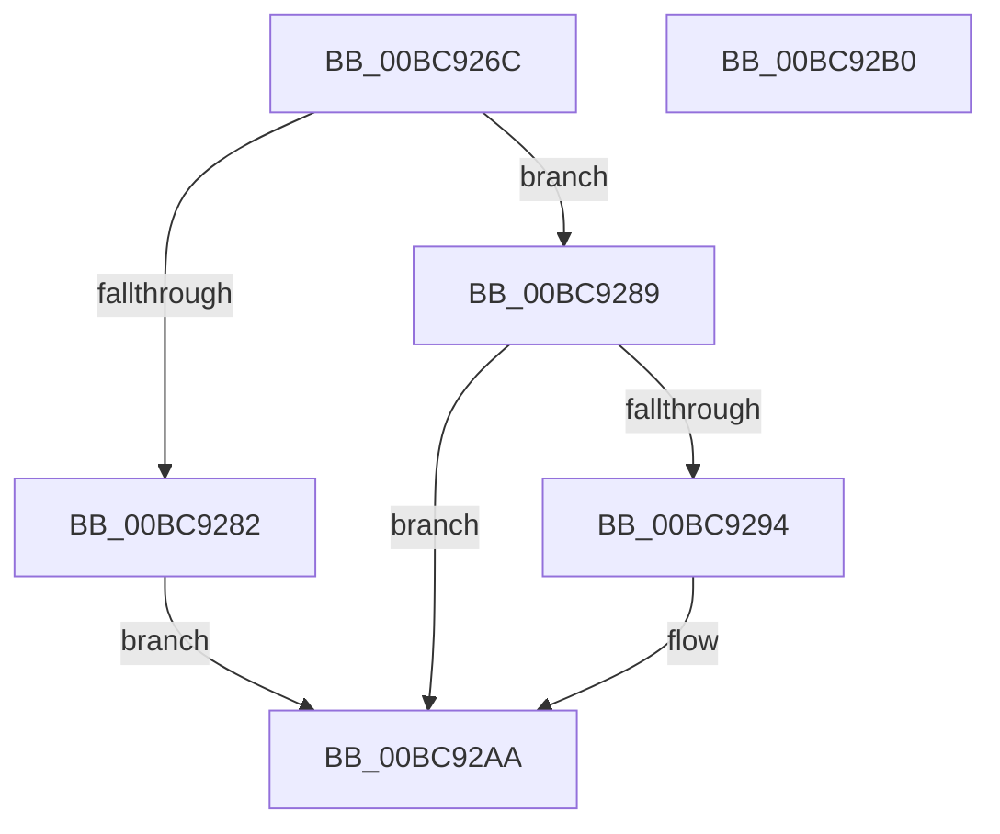

# CmpIsKeyBodyEligibleForDump

- RVA: `0x00BC926C`–`0x00BC92B1` (길이 `69` bytes)
- VA: `0x0000000140BC926C`
- 실행 섹션: `PAGECMRC`
- PDB 이름 있음: `예`; PDB Function 태그: `아니요`
- unwind 정보 RVA: `0x0005CF00`
- 디코드: `22`개 명령, `69/69` bytes 표시
- 미해석 바이트: `0` (있으면 어셈블리에 `.byte`로 보존)

> 이 문서는 커널 이미지의 기계어와 PDB 기호를 분석해 생성했습니다. 4번과 5번은 함수 원형과 자료형을 바이너리 사용 방식에서 추정한 C 해석이며 원본 소스 복구 결과는 아닙니다.

## 1. Dependencies

- 직접 호출 지점: **1**; 고유 호출 대상: **1**
- 직접 호출자로 확인된 함수: **2**
- RIP 상대 이미지 참조: **1**

### Outgoing calls
- `0x00BC928B` → [CmpPerformKeyBodyDeletionCheck](CmpPerformKeyBodyDeletionCheck_function_00BC97D0.md) (function, `0x00BC97D0`)

### Direct callers
- [CmDumpKeyToFile](../../page/7D/CmDumpKeyToFile_function_007DCD64.md) at `0x007DCDB0`
- [CmpDumpKeyToBuffer](CmpDumpKeyToBuffer_function_00BC9130.md) at `0x00BC9173`

### Static image references
- `0x00BC9272` → RVA `0x00FD9A90` (`PAGEDATA`; read)

## 2. Other-region calls and transfers

- 다른 실행 섹션으로 향하는 call: **0**
- 별도 외부 분기/꼬리 이동을 확인하지 못했습니다.

## 3. Assembly (complete function range)

```asm
00BC926C  40 53                           push rbx
00BC926E  48 83 EC 20                     sub rsp, 0x20
00BC9272  48 8B 05 17 08 41 00            mov rax, qword ptr [rip + 0x410817]
00BC9279  48 8B DA                        mov rbx, rdx
00BC927C  48 39 42 20                     cmp qword ptr [rdx + 0x20], rax
00BC9280  75 07                           jne 0x140bc9289
00BC9282  B8 22 00 00 C0                  mov eax, 0xc0000022
00BC9287  EB 21                           jmp 0x140bc92aa
00BC9289  33 D2                           xor edx, edx
00BC928B  E8 40 05 00 00                  call 0x140bc97d0
00BC9290  85 C0                           test eax, eax
00BC9292  78 16                           js 0x140bc92aa
00BC9294  8B 83 B8 00 00 00               mov eax, dword ptr [rbx + 0xb8]
00BC929A  25 00 00 04 00                  and eax, 0x40000
00BC929F  F7 D8                           neg eax
00BC92A1  1B C0                           sbb eax, eax
00BC92A3  F7 D0                           not eax
00BC92A5  25 0D 00 00 C0                  and eax, 0xc000000d
00BC92AA  48 83 C4 20                     add rsp, 0x20
00BC92AE  5B                              pop rbx
00BC92AF  C3                              ret
00BC92B0  CC                              int3
```

## 4. C-style interpretation (structured pseudocode)

```c
__int64 __fastcall CmpIsKeyBodyEligibleForDump(__int64 a1, __int64 a2)
{
    __int64 result;
    __int64 v_rsp;

    v_rsp = (v_rsp) - (32);
    if ((*(unsigned __int64 *)(a2 + 32)) != (*(unsigned __int64 *)(v_rip + 4261911))) goto loc_00BC9289;
    goto loc_00BC92AA;
loc_00BC9289:
    a2 = 0;
    result = CmpPerformKeyBodyDeletionCheck(a1, a2, a3, a4);
    if (!(sign_flag)) {
        result = *(unsigned int *)(a2 + 184);
        result = (unsigned int)((result) & (0x40000ULL));
        result = (unsigned int)(-(result));
        result = (unsigned int)(~(result));
        result = (unsigned int)((result) & (0xC000000DULL));
    }
    v_rsp = (v_rsp) + (32);
    return result;
}
```

## 5. (Beta) C Style

```c
int64_t CmpIsKeyBodyEligibleForDump(int64_t Arg1, void *Arg2)
{
    uint8_t *arg2 = (uint8_t *)Arg2;

    int64_t result;
    int64_t local_rsp;

    local_rsp = (local_rsp) - (32);
    if ((*(uint64_t *)(arg2 + 0x20)) != (*(uint64_t *)(v_rip + 0x410817))) goto loc_00BC9289;
    goto loc_00BC92AA;
loc_00BC9289:
    Arg2 = 0;
    result = CmpPerformKeyBodyDeletionCheck(Arg1, Arg2, a3, a4);
    if (!(sign_flag)) {
        result = *(uint32_t *)(arg2 + 0xB8);
        result = (uint32_t)((result) & (0x40000ULL));
        result = (uint32_t)(-(result));
        result = (uint32_t)(~(result));
        result = (uint32_t)((result) & (0xC000000DULL));
    }
    local_rsp = (local_rsp) + (32);
    return result;
}
```

### 관측된 메모리 오프셋

구조체 형식이 확인되지 않은 접근은 인자 기준의 오프셋으로만 기록했습니다.

| 기준 인자 | 오프셋 표현 | 폭 (bit) | 접근 |
|---|---:|---:|---|
| `Arg2` | `+ 0x20` | `64` | `R` |
| `Arg2` | `+ 0xB8` | `32` | `R` |

## 6. Execution-region graph

[열기: 2D/3D 그래프와 함수 탐색 컨트롤 패널](../../../control-panel.html?section=pagecmrc&rva=0x00BC926C&view=graph)

- 2D 그래프는 위에서 아래로 흐르고, 3D 그래프는 빈 공간을 드래그해 회전합니다. Shift+드래그는 이동, 휠은 확대·축소, 함수 노드 선택은 대상 보고서 이동입니다.

### Static fallback


