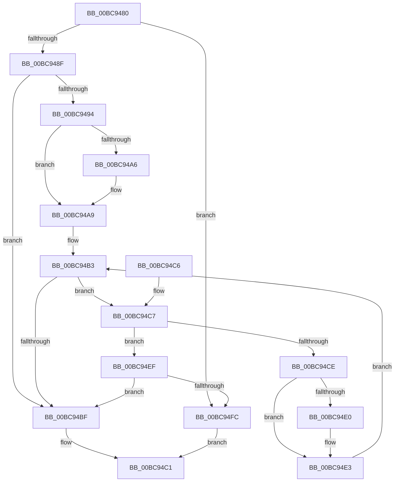

# CmpIsKeyDeletedForKeyBody

- RVA: `0x00BC9480`–`0x00BC9500` (길이 `128` bytes)
- VA: `0x0000000140BC9480`
- 실행 섹션: `PAGECMRC`
- PDB 이름 있음: `예`; PDB Function 태그: `아니요`
- unwind 정보 RVA: `0x0007FBE8`
- 디코드: `43`개 명령, `128/128` bytes 표시
- 미해석 바이트: `0` (있으면 어셈블리에 `.byte`로 보존)

> 이 문서는 커널 이미지의 기계어와 PDB 기호를 분석해 생성했습니다. 4번과 5번은 함수 원형과 자료형을 바이너리 사용 방식에서 추정한 C 해석이며 원본 소스 복구 결과는 아닙니다.

## 1. Dependencies

- 직접 호출 지점: **1**; 고유 호출 대상: **1**
- 직접 호출자로 확인된 함수: **23**
- RIP 상대 이미지 참조: **0**

### Outgoing calls
- `0x00BC94F3` → [CmEqualTrans](../../page/84/CmEqualTrans_function_0084BF60.md) (function, `0x0084BF60`)

### Direct callers
- [CmDeleteLayeredKey](../../text/41/CmDeleteLayeredKey_function_0041B598.md) at `0x0041B687`
- [CmQueryLayeredKey](../../text/46/CmQueryLayeredKey_function_0046A930.md) at `0x0046AA15`
- [CmQueryLayeredKey](../../text/46/CmQueryLayeredKey_function_0046A930.md) at `0x0046AA9B`
- [CmpLoadKeyCommon](../../text/46/CmpLoadKeyCommon_function_0046E9F8.md) at `0x0046EC43`
- [CmRestoreKey](../../page/7D/CmRestoreKey_function_007DCF04.md) at `0x007DD106`
- [CmRestoreKey](../../page/7D/CmRestoreKey_function_007DCF04.md) at `0x007DD300`
- [CmSaveMergedKeys](../../page/7D/CmSaveMergedKeys_function_007DE040.md) at `0x007DE148`
- [CmSaveMergedKeys](../../page/7D/CmSaveMergedKeys_function_007DE040.md) at `0x007DE15A`
- [CmpIsHiveAlreadyLoaded](../../page/7E/CmpIsHiveAlreadyLoaded_function_007EA594.md) at `0x007EA5C4`
- [CmSetValueKey](../../page/84/CmSetValueKey_function_008457C0.md) at `0x008459A4`
- [CmSetValueKey](../../page/84/CmSetValueKey_function_008457C0.md) at `0x00845A4B`
- [CmQueryMultipleValueKey](../../page/84/CmQueryMultipleValueKey_function_00846EC0.md) at `0x00846FA1`
- [CmQueryMultipleValueKey](../../page/84/CmQueryMultipleValueKey_function_00846EC0.md) at `0x0084740C`
- [CmQueryMultipleValueKey](../../page/84/CmQueryMultipleValueKey_function_00846EC0.md) at `0x008474D6`
- [CmDeleteValueKey](../../page/84/CmDeleteValueKey_function_008476E8.md) at `0x00847859`
- [CmDeleteValueKey](../../page/84/CmDeleteValueKey_function_008476E8.md) at `0x00847D19`
- [CmDeleteKey](../../page/84/CmDeleteKey_function_00848E5C.md) at `0x0084906B`
- [CmDeleteKey](../../page/84/CmDeleteKey_function_00848E5C.md) at `0x008490BF`
- [CmKeyBodyNeedsVirtualImage](../../page/84/CmKeyBodyNeedsVirtualImage_function_00849864.md) at `0x0084989C`
- [sub_008551B7](../../page/85/Unknown_function_008551B7.md) at `0x00855264`
- [sub_00855472](../../page/85/Unknown_function_00855472.md) at `0x0085548A`
- [CmQueryKey](../../page/85/CmQueryKey_function_00858240.md) at `0x00858369`
- [CmQueryKey](../../page/85/CmQueryKey_function_00858240.md) at `0x00858548`
- [CmQueryKey](../../page/85/CmQueryKey_function_00858240.md) at `0x00858A62`
- [CmQueryKey](../../page/85/CmQueryKey_function_00858240.md) at `0x00858C6B`
- [CmpDoParseKey](../../page/85/CmpDoParseKey_function_0085F750.md) at `0x0086078A`
- [CmpDoParseKey](../../page/85/CmpDoParseKey_function_0085F750.md) at `0x008614CE`
- [CmpCloseKeyObject](../../page/86/CmpCloseKeyObject_function_00863AD0.md) at `0x00863C1B`
- [sub_0086FA1C](../../page/86/Unknown_function_0086FA1C.md) at `0x0086FA54`
- [CmpCheckOpenAccessOnKeyBody](../../page/87/CmpCheckOpenAccessOnKeyBody_function_00870000.md) at `0x00870168`
- [CmEnumerateValueFromLayeredKey](../../page/8B/CmEnumerateValueFromLayeredKey_function_008B31FC.md) at `0x008B32E7`
- [NtNotifyChangeMultipleKeys](../../page/9D/NtNotifyChangeMultipleKeys_function_009DC6B0.md) at `0x009DCBBD`
- [NtNotifyChangeMultipleKeys](../../page/9D/NtNotifyChangeMultipleKeys_function_009DC6B0.md) at `0x009DCBD5`
- [CmpNotifyChangeKey](../../page/A4/CmpNotifyChangeKey_function_00A43C80.md) at `0x00A43CAC`
- [CmEnumerateValueKeyFromMergedView](../../page/A7/CmEnumerateValueKeyFromMergedView_function_00A7D650.md) at `0x00A7D751`
- [CmEnumerateValueKeyFromMergedView](../../page/A7/CmEnumerateValueKeyFromMergedView_function_00A7D650.md) at `0x00A7D764`
- [CmpResolveHiveLoadConflict](../../page/A9/CmpResolveHiveLoadConflict_function_00A9E78C.md) at `0x00A9E8AD`

### Static image references
- 디코드된 RIP-relative 메모리 참조가 없습니다.

## 2. Other-region calls and transfers

- 다른 실행 섹션으로 향하는 call: **1**
  - `0x00BC94F3` → [CmEqualTrans](../../page/84/CmEqualTrans_function_0084BF60.md) (`PAGECMRC` → `PAGE`)
- 별도 외부 분기/꼬리 이동을 확인하지 못했습니다.

## 3. Assembly (complete function range)

```asm
00BC9480  48 83 EC 28                     sub rsp, 0x28
00BC9484  8B 41 30                        mov eax, dword ptr [rcx + 0x30]
00BC9487  4C 8B 41 08                     mov r8, qword ptr [rcx + 8]
00BC948B  A8 09                           test al, 9
00BC948D  75 6D                           jne 0x140bc94fc
00BC948F  48 85 D2                        test rdx, rdx
00BC9492  74 2B                           je 0x140bc94bf
00BC9494  49 81 C0 D0 00 00 00            add r8, 0xd0
00BC949B  4D 8B 18                        mov r11, qword ptr [r8]
00BC949E  49 8B C3                        mov rax, r11
00BC94A1  4D 3B C3                        cmp r8, r11
00BC94A4  74 03                           je 0x140bc94a9
00BC94A6  49 8B 03                        mov rax, qword ptr [r11]
00BC94A9  45 33 C9                        xor r9d, r9d
00BC94AC  49 8D 4B E0                     lea rcx, [r11 - 0x20]
00BC94B0  4D 3B C3                        cmp r8, r11
00BC94B3  4C 0F 45 C9                     cmovne r9, rcx
00BC94B7  48 8B C8                        mov rcx, rax
00BC94BA  4D 85 C9                        test r9, r9
00BC94BD  75 08                           jne 0x140bc94c7
00BC94BF  32 C0                           xor al, al
00BC94C1  48 83 C4 28                     add rsp, 0x28
00BC94C5  C3                              ret
00BC94C6  CC                              int3
00BC94C7  41 83 79 44 02                  cmp dword ptr [r9 + 0x44], 2
00BC94CC  74 21                           je 0x140bc94ef
00BC94CE  48 85 C9                        test rcx, rcx
00BC94D1  49 8B C3                        mov rax, r11
00BC94D4  48 0F 45 C1                     cmovne rax, rcx
00BC94D8  4C 8B D0                        mov r10, rax
00BC94DB  4C 3B C0                        cmp r8, rax
00BC94DE  74 03                           je 0x140bc94e3
00BC94E0  48 8B 00                        mov rax, qword ptr [rax]
00BC94E3  45 33 C9                        xor r9d, r9d
00BC94E6  49 8D 4A E0                     lea rcx, [r10 - 0x20]
00BC94EA  4D 3B C2                        cmp r8, r10
00BC94ED  EB C4                           jmp 0x140bc94b3
00BC94EF  49 8B 49 38                     mov rcx, qword ptr [r9 + 0x38]
00BC94F3  E8 68 2A C8 FF                  call 0x14084bf60
00BC94F8  84 C0                           test al, al
00BC94FA  74 C3                           je 0x140bc94bf
00BC94FC  B0 01                           mov al, 1
00BC94FE  EB C1                           jmp 0x140bc94c1
```

## 4. C-style interpretation (structured pseudocode)

```c
__int64 __fastcall CmpIsKeyDeletedForKeyBody(__int64 a1, __int64 a2, __int64 a3, int a4)
{
    __int64 result;
    __int64 v_rsp;

    v_rsp = (v_rsp) - (40);
    if ((((unsigned __int8)((unsigned int)(*(unsigned int *)(a1 + 48)))) & (9)) != 0) goto loc_00BC94FC;
    if (a2 == 0) goto loc_00BC94BF;
    a3 = (*(unsigned __int64 *)(a1 + 8)) + (208);
    result = *(unsigned __int64 *)(a3);
    if (a3 != (*(unsigned __int64 *)(a3))) {
        result = *(unsigned __int64 *)(*(unsigned __int64 *)(a3));
    }
    a4 = 0;
loc_00BC94B3:
    if (a3 != (*(unsigned __int64 *)(a3))) { a4 = *(unsigned __int64 *)(a3) - 32; }
    if (a4 != 0) goto loc_00BC94C7;
loc_00BC94BF:
    result = 0;
loc_00BC94C1:
    v_rsp = (v_rsp) + (40);
    return result;
loc_00BC94C7:
    if ((*(unsigned int *)(a4 + 68)) == 2) goto loc_00BC94EF;
    result = *(unsigned __int64 *)(a3);
    if (0 != 0) { result = 0; }
    if (a3 != result) {
        result = *(unsigned __int64 *)(result);
    }
    a4 = 0;
    goto loc_00BC94B3;
loc_00BC94EF:
    result = CmEqualTrans(*(unsigned __int64 *)(a4 + 56), a2, a3, a4);
    if ((unsigned __int8)(result) == 0) goto loc_00BC94BF;
loc_00BC94FC:
    goto loc_00BC94C1;
}
```

## 5. (Beta) C Style

```c
int64_t CmpIsKeyDeletedForKeyBody(void *Arg1, int64_t Arg2, int64_t Arg3, int32_t Arg4)
{
    uint8_t *arg1 = (uint8_t *)Arg1;

    int64_t result;
    int64_t local_rsp;

    local_rsp = (local_rsp) - (40);
    if ((((uint8_t)((uint32_t)(*(uint32_t *)(arg1 + 0x30)))) & (9)) != 0) goto loc_00BC94FC;
    if (Arg2 == 0) goto loc_00BC94BF;
    Arg3 = (*(uint64_t *)(arg1 + 0x8)) + (208);
    result = *(uint64_t *)(Arg3);
    if (Arg3 != (*(uint64_t *)(Arg3))) {
        result = *(uint64_t *)(*(uint64_t *)(Arg3));
    }
    Arg4 = 0;
loc_00BC94B3:
    if (Arg3 != (*(uint64_t *)(Arg3))) { Arg4 = *(uint64_t *)(Arg3) - 32; }
    if (Arg4 != 0) goto loc_00BC94C7;
loc_00BC94BF:
    result = 0;
loc_00BC94C1:
    local_rsp = (local_rsp) + (40);
    return result;
loc_00BC94C7:
    if ((*(uint32_t *)(Arg4 + 0x44)) == 2) goto loc_00BC94EF;
    result = *(uint64_t *)(Arg3);
    if (0 != 0) { result = 0; }
    if (Arg3 != result) {
        result = *(uint64_t *)(result);
    }
    Arg4 = 0;
    goto loc_00BC94B3;
loc_00BC94EF:
    result = CmEqualTrans(*(uint64_t *)(Arg4 + 0x38), Arg2, Arg3, Arg4);
    if ((uint8_t)(result) == 0) goto loc_00BC94BF;
loc_00BC94FC:
    goto loc_00BC94C1;
}
```

### 관측된 메모리 오프셋

구조체 형식이 확인되지 않은 접근은 인자 기준의 오프셋으로만 기록했습니다.

| 기준 인자 | 오프셋 표현 | 폭 (bit) | 접근 |
|---|---:|---:|---|
| `Arg1` | `+ 0x8` | `64` | `R` |
| `Arg1` | `+ 0x30` | `32` | `R` |

## 6. Execution-region graph

[열기: 2D/3D 그래프와 함수 탐색 컨트롤 패널](../../../control-panel.html?section=pagecmrc&rva=0x00BC9480&view=graph)

- 2D 그래프는 위에서 아래로 흐르고, 3D 그래프는 빈 공간을 드래그해 회전합니다. Shift+드래그는 이동, 휠은 확대·축소, 함수 노드 선택은 대상 보고서 이동입니다.

### Static fallback


