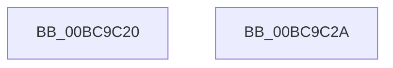

# CmpIsShutdownRundownActive

- RVA: `0x00BC9C20`–`0x00BC9C2B` (길이 `11` bytes)
- VA: `0x0000000140BC9C20`
- 실행 섹션: `PAGECMRC`
- PDB 이름 있음: `예`; PDB Function 태그: `아니요`
- unwind 정보 RVA: `0x000DB714`
- 디코드: `4`개 명령, `11/11` bytes 표시
- 미해석 바이트: `0` (있으면 어셈블리에 `.byte`로 보존)

> 이 문서는 커널 이미지의 기계어와 PDB 기호를 분석해 생성했습니다. 4번과 5번은 함수 원형과 자료형을 바이너리 사용 방식에서 추정한 C 해석이며 원본 소스 복구 결과는 아닙니다.

## 1. Dependencies

- 직접 호출 지점: **0**; 고유 호출 대상: **0**
- 직접 호출자로 확인된 함수: **7**
- RIP 상대 이미지 참조: **1**

### Outgoing calls
- 직접 디코드된 call 명령이 없습니다.

### Direct callers
- [CmRestoreKey](../../page/7D/CmRestoreKey_function_007DCF04.md) at `0x007DD2EE`
- [CmRenameKey](../../page/7E/CmRenameKey_function_007E8F48.md) at `0x007E9089`
- [CmSetLastWriteTimeKey](../../page/84/CmSetLastWriteTimeKey_function_00843368.md) at `0x008433DE`
- [CmSetValueKey](../../page/84/CmSetValueKey_function_008457C0.md) at `0x008458F0`
- [CmDeleteValueKey](../../page/84/CmDeleteValueKey_function_008476E8.md) at `0x008477D9`
- [CmDeleteKey](../../page/84/CmDeleteKey_function_00848E5C.md) at `0x00848F6D`
- [CmSetKeyFlags](../../page/9A/CmSetKeyFlags_function_009AEEA4.md) at `0x009AEF2B`

### Static image references
- `0x00BC9C20` → RVA `0x00EF7B20` (`.data`; read)

## 2. Other-region calls and transfers

- 다른 실행 섹션으로 향하는 call: **0**
- 별도 외부 분기/꼬리 이동을 확인하지 못했습니다.

## 3. Assembly (complete function range)

```asm
00BC9C20  48 8B 05 F9 DE 32 00            mov rax, qword ptr [rip + 0x32def9]
00BC9C27  24 01                           and al, 1
00BC9C29  C3                              ret
00BC9C2A  CC                              int3
```

## 4. C-style interpretation (structured pseudocode)

```c
__int64 __fastcall CmpIsShutdownRundownActive(void)
{
    __int64 result;

    result = (unsigned __int8)((*(unsigned __int64 *)(v_rip + 3333881)) & (1));
    return result;
}
```

## 5. (Beta) C Style

```c
void CmpIsShutdownRundownActive(void)
{
    int64_t result;

    result = (uint8_t)((*(uint64_t *)(v_rip + 0x32DEF9)) & (1));
    return result;
}
```

## 6. Execution-region graph

[열기: 2D/3D 그래프와 함수 탐색 컨트롤 패널](../../../control-panel.html?section=pagecmrc&rva=0x00BC9C20&view=graph)

- 2D 그래프는 위에서 아래로 흐르고, 3D 그래프는 빈 공간을 드래그해 회전합니다. Shift+드래그는 이동, 휠은 확대·축소, 함수 노드 선택은 대상 보고서 이동입니다.

### Static fallback


