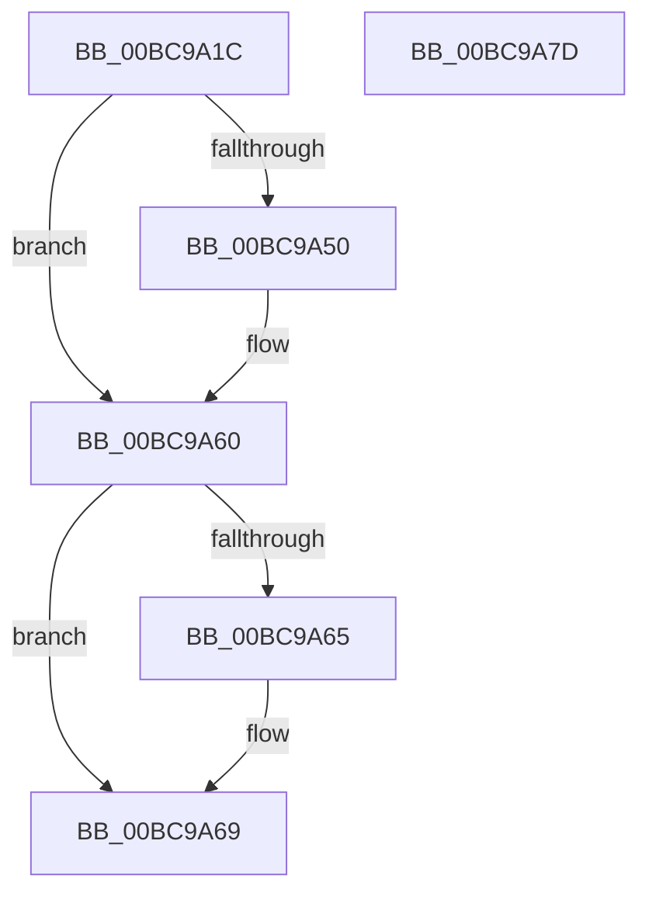

# CmpLockKcbShared

- RVA: `0x00BC9A1C`–`0x00BC9A7E` (길이 `98` bytes)
- VA: `0x0000000140BC9A1C`
- 실행 섹션: `PAGECMRC`
- PDB 이름 있음: `예`; PDB Function 태그: `아니요`
- unwind 정보 RVA: `0x0005FD94`
- 디코드: `30`개 명령, `98/98` bytes 표시
- 미해석 바이트: `0` (있으면 어셈블리에 `.byte`로 보존)

> 이 문서는 커널 이미지의 기계어와 PDB 기호를 분석해 생성했습니다. 4번과 5번은 함수 원형과 자료형을 바이너리 사용 방식에서 추정한 C 해석이며 원본 소스 복구 결과는 아닙니다.

## 1. Dependencies

- 직접 호출 지점: **2**; 고유 호출 대상: **2**
- 직접 호출자로 확인된 함수: **36**
- RIP 상대 이미지 참조: **0**

### Outgoing calls
- `0x00BC9A3A` → [KeAbPreAcquire](../../text/21/KeAbPreAcquire_function_00210230.md) (function, `0x00210230`)
- `0x00BC9A5B` → [ExfAcquirePushLockSharedEx](../../text/21/ExfAcquirePushLockSharedEx_function_0021044C.md) (function, `0x0021044C`)

### Direct callers
- [CmpDoQueryKeyName](../../text/45/CmpDoQueryKeyName_function_00456664.md) at `0x00456815`
- [CmDumpKeyToFile](../../page/7D/CmDumpKeyToFile_function_007DCD64.md) at `0x007DCDA5`
- [CmRestoreKey](../../page/7D/CmRestoreKey_function_007DCF04.md) at `0x007DD0D7`
- [CmpRefreshHive](../../page/7D/CmpRefreshHive_function_007DEAD0.md) at `0x007DEB83`
- [CmSetValueKey](../../page/84/CmSetValueKey_function_008457C0.md) at `0x00845A15`
- [CmSetValueKey](../../page/84/CmSetValueKey_function_008457C0.md) at `0x008464D4`
- [CmSetValueKey](../../page/84/CmSetValueKey_function_008457C0.md) at `0x00846534`
- [CmpLockKcbStackTopExclusiveRestShared](../../page/84/CmpLockKcbStackTopExclusiveRestShared_function_00846B04.md) at `0x00846B61`
- [CmQueryMultipleValueKey](../../page/84/CmQueryMultipleValueKey_function_00846EC0.md) at `0x00847402`
- [CmpLockTwoKcbsShared](../../page/84/CmpLockTwoKcbsShared_function_008485B4.md) at `0x008485CA`
- [CmpLockTwoKcbsShared](../../page/84/CmpLockTwoKcbsShared_function_008485B4.md) at `0x00848604`
- [CmKeyBodyNeedsVirtualImage](../../page/84/CmKeyBodyNeedsVirtualImage_function_00849864.md) at `0x00849892`
- [sub_0084D18D](../../page/84/Unknown_function_0084D18D.md) at `0x0084D1D1`
- [sub_0084E4B5](../../page/84/Unknown_function_0084E4B5.md) at `0x0084E578`
- [sub_0084E7D5](../../page/84/Unknown_function_0084E7D5.md) at `0x0084E9E5`
- [sub_0084E7D5](../../page/84/Unknown_function_0084E7D5.md) at `0x0084EA03`
- [sub_0084E7D5](../../page/84/Unknown_function_0084E7D5.md) at `0x0084EA63`
- [CmpPerformCompleteKcbCacheLookup](../../page/84/CmpPerformCompleteKcbCacheLookup_function_0084FD20.md) at `0x00850068`
- [CmpPerformCompleteKcbCacheLookup](../../page/84/CmpPerformCompleteKcbCacheLookup_function_0084FD20.md) at `0x00850183`
- [CmpPerformCompleteKcbCacheLookup](../../page/84/CmpPerformCompleteKcbCacheLookup_function_0084FD20.md) at `0x00850A72`
- [CmpWalkOneLevel](../../page/85/CmpWalkOneLevel_function_00852BA0.md) at `0x00852D33`
- [sub_008551B7](../../page/85/Unknown_function_008551B7.md) at `0x00855240`
- [CmpGetSymbolicLinkTarget](../../page/85/CmpGetSymbolicLinkTarget_function_008570A0.md) at `0x008572BC`
- [CmQueryKey](../../page/85/CmQueryKey_function_00858240.md) at `0x0085834A`
- [CmQueryKey](../../page/85/CmQueryKey_function_00858240.md) at `0x00858C61`
- [sub_0085E7B7](../../page/85/Unknown_function_0085E7B7.md) at `0x0085E7EC`
- [sub_0085E7B7](../../page/85/Unknown_function_0085E7B7.md) at `0x0085E87D`
- [sub_0085E942](../../page/85/Unknown_function_0085E942.md) at `0x0085E97D`
- [sub_0085E9A1](../../page/85/Unknown_function_0085E9A1.md) at `0x0085E9F0`
- [sub_0085EA2A](../../page/85/Unknown_function_0085EA2A.md) at `0x0085EA30`
- [sub_0085EA74](../../page/85/Unknown_function_0085EA74.md) at `0x0085EA94`
- [sub_0085EABD](../../page/85/Unknown_function_0085EABD.md) at `0x0085EB20`
- [CmpDoParseKey](../../page/85/CmpDoParseKey_function_0085F750.md) at `0x0085FACE`
- [CmpDoParseKey](../../page/85/CmpDoParseKey_function_0085F750.md) at `0x0085FDC1`
- [CmpDoParseKey](../../page/85/CmpDoParseKey_function_0085F750.md) at `0x0086075D`
- [CmpDoParseKey](../../page/85/CmpDoParseKey_function_0085F750.md) at `0x00861A5B`
- [CmpCloseKeyObject](../../page/86/CmpCloseKeyObject_function_00863AD0.md) at `0x00863C11`
- [CmpSecurityMethod](../../page/87/CmpSecurityMethod_function_00870CC0.md) at `0x00870E80`
- [NtEnumerateValueKey](../../page/8B/NtEnumerateValueKey_function_008B3B50.md) at `0x008B3F51`
- [sub_008B4B26](../../page/8B/Unknown_function_008B4B26.md) at `0x008B4B5F`
- [CmpLockKcbStackShared](../../page/94/CmpLockKcbStackShared_function_00948000.md) at `0x00948024`
- [CmpReferenceKeyControlBlockLockNotHeld](../../page/99/CmpReferenceKeyControlBlockLockNotHeld_function_0099F9A0.md) at `0x0099F9D2`
- [sub_009DC3C2](../../page/9D/Unknown_function_009DC3C2.md) at `0x009DC420`
- [NtNotifyChangeMultipleKeys](../../page/9D/NtNotifyChangeMultipleKeys_function_009DC6B0.md) at `0x009DCBB3`
- [CmpEnumerateAllHigherLayerKcbs](../../page/A5/CmpEnumerateAllHigherLayerKcbs_function_00A55234.md) at `0x00A552D1`
- [NtFlushKey](../../page/A8/NtFlushKey_function_00A8A030.md) at `0x00A8A16B`
- [CmKeyBodyRemapToVirtual](../../page/AC/CmKeyBodyRemapToVirtual_function_00AC9494.md) at `0x00AC95A9`
- [CmpDumpKeyToBuffer](CmpDumpKeyToBuffer_function_00BC9130.md) at `0x00BC9168`

### Static image references
- 디코드된 RIP-relative 메모리 참조가 없습니다.

## 2. Other-region calls and transfers

- 다른 실행 섹션으로 향하는 call: **2**
  - `0x00BC9A3A` → [KeAbPreAcquire](../../text/21/KeAbPreAcquire_function_00210230.md) (`PAGECMRC` → `.text`)
  - `0x00BC9A5B` → [ExfAcquirePushLockSharedEx](../../text/21/ExfAcquirePushLockSharedEx_function_0021044C.md) (`PAGECMRC` → `.text`)
- 별도 외부 분기/꼬리 이동을 확인하지 못했습니다.

## 3. Assembly (complete function range)

```asm
00BC9A1C  48 89 5C 24 10                  mov qword ptr [rsp + 0x10], rbx
00BC9A21  48 89 74 24 18                  mov qword ptr [rsp + 0x18], rsi
00BC9A26  57                              push rdi
00BC9A27  48 83 EC 20                     sub rsp, 0x20
00BC9A2B  48 8D 79 30                     lea rdi, [rcx + 0x30]
00BC9A2F  48 8B F1                        mov rsi, rcx
00BC9A32  48 8B CF                        mov rcx, rdi
00BC9A35  45 33 C0                        xor r8d, r8d
00BC9A38  33 D2                           xor edx, edx
00BC9A3A  E8 F1 67 64 FF                  call 0x140210230
00BC9A3F  48 8B D8                        mov rbx, rax
00BC9A42  B9 11 00 00 00                  mov ecx, 0x11
00BC9A47  33 C0                           xor eax, eax
00BC9A49  F0 48 0F B1 0F                  lock cmpxchg qword ptr [rdi], rcx
00BC9A4E  74 10                           je 0x140bc9a60
00BC9A50  4C 8B CF                        mov r9, rdi
00BC9A53  4C 8B C3                        mov r8, rbx
00BC9A56  33 D2                           xor edx, edx
00BC9A58  48 8B CF                        mov rcx, rdi
00BC9A5B  E8 EC 69 64 FF                  call 0x14021044c
00BC9A60  48 85 DB                        test rbx, rbx
00BC9A63  74 04                           je 0x140bc9a69
00BC9A65  C6 43 0A 01                     mov byte ptr [rbx + 0xa], 1
00BC9A69  F0 FF 46 38                     lock inc dword ptr [rsi + 0x38]
00BC9A6D  48 8B 5C 24 38                  mov rbx, qword ptr [rsp + 0x38]
00BC9A72  48 8B 74 24 40                  mov rsi, qword ptr [rsp + 0x40]
00BC9A77  48 83 C4 20                     add rsp, 0x20
00BC9A7B  5F                              pop rdi
00BC9A7C  C3                              ret
00BC9A7D  CC                              int3
```

## 4. C-style interpretation (structured pseudocode)

```c
__int64 __fastcall CmpLockKcbShared(__int64 a1, int a2, int a3)
{
    __int64 result;
    __int64 v_rsp;
    unsigned __int64 v_stack_p10;
    unsigned __int64 v_stack_p18;

    v_stack_p10 = v_rbx;
    v_stack_p18 = v_rsi;
    v_rsp = (v_rsp) - (32);
    a3 = 0;
    a2 = 0;
    result = KeAbPreAcquire(a1 + 48, a2, a3, a4);
    result = 0;
    if (!(condition_is_equal)) {
        a4 = a1 + 48;
        a3 = 0;
        a2 = 0;
        a1 = a1 + 48;
        result = ExfAcquirePushLockSharedEx(a1, a2, a3, a4);
    }
    if (result != 0) {
        *(unsigned __int8 *)(result + 10) = 1;
    }
    v_rsp = (v_rsp) + (32);
    return result;
}
```

## 5. (Beta) C Style

```c
int64_t CmpLockKcbShared(void *Arg1, int32_t Arg2, int32_t Arg3)
{
    uint8_t *arg1 = (uint8_t *)Arg1;

    int64_t result;
    int64_t local_rsp;
    uint64_t v_stack_p10;
    uint64_t v_stack_p18;

    v_stack_p10 = local_rbx;
    v_stack_p18 = local_rsi;
    local_rsp = (local_rsp) - (32);
    Arg3 = 0;
    Arg2 = 0;
    result = KeAbPreAcquire(Arg1 + 48, Arg2, Arg3, a4);
    result = 0;
    if (!(condition_is_equal)) {
        a4 = Arg1 + 48;
        Arg3 = 0;
        Arg2 = 0;
        Arg1 = Arg1 + 48;
        result = ExfAcquirePushLockSharedEx(Arg1, Arg2, Arg3, a4);
    }
    if (result != 0) {
        *(uint8_t *)(result + 0xA) = 1;
    }
    local_rsp = (local_rsp) + (32);
    return result;
}
```

### 관측된 메모리 오프셋

구조체 형식이 확인되지 않은 접근은 인자 기준의 오프셋으로만 기록했습니다.

| 기준 인자 | 오프셋 표현 | 폭 (bit) | 접근 |
|---|---:|---:|---|
| `Arg1` | `+ 0x0` | `64` | `R` |
| `Arg1` | `+ 0x30` | `64` | `R` |
| `Arg1` | `+ 0x38` | `32` | `R/W` |

## 6. Execution-region graph

[열기: 2D/3D 그래프와 함수 탐색 컨트롤 패널](../../../control-panel.html?section=pagecmrc&rva=0x00BC9A1C&view=graph)

- 2D 그래프는 위에서 아래로 흐르고, 3D 그래프는 빈 공간을 드래그해 회전합니다. Shift+드래그는 이동, 휠은 확대·축소, 함수 노드 선택은 대상 보고서 이동입니다.

### Static fallback


