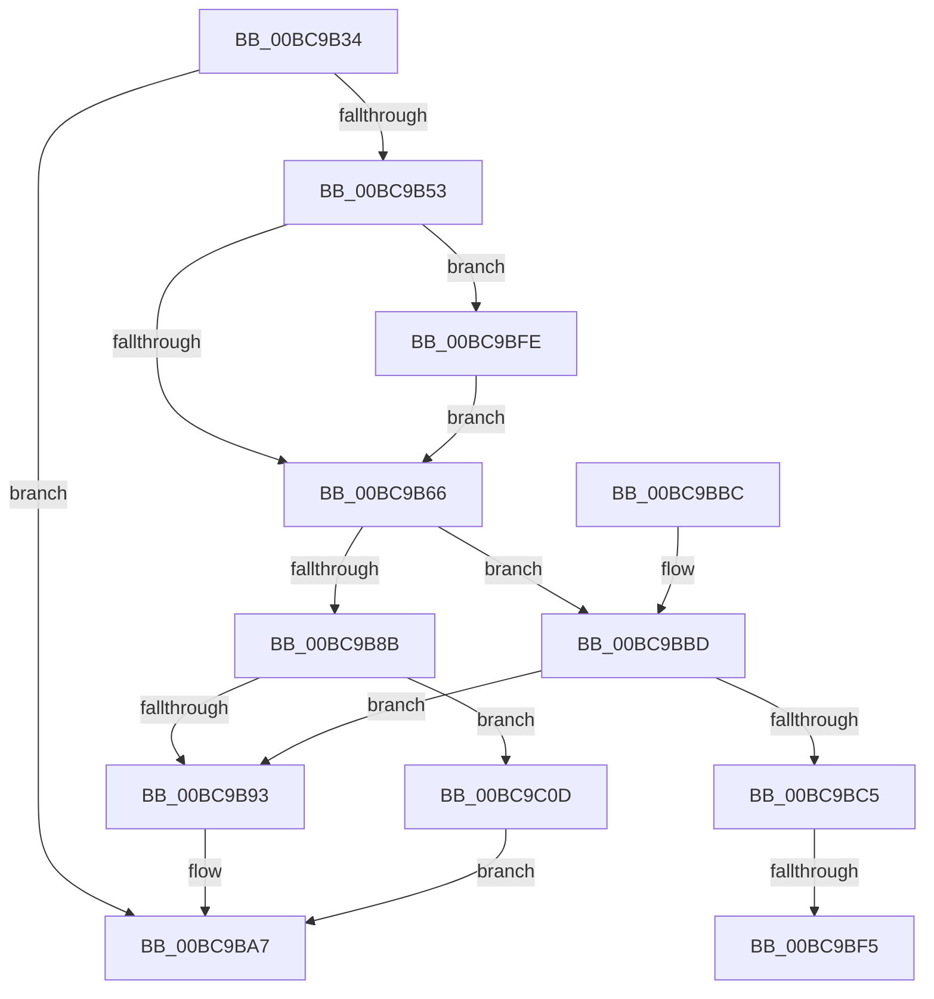

# CmpLockRegistry

- RVA: `0x00BC9B34`–`0x00BC9C17` (길이 `227` bytes)
- VA: `0x0000000140BC9B34`
- 실행 섹션: `PAGECMRC`
- PDB 이름 있음: `예`; PDB Function 태그: `예`
- unwind 정보 RVA: `0x00065050`
- 디코드: `57`개 명령, `227/227` bytes 표시
- 미해석 바이트: `0` (있으면 어셈블리에 `.byte`로 보존)

> 이 문서는 커널 이미지의 기계어와 PDB 기호를 분석해 생성했습니다. 4번과 5번은 함수 원형과 자료형을 바이너리 사용 방식에서 추정한 C 해석이며 원본 소스 복구 결과는 아닙니다.

## 1. Dependencies

- 직접 호출 지점: **7**; 고유 호출 대상: **7**
- 직접 호출자로 확인된 함수: **68**
- RIP 상대 이미지 참조: **3**

### Outgoing calls
- `0x00BC9B71` → [PsBoostThreadIo](../../text/39/PsBoostThreadIo_function_003927C0.md) (function, `0x003927C0`)
- `0x00BC9B93` → [CmpRecordRegistryLockAcquire](../../text/45/CmpRecordRegistryLockAcquire_function_004565F4.md) (function, `0x004565F4`)
- `0x00BC9BA2` → [ExAcquireResourceSharedLite](../../text/21/ExAcquireResourceSharedLite_function_00211BC0.md) (function, `0x00211BC0`)
- `0x00BC9BD4` → [KeAbPreAcquire](../../text/21/KeAbPreAcquire_function_00210230.md) (function, `0x00210230`)
- `0x00BC9BE7` → [ExfAcquireCacheAwarePushLockSharedEx](../../text/41/ExfAcquireCacheAwarePushLockSharedEx_function_00418DE0.md) (function, `0x00418DE0`)
- `0x00BC9BFE` → [CmpTestRegistryLock](../../text/66/CmpTestRegistryLock_function_0066AC84.md) (function, `0x0066AC84`)
- `0x00BC9C10` → [CmpRecordRegistryLockSharedAcquire](../../text/66/CmpRecordRegistryLockSharedAcquire_function_0066ABA4.md) (function, `0x0066ABA4`)

### Direct callers
- [CmpDoQueryKeyName](../../text/45/CmpDoQueryKeyName_function_00456664.md) at `0x004567F3`
- [CmpRecheckHiveVolumePolicy](../../text/46/CmpRecheckHiveVolumePolicy_function_0046EE14.md) at `0x0046EE26`
- [CmShutdownSystem1](../../text/66/CmShutdownSystem1_function_0066A5B0.md) at `0x0066A72F`
- [CmShutdownSystem1](../../text/66/CmShutdownSystem1_function_0066A5B0.md) at `0x0066A762`
- [sub_006F34C4](../../text/6F/Unknown_function_006F34C4.md) at `0x006F34F7`
- [CmpLoadHiveThread](../../page/7D/CmpLoadHiveThread_function_007DB040.md) at `0x007DB740`
- [CmpLoadHiveThread](../../page/7D/CmpLoadHiveThread_function_007DB040.md) at `0x007DB829`
- [CmpLoadHiveThread](../../page/7D/CmpLoadHiveThread_function_007DB040.md) at `0x007DB9D8`
- [CmpLoadHiveThread](../../page/7D/CmpLoadHiveThread_function_007DB040.md) at `0x007DBA90`
- [CmpLoadHiveThread](../../page/7D/CmpLoadHiveThread_function_007DB040.md) at `0x007DBAFE`
- [CmpMountPreloadedHives](../../page/7D/CmpMountPreloadedHives_function_007DBE18.md) at `0x007DC1F8`
- [CmpMountPreloadedHives](../../page/7D/CmpMountPreloadedHives_function_007DBE18.md) at `0x007DC2EC`
- [CmpMountPreloadedHives](../../page/7D/CmpMountPreloadedHives_function_007DBE18.md) at `0x007DC3CF`
- [CmpMountPreloadedHives](../../page/7D/CmpMountPreloadedHives_function_007DBE18.md) at `0x007DC401`
- [CmDumpKeyToFile](../../page/7D/CmDumpKeyToFile_function_007DCD64.md) at `0x007DCD96`
- [CmSaveKey](../../page/7D/CmSaveKey_function_007DDBDC.md) at `0x007DDCB8`
- [CmSaveMergedKeys](../../page/7D/CmSaveMergedKeys_function_007DE040.md) at `0x007DE110`
- [CmpRefreshHive](../../page/7D/CmpRefreshHive_function_007DEAD0.md) at `0x007DEB78`
- [CmOpenKeyForBugCheckRecovery](../../page/7D/CmOpenKeyForBugCheckRecovery_function_007DF3C0.md) at `0x007DF48F`
- [CmpFinishBeingActiveFlusherAndReconciler](../../page/7E/CmpFinishBeingActiveFlusherAndReconciler_function_007E7EB0.md) at `0x007E7ECC`
- [CmReplaceKey](../../page/7E/CmReplaceKey_function_007EA1C8.md) at `0x007EA297`
- [CmReplaceKey](../../page/7E/CmReplaceKey_function_007EA1C8.md) at `0x007EA32B`
- [CmpFlushBackupHive](../../page/7E/CmpFlushBackupHive_function_007EC1A8.md) at `0x007EC320`
- [CmpAssignKeySecurity](../../page/7E/CmpAssignKeySecurity_function_007EC8B0.md) at `0x007EC906`
- [CmpRecoverFlushProtocolStateFromFiles](../../page/7E/CmpRecoverFlushProtocolStateFromFiles_function_007EE4B0.md) at `0x007EE4EB`
- [CmpDoReOpenTransKey](../../page/7F/CmpDoReOpenTransKey_function_007F78E8.md) at `0x007F7A99`
- [CmpDoReOpenTransKey](../../page/7F/CmpDoReOpenTransKey_function_007F78E8.md) at `0x007F7BF0`
- [CmpStopRMLog](../../page/84/CmpStopRMLog_function_008427AC.md) at `0x008427B5`
- [CmpCleanupTransactionState](../../page/84/CmpCleanupTransactionState_function_008428E0.md) at `0x0084299D`
- [CmSetLastWriteTimeKey](../../page/84/CmSetLastWriteTimeKey_function_00843368.md) at `0x008433EB`
- [CmKeyBodyReplicateToVirtual](../../page/84/CmKeyBodyReplicateToVirtual_function_00843FE4.md) at `0x008440E3`
- [CmSetValueKey](../../page/84/CmSetValueKey_function_008457C0.md) at `0x00845900`
- [CmQueryMultipleValueKey](../../page/84/CmQueryMultipleValueKey_function_00846EC0.md) at `0x00846F57`
- [CmDeleteValueKey](../../page/84/CmDeleteValueKey_function_008476E8.md) at `0x008477F3`
- [CmDeleteKey](../../page/84/CmDeleteKey_function_00848E5C.md) at `0x00848F83`
- [CmKeyBodyNeedsVirtualImage](../../page/84/CmKeyBodyNeedsVirtualImage_function_00849864.md) at `0x00849889`
- [sub_0084D0A2](../../page/84/Unknown_function_0084D0A2.md) at `0x0084D145`
- [sub_0084E4B5](../../page/84/Unknown_function_0084E4B5.md) at `0x0084E558`
- [sub_00855118](../../page/85/Unknown_function_00855118.md) at `0x00855192`
- [CmQueryKey](../../page/85/CmQueryKey_function_00858240.md) at `0x008582F9`
- [CmpDoParseKey](../../page/85/CmpDoParseKey_function_0085F750.md) at `0x0085FA0E`
- [CmpDoParseKey](../../page/85/CmpDoParseKey_function_0085F750.md) at `0x0085FC18`
- [CmpDoParseKey](../../page/85/CmpDoParseKey_function_0085F750.md) at `0x0085FC51`
- [CmpDoParseKey](../../page/85/CmpDoParseKey_function_0085F750.md) at `0x00860A9C`
- [CmpCloseKeyObject](../../page/86/CmpCloseKeyObject_function_00863AD0.md) at `0x00863C08`
- [sub_0086560A](../../page/86/Unknown_function_0086560A.md) at `0x00865793`
- [CmpSecurityMethod](../../page/87/CmpSecurityMethod_function_00870CC0.md) at `0x00870DEC`
- [CmLoadDifferencingKey](../../page/87/CmLoadDifferencingKey_function_00875670.md) at `0x0087620C`
- [CmOpenKey](../../page/87/CmOpenKey_function_00876350.md) at `0x00876741`
- [sub_008769B9](../../page/87/Unknown_function_008769B9.md) at `0x008769BD`
- [CmReleaseLoadKeyContext](../../page/87/CmReleaseLoadKeyContext_function_00877C88.md) at `0x00877C95`
- [CmReleaseLoadKeyContext](../../page/87/CmReleaseLoadKeyContext_function_00877C88.md) at `0x00877CB3`
- [CmpLinkHiveToMaster](../../page/87/CmpLinkHiveToMaster_function_00877D6C.md) at `0x00877F5F`
- [CmpLinkHiveToMaster](../../page/87/CmpLinkHiveToMaster_function_00877D6C.md) at `0x00877FE6`
- [CmpLinkHiveToMaster](../../page/87/CmpLinkHiveToMaster_function_00877D6C.md) at `0x008781BD`
- [CmpCreateHive](../../page/87/CmpCreateHive_function_00879DF0.md) at `0x0087A1FB`
- [CmpReorganizeHive](../../page/87/CmpReorganizeHive_function_0087B92C.md) at `0x0087BACD`
- [CmpInitCmRM](../../page/87/CmpInitCmRM_function_0087C700.md) at `0x0087CE57`
- [NtEnumerateValueKey](../../page/8B/NtEnumerateValueKey_function_008B3B50.md) at `0x008B3F35`
- [sub_008B4B26](../../page/8B/Unknown_function_008B4B26.md) at `0x008B4B57`
- [sub_008B4B26](../../page/8B/Unknown_function_008B4B26.md) at `0x008B4C66`
- [sub_008B4CB2](../../page/8B/Unknown_function_008B4CB2.md) at `0x008B4CB2`
- [CmNotifyRunDown](../../page/90/CmNotifyRunDown_function_00906984.md) at `0x009069CD`
- [CmpEnumerateLayeredKey](../../page/94/CmpEnumerateLayeredKey_function_00945E58.md) at `0x00945F42`
- [CmpSetKeySecurity](../../page/94/CmpSetKeySecurity_function_0094A124.md) at `0x0094A1FF`
- [CmSetKeyFlags](../../page/9A/CmSetKeyFlags_function_009AEEA4.md) at `0x009AEF45`
- [CmpTransMgrSyncHive](../../page/9B/CmpTransMgrSyncHive_function_009B07C4.md) at `0x009B07D1`
- [CmpTransMgrPrepare](../../page/9B/CmpTransMgrPrepare_function_009B175C.md) at `0x009B17D4`
- [CmpTransMgrPrepare](../../page/9B/CmpTransMgrPrepare_function_009B175C.md) at `0x009B186A`
- [CmpLateUnloadHiveWorker](../../page/9B/CmpLateUnloadHiveWorker_function_009B20D0.md) at `0x009B21EE`
- [HvpFinishPrimaryWrite](../../page/9B/HvpFinishPrimaryWrite_function_009B2580.md) at `0x009B260F`
- [CmpFlushHive](../../page/9B/CmpFlushHive_function_009B3DC0.md) at `0x009B4336`
- [CmpFlushHive](../../page/9B/CmpFlushHive_function_009B3DC0.md) at `0x009B446F`
- [CmpFlushHive](../../page/9B/CmpFlushHive_function_009B3DC0.md) at `0x009B47C6`
- [CmpLockRegistryFreezeAware](../../page/9B/CmpLockRegistryFreezeAware_function_009B4AE4.md) at `0x009B4B18`
- [CmpLockRegistryFreezeAware](../../page/9B/CmpLockRegistryFreezeAware_function_009B4AE4.md) at `0x009B4BBC`
- [CmpDoLocalizeNextHive](../../page/9B/CmpDoLocalizeNextHive_function_009B7400.md) at `0x009B74A0`
- [CmpDelayCloseWorker](../../page/9D/CmpDelayCloseWorker_function_009DB8E0.md) at `0x009DB958`
- [sub_009DC2FF](../../page/9D/Unknown_function_009DC2FF.md) at `0x009DC3A5`
- [NtNotifyChangeMultipleKeys](../../page/9D/NtNotifyChangeMultipleKeys_function_009DC6B0.md) at `0x009DCB99`
- [NtNotifyChangeMultipleKeys](../../page/9D/NtNotifyChangeMultipleKeys_function_009DC6B0.md) at `0x009DCF01`
- [NtNotifyChangeMultipleKeys](../../page/9D/NtNotifyChangeMultipleKeys_function_009DC6B0.md) at `0x009DD0D2`
- [CmpStopSiloKeyLockTracker](../../page/9E/CmpStopSiloKeyLockTracker_function_009E7BF0.md) at `0x009E7C61`
- [CmLockKeyForWrite](../../page/9E/CmLockKeyForWrite_function_009E7EE8.md) at `0x009E7F1D`
- [CmpStartSiloRegistryNamespace](../../page/9E/CmpStartSiloRegistryNamespace_function_009E85D0.md) at `0x009E86A5`
- [CmpTrimHive](../../page/A4/CmpTrimHive_function_00A4F2FC.md) at `0x00A4F32E`
- [CmEnumerateValueKeyFromMergedView](../../page/A7/CmEnumerateValueKeyFromMergedView_function_00A7D650.md) at `0x00A7D987`
- [CmKeyBodyRemapToVirtual](../../page/AC/CmKeyBodyRemapToVirtual_function_00AC9494.md) at `0x00AC95A1`
- [sub_00B1664A](../../page/B1/Unknown_function_00B1664A.md) at `0x00B1673F`
- [sub_00B1845C](../../page/B1/Unknown_function_00B1845C.md) at `0x00B186C3`
- [sub_00B1845C](../../page/B1/Unknown_function_00B1845C.md) at `0x00B187BB`
- [sub_00B1845C](../../page/B1/Unknown_function_00B1845C.md) at `0x00B188D8`
- [CmpDumpKeyToBuffer](CmpDumpKeyToBuffer_function_00BC9130.md) at `0x00BC915C`

### Static image references
- `0x00BC9B4A` → RVA `0x00FD8005` (`PAGEDATA`; read)
- `0x00BC9B53` → RVA `0x00EF7108` (`.data`; read)
- `0x00BC9B98` → RVA `0x00EF7110` (`.data`; read)

## 2. Other-region calls and transfers

- 다른 실행 섹션으로 향하는 call: **7**
  - `0x00BC9B71` → [PsBoostThreadIo](../../text/39/PsBoostThreadIo_function_003927C0.md) (`PAGECMRC` → `.text`)
  - `0x00BC9B93` → [CmpRecordRegistryLockAcquire](../../text/45/CmpRecordRegistryLockAcquire_function_004565F4.md) (`PAGECMRC` → `.text`)
  - `0x00BC9BA2` → [ExAcquireResourceSharedLite](../../text/21/ExAcquireResourceSharedLite_function_00211BC0.md) (`PAGECMRC` → `.text`)
  - `0x00BC9BD4` → [KeAbPreAcquire](../../text/21/KeAbPreAcquire_function_00210230.md) (`PAGECMRC` → `.text`)
  - `0x00BC9BE7` → [ExfAcquireCacheAwarePushLockSharedEx](../../text/41/ExfAcquireCacheAwarePushLockSharedEx_function_00418DE0.md) (`PAGECMRC` → `.text`)
  - `0x00BC9BFE` → [CmpTestRegistryLock](../../text/66/CmpTestRegistryLock_function_0066AC84.md) (`PAGECMRC` → `.text`)
  - `0x00BC9C10` → [CmpRecordRegistryLockSharedAcquire](../../text/66/CmpRecordRegistryLockSharedAcquire_function_0066ABA4.md) (`PAGECMRC` → `.text`)
- call이 아닌 외부 분기/꼬리 이동: **2**
  - `0x00BC9BEF` → [sub_00BCA03A](Unknown_function_00BCA03A.md) (`tail-transfer`)
  - `0x00BC9BF9` → [sub_00BCA03A](Unknown_function_00BCA03A.md) (`tail-transfer`)

## 3. Assembly (complete function range)

```asm
00BC9B34  48 89 5C 24 08                  mov qword ptr [rsp + 8], rbx
00BC9B39  48 89 6C 24 10                  mov qword ptr [rsp + 0x10], rbp
00BC9B3E  48 89 74 24 18                  mov qword ptr [rsp + 0x18], rsi
00BC9B43  57                              push rdi
00BC9B44  48 83 EC 20                     sub rsp, 0x20
00BC9B48  33 FF                           xor edi, edi
00BC9B4A  40 38 3D B4 E4 40 00            cmp byte ptr [rip + 0x40e4b4], dil
00BC9B51  75 54                           jne 0x140bc9ba7
00BC9B53  39 3D AF D5 32 00               cmp dword ptr [rip + 0x32d5af], edi
00BC9B59  8D 6F 01                        lea ebp, [rdi + 1]
00BC9B5C  40 0F B6 DF                     movzx ebx, dil
00BC9B60  0F 85 98 00 00 00               jne 0x140bc9bfe
00BC9B66  65 48 8B 0C 25 88 01 00 00      mov rcx, qword ptr gs:[0x188]
00BC9B6F  33 D2                           xor edx, edx
00BC9B71  E8 4A 8C 7C FF                  call 0x1403927c0
00BC9B76  65 48 8B 04 25 88 01 00 00      mov rax, qword ptr gs:[0x188]
00BC9B7F  66 FF 88 E4 01 00 00            dec word ptr [rax + 0x1e4]
00BC9B86  90                              nop
00BC9B87  84 DB                           test bl, bl
00BC9B89  74 32                           je 0x140bc9bbd
00BC9B8B  39 2D 77 D5 32 00               cmp dword ptr [rip + 0x32d577], ebp
00BC9B91  74 7A                           je 0x140bc9c0d
00BC9B93  E8 5C CA 88 FF                  call 0x1404565f4
00BC9B98  48 8B 0D 71 D5 32 00            mov rcx, qword ptr [rip + 0x32d571]
00BC9B9F  40 8A D5                        mov dl, bpl
00BC9BA2  E8 19 80 64 FF                  call 0x140211bc0
00BC9BA7  48 8B 5C 24 30                  mov rbx, qword ptr [rsp + 0x30]
00BC9BAC  48 8B 6C 24 38                  mov rbp, qword ptr [rsp + 0x38]
00BC9BB1  48 8B 74 24 40                  mov rsi, qword ptr [rsp + 0x40]
00BC9BB6  48 83 C4 20                     add rsp, 0x20
00BC9BBA  5F                              pop rdi
00BC9BBB  C3                              ret
00BC9BBC  CC                              int3
00BC9BBD  39 2D 45 D5 32 00               cmp dword ptr [rip + 0x32d545], ebp
00BC9BC3  75 CE                           jne 0x140bc9b93
00BC9BC5  48 8B 1D 44 D5 32 00            mov rbx, qword ptr [rip + 0x32d544]
00BC9BCC  45 33 C0                        xor r8d, r8d
00BC9BCF  48 8B CB                        mov rcx, rbx
00BC9BD2  33 D2                           xor edx, edx
00BC9BD4  E8 57 66 64 FF                  call 0x140210230
00BC9BD9  4C 8B CB                        mov r9, rbx
00BC9BDC  4C 8B C0                        mov r8, rax
00BC9BDF  33 D2                           xor edx, edx
00BC9BE1  48 8B CB                        mov rcx, rbx
00BC9BE4  48 8B F0                        mov rsi, rax
00BC9BE7  E8 F4 F1 84 FF                  call 0x140418de0
00BC9BEC  48 85 F6                        test rsi, rsi
00BC9BEF  0F 84 45 04 00 00               je 0x140bca03a
00BC9BF5  40 88 6E 0A                     mov byte ptr [rsi + 0xa], bpl
00BC9BF9  E9 3C 04 00 00                  jmp 0x140bca03a
00BC9BFE  E8 81 10 AA FF                  call 0x14066ac84
00BC9C03  84 C0                           test al, al
00BC9C05  0F 45 DD                        cmovne ebx, ebp
00BC9C08  E9 59 FF FF FF                  jmp 0x140bc9b66
00BC9C0D  48 8B CF                        mov rcx, rdi
00BC9C10  E8 8F 0F AA FF                  call 0x14066aba4
00BC9C15  EB 90                           jmp 0x140bc9ba7
```

## 4. C-style interpretation (structured pseudocode)

```c
__int64 __fastcall CmpLockRegistry(__int64 a1, int a2, int a3)
{
    __int64 result;
    __int64 v_rbx;
    __int64 v_rdi;
    __int64 v_rsp;
    unsigned __int64 v_stack_p10;
    unsigned __int64 v_stack_p18;
    unsigned __int64 v_stack_p8;

    v_stack_p8 = v_rbx;
    v_stack_p10 = v_rbp;
    v_stack_p18 = v_rsi;
    v_rsp = (v_rsp) - (32);
    v_rdi = 0;
    if ((*(unsigned __int8 *)(v_rip + 4252852)) != 0) goto loc_00BC9BA7;
    if ((*(unsigned int *)(v_rip + 3331503)) != 0) goto loc_00BC9BFE;
loc_00BC9B66:
    a2 = 0;
    result = PsBoostThreadIo(*(unsigned __int64 *)(gs_base + (0 + 392)), a2, a3, a4);
    if (0 == 0) goto loc_00BC9BBD;
    if ((*(unsigned int *)(v_rip + 3331447)) == ((unsigned int)(v_rdi + 1))) goto loc_00BC9C0D;
loc_00BC9B93:
    result = CmpRecordRegistryLockAcquire(*(unsigned __int64 *)(gs_base + (0 + 392)), a2, a3, a4);
    result = ExAcquireResourceSharedLite(*(unsigned __int64 *)(v_rip + 3331441), (unsigned __int8)(v_rdi + 1), a3, a4);
loc_00BC9BA7:
    v_rsp = (v_rsp) + (32);
    return result;
loc_00BC9BBD:
    if ((*(unsigned int *)(v_rip + 3331397)) != ((unsigned int)(v_stack_p10))) goto loc_00BC9B93;
    a3 = 0;
    a2 = 0;
    result = KeAbPreAcquire(*(unsigned __int64 *)(v_rip + 3331396), a2, a3, a4);
    a2 = 0;
    result = ExfAcquireCacheAwarePushLockSharedEx(*(unsigned __int64 *)(v_rip + 3331396), a2, result, *(unsigned __int64 *)(v_rip + 3331396));
    *(unsigned __int8 *)(result + 10) = (unsigned __int8)(v_stack_p10);
loc_00BC9BFE:
    result = CmpTestRegistryLock(*(unsigned __int64 *)(v_rip + 3331396), a2, result, *(unsigned __int64 *)(v_rip + 3331396));
    v_rbx = *(unsigned __int64 *)(v_rip + 3331396);
    if ((unsigned __int8)(result) != 0) { v_rbx = (unsigned int)(v_stack_p10); }
    goto loc_00BC9B66;
loc_00BC9C0D:
    result = CmpRecordRegistryLockSharedAcquire(0, a2, result, *(unsigned __int64 *)(v_rip + 3331396));
    goto loc_00BC9BA7;
}
```

## 5. (Beta) C Style

```c
int64_t CmpLockRegistry(int64_t Arg1, int32_t Arg2, int32_t Arg3)
{
    int64_t result;
    int64_t local_rbx;
    int64_t local_rdi;
    int64_t local_rsp;
    uint64_t v_stack_p10;
    uint64_t v_stack_p18;
    uint64_t v_stack_p8;

    v_stack_p8 = local_rbx;
    v_stack_p10 = local_rbp;
    v_stack_p18 = local_rsi;
    local_rsp = (local_rsp) - (32);
    local_rdi = 0;
    if ((*(uint8_t *)(v_rip + 0x40E4B4)) != 0) goto loc_00BC9BA7;
    if ((*(uint32_t *)(v_rip + 0x32D5AF)) != 0) goto loc_00BC9BFE;
loc_00BC9B66:
    Arg2 = 0;
    result = PsBoostThreadIo(*(uint64_t *)(gs_base + (0 + 0x188)), Arg2, Arg3, a4);
    if (0 == 0) goto loc_00BC9BBD;
    if ((*(uint32_t *)(v_rip + 0x32D577)) == ((uint32_t)(local_rdi + 1))) goto loc_00BC9C0D;
loc_00BC9B93:
    result = CmpRecordRegistryLockAcquire(*(uint64_t *)(gs_base + (0 + 0x188)), Arg2, Arg3, a4);
    result = ExAcquireResourceSharedLite(*(uint64_t *)(v_rip + 0x32D571), (uint8_t)(local_rdi + 1), Arg3, a4);
loc_00BC9BA7:
    local_rsp = (local_rsp) + (32);
    return result;
loc_00BC9BBD:
    if ((*(uint32_t *)(v_rip + 0x32D545)) != ((uint32_t)(v_stack_p10))) goto loc_00BC9B93;
    Arg3 = 0;
    Arg2 = 0;
    result = KeAbPreAcquire(*(uint64_t *)(v_rip + 0x32D544), Arg2, Arg3, a4);
    Arg2 = 0;
    result = ExfAcquireCacheAwarePushLockSharedEx(*(uint64_t *)(v_rip + 0x32D544), Arg2, result, *(uint64_t *)(v_rip + 0x32D544));
    *(uint8_t *)(result + 0xA) = (uint8_t)(v_stack_p10);
loc_00BC9BFE:
    result = CmpTestRegistryLock(*(uint64_t *)(v_rip + 0x32D544), Arg2, result, *(uint64_t *)(v_rip + 0x32D544));
    local_rbx = *(uint64_t *)(v_rip + 0x32D544);
    if ((uint8_t)(result) != 0) { local_rbx = (uint32_t)(v_stack_p10); }
    goto loc_00BC9B66;
loc_00BC9C0D:
    result = CmpRecordRegistryLockSharedAcquire(0, Arg2, result, *(uint64_t *)(v_rip + 0x32D544));
    goto loc_00BC9BA7;
}
```

## 6. Execution-region graph

[열기: 2D/3D 그래프와 함수 탐색 컨트롤 패널](../../../control-panel.html?section=pagecmrc&rva=0x00BC9B34&view=graph)

- 2D 그래프는 위에서 아래로 흐르고, 3D 그래프는 빈 공간을 드래그해 회전합니다. Shift+드래그는 이동, 휠은 확대·축소, 함수 노드 선택은 대상 보고서 이동입니다.

### Static fallback


