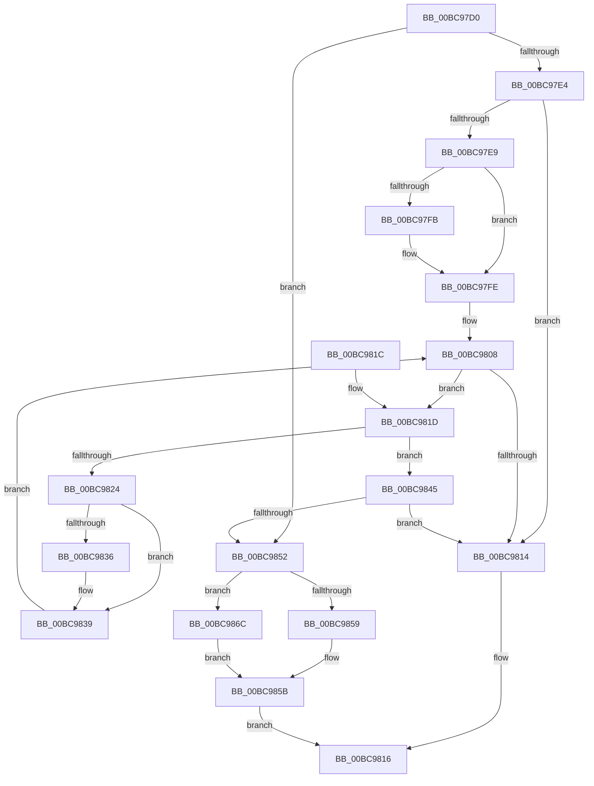

# CmpPerformKeyBodyDeletionCheck

- RVA: `0x00BC97D0`–`0x00BC9870` (길이 `160` bytes)
- VA: `0x0000000140BC97D0`
- 실행 섹션: `PAGECMRC`
- PDB 이름 있음: `예`; PDB Function 태그: `아니요`
- unwind 정보 RVA: `0x00063DA4`
- 디코드: `55`개 명령, `160/160` bytes 표시
- 미해석 바이트: `0` (있으면 어셈블리에 `.byte`로 보존)

> 이 문서는 커널 이미지의 기계어와 PDB 기호를 분석해 생성했습니다. 4번과 5번은 함수 원형과 자료형을 바이너리 사용 방식에서 추정한 C 해석이며 원본 소스 복구 결과는 아닙니다.

## 1. Dependencies

- 직접 호출 지점: **1**; 고유 호출 대상: **1**
- 직접 호출자로 확인된 함수: **31**
- RIP 상대 이미지 참조: **0**

### Outgoing calls
- `0x00BC9849` → [CmEqualTrans](../../page/84/CmEqualTrans_function_0084BF60.md) (function, `0x0084BF60`)

### Direct callers
- [CmpDoQueryKeyName](../../text/45/CmpDoQueryKeyName_function_00456664.md) at `0x00456826`
- [CmQueryLayeredKey](../../text/46/CmQueryLayeredKey_function_0046A930.md) at `0x0046AB0F`
- [CmpLoadKeyCommon](../../text/46/CmpLoadKeyCommon_function_0046E9F8.md) at `0x0046EBA0`
- [CmpSaveBootControlSet](../../page/7D/CmpSaveBootControlSet_function_007DC744.md) at `0x007DC99C`
- [CmpSaveBootControlSet](../../page/7D/CmpSaveBootControlSet_function_007DC744.md) at `0x007DC9B0`
- [CmSaveKey](../../page/7D/CmSaveKey_function_007DDBDC.md) at `0x007DDD16`
- [CmpLoadHiveVolatile](../../page/7D/CmpLoadHiveVolatile_function_007DE5F0.md) at `0x007DE7AA`
- [CmpRefreshHive](../../page/7D/CmpRefreshHive_function_007DEAD0.md) at `0x007DEB8D`
- [CmpRefreshHive](../../page/7D/CmpRefreshHive_function_007DEAD0.md) at `0x007DED23`
- [CmOpenKeyForBugCheckRecovery](../../page/7D/CmOpenKeyForBugCheckRecovery_function_007DF3C0.md) at `0x007DF4C2`
- [NtCompactKeys](../../page/7D/NtCompactKeys_function_007DF730.md) at `0x007DF8C0`
- [NtCompressKey](../../page/7D/NtCompressKey_function_007DF9D0.md) at `0x007DFAAF`
- [NtQueryOpenSubKeys](../../page/7D/NtQueryOpenSubKeys_function_007DFF80.md) at `0x007E00A5`
- [NtQueryOpenSubKeysEx](../../page/7E/NtQueryOpenSubKeysEx_function_007E0190.md) at `0x007E0347`
- [CmRenameKey](../../page/7E/CmRenameKey_function_007E8F48.md) at `0x007E911F`
- [CmRenameKey](../../page/7E/CmRenameKey_function_007E8F48.md) at `0x007E916A`
- [CmpAssignKeySecurity](../../page/7E/CmpAssignKeySecurity_function_007EC8B0.md) at `0x007EC93A`
- [CmSetLastWriteTimeKey](../../page/84/CmSetLastWriteTimeKey_function_00843368.md) at `0x0084342F`
- [CmSetLastWriteTimeKey](../../page/84/CmSetLastWriteTimeKey_function_00843368.md) at `0x00843476`
- [CmKeyBodyReplicateToVirtual](../../page/84/CmKeyBodyReplicateToVirtual_function_00843FE4.md) at `0x00844113`
- [sub_0084E4B5](../../page/84/Unknown_function_0084E4B5.md) at `0x0084E582`
- [sub_0084E7D5](../../page/84/Unknown_function_0084E7D5.md) at `0x0084E812`
- [sub_0084E7D5](../../page/84/Unknown_function_0084E7D5.md) at `0x0084EA78`
- [CmpSecurityMethod](../../page/87/CmpSecurityMethod_function_00870CC0.md) at `0x00870E97`
- [CmpSecurityMethod](../../page/87/CmpSecurityMethod_function_00870CC0.md) at `0x00871368`
- [NtEnumerateValueKey](../../page/8B/NtEnumerateValueKey_function_008B3B50.md) at `0x008B3F60`
- [NtEnumerateValueKey](../../page/8B/NtEnumerateValueKey_function_008B3B50.md) at `0x008B4682`
- [sub_008B4D32](../../page/8B/Unknown_function_008B4D32.md) at `0x008B4D88`
- [CmpEnumerateLayeredKey](../../page/94/CmpEnumerateLayeredKey_function_00945E58.md) at `0x00945F72`
- [CmpSetKeySecurity](../../page/94/CmpSetKeySecurity_function_0094A124.md) at `0x0094A24F`
- [CmpSetKeySecurity](../../page/94/CmpSetKeySecurity_function_0094A124.md) at `0x0094A283`
- [CmSetKeyFlags](../../page/9A/CmSetKeyFlags_function_009AEEA4.md) at `0x009AEF68`
- [CmSetKeyFlags](../../page/9A/CmSetKeyFlags_function_009AEEA4.md) at `0x009AF182`
- [CmpPerformUnloadKey](../../page/9A/CmpPerformUnloadKey_function_009AFA28.md) at `0x009AFAD1`
- [CmLockKeyForWrite](../../page/9E/CmLockKeyForWrite_function_009E7EE8.md) at `0x009E7F33`
- [NtFlushKey](../../page/A8/NtFlushKey_function_00A8A030.md) at `0x00A8A175`
- [CmQueryMultipleValueForLayeredKey](../../page/A8/CmQueryMultipleValueForLayeredKey_function_00A8DE80.md) at `0x00A8DF97`
- [CmKeyBodyRemapToVirtual](../../page/AC/CmKeyBodyRemapToVirtual_function_00AC9494.md) at `0x00AC95B3`
- [CmpIsKeyBodyEligibleForDump](CmpIsKeyBodyEligibleForDump_function_00BC926C.md) at `0x00BC928B`
- [CmpAcquireSystemDriverHiveContext](../../init/C5/CmpAcquireSystemDriverHiveContext_function_00C56514.md) at `0x00C5652C`

### Static image references
- 디코드된 RIP-relative 메모리 참조가 없습니다.

## 2. Other-region calls and transfers

- 다른 실행 섹션으로 향하는 call: **1**
  - `0x00BC9849` → [CmEqualTrans](../../page/84/CmEqualTrans_function_0084BF60.md) (`PAGECMRC` → `PAGE`)
- 별도 외부 분기/꼬리 이동을 확인하지 못했습니다.

## 3. Assembly (complete function range)

```asm
00BC97D0  40 53                           push rbx
00BC97D2  48 83 EC 20                     sub rsp, 0x20
00BC97D6  8B 41 30                        mov eax, dword ptr [rcx + 0x30]
00BC97D9  48 8B D9                        mov rbx, rcx
00BC97DC  4C 8B 49 08                     mov r9, qword ptr [rcx + 8]
00BC97E0  A8 09                           test al, 9
00BC97E2  75 6E                           jne 0x140bc9852
00BC97E4  48 85 D2                        test rdx, rdx
00BC97E7  74 2B                           je 0x140bc9814
00BC97E9  49 81 C1 D0 00 00 00            add r9, 0xd0
00BC97F0  4D 8B 19                        mov r11, qword ptr [r9]
00BC97F3  49 8B C3                        mov rax, r11
00BC97F6  4D 3B CB                        cmp r9, r11
00BC97F9  74 03                           je 0x140bc97fe
00BC97FB  49 8B 03                        mov rax, qword ptr [r11]
00BC97FE  45 33 C0                        xor r8d, r8d
00BC9801  49 8D 4B E0                     lea rcx, [r11 - 0x20]
00BC9805  4D 3B CB                        cmp r9, r11
00BC9808  4C 0F 45 C1                     cmovne r8, rcx
00BC980C  48 8B C8                        mov rcx, rax
00BC980F  4D 85 C0                        test r8, r8
00BC9812  75 09                           jne 0x140bc981d
00BC9814  33 C0                           xor eax, eax
00BC9816  48 83 C4 20                     add rsp, 0x20
00BC981A  5B                              pop rbx
00BC981B  C3                              ret
00BC981C  CC                              int3
00BC981D  41 83 78 44 02                  cmp dword ptr [r8 + 0x44], 2
00BC9822  74 21                           je 0x140bc9845
00BC9824  48 85 C9                        test rcx, rcx
00BC9827  49 8B C3                        mov rax, r11
00BC982A  48 0F 45 C1                     cmovne rax, rcx
00BC982E  4C 8B D0                        mov r10, rax
00BC9831  4C 3B C8                        cmp r9, rax
00BC9834  74 03                           je 0x140bc9839
00BC9836  48 8B 00                        mov rax, qword ptr [rax]
00BC9839  45 33 C0                        xor r8d, r8d
00BC983C  49 8D 4A E0                     lea rcx, [r10 - 0x20]
00BC9840  4D 3B CA                        cmp r9, r10
00BC9843  EB C3                           jmp 0x140bc9808
00BC9845  49 8B 48 38                     mov rcx, qword ptr [r8 + 0x38]
00BC9849  E8 12 27 C8 FF                  call 0x14084bf60
00BC984E  84 C0                           test al, al
00BC9850  74 C2                           je 0x140bc9814
00BC9852  8B 43 30                        mov eax, dword ptr [rbx + 0x30]
00BC9855  A8 01                           test al, 1
00BC9857  74 13                           je 0x140bc986c
00BC9859  B1 01                           mov cl, 1
00BC985B  84 C9                           test cl, cl
00BC985D  B8 25 04 00 C0                  mov eax, 0xc0000425
00BC9862  BA 7C 01 00 C0                  mov edx, 0xc000017c
00BC9867  0F 44 C2                        cmove eax, edx
00BC986A  EB AA                           jmp 0x140bc9816
00BC986C  32 C9                           xor cl, cl
00BC986E  EB EB                           jmp 0x140bc985b
```

## 4. C-style interpretation (structured pseudocode)

```c
__int64 __fastcall CmpPerformKeyBodyDeletionCheck(__int64 a1, __int64 a2, int a3)
{
    __int64 result;
    __int64 v_rsp;

    v_rsp = (v_rsp) - (32);
    if ((((unsigned __int8)((unsigned int)(*(unsigned int *)(a1 + 48)))) & (9)) != 0) goto loc_00BC9852;
    if (a2 == 0) goto loc_00BC9814;
    a4 = (*(unsigned __int64 *)(a1 + 8)) + (208);
    result = *(unsigned __int64 *)(a4);
    if (a4 != (*(unsigned __int64 *)(a4))) {
        result = *(unsigned __int64 *)(*(unsigned __int64 *)(a4));
    }
    a3 = 0;
loc_00BC9808:
    if (a4 != (*(unsigned __int64 *)(a4))) { a3 = *(unsigned __int64 *)(a4) - 32; }
    if (a3 != 0) goto loc_00BC981D;
loc_00BC9814:
    result = 0;
loc_00BC9816:
    v_rsp = (v_rsp) + (32);
    return result;
loc_00BC981D:
    if ((*(unsigned int *)(a3 + 68)) == 2) goto loc_00BC9845;
    result = *(unsigned __int64 *)(a4);
    if (0 != 0) { result = 0; }
    if (a4 != result) {
        result = *(unsigned __int64 *)(result);
    }
    a3 = 0;
    goto loc_00BC9808;
loc_00BC9845:
    result = CmEqualTrans(*(unsigned __int64 *)(a3 + 56), a2, a3, a4);
    if ((unsigned __int8)(result) == 0) goto loc_00BC9814;
loc_00BC9852:
    if ((((unsigned __int8)((unsigned int)(*(unsigned int *)(a1 + 48)))) & (1)) == 0) goto loc_00BC986C;
loc_00BC985B:
    result = (unsigned int)(0xC0000425ULL);
    if (1 == 0) { result = (unsigned int)((unsigned int)(0xC000017CULL)); }
    goto loc_00BC9816;
loc_00BC986C:
    a1 = 0;
    goto loc_00BC985B;
}
```

## 5. (Beta) C Style

```c
int64_t CmpPerformKeyBodyDeletionCheck(void *Arg1, int64_t Arg2, int32_t Arg3)
{
    uint8_t *arg1 = (uint8_t *)Arg1;

    int64_t result;
    int64_t local_rsp;

    local_rsp = (local_rsp) - (32);
    if ((((uint8_t)((uint32_t)(*(uint32_t *)(arg1 + 0x30)))) & (9)) != 0) goto loc_00BC9852;
    if (Arg2 == 0) goto loc_00BC9814;
    a4 = (*(uint64_t *)(arg1 + 0x8)) + (208);
    result = *(uint64_t *)(a4);
    if (a4 != (*(uint64_t *)(a4))) {
        result = *(uint64_t *)(*(uint64_t *)(a4));
    }
    Arg3 = 0;
loc_00BC9808:
    if (a4 != (*(uint64_t *)(a4))) { Arg3 = *(uint64_t *)(a4) - 32; }
    if (Arg3 != 0) goto loc_00BC981D;
loc_00BC9814:
    result = 0;
loc_00BC9816:
    local_rsp = (local_rsp) + (32);
    return result;
loc_00BC981D:
    if ((*(uint32_t *)(Arg3 + 0x44)) == 2) goto loc_00BC9845;
    result = *(uint64_t *)(a4);
    if (0 != 0) { result = 0; }
    if (a4 != result) {
        result = *(uint64_t *)(result);
    }
    Arg3 = 0;
    goto loc_00BC9808;
loc_00BC9845:
    result = CmEqualTrans(*(uint64_t *)(Arg3 + 0x38), Arg2, Arg3, a4);
    if ((uint8_t)(result) == 0) goto loc_00BC9814;
loc_00BC9852:
    if ((((uint8_t)((uint32_t)(*(uint32_t *)(arg1 + 0x30)))) & (1)) == 0) goto loc_00BC986C;
loc_00BC985B:
    result = (uint32_t)(0xC0000425ULL);
    if (1 == 0) { result = (uint32_t)((uint32_t)(0xC000017CULL)); }
    goto loc_00BC9816;
loc_00BC986C:
    Arg1 = 0;
    goto loc_00BC985B;
}
```

### 관측된 메모리 오프셋

구조체 형식이 확인되지 않은 접근은 인자 기준의 오프셋으로만 기록했습니다.

| 기준 인자 | 오프셋 표현 | 폭 (bit) | 접근 |
|---|---:|---:|---|
| `Arg1` | `+ 0x8` | `64` | `R` |
| `Arg1` | `+ 0x30` | `32` | `R` |

## 6. Execution-region graph

[열기: 2D/3D 그래프와 함수 탐색 컨트롤 패널](../../../control-panel.html?section=pagecmrc&rva=0x00BC97D0&view=graph)

- 2D 그래프는 위에서 아래로 흐르고, 3D 그래프는 빈 공간을 드래그해 회전합니다. Shift+드래그는 이동, 휠은 확대·축소, 함수 노드 선택은 대상 보고서 이동입니다.

### Static fallback


