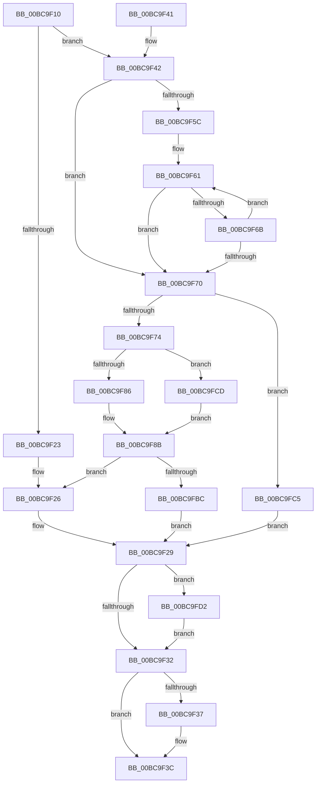

# CmpSplitParentKeyName

- RVA: `0x00BC9F10`–`0x00BC9FDC` (길이 `204` bytes)
- VA: `0x0000000140BC9F10`
- 실행 섹션: `PAGECMRC`
- PDB 이름 있음: `예`; PDB Function 태그: `아니요`
- unwind 정보 RVA: `0x000B4C18`
- 디코드: `58`개 명령, `204/204` bytes 표시
- 미해석 바이트: `0` (있으면 어셈블리에 `.byte`로 보존)

> 이 문서는 커널 이미지의 기계어와 PDB 기호를 분석해 생성했습니다. 4번과 5번은 함수 원형과 자료형을 바이너리 사용 방식에서 추정한 C 해석이며 원본 소스 복구 결과는 아닙니다.

## 1. Dependencies

- 직접 호출 지점: **0**; 고유 호출 대상: **0**
- 직접 호출자로 확인된 함수: **3**
- RIP 상대 이미지 참조: **0**

### Outgoing calls
- 직접 디코드된 call 명령이 없습니다.

### Direct callers
- [CmpDoReDoCreateKey](../../page/7F/CmpDoReDoCreateKey_function_007F75C8.md) at `0x007F760F`
- [CmpDoReOpenTransKey](../../page/7F/CmpDoReOpenTransKey_function_007F78E8.md) at `0x007F7A1A`
- [CmLoadAppKey](../../page/87/CmLoadAppKey_function_00876FFC.md) at `0x00877801`

### Static image references
- 디코드된 RIP-relative 메모리 참조가 없습니다.

## 2. Other-region calls and transfers

- 다른 실행 섹션으로 향하는 call: **0**
- 별도 외부 분기/꼬리 이동을 확인하지 못했습니다.

## 3. Assembly (complete function range)

```asm
00BC9F10  48 83 EC 28                     sub rsp, 0x28
00BC9F14  45 33 DB                        xor r11d, r11d
00BC9F17  4C 8B D2                        mov r10, rdx
00BC9F1A  4C 8B C9                        mov r9, rcx
00BC9F1D  66 44 39 19                     cmp word ptr [rcx], r11w
00BC9F21  75 1F                           jne 0x140bc9f42
00BC9F23  0F 57 C0                        xorps xmm0, xmm0
00BC9F26  0F 57 C9                        xorps xmm1, xmm1
00BC9F29  4D 85 D2                        test r10, r10
00BC9F2C  0F 85 A0 00 00 00               jne 0x140bc9fd2
00BC9F32  4D 85 C0                        test r8, r8
00BC9F35  74 05                           je 0x140bc9f3c
00BC9F37  F3 41 0F 7F 08                  movdqu xmmword ptr [r8], xmm1
00BC9F3C  48 83 C4 28                     add rsp, 0x28
00BC9F40  C3                              ret
00BC9F41  CC                              int3
00BC9F42  0F 10 09                        movups xmm1, xmmword ptr [rcx]
00BC9F45  66 0F 7E C8                     movd eax, xmm1
00BC9F49  0F 11 0C 24                     movups xmmword ptr [rsp], xmm1
00BC9F4D  0F B7 D0                        movzx edx, ax
00BC9F50  D1 EA                           shr edx, 1
00BC9F52  83 EA 01                        sub edx, 1
00BC9F55  0F 11 4C 24 10                  movups xmmword ptr [rsp + 0x10], xmm1
00BC9F5A  78 14                           js 0x140bc9f70
00BC9F5C  48 8B 4C 24 18                  mov rcx, qword ptr [rsp + 0x18]
00BC9F61  48 63 C2                        movsxd rax, edx
00BC9F64  66 83 3C 41 5C                  cmp word ptr [rcx + rax*2], 0x5c
00BC9F69  74 05                           je 0x140bc9f70
00BC9F6B  83 EA 01                        sub edx, 1
00BC9F6E  79 F1                           jns 0x140bc9f61
00BC9F70  85 D2                           test edx, edx
00BC9F72  78 51                           js 0x140bc9fc5
00BC9F74  0F B7 CA                        movzx ecx, dx
00BC9F77  66 03 C9                        add cx, cx
00BC9F7A  66 89 4C 24 10                  mov word ptr [rsp + 0x10], cx
00BC9F7F  66 89 4C 24 12                  mov word ptr [rsp + 0x12], cx
00BC9F84  74 47                           je 0x140bc9fcd
00BC9F86  0F 10 44 24 10                  movups xmm0, xmmword ptr [rsp + 0x10]
00BC9F8B  B8 FE FF 00 00                  mov eax, 0xfffe
00BC9F90  66 2B C1                        sub ax, cx
00BC9F93  0F B7 0C 24                     movzx ecx, word ptr [rsp]
00BC9F97  66 03 C8                        add cx, ax
00BC9F9A  8D 42 01                        lea eax, [rdx + 1]
00BC9F9D  66 89 0C 24                     mov word ptr [rsp], cx
00BC9FA1  66 89 4C 24 02                  mov word ptr [rsp + 2], cx
00BC9FA6  48 63 C8                        movsxd rcx, eax
00BC9FA9  49 8B 41 08                     mov rax, qword ptr [r9 + 8]
00BC9FAD  48 8D 0C 48                     lea rcx, [rax + rcx*2]
00BC9FB1  48 89 4C 24 08                  mov qword ptr [rsp + 8], rcx
00BC9FB6  0F 84 6A FF FF FF               je 0x140bc9f26
00BC9FBC  0F 10 0C 24                     movups xmm1, xmmword ptr [rsp]
00BC9FC0  E9 64 FF FF FF                  jmp 0x140bc9f29
00BC9FC5  0F 57 C0                        xorps xmm0, xmm0
00BC9FC8  E9 5C FF FF FF                  jmp 0x140bc9f29
00BC9FCD  0F 57 C0                        xorps xmm0, xmm0
00BC9FD0  EB B9                           jmp 0x140bc9f8b
00BC9FD2  F3 41 0F 7F 02                  movdqu xmmword ptr [r10], xmm0
00BC9FD7  E9 56 FF FF FF                  jmp 0x140bc9f32
```

## 4. C-style interpretation (structured pseudocode)

```c
__int64 __fastcall CmpSplitParentKeyName(__int64 a1, __int64 a2, __int64 a3)
{
    __int64 result;
    __int64 v_r11;
    __int64 v_rsp;
    unsigned __int64 v_stack_p0;
    unsigned __int64 v_stack_p10;
    unsigned __int16 v_stack_p12;
    unsigned __int64 v_stack_p18;
    unsigned __int16 v_stack_p2;
    unsigned __int64 v_stack_p8;

    v_rsp = (v_rsp) - (40);
    v_r11 = 0;
    if ((*(unsigned __int16 *)(a1)) != 0) goto loc_00BC9F42;
loc_00BC9F26:
loc_00BC9F29:
    if (a2 != 0) goto loc_00BC9FD2;
loc_00BC9F32:
    if (a3 != 0) {
        *(unsigned __int64 *)(a3) = v_xmm1;
    }
    v_rsp = (v_rsp) + (40);
    return result;
loc_00BC9F42:
    v_stack_p0 = v_xmm1;
    a2 = (unsigned int)(((unsigned __int16)(result)) >> (1));
    a2 = (unsigned int)((a2) - (1));
    v_stack_p10 = v_xmm1;
    if (sign_flag) goto loc_00BC9F70;
loc_00BC9F61:
    if ((*(unsigned __int16 *)(v_stack_p18 + (int)((unsigned int)(a2)) * 2)) == 92) goto loc_00BC9F70;
    a2 = (unsigned int)((a2) - (1));
    if (!sign_flag) goto loc_00BC9F61;
loc_00BC9F70:
    if (sign_flag) goto loc_00BC9FC5;
    a1 = (unsigned __int16)(((unsigned __int16)(a2)) + ((unsigned __int16)((unsigned __int16)(a2))));
    v_stack_p10 = (unsigned __int16)(a1);
    v_stack_p12 = (unsigned __int16)(a1);
    if (condition_is_equal) goto loc_00BC9FCD;
loc_00BC9F8B:
    result = (unsigned __int16)(((unsigned int)(0xFFFEULL)) - ((unsigned __int16)(a1)));
    a1 = (unsigned __int16)((v_stack_p0) + ((unsigned __int16)(result)));
    v_stack_p0 = (unsigned __int16)(a1);
    v_stack_p2 = (unsigned __int16)(a1);
    v_stack_p8 = *(unsigned __int64 *)(a1 + 8) + (int)((unsigned int)(a2 + 1)) * 2;
    if (condition_is_equal) goto loc_00BC9F26;
    goto loc_00BC9F29;
loc_00BC9FC5:
    goto loc_00BC9F29;
loc_00BC9FCD:
    goto loc_00BC9F8B;
loc_00BC9FD2:
    *(unsigned __int64 *)(a2) = v_xmm0;
    goto loc_00BC9F32;
}
```

## 5. (Beta) C Style

```c
int64_t CmpSplitParentKeyName(void *Arg1, int64_t Arg2, int64_t Arg3)
{
    uint8_t *arg1 = (uint8_t *)Arg1;

    int64_t result;
    int64_t local_r11;
    int64_t local_rsp;
    uint64_t v_stack_p0;
    uint64_t v_stack_p10;
    uint16_t v_stack_p12;
    uint64_t v_stack_p18;
    uint16_t v_stack_p2;
    uint64_t v_stack_p8;

    local_rsp = (local_rsp) - (40);
    local_r11 = 0;
    if ((*(uint16_t *)(arg1)) != 0) goto loc_00BC9F42;
loc_00BC9F26:
loc_00BC9F29:
    if (Arg2 != 0) goto loc_00BC9FD2;
loc_00BC9F32:
    if (Arg3 != 0) {
        *(uint64_t *)(Arg3) = v_xmm1;
    }
    local_rsp = (local_rsp) + (40);
    return result;
loc_00BC9F42:
    v_stack_p0 = v_xmm1;
    Arg2 = (uint32_t)(((uint16_t)(result)) >> (1));
    Arg2 = (uint32_t)((Arg2) - (1));
    v_stack_p10 = v_xmm1;
    if (sign_flag) goto loc_00BC9F70;
loc_00BC9F61:
    if ((*(uint16_t *)(v_stack_p18 + (int32_t)((uint32_t)(Arg2)) * 2)) == 92) goto loc_00BC9F70;
    Arg2 = (uint32_t)((Arg2) - (1));
    if (!sign_flag) goto loc_00BC9F61;
loc_00BC9F70:
    if (sign_flag) goto loc_00BC9FC5;
    Arg1 = (uint16_t)(((uint16_t)(Arg2)) + ((uint16_t)((uint16_t)(Arg2))));
    v_stack_p10 = (uint16_t)(Arg1);
    v_stack_p12 = (uint16_t)(Arg1);
    if (condition_is_equal) goto loc_00BC9FCD;
loc_00BC9F8B:
    result = (uint16_t)(((uint32_t)(0xFFFEULL)) - ((uint16_t)(Arg1)));
    Arg1 = (uint16_t)((v_stack_p0) + ((uint16_t)(result)));
    v_stack_p0 = (uint16_t)(Arg1);
    v_stack_p2 = (uint16_t)(Arg1);
    v_stack_p8 = *(uint64_t *)(arg1 + 0x8) + (int32_t)((uint32_t)(Arg2 + 1)) * 2;
    if (condition_is_equal) goto loc_00BC9F26;
    goto loc_00BC9F29;
loc_00BC9FC5:
    goto loc_00BC9F29;
loc_00BC9FCD:
    goto loc_00BC9F8B;
loc_00BC9FD2:
    *(uint64_t *)(Arg2) = v_xmm0;
    goto loc_00BC9F32;
}
```

### 관측된 메모리 오프셋

구조체 형식이 확인되지 않은 접근은 인자 기준의 오프셋으로만 기록했습니다.

| 기준 인자 | 오프셋 표현 | 폭 (bit) | 접근 |
|---|---:|---:|---|
| `Arg1` | `+ 0x0` | `16` | `R` |
| `Arg1` | `+ 0x0` | `128` | `R` |
| `Arg1` | `+ 0x8` | `64` | `R` |

## 6. Execution-region graph

[열기: 2D/3D 그래프와 함수 탐색 컨트롤 패널](../../../control-panel.html?section=pagecmrc&rva=0x00BC9F10&view=graph)

- 2D 그래프는 위에서 아래로 흐르고, 3D 그래프는 빈 공간을 드래그해 회전합니다. Shift+드래그는 이동, 휠은 확대·축소, 함수 노드 선택은 대상 보고서 이동입니다.

### Static fallback


