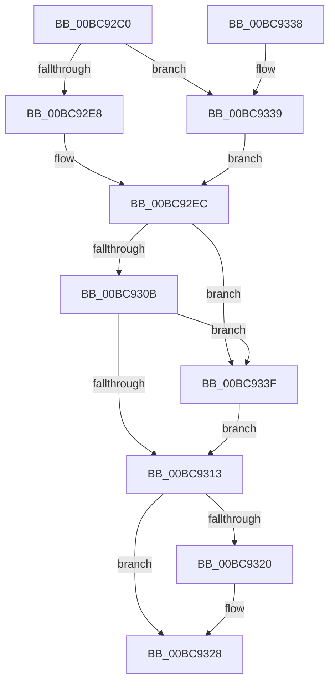

# CmpUnlockKcb

- RVA: `0x00BC92C0`–`0x00BC934A` (길이 `138` bytes)
- VA: `0x0000000140BC92C0`
- 실행 섹션: `PAGECMRC`
- PDB 이름 있음: `예`; PDB Function 태그: `아니요`
- unwind 정보 RVA: `0x00078D6C`
- 디코드: `40`개 명령, `138/138` bytes 표시
- 미해석 바이트: `0` (있으면 어셈블리에 `.byte`로 보존)

> 이 문서는 커널 이미지의 기계어와 PDB 기호를 분석해 생성했습니다. 4번과 5번은 함수 원형과 자료형을 바이너리 사용 방식에서 추정한 C 해석이며 원본 소스 복구 결과는 아닙니다.

## 1. Dependencies

- 직접 호출 지점: **4**; 고유 호출 대상: **4**
- 직접 호출자로 확인된 함수: **58**
- RIP 상대 이미지 참조: **0**

### Outgoing calls
- `0x00BC92DB` → [CmpIsKcbLockedExclusive](../../page/9A/CmpIsKcbLockedExclusive_function_009A71D0.md) (function, `0x009A71D0`)
- `0x00BC9317` → [KeAbPostRelease](../../text/2E/KeAbPostRelease_function_002E1600.md) (function, `0x002E1600`)
- `0x00BC9323` → [CmpDecommisssionKcb](../../page/86/CmpDecommisssionKcb_function_00862750.md) (function, `0x00862750`)
- `0x00BC9343` → [ExfReleasePushLock](../../text/26/ExfReleasePushLock_function_002638D0.md) (function, `0x002638D0`)

### Direct callers
- [sub_0041B9B6](../../text/41/Unknown_function_0041B9B6.md) at `0x0041BA3E`
- [sub_0041B9B6](../../text/41/Unknown_function_0041B9B6.md) at `0x0041BA4B`
- [sub_0041BA7B](../../text/41/Unknown_function_0041BA7B.md) at `0x0041BA8B`
- [CmpDoQueryKeyName](../../text/45/CmpDoQueryKeyName_function_00456664.md) at `0x0045686F`
- [CmpDoQueryKeyName](../../text/45/CmpDoQueryKeyName_function_00456664.md) at `0x00456926`
- [CmpRemoveHiveFromNamespace](../../text/49/CmpRemoveHiveFromNamespace_function_0049C4CC.md) at `0x0049C566`
- [CmpRemoveHiveFromNamespace](../../text/49/CmpRemoveHiveFromNamespace_function_0049C4CC.md) at `0x0049C56E`
- [CmDumpKeyToFile](../../page/7D/CmDumpKeyToFile_function_007DCD64.md) at `0x007DCDCA`
- [CmDumpKeyToFile](../../page/7D/CmDumpKeyToFile_function_007DCD64.md) at `0x007DCE7A`
- [CmDumpKeyToFile](../../page/7D/CmDumpKeyToFile_function_007DCD64.md) at `0x007DCED8`
- [CmRestoreKey](../../page/7D/CmRestoreKey_function_007DCF04.md) at `0x007DD296`
- [CmRestoreKey](../../page/7D/CmRestoreKey_function_007DCF04.md) at `0x007DDAFE`
- [CmpRefreshHive](../../page/7D/CmpRefreshHive_function_007DEAD0.md) at `0x007DEBA9`
- [CmpRefreshHive](../../page/7D/CmpRefreshHive_function_007DEAD0.md) at `0x007DEC27`
- [CmpReplicateKeyToVirtual](../../page/7E/CmpReplicateKeyToVirtual_function_007EBAEC.md) at `0x007EBBA3`
- [CmpGlobalUnlockKeyForWrite](../../page/7E/CmpGlobalUnlockKeyForWrite_function_007EDD80.md) at `0x007EDE03`
- [CmpGlobalUnlockKeyForWrite](../../page/7E/CmpGlobalUnlockKeyForWrite_function_007EDD80.md) at `0x007EDE36`
- [CmpEnlistKeyBody](../../page/84/CmpEnlistKeyBody_function_008425C0.md) at `0x00842694`
- [CmKeyBodyReplicateToVirtual](../../page/84/CmKeyBodyReplicateToVirtual_function_00843FE4.md) at `0x00844194`
- [CmKeyBodyReplicateToVirtual](../../page/84/CmKeyBodyReplicateToVirtual_function_00843FE4.md) at `0x0084420F`
- [CmKeyBodyReplicateToVirtual](../../page/84/CmKeyBodyReplicateToVirtual_function_00843FE4.md) at `0x00844237`
- [CmKeyBodyReplicateToVirtual](../../page/84/CmKeyBodyReplicateToVirtual_function_00843FE4.md) at `0x0084431F`
- [CmSetValueKey](../../page/84/CmSetValueKey_function_008457C0.md) at `0x00845AF3`
- [CmSetValueKey](../../page/84/CmSetValueKey_function_008457C0.md) at `0x00845C70`
- [CmSetValueKey](../../page/84/CmSetValueKey_function_008457C0.md) at `0x00846046`
- [CmSetValueKey](../../page/84/CmSetValueKey_function_008457C0.md) at `0x008462B5`
- [CmQueryMultipleValueKey](../../page/84/CmQueryMultipleValueKey_function_00846EC0.md) at `0x0084741C`
- [CmQueryMultipleValueKey](../../page/84/CmQueryMultipleValueKey_function_00846EC0.md) at `0x008474B8`
- [CmpUnlockKcbStack](../../page/84/CmpUnlockKcbStack_function_00848460.md) at `0x00848484`
- [CmpUnlockTwoKcbs](../../page/84/CmpUnlockTwoKcbs_function_0084869C.md) at `0x008486AF`
- [CmpUnlockTwoKcbs](../../page/84/CmpUnlockTwoKcbs_function_0084869C.md) at `0x008486EC`
- [CmKeyBodyNeedsVirtualImage](../../page/84/CmKeyBodyNeedsVirtualImage_function_00849864.md) at `0x008498CF`
- [sub_0084D304](../../page/84/Unknown_function_0084D304.md) at `0x0084D330`
- [sub_0084E4B5](../../page/84/Unknown_function_0084E4B5.md) at `0x0084E75C`
- [sub_0084E7D5](../../page/84/Unknown_function_0084E7D5.md) at `0x0084E90F`
- [sub_0084E7D5](../../page/84/Unknown_function_0084E7D5.md) at `0x0084E922`
- [sub_0084E7D5](../../page/84/Unknown_function_0084E7D5.md) at `0x0084EA37`
- [CmpPerformCompleteKcbCacheLookup](../../page/84/CmpPerformCompleteKcbCacheLookup_function_0084FD20.md) at `0x008501F5`
- [CmpPerformCompleteKcbCacheLookup](../../page/84/CmpPerformCompleteKcbCacheLookup_function_0084FD20.md) at `0x008506D3`
- [CmpPerformCompleteKcbCacheLookup](../../page/84/CmpPerformCompleteKcbCacheLookup_function_0084FD20.md) at `0x008506E0`
- [CmpPerformCompleteKcbCacheLookup](../../page/84/CmpPerformCompleteKcbCacheLookup_function_0084FD20.md) at `0x00850979`
- [CmpPerformCompleteKcbCacheLookup](../../page/84/CmpPerformCompleteKcbCacheLookup_function_0084FD20.md) at `0x008509B5`
- [CmpPerformCompleteKcbCacheLookup](../../page/84/CmpPerformCompleteKcbCacheLookup_function_0084FD20.md) at `0x00850A7A`
- [CmpPerformCompleteKcbCacheLookup](../../page/84/CmpPerformCompleteKcbCacheLookup_function_0084FD20.md) at `0x00850C69`
- [CmpPerformCompleteKcbCacheLookup](../../page/84/CmpPerformCompleteKcbCacheLookup_function_0084FD20.md) at `0x00850EFB`
- [CmpPerformCompleteKcbCacheLookup](../../page/84/CmpPerformCompleteKcbCacheLookup_function_0084FD20.md) at `0x00850F08`
- [CmpPerformCompleteKcbCacheLookup](../../page/84/CmpPerformCompleteKcbCacheLookup_function_0084FD20.md) at `0x00851032`
- [sub_008515D5](../../page/85/Unknown_function_008515D5.md) at `0x008518B7`
- [sub_008515D5](../../page/85/Unknown_function_008515D5.md) at `0x008518C4`
- [sub_00851A5C](../../page/85/Unknown_function_00851A5C.md) at `0x00851A70`
- [CmpCreateKeyControlBlock](../../page/85/CmpCreateKeyControlBlock_function_00851DB0.md) at `0x00852284`
- [CmpCreateKeyControlBlock](../../page/85/CmpCreateKeyControlBlock_function_00851DB0.md) at `0x008524EB`
- [CmpCreateKeyControlBlock](../../page/85/CmpCreateKeyControlBlock_function_00851DB0.md) at `0x008524F3`
- [CmpCreateKeyControlBlock](../../page/85/CmpCreateKeyControlBlock_function_00851DB0.md) at `0x00852509`
- [CmpCreateKeyControlBlock](../../page/85/CmpCreateKeyControlBlock_function_00851DB0.md) at `0x00852663`
- [CmpCreateKeyControlBlock](../../page/85/CmpCreateKeyControlBlock_function_00851DB0.md) at `0x0085266B`
- [CmpCreateKeyControlBlock](../../page/85/CmpCreateKeyControlBlock_function_00851DB0.md) at `0x008526FC`
- [CmpCreateKeyControlBlock](../../page/85/CmpCreateKeyControlBlock_function_00851DB0.md) at `0x00852704`
- [CmpWalkOneLevel](../../page/85/CmpWalkOneLevel_function_00852BA0.md) at `0x00853133`
- [sub_008551B7](../../page/85/Unknown_function_008551B7.md) at `0x008553F6`
- [CmpGetSymbolicLinkTarget](../../page/85/CmpGetSymbolicLinkTarget_function_008570A0.md) at `0x008572A3`
- [CmpGetSymbolicLinkTarget](../../page/85/CmpGetSymbolicLinkTarget_function_008570A0.md) at `0x008574F0`
- [sub_00858022](../../page/85/Unknown_function_00858022.md) at `0x0085805A`
- [CmQueryKey](../../page/85/CmQueryKey_function_00858240.md) at `0x00858BE6`
- [CmQueryKey](../../page/85/CmQueryKey_function_00858240.md) at `0x00858C7B`
- [CmQueryKey](../../page/85/CmQueryKey_function_00858240.md) at `0x00858D7E`
- [sub_0085E709](../../page/85/Unknown_function_0085E709.md) at `0x0085E73B`
- [sub_0085E709](../../page/85/Unknown_function_0085E709.md) at `0x0085E743`
- [sub_0085E7B7](../../page/85/Unknown_function_0085E7B7.md) at `0x0085E898`
- [sub_0085E942](../../page/85/Unknown_function_0085E942.md) at `0x0085E975`
- [sub_0085EABD](../../page/85/Unknown_function_0085EABD.md) at `0x0085EB18`
- [CmpDoParseKey](../../page/85/CmpDoParseKey_function_0085F750.md) at `0x0085FB3B`
- [CmpDoParseKey](../../page/85/CmpDoParseKey_function_0085F750.md) at `0x0085FDE9`
- [CmpDoParseKey](../../page/85/CmpDoParseKey_function_0085F750.md) at `0x008601BB`
- [CmpDoParseKey](../../page/85/CmpDoParseKey_function_0085F750.md) at `0x008601FC`
- [CmpDoParseKey](../../page/85/CmpDoParseKey_function_0085F750.md) at `0x00860572`
- [CmpDoParseKey](../../page/85/CmpDoParseKey_function_0085F750.md) at `0x008605C4`
- [CmpDoParseKey](../../page/85/CmpDoParseKey_function_0085F750.md) at `0x008606C2`
- [CmpDoParseKey](../../page/85/CmpDoParseKey_function_0085F750.md) at `0x00860EBA`
- [CmpDoParseKey](../../page/85/CmpDoParseKey_function_0085F750.md) at `0x00861A4D`
- [CmpDoParseKey](../../page/85/CmpDoParseKey_function_0085F750.md) at `0x00861E51`
- [CmpDoParseKey](../../page/85/CmpDoParseKey_function_0085F750.md) at `0x00861E5E`
- [CmpCloseKeyObject](../../page/86/CmpCloseKeyObject_function_00863AD0.md) at `0x00863C7A`
- [CmpCloseKeyObject](../../page/86/CmpCloseKeyObject_function_00863AD0.md) at `0x00863CE1`
- [sub_0086560A](../../page/86/Unknown_function_0086560A.md) at `0x00865893`
- [sub_0086560A](../../page/86/Unknown_function_0086560A.md) at `0x0086597E`
- [CmpSecurityMethod](../../page/87/CmpSecurityMethod_function_00870CC0.md) at `0x00870F94`
- [NtEnumerateValueKey](../../page/8B/NtEnumerateValueKey_function_008B3B50.md) at `0x008B4071`
- [sub_008B4B26](../../page/8B/Unknown_function_008B4B26.md) at `0x008B4B84`
- [sub_008B4D32](../../page/8B/Unknown_function_008B4D32.md) at `0x008B4DB6`
- [sub_008C405D](../../page/8C/Unknown_function_008C405D.md) at `0x008C413A`
- [sub_0099FAAF](../../page/99/Unknown_function_0099FAAF.md) at `0x0099FB06`
- [CmpDelayCloseWorker](../../page/9D/CmpDelayCloseWorker_function_009DB8E0.md) at `0x009DBB44`
- [CmpDelayCloseWorker](../../page/9D/CmpDelayCloseWorker_function_009DB8E0.md) at `0x009DBB51`
- [CmpDelayCloseWorker](../../page/9D/CmpDelayCloseWorker_function_009DB8E0.md) at `0x009DBC9A`
- [sub_009DC3C2](../../page/9D/Unknown_function_009DC3C2.md) at `0x009DC4B0`
- [NtNotifyChangeMultipleKeys](../../page/9D/NtNotifyChangeMultipleKeys_function_009DC6B0.md) at `0x009DCCFB`
- [NtNotifyChangeMultipleKeys](../../page/9D/NtNotifyChangeMultipleKeys_function_009DC6B0.md) at `0x009DCE91`
- [NtNotifyChangeMultipleKeys](../../page/9D/NtNotifyChangeMultipleKeys_function_009DC6B0.md) at `0x009DD285`
- [CmLockKeyForWrite](../../page/9E/CmLockKeyForWrite_function_009E7EE8.md) at `0x009E7FFC`
- [CmpStartSiloRegistryNamespace](../../page/9E/CmpStartSiloRegistryNamespace_function_009E85D0.md) at `0x009E8783`
- [CmpEnumerateAllHigherLayerKcbs](../../page/A5/CmpEnumerateAllHigherLayerKcbs_function_00A55234.md) at `0x00A5531A`
- [CmpEnumerateAllHigherLayerKcbs](../../page/A5/CmpEnumerateAllHigherLayerKcbs_function_00A55234.md) at `0x00A553BA`
- [CmpSearchKeyControlBlockTreeEx](../../page/A6/CmpSearchKeyControlBlockTreeEx_function_00A65548.md) at `0x00A65678`
- [CmpSearchKeyControlBlockTreeEx](../../page/A6/CmpSearchKeyControlBlockTreeEx_function_00A65548.md) at `0x00A656DB`
- [CmpSearchKeyControlBlockTreeEx](../../page/A6/CmpSearchKeyControlBlockTreeEx_function_00A65548.md) at `0x00A656E9`
- [CmpSearchKeyControlBlockTreeEx](../../page/A6/CmpSearchKeyControlBlockTreeEx_function_00A65548.md) at `0x00A6570E`
- [CmpSearchKeyControlBlockTreeEx](../../page/A6/CmpSearchKeyControlBlockTreeEx_function_00A65548.md) at `0x00A65725`
- [NtFlushKey](../../page/A8/NtFlushKey_function_00A8A030.md) at `0x00A8A1B1`
- [NtFlushKey](../../page/A8/NtFlushKey_function_00A8A030.md) at `0x00A8A268`
- [NtFlushKey](../../page/A8/NtFlushKey_function_00A8A030.md) at `0x00A8A3D6`
- [CmKeyBodyRemapToVirtual](../../page/AC/CmKeyBodyRemapToVirtual_function_00AC9494.md) at `0x00AC95D7`
- [CmKeyBodyRemapToVirtual](../../page/AC/CmKeyBodyRemapToVirtual_function_00AC9494.md) at `0x00AC963E`
- [CmQueryKey$fin$0](../../page/B0/CmQueryKey_fin_0_function_00B0E530.md) at `0x00B0E563`
- [sub_00B169F2](../../page/B1/Unknown_function_00B169F2.md) at `0x00B16B02`
- [sub_00B16F66](../../page/B1/Unknown_function_00B16F66.md) at `0x00B17187`
- [sub_00B16F66](../../page/B1/Unknown_function_00B16F66.md) at `0x00B17274`
- [sub_00B3073E](../../page/B3/Unknown_function_00B3073E.md) at `0x00B3079E`
- [sub_00B3073E](../../page/B3/Unknown_function_00B3073E.md) at `0x00B307BD`
- [sub_00B37F04](../../page/B3/Unknown_function_00B37F04.md) at `0x00B37FAC`
- [sub_00B49062](../../page/B4/Unknown_function_00B49062.md) at `0x00B49135`
- [sub_00B49062](../../page/B4/Unknown_function_00B49062.md) at `0x00B4916D`
- [CmpDumpKeyToBuffer](CmpDumpKeyToBuffer_function_00BC9130.md) at `0x00BC91C3`
- [CmpDumpKeyToBuffer](CmpDumpKeyToBuffer_function_00BC9130.md) at `0x00BC9253`
- [CmpCreateRegistryRoot](../../init/C5/CmpCreateRegistryRoot_function_00C57880.md) at `0x00C579E8`

### Static image references
- 디코드된 RIP-relative 메모리 참조가 없습니다.

## 2. Other-region calls and transfers

- 다른 실행 섹션으로 향하는 call: **4**
  - `0x00BC92DB` → [CmpIsKcbLockedExclusive](../../page/9A/CmpIsKcbLockedExclusive_function_009A71D0.md) (`PAGECMRC` → `PAGE`)
  - `0x00BC9317` → [KeAbPostRelease](../../text/2E/KeAbPostRelease_function_002E1600.md) (`PAGECMRC` → `.text`)
  - `0x00BC9323` → [CmpDecommisssionKcb](../../page/86/CmpDecommisssionKcb_function_00862750.md) (`PAGECMRC` → `PAGE`)
  - `0x00BC9343` → [ExfReleasePushLock](../../text/26/ExfReleasePushLock_function_002638D0.md) (`PAGECMRC` → `.text`)
- 별도 외부 분기/꼬리 이동을 확인하지 못했습니다.

## 3. Assembly (complete function range)

```asm
00BC92C0  48 89 5C 24 08                  mov qword ptr [rsp + 8], rbx
00BC92C5  48 89 74 24 10                  mov qword ptr [rsp + 0x10], rsi
00BC92CA  57                              push rdi
00BC92CB  48 83 EC 20                     sub rsp, 0x20
00BC92CF  8B 71 08                        mov esi, dword ptr [rcx + 8]
00BC92D2  48 8B D9                        mov rbx, rcx
00BC92D5  81 E6 00 00 08 00               and esi, 0x80000
00BC92DB  E8 F0 DE DD FF                  call 0x1409a71d0
00BC92E0  45 33 C0                        xor r8d, r8d
00BC92E3  83 F8 01                        cmp eax, 1
00BC92E6  75 51                           jne 0x140bc9339
00BC92E8  4C 89 41 38                     mov qword ptr [rcx + 0x38], r8
00BC92EC  0F 0D 49 30                     prefetchw byte ptr [rcx + 0x30]
00BC92F0  48 8B 41 30                     mov rax, qword ptr [rcx + 0x30]
00BC92F4  48 8B C8                        mov rcx, rax
00BC92F7  48 83 E1 F0                     and rcx, 0xfffffffffffffff0
00BC92FB  48 83 F9 10                     cmp rcx, 0x10
00BC92FF  48 8D 50 F0                     lea rdx, [rax - 0x10]
00BC9303  49 0F 46 D0                     cmovbe rdx, r8
00BC9307  A8 02                           test al, 2
00BC9309  75 34                           jne 0x140bc933f
00BC930B  F0 48 0F B1 53 30               lock cmpxchg qword ptr [rbx + 0x30], rdx
00BC9311  75 2C                           jne 0x140bc933f
00BC9313  48 8D 4B 30                     lea rcx, [rbx + 0x30]
00BC9317  E8 E4 82 71 FF                  call 0x1402e1600
00BC931C  85 F6                           test esi, esi
00BC931E  74 08                           je 0x140bc9328
00BC9320  48 8B CB                        mov rcx, rbx
00BC9323  E8 28 94 C9 FF                  call 0x140862750
00BC9328  48 8B 5C 24 30                  mov rbx, qword ptr [rsp + 0x30]
00BC932D  48 8B 74 24 38                  mov rsi, qword ptr [rsp + 0x38]
00BC9332  48 83 C4 20                     add rsp, 0x20
00BC9336  5F                              pop rdi
00BC9337  C3                              ret
00BC9338  CC                              int3
00BC9339  F0 FF 49 38                     lock dec dword ptr [rcx + 0x38]
00BC933D  EB AD                           jmp 0x140bc92ec
00BC933F  48 8D 4B 30                     lea rcx, [rbx + 0x30]
00BC9343  E8 88 A5 69 FF                  call 0x1402638d0
00BC9348  EB C9                           jmp 0x140bc9313
```

## 4. C-style interpretation (structured pseudocode)

```c
__int64 __fastcall CmpUnlockKcb(__int64 a1, __int64 a2, int a3)
{
    __int64 result;
    __int64 v_rsi;
    __int64 v_rsp;
    unsigned __int64 v_stack_p10;
    unsigned __int64 v_stack_p8;

    v_stack_p8 = v_rbx;
    v_stack_p10 = v_rsi;
    v_rsp = (v_rsp) - (32);
    v_rsi = (unsigned int)(((unsigned int)(*(unsigned int *)(a1 + 8))) & (0x80000ULL));
    result = CmpIsKcbLockedExclusive(a1, a2, a3, a4);
    a3 = 0;
    if (((unsigned int)(result)) != 1) goto loc_00BC9339;
    *(unsigned __int64 *)(a1 + 56) = 0;
loc_00BC92EC:
    a1 = (*(unsigned __int64 *)(a1 + 48)) & (-16);
    a2 = *(unsigned __int64 *)(a1 + 48) - 16;
    if (a1 <= 16) { a2 = 0; }
    if ((((unsigned __int8)(*(unsigned __int64 *)(a1 + 48))) & (2)) != 0) goto loc_00BC933F;
    if ((((unsigned __int8)(*(unsigned __int64 *)(a1 + 48))) & (2)) != 0) goto loc_00BC933F;
loc_00BC9313:
    result = KeAbPostRelease(a1 + 48, a2, a3, a4);
    if ((unsigned int)(v_rsi) != 0) {
        a1 = a1;
        result = CmpDecommisssionKcb(a1, a2, a3, a4);
    }
    v_rsp = (v_rsp) + (32);
    return result;
loc_00BC9339:
    goto loc_00BC92EC;
loc_00BC933F:
    result = ExfReleasePushLock(v_stack_p8 + 48, a2, a3, a4);
    goto loc_00BC9313;
}
```

## 5. (Beta) C Style

```c
int64_t CmpUnlockKcb(void *Arg1, int64_t Arg2, int32_t Arg3)
{
    uint8_t *arg1 = (uint8_t *)Arg1;

    int64_t result;
    int64_t local_rsi;
    int64_t local_rsp;
    uint64_t v_stack_p10;
    uint64_t v_stack_p8;

    v_stack_p8 = local_rbx;
    v_stack_p10 = local_rsi;
    local_rsp = (local_rsp) - (32);
    local_rsi = (uint32_t)(((uint32_t)(*(uint32_t *)(arg1 + 0x8))) & (0x80000ULL));
    result = CmpIsKcbLockedExclusive(Arg1, Arg2, Arg3, a4);
    Arg3 = 0;
    if (((uint32_t)(result)) != 1) goto loc_00BC9339;
    *(uint64_t *)(arg1 + 0x38) = 0;
loc_00BC92EC:
    Arg1 = (*(uint64_t *)(arg1 + 0x30)) & (-16);
    Arg2 = *(uint64_t *)(arg1 + 0x30) - 16;
    if (Arg1 <= 16) { Arg2 = 0; }
    if ((((uint8_t)(*(uint64_t *)(arg1 + 0x30))) & (2)) != 0) goto loc_00BC933F;
    if ((((uint8_t)(*(uint64_t *)(arg1 + 0x30))) & (2)) != 0) goto loc_00BC933F;
loc_00BC9313:
    result = KeAbPostRelease(Arg1 + 48, Arg2, Arg3, a4);
    if ((uint32_t)(local_rsi) != 0) {
        Arg1 = Arg1;
        result = CmpDecommisssionKcb(Arg1, Arg2, Arg3, a4);
    }
    local_rsp = (local_rsp) + (32);
    return result;
loc_00BC9339:
    goto loc_00BC92EC;
loc_00BC933F:
    result = ExfReleasePushLock(v_stack_p8 + 48, Arg2, Arg3, a4);
    goto loc_00BC9313;
}
```

### 관측된 메모리 오프셋

구조체 형식이 확인되지 않은 접근은 인자 기준의 오프셋으로만 기록했습니다.

| 기준 인자 | 오프셋 표현 | 폭 (bit) | 접근 |
|---|---:|---:|---|
| `Arg1` | `+ 0x8` | `32` | `R` |
| `Arg1` | `+ 0x30` | `64` | `R` |

## 6. Execution-region graph

[열기: 2D/3D 그래프와 함수 탐색 컨트롤 패널](../../../control-panel.html?section=pagecmrc&rva=0x00BC92C0&view=graph)

- 2D 그래프는 위에서 아래로 흐르고, 3D 그래프는 빈 공간을 드래그해 회전합니다. Shift+드래그는 이동, 휠은 확대·축소, 함수 노드 선택은 대상 보고서 이동입니다.

### Static fallback


