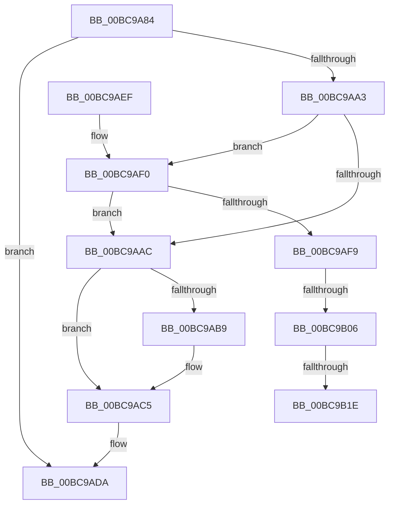

# CmpUnlockRegistry

- RVA: `0x00BC9A84`–`0x00BC9B2C` (길이 `168` bytes)
- VA: `0x0000000140BC9A84`
- 실행 섹션: `PAGECMRC`
- PDB 이름 있음: `예`; PDB Function 태그: `예`
- unwind 정보 RVA: `0x000ABB84`
- 디코드: `41`개 명령, `168/168` bytes 표시
- 미해석 바이트: `0` (있으면 어셈블리에 `.byte`로 보존)

> 이 문서는 커널 이미지의 기계어와 PDB 기호를 분석해 생성했습니다. 4번과 5번은 함수 원형과 자료형을 바이너리 사용 방식에서 추정한 C 해석이며 원본 소스 복구 결과는 아닙니다.

## 1. Dependencies

- 직접 호출 지점: **8**; 고유 호출 대상: **8**
- 직접 호출자로 확인된 함수: **113**
- RIP 상대 이미지 참조: **3**

### Outgoing calls
- `0x00BC9AAC` → [CmpRecordRegistryLockRelease](../../text/45/CmpRecordRegistryLockRelease_function_00456618.md) (function, `0x00456618`)
- `0x00BC9AC0` → [ExReleaseResourceLite](../../text/25/ExReleaseResourceLite_function_0025FA10.md) (function, `0x0025FA10`)
- `0x00BC9AC5` → [KeLeaveCriticalRegion](../../text/25/KeLeaveCriticalRegion_function_0025D8B0.md) (function, `0x0025D8B0`)
- `0x00BC9AD5` → [PsBoostThreadIo](../../text/39/PsBoostThreadIo_function_003927C0.md) (function, `0x003927C0`)
- `0x00BC9AF0` → [CmpIsRegistryLockAcquiredRecursively](../../text/66/CmpIsRegistryLockAcquiredRecursively_function_0066AB88.md) (function, `0x0066AB88`)
- `0x00BC9AF9` → [CmpTestRegistryLockExclusive](../../text/66/CmpTestRegistryLockExclusive_function_0066ACC4.md) (function, `0x0066ACC4`)
- `0x00BC9B06` → [CmpGetSharedLockHandle](../../text/66/CmpGetSharedLockHandle_function_0066AB6C.md) (function, `0x0066AB6C`)
- `0x00BC9B21` → [ExfReleasePushLockShared](../../text/26/ExfReleasePushLockShared_function_00263440.md) (function, `0x00263440`)

### Direct callers
- [CmpTryToRundownHive](../../text/2A/CmpTryToRundownHive_function_002A4A60.md) at `0x002A4AB0`
- [CmpTryToRundownHive](../../text/2A/CmpTryToRundownHive_function_002A4A60.md) at `0x002A4B6F`
- [CmDeleteLayeredKey](../../text/41/CmDeleteLayeredKey_function_0041B598.md) at `0x0041B8E9`
- [CmpDoQueryKeyName](../../text/45/CmpDoQueryKeyName_function_00456664.md) at `0x00456879`
- [CmpDoQueryKeyName](../../text/45/CmpDoQueryKeyName_function_00456664.md) at `0x00456930`
- [CmpLoadKeyCommon](../../text/46/CmpLoadKeyCommon_function_0046E9F8.md) at `0x0046EAAA`
- [CmpLoadKeyCommon](../../text/46/CmpLoadKeyCommon_function_0046E9F8.md) at `0x0046EBEB`
- [CmpLoadKeyCommon](../../text/46/CmpLoadKeyCommon_function_0046E9F8.md) at `0x0046ECE2`
- [CmpRecheckHiveVolumePolicy](../../text/46/CmpRecheckHiveVolumePolicy_function_0046EE14.md) at `0x0046EE8B`
- [CmShutdownSystem1](../../text/66/CmShutdownSystem1_function_0066A5B0.md) at `0x0066A622`
- [CmShutdownSystem1](../../text/66/CmShutdownSystem1_function_0066A5B0.md) at `0x0066A712`
- [CmShutdownSystem1](../../text/66/CmShutdownSystem1_function_0066A5B0.md) at `0x0066A73C`
- [CmShutdownSystem1](../../text/66/CmShutdownSystem1_function_0066A5B0.md) at `0x0066A77E`
- [CmShutdownSystem2](../../text/66/CmShutdownSystem2_function_0066A7FC.md) at `0x0066A922`
- [sub_006F34C4](../../text/6F/Unknown_function_006F34C4.md) at `0x006F34E2`
- [ExpWatchProductTypeWork](../../page/6F/ExpWatchProductTypeWork_function_006FFCA0.md) at `0x0070029B`
- [CmpFinishSystemHivesLoad](../../page/7D/CmpFinishSystemHivesLoad_function_007DA210.md) at `0x007DA59B`
- [CmpFinishSystemHivesLoad](../../page/7D/CmpFinishSystemHivesLoad_function_007DA210.md) at `0x007DA630`
- [CmpFinishSystemHivesLoad](../../page/7D/CmpFinishSystemHivesLoad_function_007DA210.md) at `0x007DA6F6`
- [CmpFinishSystemHivesLoad](../../page/7D/CmpFinishSystemHivesLoad_function_007DA210.md) at `0x007DA746`
- [CmpFinishSystemHivesLoad](../../page/7D/CmpFinishSystemHivesLoad_function_007DA210.md) at `0x007DA861`
- [CmpFinishSystemHivesLoad](../../page/7D/CmpFinishSystemHivesLoad_function_007DA210.md) at `0x007DA959`
- [CmpFinishSystemHivesLoad](../../page/7D/CmpFinishSystemHivesLoad_function_007DA210.md) at `0x007DAA70`
- [CmpFinishSystemHivesLoad](../../page/7D/CmpFinishSystemHivesLoad_function_007DA210.md) at `0x007DAAE2`
- [CmpLoadHiveThread](../../page/7D/CmpLoadHiveThread_function_007DB040.md) at `0x007DB803`
- [CmpLoadHiveThread](../../page/7D/CmpLoadHiveThread_function_007DB040.md) at `0x007DB8C2`
- [CmpLoadHiveThread](../../page/7D/CmpLoadHiveThread_function_007DB040.md) at `0x007DB910`
- [CmpLoadHiveThread](../../page/7D/CmpLoadHiveThread_function_007DB040.md) at `0x007DBA02`
- [CmpLoadHiveThread](../../page/7D/CmpLoadHiveThread_function_007DB040.md) at `0x007DBAAC`
- [CmpLoadHiveThread](../../page/7D/CmpLoadHiveThread_function_007DB040.md) at `0x007DBB1B`
- [CmpMarkCurrentProfileDirty](../../page/7D/CmpMarkCurrentProfileDirty_function_007DBBAC.md) at `0x007DBCF6`
- [CmpMountPreloadedHives](../../page/7D/CmpMountPreloadedHives_function_007DBE18.md) at `0x007DBF11`
- [CmpMountPreloadedHives](../../page/7D/CmpMountPreloadedHives_function_007DBE18.md) at `0x007DC2D1`
- [CmpMountPreloadedHives](../../page/7D/CmpMountPreloadedHives_function_007DBE18.md) at `0x007DC37F`
- [CmpMountPreloadedHives](../../page/7D/CmpMountPreloadedHives_function_007DBE18.md) at `0x007DC393`
- [CmpMountPreloadedHives](../../page/7D/CmpMountPreloadedHives_function_007DBE18.md) at `0x007DC3EE`
- [CmpMountPreloadedHives](../../page/7D/CmpMountPreloadedHives_function_007DBE18.md) at `0x007DC428`
- [CmpSaveBootControlSet](../../page/7D/CmpSaveBootControlSet_function_007DC744.md) at `0x007DCA57`
- [CmpSaveBootControlSet](../../page/7D/CmpSaveBootControlSet_function_007DC744.md) at `0x007DCB4E`
- [CmDumpKeyToFile](../../page/7D/CmDumpKeyToFile_function_007DCD64.md) at `0x007DCDCF`
- [CmDumpKeyToFile](../../page/7D/CmDumpKeyToFile_function_007DCD64.md) at `0x007DCE7F`
- [CmDumpKeyToFile](../../page/7D/CmDumpKeyToFile_function_007DCD64.md) at `0x007DCEDD`
- [CmRestoreKey](../../page/7D/CmRestoreKey_function_007DCF04.md) at `0x007DD29B`
- [CmRestoreKey](../../page/7D/CmRestoreKey_function_007DCF04.md) at `0x007DD3AE`
- [CmRestoreKey](../../page/7D/CmRestoreKey_function_007DCF04.md) at `0x007DD481`
- [CmRestoreKey](../../page/7D/CmRestoreKey_function_007DCF04.md) at `0x007DDA7C`
- [CmRestoreKey](../../page/7D/CmRestoreKey_function_007DCF04.md) at `0x007DDB1D`
- [CmSaveKey](../../page/7D/CmSaveKey_function_007DDBDC.md) at `0x007DDE06`
- [CmSaveKey](../../page/7D/CmSaveKey_function_007DDBDC.md) at `0x007DDF7A`
- [CmSaveKey](../../page/7D/CmSaveKey_function_007DDBDC.md) at `0x007DDFCB`
- [CmSaveMergedKeys](../../page/7D/CmSaveMergedKeys_function_007DE040.md) at `0x007DE3DE`
- [CmSaveMergedKeys](../../page/7D/CmSaveMergedKeys_function_007DE040.md) at `0x007DE475`
- [CmpLoadHiveVolatile](../../page/7D/CmpLoadHiveVolatile_function_007DE5F0.md) at `0x007DEA4F`
- [CmpRefreshHive](../../page/7D/CmpRefreshHive_function_007DEAD0.md) at `0x007DEC2C`
- [CmpRefreshHive](../../page/7D/CmpRefreshHive_function_007DEAD0.md) at `0x007DED51`
- [CmCompleteRegistryInitialization](../../page/7D/CmCompleteRegistryInitialization_function_007DF1EC.md) at `0x007DF26C`
- [CmOpenKeyForBugCheckRecovery](../../page/7D/CmOpenKeyForBugCheckRecovery_function_007DF3C0.md) at `0x007DF51B`
- [NtCompactKeys](../../page/7D/NtCompactKeys_function_007DF730.md) at `0x007DF927`
- [NtCompactKeys](../../page/7D/NtCompactKeys_function_007DF730.md) at `0x007DF95D`
- [NtCompressKey](../../page/7D/NtCompressKey_function_007DF9D0.md) at `0x007DFB77`
- [NtQueryOpenSubKeys](../../page/7D/NtQueryOpenSubKeys_function_007DFF80.md) at `0x007E00EB`
- [NtQueryOpenSubKeys](../../page/7D/NtQueryOpenSubKeys_function_007DFF80.md) at `0x007E011E`
- [NtQueryOpenSubKeysEx](../../page/7E/NtQueryOpenSubKeysEx_function_007E0190.md) at `0x007E03CA`
- [NtQueryOpenSubKeysEx](../../page/7E/NtQueryOpenSubKeysEx_function_007E0190.md) at `0x007E0434`
- [CmpCloneHwProfile](../../page/7E/CmpCloneHwProfile_function_007E303C.md) at `0x007E37C9`
- [CmpBecomeActiveFlusherAndReconciler](../../page/7E/CmpBecomeActiveFlusherAndReconciler_function_007E7E20.md) at `0x007E7E91`
- [CmpFinishBeingActiveFlusherAndReconciler](../../page/7E/CmpFinishBeingActiveFlusherAndReconciler_function_007E7EB0.md) at `0x007E7F05`
- [CmFreezeRegistry](../../page/7E/CmFreezeRegistry_function_007E834C.md) at `0x007E8384`
- [CmFreezeRegistry](../../page/7E/CmFreezeRegistry_function_007E834C.md) at `0x007E848E`
- [CmThawRegistry](../../page/7E/CmThawRegistry_function_007E8510.md) at `0x007E864D`
- [CmRenameKey](../../page/7E/CmRenameKey_function_007E8F48.md) at `0x007E9618`
- [CmRenameKey](../../page/7E/CmRenameKey_function_007E8F48.md) at `0x007E9681`
- [CmRenameKey](../../page/7E/CmRenameKey_function_007E8F48.md) at `0x007EA16A`
- [CmReplaceKey](../../page/7E/CmReplaceKey_function_007EA1C8.md) at `0x007EA2F7`
- [CmReplaceKey](../../page/7E/CmReplaceKey_function_007EA1C8.md) at `0x007EA3E4`
- [CmpFlushBackupHive](../../page/7E/CmpFlushBackupHive_function_007EC1A8.md) at `0x007EC373`
- [CmpFlushBackupHive](../../page/7E/CmpFlushBackupHive_function_007EC1A8.md) at `0x007EC4A4`
- [CmpAssignKeySecurity](../../page/7E/CmpAssignKeySecurity_function_007EC8B0.md) at `0x007ECA3B`
- [CmpRecoverFlushProtocolStateFromFiles](../../page/7E/CmpRecoverFlushProtocolStateFromFiles_function_007EE4B0.md) at `0x007EE51A`
- [CmpDoReOpenTransKey](../../page/7F/CmpDoReOpenTransKey_function_007F78E8.md) at `0x007F7AC0`
- [CmpDoReOpenTransKey](../../page/7F/CmpDoReOpenTransKey_function_007F78E8.md) at `0x007F7B11`
- [CmpDoReOpenTransKey](../../page/7F/CmpDoReOpenTransKey_function_007F78E8.md) at `0x007F7C16`
- [CmpStopRMLog](../../page/84/CmpStopRMLog_function_008427AC.md) at `0x008427DA`
- [CmpCleanupTransactionState](../../page/84/CmpCleanupTransactionState_function_008428E0.md) at `0x00842932`
- [CmpCleanupTransactionState](../../page/84/CmpCleanupTransactionState_function_008428E0.md) at `0x008429C6`
- [CmSetLastWriteTimeKey](../../page/84/CmSetLastWriteTimeKey_function_00843368.md) at `0x008434F3`
- [CmSetLastWriteTimeKey](../../page/84/CmSetLastWriteTimeKey_function_00843368.md) at `0x0084355D`
- [CmSetLastWriteTimeKey](../../page/84/CmSetLastWriteTimeKey_function_00843368.md) at `0x008436DA`
- [CmKeyBodyReplicateToVirtual](../../page/84/CmKeyBodyReplicateToVirtual_function_00843FE4.md) at `0x00844199`
- [CmKeyBodyReplicateToVirtual](../../page/84/CmKeyBodyReplicateToVirtual_function_00843FE4.md) at `0x00844248`
- [CmKeyBodyReplicateToVirtual](../../page/84/CmKeyBodyReplicateToVirtual_function_00843FE4.md) at `0x00844324`
- [CmSetValueKey](../../page/84/CmSetValueKey_function_008457C0.md) at `0x00845B32`
- [CmSetValueKey](../../page/84/CmSetValueKey_function_008457C0.md) at `0x00845F68`
- [CmQueryMultipleValueKey](../../page/84/CmQueryMultipleValueKey_function_00846EC0.md) at `0x0084734E`
- [CmQueryMultipleValueKey](../../page/84/CmQueryMultipleValueKey_function_00846EC0.md) at `0x008473E4`
- [CmQueryMultipleValueKey](../../page/84/CmQueryMultipleValueKey_function_00846EC0.md) at `0x0084747A`
- [CmQueryMultipleValueKey](../../page/84/CmQueryMultipleValueKey_function_00846EC0.md) at `0x0084749A`
- [CmDeleteValueKey](../../page/84/CmDeleteValueKey_function_008476E8.md) at `0x00847C99`
- [CmDeleteValueKey](../../page/84/CmDeleteValueKey_function_008476E8.md) at `0x00847FE8`
- [CmDeleteKey](../../page/84/CmDeleteKey_function_00848E5C.md) at `0x0084937A`
- [CmDeleteKey](../../page/84/CmDeleteKey_function_00848E5C.md) at `0x00849431`
- [CmDeleteKey](../../page/84/CmDeleteKey_function_00848E5C.md) at `0x0084967E`
- [CmKeyBodyNeedsVirtualImage](../../page/84/CmKeyBodyNeedsVirtualImage_function_00849864.md) at `0x008498D4`
- [CmpDoFlushNextHive](../../page/84/CmpDoFlushNextHive_function_0084C7C0.md) at `0x0084C86F`
- [sub_0084D349](../../page/84/Unknown_function_0084D349.md) at `0x0084D349`
- [sub_0084E7AE](../../page/84/Unknown_function_0084E7AE.md) at `0x0084E7AE`
- [sub_00855411](../../page/85/Unknown_function_00855411.md) at `0x00855411`
- [CmQueryKey](../../page/85/CmQueryKey_function_00858240.md) at `0x00858BFA`
- [CmQueryKey](../../page/85/CmQueryKey_function_00858240.md) at `0x00858D83`
- [CmQueryKey](../../page/85/CmQueryKey_function_00858240.md) at `0x00858DC4`
- [CmpDoParseKey](../../page/85/CmpDoParseKey_function_0085F750.md) at `0x0085FC28`
- [CmpDoParseKey](../../page/85/CmpDoParseKey_function_0085F750.md) at `0x00860643`
- [CmpDoParseKey](../../page/85/CmpDoParseKey_function_0085F750.md) at `0x00860A68`
- [CmpDoParseKey](../../page/85/CmpDoParseKey_function_0085F750.md) at `0x00860B30`
- [CmpCloseKeyObject](../../page/86/CmpCloseKeyObject_function_00863AD0.md) at `0x00863C7F`
- [CmpCloseKeyObject](../../page/86/CmpCloseKeyObject_function_00863AD0.md) at `0x00863CE6`
- [sub_0086560A](../../page/86/Unknown_function_0086560A.md) at `0x00865A62`
- [CmpSecurityMethod](../../page/87/CmpSecurityMethod_function_00870CC0.md) at `0x00870FCC`
- [CmpTransMgrFreeVolatileData](../../page/87/CmpTransMgrFreeVolatileData_function_00874BDC.md) at `0x00874C59`
- [CmpTransMgrFreeVolatileData](../../page/87/CmpTransMgrFreeVolatileData_function_00874BDC.md) at `0x00874CDE`
- [CmLoadDifferencingKey](../../page/87/CmLoadDifferencingKey_function_00875670.md) at `0x0087621E`
- [CmOpenKey](../../page/87/CmOpenKey_function_00876350.md) at `0x0087674F`
- [sub_008769B9](../../page/87/Unknown_function_008769B9.md) at `0x008769CB`
- [CmLoadAppKey](../../page/87/CmLoadAppKey_function_00876FFC.md) at `0x00877833`
- [CmLoadAppKey](../../page/87/CmLoadAppKey_function_00876FFC.md) at `0x00877A74`
- [CmLoadAppKey](../../page/87/CmLoadAppKey_function_00876FFC.md) at `0x00877A93`
- [CmLoadAppKey](../../page/87/CmLoadAppKey_function_00876FFC.md) at `0x00877AA9`
- [CmLoadAppKey](../../page/87/CmLoadAppKey_function_00876FFC.md) at `0x00877AE7`
- [CmLoadAppKey](../../page/87/CmLoadAppKey_function_00876FFC.md) at `0x00877B1E`
- [CmLoadAppKey](../../page/87/CmLoadAppKey_function_00876FFC.md) at `0x00877B3A`
- [CmLoadAppKey](../../page/87/CmLoadAppKey_function_00876FFC.md) at `0x00877C46`
- [CmReleaseLoadKeyContext](../../page/87/CmReleaseLoadKeyContext_function_00877C88.md) at `0x00877CA2`
- [CmpLinkHiveToMaster](../../page/87/CmpLinkHiveToMaster_function_00877D6C.md) at `0x00877F75`
- [CmpLinkHiveToMaster](../../page/87/CmpLinkHiveToMaster_function_00877D6C.md) at `0x00878032`
- [CmpCreateHive](../../page/87/CmpCreateHive_function_00879DF0.md) at `0x0087A233`
- [CmpReorganizeHive](../../page/87/CmpReorganizeHive_function_0087B92C.md) at `0x0087BB0A`
- [CmpInitCmRM](../../page/87/CmpInitCmRM_function_0087C700.md) at `0x0087CE84`
- [NtEnumerateValueKey](../../page/8B/NtEnumerateValueKey_function_008B3B50.md) at `0x008B4076`
- [sub_008B4B26](../../page/8B/Unknown_function_008B4B26.md) at `0x008B4B89`
- [sub_008B4B26](../../page/8B/Unknown_function_008B4B26.md) at `0x008B4C87`
- [sub_008B4CB2](../../page/8B/Unknown_function_008B4CB2.md) at `0x008B4CC0`
- [sub_008B4D32](../../page/8B/Unknown_function_008B4D32.md) at `0x008B4DC3`
- [CmNotifyRunDown](../../page/90/CmNotifyRunDown_function_00906984.md) at `0x00906A30`
- [CmpEnumerateLayeredKey](../../page/94/CmpEnumerateLayeredKey_function_00945E58.md) at `0x00946260`
- [CmpSetKeySecurity](../../page/94/CmpSetKeySecurity_function_0094A124.md) at `0x0094A462`
- [CmpSetKeySecurity](../../page/94/CmpSetKeySecurity_function_0094A124.md) at `0x0094A521`
- [CmpSetKeySecurity](../../page/94/CmpSetKeySecurity_function_0094A124.md) at `0x0094A580`
- [CmSetKeyFlags](../../page/9A/CmSetKeyFlags_function_009AEEA4.md) at `0x009AEF98`
- [CmSetKeyFlags](../../page/9A/CmSetKeyFlags_function_009AEEA4.md) at `0x009AF1BA`
- [CmpPerformUnloadKey](../../page/9A/CmpPerformUnloadKey_function_009AFA28.md) at `0x009AFC67`
- [CmpPerformUnloadKey](../../page/9A/CmpPerformUnloadKey_function_009AFA28.md) at `0x009AFDF4`
- [CmpPerformUnloadKey](../../page/9A/CmpPerformUnloadKey_function_009AFA28.md) at `0x009AFE4A`
- [CmpPerformUnloadKey](../../page/9A/CmpPerformUnloadKey_function_009AFA28.md) at `0x009AFF1F`
- [CmpPerformUnloadKey](../../page/9A/CmpPerformUnloadKey_function_009AFA28.md) at `0x009B012F`
- [CmpTransMgrSyncHive](../../page/9B/CmpTransMgrSyncHive_function_009B07C4.md) at `0x009B07F5`
- [CmpTransMgrSyncHive](../../page/9B/CmpTransMgrSyncHive_function_009B07C4.md) at `0x009B084D`
- [CmpCommitLightWeightTransaction](../../page/9B/CmpCommitLightWeightTransaction_function_009B0868.md) at `0x009B0923`
- [CmpCommitLightWeightTransaction](../../page/9B/CmpCommitLightWeightTransaction_function_009B0868.md) at `0x009B0A05`
- [CmpCleanupLightWeightTransaction](../../page/9B/CmpCleanupLightWeightTransaction_function_009B1340.md) at `0x009B1389`
- [CmpTransMgrPrepare](../../page/9B/CmpTransMgrPrepare_function_009B175C.md) at `0x009B1857`
- [CmpTransMgrPrepare](../../page/9B/CmpTransMgrPrepare_function_009B175C.md) at `0x009B18E1`
- [CmpTransMgrPrepare](../../page/9B/CmpTransMgrPrepare_function_009B175C.md) at `0x009B1934`
- [CmpLateUnloadHiveWorker](../../page/9B/CmpLateUnloadHiveWorker_function_009B20D0.md) at `0x009B21FB`
- [CmpLateUnloadHiveWorker](../../page/9B/CmpLateUnloadHiveWorker_function_009B20D0.md) at `0x009B22EF`
- [HvpFinishPrimaryWrite](../../page/9B/HvpFinishPrimaryWrite_function_009B2580.md) at `0x009B2667`
- [CmpCompleteUnloadKey](../../page/9B/CmpCompleteUnloadKey_function_009B32FC.md) at `0x009B340D`
- [CmpFlushHive](../../page/9B/CmpFlushHive_function_009B3DC0.md) at `0x009B3FAA`
- [CmpFlushHive](../../page/9B/CmpFlushHive_function_009B3DC0.md) at `0x009B4240`
- [CmpFlushHive](../../page/9B/CmpFlushHive_function_009B3DC0.md) at `0x009B442F`
- [CmpFlushHive](../../page/9B/CmpFlushHive_function_009B3DC0.md) at `0x009B479B`
- [CmpFlushHive](../../page/9B/CmpFlushHive_function_009B3DC0.md) at `0x009B480B`
- [CmpLockRegistryFreezeAware](../../page/9B/CmpLockRegistryFreezeAware_function_009B4AE4.md) at `0x009B4B87`
- [CmpDoLocalizeNextHive](../../page/9B/CmpDoLocalizeNextHive_function_009B7400.md) at `0x009B7464`
- [CmpDoLocalizeNextHive](../../page/9B/CmpDoLocalizeNextHive_function_009B7400.md) at `0x009B74B0`
- [CmpDelayCloseWorker](../../page/9D/CmpDelayCloseWorker_function_009DB8E0.md) at `0x009DBC3E`
- [sub_009DC4C9](../../page/9D/Unknown_function_009DC4C9.md) at `0x009DC4C9`
- [NtNotifyChangeMultipleKeys](../../page/9D/NtNotifyChangeMultipleKeys_function_009DC6B0.md) at `0x009DCD00`
- [NtNotifyChangeMultipleKeys](../../page/9D/NtNotifyChangeMultipleKeys_function_009DC6B0.md) at `0x009DCE96`
- [NtNotifyChangeMultipleKeys](../../page/9D/NtNotifyChangeMultipleKeys_function_009DC6B0.md) at `0x009DD06C`
- [NtNotifyChangeMultipleKeys](../../page/9D/NtNotifyChangeMultipleKeys_function_009DC6B0.md) at `0x009DD230`
- [NtNotifyChangeMultipleKeys](../../page/9D/NtNotifyChangeMultipleKeys_function_009DC6B0.md) at `0x009DD28A`
- [CmpStopSiloKeyLockTracker](../../page/9E/CmpStopSiloKeyLockTracker_function_009E7BF0.md) at `0x009E7CB2`
- [CmpStartSiloRegistryNamespace](../../page/9E/CmpStartSiloRegistryNamespace_function_009E85D0.md) at `0x009E874F`
- [CmpStartSiloRegistryNamespace](../../page/9E/CmpStartSiloRegistryNamespace_function_009E85D0.md) at `0x009E8796`
- [CmpTrimHive](../../page/A4/CmpTrimHive_function_00A4F2FC.md) at `0x00A4F36D`
- [CmEnumerateValueKeyFromMergedView](../../page/A7/CmEnumerateValueKeyFromMergedView_function_00A7D650.md) at `0x00A7D708`
- [CmEtwRunDown](../../page/A8/CmEtwRunDown_function_00A85AC0.md) at `0x00A85C04`
- [NtFlushKey](../../page/A8/NtFlushKey_function_00A8A030.md) at `0x00A8A1B6`
- [NtFlushKey](../../page/A8/NtFlushKey_function_00A8A030.md) at `0x00A8A26D`
- [NtFlushKey](../../page/A8/NtFlushKey_function_00A8A030.md) at `0x00A8A3DB`
- [CmpWaitOnHiveWriteQueue](../../page/AA/CmpWaitOnHiveWriteQueue_function_00AA0110.md) at `0x00AA015E`
- [CmpDelayFreeRMWorker](../../page/AB/CmpDelayFreeRMWorker_function_00AB65B0.md) at `0x00AB6644`
- [CmKeyBodyRemapToVirtual](../../page/AC/CmKeyBodyRemapToVirtual_function_00AC9494.md) at `0x00AC95DC`
- [CmKeyBodyRemapToVirtual](../../page/AC/CmKeyBodyRemapToVirtual_function_00AC9494.md) at `0x00AC9643`
- [CmQueryKey$fin$0](../../page/B0/CmQueryKey_fin_0_function_00B0E530.md) at `0x00B0E577`
- [sub_00B15E66](../../page/B1/Unknown_function_00B15E66.md) at `0x00B15ECB`
- [sub_00B160F4](../../page/B1/Unknown_function_00B160F4.md) at `0x00B1610B`
- [sub_00B16440](../../page/B1/Unknown_function_00B16440.md) at `0x00B164C0`
- [sub_00B1664A](../../page/B1/Unknown_function_00B1664A.md) at `0x00B1671E`
- [sub_00B1664A](../../page/B1/Unknown_function_00B1664A.md) at `0x00B16755`
- [sub_00B179DA](../../page/B1/Unknown_function_00B179DA.md) at `0x00B17A6A`
- [sub_00B17CD8](../../page/B1/Unknown_function_00B17CD8.md) at `0x00B17CDD`
- [sub_00B17CEE](../../page/B1/Unknown_function_00B17CEE.md) at `0x00B17D14`
- [sub_00B1845C](../../page/B1/Unknown_function_00B1845C.md) at `0x00B18700`
- [sub_00B1845C](../../page/B1/Unknown_function_00B1845C.md) at `0x00B187F8`
- [sub_00B1845C](../../page/B1/Unknown_function_00B1845C.md) at `0x00B18915`
- [sub_00B25E36](../../page/B2/Unknown_function_00B25E36.md) at `0x00B25E55`
- [sub_00B2D804](../../page/B2/Unknown_function_00B2D804.md) at `0x00B2D822`
- [sub_00B2DB96](../../page/B2/Unknown_function_00B2DB96.md) at `0x00B2DBA5`
- [sub_00B3073E](../../page/B3/Unknown_function_00B3073E.md) at `0x00B307D5`
- [sub_00B49062](../../page/B4/Unknown_function_00B49062.md) at `0x00B491BE`
- [CmpDumpKeyToBuffer](CmpDumpKeyToBuffer_function_00BC9130.md) at `0x00BC91C8`
- [CmpDumpKeyToBuffer](CmpDumpKeyToBuffer_function_00BC9130.md) at `0x00BC9258`
- [CmInitSystem1](../../init/C5/CmInitSystem1_function_00C559CC.md) at `0x00C562C2`
- [CmGetSystemDriverList](../../init/C7/CmGetSystemDriverList_function_00C7380C.md) at `0x00C73BB9`
- [CmGetSystemDriverList](../../init/C7/CmGetSystemDriverList_function_00C7380C.md) at `0x00C73C97`

### Static image references
- `0x00BC9A9A` → RVA `0x00FD8005` (`PAGEDATA`; read)
- `0x00BC9AA3` → RVA `0x00EF7108` (`.data`; read)
- `0x00BC9AB9` → RVA `0x00EF7110` (`.data`; read)

## 2. Other-region calls and transfers

- 다른 실행 섹션으로 향하는 call: **8**
  - `0x00BC9AAC` → [CmpRecordRegistryLockRelease](../../text/45/CmpRecordRegistryLockRelease_function_00456618.md) (`PAGECMRC` → `.text`)
  - `0x00BC9AC0` → [ExReleaseResourceLite](../../text/25/ExReleaseResourceLite_function_0025FA10.md) (`PAGECMRC` → `.text`)
  - `0x00BC9AC5` → [KeLeaveCriticalRegion](../../text/25/KeLeaveCriticalRegion_function_0025D8B0.md) (`PAGECMRC` → `.text`)
  - `0x00BC9AD5` → [PsBoostThreadIo](../../text/39/PsBoostThreadIo_function_003927C0.md) (`PAGECMRC` → `.text`)
  - `0x00BC9AF0` → [CmpIsRegistryLockAcquiredRecursively](../../text/66/CmpIsRegistryLockAcquiredRecursively_function_0066AB88.md) (`PAGECMRC` → `.text`)
  - `0x00BC9AF9` → [CmpTestRegistryLockExclusive](../../text/66/CmpTestRegistryLockExclusive_function_0066ACC4.md) (`PAGECMRC` → `.text`)
  - `0x00BC9B06` → [CmpGetSharedLockHandle](../../text/66/CmpGetSharedLockHandle_function_0066AB6C.md) (`PAGECMRC` → `.text`)
  - `0x00BC9B21` → [ExfReleasePushLockShared](../../text/26/ExfReleasePushLockShared_function_00263440.md) (`PAGECMRC` → `.text`)
- call이 아닌 외부 분기/꼬리 이동: **3**
  - `0x00BC9B00` → [sub_00BC9FF0 + 0x6](Unknown_function_00BC9FF0.md) (`tail-transfer`)
  - `0x00BC9B18` → [sub_00BC9FF0](Unknown_function_00BC9FF0.md) (`tail-transfer`)
  - `0x00BC9B27` → [sub_00BC9FF0](Unknown_function_00BC9FF0.md) (`tail-transfer`)

## 3. Assembly (complete function range)

```asm
00BC9A84  48 89 5C 24 10                  mov qword ptr [rsp + 0x10], rbx
00BC9A89  48 89 6C 24 18                  mov qword ptr [rsp + 0x18], rbp
00BC9A8E  48 89 74 24 20                  mov qword ptr [rsp + 0x20], rsi
00BC9A93  57                              push rdi
00BC9A94  48 83 EC 20                     sub rsp, 0x20
00BC9A98  33 ED                           xor ebp, ebp
00BC9A9A  40 38 2D 64 E5 40 00            cmp byte ptr [rip + 0x40e564], bpl
00BC9AA1  75 37                           jne 0x140bc9ada
00BC9AA3  83 3D 5E D6 32 00 01            cmp dword ptr [rip + 0x32d65e], 1
00BC9AAA  74 44                           je 0x140bc9af0
00BC9AAC  E8 67 CB 88 FF                  call 0x140456618
00BC9AB1  39 2D 51 D6 32 00               cmp dword ptr [rip + 0x32d651], ebp
00BC9AB7  75 0C                           jne 0x140bc9ac5
00BC9AB9  48 8B 0D 50 D6 32 00            mov rcx, qword ptr [rip + 0x32d650]
00BC9AC0  E8 4B 5F 69 FF                  call 0x14025fa10
00BC9AC5  E8 E6 3D 69 FF                  call 0x14025d8b0
00BC9ACA  65 48 8B 0C 25 88 01 00 00      mov rcx, qword ptr gs:[0x188]
00BC9AD3  B2 01                           mov dl, 1
00BC9AD5  E8 E6 8C 7C FF                  call 0x1403927c0
00BC9ADA  48 8B 5C 24 38                  mov rbx, qword ptr [rsp + 0x38]
00BC9ADF  48 8B 6C 24 40                  mov rbp, qword ptr [rsp + 0x40]
00BC9AE4  48 8B 74 24 48                  mov rsi, qword ptr [rsp + 0x48]
00BC9AE9  48 83 C4 20                     add rsp, 0x20
00BC9AED  5F                              pop rdi
00BC9AEE  C3                              ret
00BC9AEF  CC                              int3
00BC9AF0  E8 93 10 AA FF                  call 0x14066ab88
00BC9AF5  84 C0                           test al, al
00BC9AF7  75 B3                           jne 0x140bc9aac
00BC9AF9  E8 C6 11 AA FF                  call 0x14066acc4
00BC9AFE  84 C0                           test al, al
00BC9B00  0F 85 F0 04 00 00               jne 0x140bc9ff6
00BC9B06  E8 61 10 AA FF                  call 0x14066ab6c
00BC9B0B  48 8B D8                        mov rbx, rax
00BC9B0E  B8 11 00 00 00                  mov eax, 0x11
00BC9B13  F0 48 0F B1 2B                  lock cmpxchg qword ptr [rbx], rbp
00BC9B18  0F 84 D2 04 00 00               je 0x140bc9ff0
00BC9B1E  48 8B CB                        mov rcx, rbx
00BC9B21  E8 1A 99 69 FF                  call 0x140263440
00BC9B26  90                              nop
00BC9B27  E9 C4 04 00 00                  jmp 0x140bc9ff0
```

## 4. C-style interpretation (structured pseudocode)

```c
__int64 __fastcall CmpUnlockRegistry(void)
{
    __int64 result;
    __int64 v_rbp;
    __int64 v_rsp;
    unsigned __int64 v_stack_p10;
    unsigned __int64 v_stack_p18;
    unsigned __int64 v_stack_p20;

    v_stack_p10 = v_rbx;
    v_stack_p18 = v_rbp;
    v_stack_p20 = v_rsi;
    v_rsp = (v_rsp) - (32);
    v_rbp = 0;
    if ((*(unsigned __int8 *)(v_rip + 4253028)) != 0) goto loc_00BC9ADA;
    if ((*(unsigned int *)(v_rip + 3331678)) == 1) goto loc_00BC9AF0;
loc_00BC9AAC:
    result = CmpRecordRegistryLockRelease(a1, a2, a3, a4);
    if ((*(unsigned int *)(v_rip + 3331665)) == 0) {
        a1 = *(unsigned __int64 *)(v_rip + 3331664);
        result = ExReleaseResourceLite(a1, a2, a3, a4);
    }
    result = KeLeaveCriticalRegion(a1, a2, a3, a4);
    result = PsBoostThreadIo(*(unsigned __int64 *)(gs_base + (0 + 392)), 1, a3, a4);
loc_00BC9ADA:
    v_rsp = (v_rsp) + (32);
    return result;
loc_00BC9AF0:
    result = CmpIsRegistryLockAcquiredRecursively(*(unsigned __int64 *)(gs_base + (0 + 392)), 1, a3, a4);
    if ((unsigned __int8)(result) != 0) goto loc_00BC9AAC;
    result = CmpTestRegistryLockExclusive(*(unsigned __int64 *)(gs_base + (0 + 392)), 1, a3, a4);
    result = CmpGetSharedLockHandle(*(unsigned __int64 *)(gs_base + (0 + 392)), 1, a3, a4);
    result = ExfReleasePushLockShared(result, 1, a3, a4);
}
```

## 5. (Beta) C Style

```c
void CmpUnlockRegistry(void)
{
    int64_t result;
    int64_t local_rbp;
    int64_t local_rsp;
    uint64_t v_stack_p10;
    uint64_t v_stack_p18;
    uint64_t v_stack_p20;

    v_stack_p10 = local_rbx;
    v_stack_p18 = local_rbp;
    v_stack_p20 = local_rsi;
    local_rsp = (local_rsp) - (32);
    local_rbp = 0;
    if ((*(uint8_t *)(v_rip + 0x40E564)) != 0) goto loc_00BC9ADA;
    if ((*(uint32_t *)(v_rip + 0x32D65E)) == 1) goto loc_00BC9AF0;
loc_00BC9AAC:
    result = CmpRecordRegistryLockRelease(a1, a2, a3, a4);
    if ((*(uint32_t *)(v_rip + 0x32D651)) == 0) {
        a1 = *(uint64_t *)(v_rip + 0x32D650);
        result = ExReleaseResourceLite(a1, a2, a3, a4);
    }
    result = KeLeaveCriticalRegion(a1, a2, a3, a4);
    result = PsBoostThreadIo(*(uint64_t *)(gs_base + (0 + 0x188)), 1, a3, a4);
loc_00BC9ADA:
    local_rsp = (local_rsp) + (32);
    return result;
loc_00BC9AF0:
    result = CmpIsRegistryLockAcquiredRecursively(*(uint64_t *)(gs_base + (0 + 0x188)), 1, a3, a4);
    if ((uint8_t)(result) != 0) goto loc_00BC9AAC;
    result = CmpTestRegistryLockExclusive(*(uint64_t *)(gs_base + (0 + 0x188)), 1, a3, a4);
    result = CmpGetSharedLockHandle(*(uint64_t *)(gs_base + (0 + 0x188)), 1, a3, a4);
    result = ExfReleasePushLockShared(result, 1, a3, a4);
}
```

## 6. Execution-region graph

[열기: 2D/3D 그래프와 함수 탐색 컨트롤 패널](../../../control-panel.html?section=pagecmrc&rva=0x00BC9A84&view=graph)

- 2D 그래프는 위에서 아래로 흐르고, 3D 그래프는 빈 공간을 드래그해 회전합니다. Shift+드래그는 이동, 휠은 확대·축소, 함수 노드 선택은 대상 보고서 이동입니다.

### Static fallback


