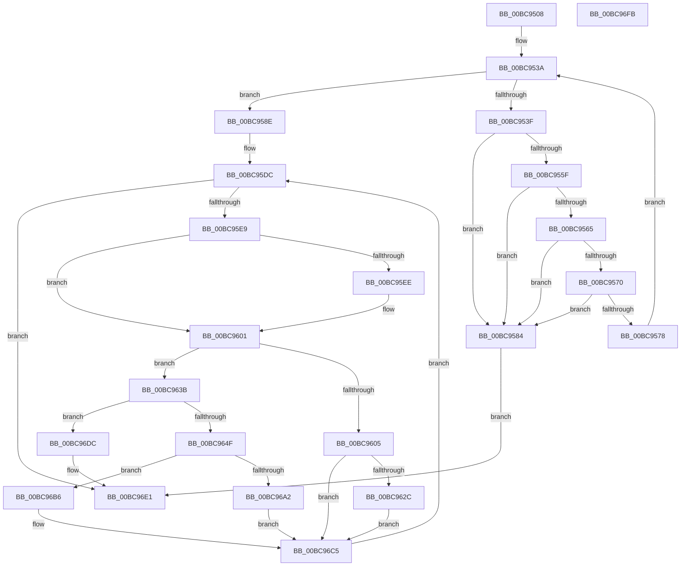

# HvSnapshotHiveToOffsetArray

- RVA: `0x00BC9508`–`0x00BC96FC` (길이 `500` bytes)
- VA: `0x0000000140BC9508`
- 실행 섹션: `PAGECMRC`
- PDB 이름 있음: `예`; PDB Function 태그: `아니요`
- unwind 정보 RVA: `0x00099E84`
- 디코드: `139`개 명령, `500/500` bytes 표시
- 미해석 바이트: `0` (있으면 어셈블리에 `.byte`로 보존)

> 이 문서는 커널 이미지의 기계어와 PDB 기호를 분석해 생성했습니다. 4번과 5번은 함수 원형과 자료형을 바이너리 사용 방식에서 추정한 C 해석이며 원본 소스 복구 결과는 아닙니다.

## 1. Dependencies

- 직접 호출 지점: **11**; 고유 호출 대상: **5**
- 직접 호출자로 확인된 함수: **3**
- RIP 상대 이미지 참조: **0**

### Outgoing calls
- `0x00BC9545` → [HvpGetCellMap](HvpGetCellMap_function_00BC9710.md) (function, `0x00BC9710`)
- `0x00BC9552` → [HvpMapEntryGetBinAddress](HvpMapEntryGetBinAddress_function_00BC9770.md) (function, `0x00BC9770`)
- `0x00BC957D` → [HvpMapEntryReleaseBinAddress](HvpMapEntryReleaseBinAddress_function_00BC9790.md) (function, `0x00BC9790`)
- `0x00BC959D` → [memcpy](../../text/6C/memcpy_function_006C6840.md) (function, `0x006C6840`)
- `0x00BC95B5` → [HvpHeaderCheckSum](HvpHeaderCheckSum_function_00BC97A0.md) (function, `0x00BC97A0`)
- `0x00BC961F` → [memcpy](../../text/6C/memcpy_function_006C6840.md) (function, `0x006C6840`)
- `0x00BC9631` → [HvpMapEntryReleaseBinAddress](HvpMapEntryReleaseBinAddress_function_00BC9790.md) (function, `0x00BC9790`)
- `0x00BC9641` → [HvpGetCellMap](HvpGetCellMap_function_00BC9710.md) (function, `0x00BC9710`)
- `0x00BC9657` → [HvpMapEntryGetBinAddress](HvpMapEntryGetBinAddress_function_00BC9770.md) (function, `0x00BC9770`)
- `0x00BC9699` → [memcpy](../../text/6C/memcpy_function_006C6840.md) (function, `0x006C6840`)
- `0x00BC96BB` → [HvpMapEntryReleaseBinAddress](HvpMapEntryReleaseBinAddress_function_00BC9790.md) (function, `0x00BC9790`)

### Direct callers
- [CmDumpKeyToFile](../../page/7D/CmDumpKeyToFile_function_007DCD64.md) at `0x007DCE60`
- [CmpFlushBackupHive](../../page/7E/CmpFlushBackupHive_function_007EC1A8.md) at `0x007EC35C`
- [CmpDumpKeyToBuffer](CmpDumpKeyToBuffer_function_00BC9130.md) at `0x00BC9234`

### Static image references
- 디코드된 RIP-relative 메모리 참조가 없습니다.

## 2. Other-region calls and transfers

- 다른 실행 섹션으로 향하는 call: **3**
  - `0x00BC959D` → [memcpy](../../text/6C/memcpy_function_006C6840.md) (`PAGECMRC` → `.text`)
  - `0x00BC961F` → [memcpy](../../text/6C/memcpy_function_006C6840.md) (`PAGECMRC` → `.text`)
  - `0x00BC9699` → [memcpy](../../text/6C/memcpy_function_006C6840.md) (`PAGECMRC` → `.text`)
- 별도 외부 분기/꼬리 이동을 확인하지 못했습니다.

## 3. Assembly (complete function range)

```asm
00BC9508  48 89 5C 24 18                  mov qword ptr [rsp + 0x18], rbx
00BC950D  89 54 24 10                     mov dword ptr [rsp + 0x10], edx
00BC9511  55                              push rbp
00BC9512  56                              push rsi
00BC9513  57                              push rdi
00BC9514  41 54                           push r12
00BC9516  41 55                           push r13
00BC9518  41 56                           push r14
00BC951A  41 57                           push r15
00BC951C  48 83 EC 30                     sub rsp, 0x30
00BC9520  4C 8B 59 40                     mov r11, qword ptr [rcx + 0x40]
00BC9524  33 DB                           xor ebx, ebx
00BC9526  8B B9 18 01 00 00               mov edi, dword ptr [rcx + 0x118]
00BC952C  44 8B D3                        mov r10d, ebx
00BC952F  66 89 5C 24 78                  mov word ptr [rsp + 0x78], bx
00BC9534  4D 8B E8                        mov r13, r8
00BC9537  4C 8B F1                        mov r14, rcx
00BC953A  44 3B D7                        cmp r10d, edi
00BC953D  73 4F                           jae 0x140bc958e
00BC953F  41 8B D2                        mov edx, r10d
00BC9542  49 8B CE                        mov rcx, r14
00BC9545  E8 C6 01 00 00                  call 0x140bc9710
00BC954A  48 8B D0                        mov rdx, rax
00BC954D  4C 8D 44 24 78                  lea r8, [rsp + 0x78]
00BC9552  E8 19 02 00 00                  call 0x140bc9770
00BC9557  81 38 68 62 69 6E               cmp dword ptr [rax], 0x6e696268
00BC955D  75 25                           jne 0x140bc9584
00BC955F  44 39 50 04                     cmp dword ptr [rax + 4], r10d
00BC9563  75 1F                           jne 0x140bc9584
00BC9565  8B 48 08                        mov ecx, dword ptr [rax + 8]
00BC9568  44 03 D1                        add r10d, ecx
00BC956B  44 3B D7                        cmp r10d, edi
00BC956E  77 14                           ja 0x140bc9584
00BC9570  F7 C1 FF 0F 00 00               test ecx, 0xfff
00BC9576  75 0C                           jne 0x140bc9584
00BC9578  4C 8D 44 24 78                  lea r8, [rsp + 0x78]
00BC957D  E8 0E 02 00 00                  call 0x140bc9790
00BC9582  EB B6                           jmp 0x140bc953a
00BC9584  BB 4C 01 00 C0                  mov ebx, 0xc000014c
00BC9589  E9 53 01 00 00                  jmp 0x140bc96e1
00BC958E  49 8B 4D 08                     mov rcx, qword ptr [r13 + 8]
00BC9592  BD 00 10 00 00                  mov ebp, 0x1000
00BC9597  44 8B C5                        mov r8d, ebp
00BC959A  49 8B D3                        mov rdx, r11
00BC959D  E8 9E D2 AF FF                  call 0x1406c6840
00BC95A2  4D 8B 4D 08                     mov r9, qword ptr [r13 + 8]
00BC95A6  49 8B C9                        mov rcx, r9
00BC95A9  41 8B 41 04                     mov eax, dword ptr [r9 + 4]
00BC95AD  41 89 41 08                     mov dword ptr [r9 + 8], eax
00BC95B1  41 89 79 28                     mov dword ptr [r9 + 0x28], edi
00BC95B5  E8 E6 01 00 00                  call 0x140bc97a0
00BC95BA  41 89 81 FC 01 00 00            mov dword ptr [r9 + 0x1fc], eax
00BC95C1  44 8B FB                        mov r15d, ebx
00BC95C4  45 8B 65 10                     mov r12d, dword ptr [r13 + 0x10]
00BC95C8  8B FB                           mov edi, ebx
00BC95CA  48 8B D3                        mov rdx, rbx
00BC95CD  48 89 9C 24 88 00 00 00         mov qword ptr [rsp + 0x88], rbx
00BC95D5  44 8B D3                        mov r10d, ebx
00BC95D8  89 5C 24 70                     mov dword ptr [rsp + 0x70], ebx
00BC95DC  45 3B BE 18 01 00 00            cmp r15d, dword ptr [r14 + 0x118]
00BC95E3  0F 83 F8 00 00 00               jae 0x140bc96e1
00BC95E9  41 3B EC                        cmp ebp, r12d
00BC95EC  75 13                           jne 0x140bc9601
00BC95EE  41 FF C2                        inc r10d
00BC95F1  8B EB                           mov ebp, ebx
00BC95F3  44 89 54 24 70                  mov dword ptr [rsp + 0x70], r10d
00BC95F8  4B 8D 0C 52                     lea rcx, [r10 + r10*2]
00BC95FC  45 8B 64 CD 10                  mov r12d, dword ptr [r13 + rcx*8 + 0x10]
00BC9601  85 FF                           test edi, edi
00BC9603  74 36                           je 0x140bc963b
00BC9605  8B C7                           mov eax, edi
00BC9607  41 3B FC                        cmp edi, r12d
00BC960A  41 0F 47 C4                     cmova eax, r12d
00BC960E  8B F0                           mov esi, eax
00BC9610  44 8B C0                        mov r8d, eax
00BC9613  41 8B C2                        mov eax, r10d
00BC9616  48 8D 0C 40                     lea rcx, [rax + rax*2]
00BC961A  49 8B 4C CD 08                  mov rcx, qword ptr [r13 + rcx*8 + 8]
00BC961F  E8 1C D2 AF FF                  call 0x1406c6840
00BC9624  2B FE                           sub edi, esi
00BC9626  0F 85 99 00 00 00               jne 0x140bc96c5
00BC962C  4C 8D 44 24 78                  lea r8, [rsp + 0x78]
00BC9631  E8 5A 01 00 00                  call 0x140bc9790
00BC9636  E9 8A 00 00 00                  jmp 0x140bc96c5
00BC963B  41 8B D7                        mov edx, r15d
00BC963E  49 8B CE                        mov rcx, r14
00BC9641  E8 CA 00 00 00                  call 0x140bc9710
00BC9646  48 85 C0                        test rax, rax
00BC9649  0F 84 8D 00 00 00               je 0x140bc96dc
00BC964F  4C 8D 44 24 78                  lea r8, [rsp + 0x78]
00BC9654  48 8B D0                        mov rdx, rax
00BC9657  E8 14 01 00 00                  call 0x140bc9770
00BC965C  48 8B F0                        mov rsi, rax
00BC965F  48 89 84 24 88 00 00 00         mov qword ptr [rsp + 0x88], rax
00BC9667  41 8B D4                        mov edx, r12d
00BC966A  2B D5                           sub edx, ebp
00BC966C  44 8B 40 08                     mov r8d, dword ptr [rax + 8]
00BC9670  41 8B C8                        mov ecx, r8d
00BC9673  2B CA                           sub ecx, edx
00BC9675  41 8B C2                        mov eax, r10d
00BC9678  41 3B D0                        cmp edx, r8d
00BC967B  1B FF                           sbb edi, edi
00BC967D  23 F9                           and edi, ecx
00BC967F  8B CD                           mov ecx, ebp
00BC9681  44 3B C2                        cmp r8d, edx
00BC9684  44 0F 47 C2                     cmova r8d, edx
00BC9688  48 8D 14 40                     lea rdx, [rax + rax*2]
00BC968C  49 03 4C D5 08                  add rcx, qword ptr [r13 + rdx*8 + 8]
00BC9691  48 8B D6                        mov rdx, rsi
00BC9694  4C 89 44 24 20                  mov qword ptr [rsp + 0x20], r8
00BC9699  E8 A2 D1 AF FF                  call 0x1406c6840
00BC969E  85 FF                           test edi, edi
00BC96A0  74 14                           je 0x140bc96b6
00BC96A2  48 8B 44 24 20                  mov rax, qword ptr [rsp + 0x20]
00BC96A7  48 03 F0                        add rsi, rax
00BC96AA  48 89 B4 24 88 00 00 00         mov qword ptr [rsp + 0x88], rsi
00BC96B2  8B F0                           mov esi, eax
00BC96B4  EB 0F                           jmp 0x140bc96c5
00BC96B6  4C 8D 44 24 78                  lea r8, [rsp + 0x78]
00BC96BB  E8 D0 00 00 00                  call 0x140bc9790
00BC96C0  48 8B 74 24 20                  mov rsi, qword ptr [rsp + 0x20]
00BC96C5  44 8B 54 24 70                  mov r10d, dword ptr [rsp + 0x70]
00BC96CA  03 EE                           add ebp, esi
00BC96CC  48 8B 94 24 88 00 00 00         mov rdx, qword ptr [rsp + 0x88]
00BC96D4  44 03 FE                        add r15d, esi
00BC96D7  E9 00 FF FF FF                  jmp 0x140bc95dc
00BC96DC  BB 25 02 00 C0                  mov ebx, 0xc0000225
00BC96E1  8B C3                           mov eax, ebx
00BC96E3  48 8B 9C 24 80 00 00 00         mov rbx, qword ptr [rsp + 0x80]
00BC96EB  48 83 C4 30                     add rsp, 0x30
00BC96EF  41 5F                           pop r15
00BC96F1  41 5E                           pop r14
00BC96F3  41 5D                           pop r13
00BC96F5  41 5C                           pop r12
00BC96F7  5F                              pop rdi
00BC96F8  5E                              pop rsi
00BC96F9  5D                              pop rbp
00BC96FA  C3                              ret
00BC96FB  CC                              int3
```

## 4. C-style interpretation (structured pseudocode)

```c
__int64 __fastcall HvSnapshotHiveToOffsetArray(__int64 a1, int a2, __int64 a3)
{
    __int64 result;
    __int64 v_r10;
    __int64 v_r12;
    __int64 v_r15;
    __int64 v_rbp;
    __int64 v_rbx;
    __int64 v_rdi;
    __int64 v_rsi;
    __int64 v_rsp;
    unsigned __int64 v_stack_m48;
    unsigned int v_stack_p10;
    unsigned __int64 v_stack_p18;
    unsigned __int64 v_stack_p20;
    unsigned int v_stack_p8;

    v_stack_p18 = v_rbx;
    v_stack_p10 = a2;
    v_rsp = (v_rsp) - (48);
    v_rbx = 0;
    v_stack_p10 = 0;
loc_00BC953A:
    if (0 >= ((unsigned int)((unsigned int)(*(unsigned int *)(a1 + 280))))) goto loc_00BC958E;
    result = HvpGetCellMap(a1, 0, a3, a4);
    result = HvpMapEntryGetBinAddress(a1, result, v_stack_p10, a4);
    if ((*(unsigned int *)(result)) != 0x6E696268ULL) goto loc_00BC9584;
    if ((*(unsigned int *)(result + 4)) != 0) goto loc_00BC9584;
    v_r10 = (unsigned int)((0) + ((unsigned int)((unsigned int)(*(unsigned int *)(result + 8)))));
    if (((unsigned int)(v_r10)) > ((unsigned int)((unsigned int)(*(unsigned int *)(a1 + 280))))) goto loc_00BC9584;
    if ((((unsigned int)((unsigned int)(*(unsigned int *)(result + 8)))) & (0xFFFULL)) != 0) goto loc_00BC9584;
    result = HvpMapEntryReleaseBinAddress((unsigned int)(*(unsigned int *)(result + 8)), result, v_stack_p10, a4);
    goto loc_00BC953A;
loc_00BC9584:
    goto loc_00BC96E1;
loc_00BC958E:
    result = memcpy(*(unsigned __int64 *)(a3 + 8), *(unsigned __int64 *)(a1 + 64), (unsigned int)((unsigned int)((unsigned int)(0x1000ULL))), a4);
    *(unsigned int *)(*(unsigned __int64 *)(a3 + 8) + 8) = (unsigned int)((unsigned int)(*(unsigned int *)(*(unsigned __int64 *)(a3 + 8) + 4)));
    *(unsigned int *)(*(unsigned __int64 *)(a3 + 8) + 40) = (unsigned int)((unsigned int)(*(unsigned int *)(a1 + 280)));
    result = HvpHeaderCheckSum(*(unsigned __int64 *)(a3 + 8), *(unsigned __int64 *)(a1 + 64), (unsigned int)((unsigned int)((unsigned int)(0x1000ULL))), *(unsigned __int64 *)(a3 + 8));
    *(unsigned int *)(*(unsigned __int64 *)(a3 + 8) + 508) = (unsigned int)(result);
    v_stack_p20 = (unsigned int)(0xC000014CULL);
    v_stack_p8 = (unsigned int)((unsigned int)(0xC000014CULL));
loc_00BC95DC:
    if (((unsigned int)((unsigned int)((unsigned int)((unsigned int)(0xC000014CULL))))) >= (*(unsigned int *)(a1 + 280))) goto loc_00BC96E1;
    v_rbp = (unsigned int)(0x1000ULL);
    v_r10 = (unsigned int)((unsigned int)((unsigned int)(0xC000014CULL)));
    v_r12 = (unsigned int)(*(unsigned int *)(a3 + 16));
    if (((unsigned int)((unsigned int)(0x1000ULL))) == ((unsigned int)((unsigned int)(*(unsigned int *)(a3 + 16))))) {
        v_r10 = (unsigned int)(((unsigned int)((unsigned int)((unsigned int)(0xC000014CULL)))) + 1);
        v_rbp = (unsigned int)((unsigned int)(0xC000014CULL));
        v_stack_p8 = (unsigned int)(v_r10);
        a1 = v_r10 + v_r10 * 2;
        v_r12 = *(unsigned int *)(a3 + a1 * 8 + 16);
    }
    if ((unsigned int)((unsigned int)((unsigned int)((unsigned int)(0xC000014CULL)))) == 0) goto loc_00BC963B;
    result = (unsigned int)((unsigned int)((unsigned int)((unsigned int)((unsigned int)(0xC000014CULL)))));
    if (((unsigned int)((unsigned int)((unsigned int)((unsigned int)(0xC000014CULL))))) > ((unsigned int)(v_r12))) { result = (unsigned int)(v_r12); }
    result = memcpy(*(unsigned __int64 *)(a3 + (unsigned int)((unsigned int)(v_r10)) + (unsigned int)((unsigned int)(v_r10)) * 2 * 8 + 8), (unsigned int)(0xC000014CULL), (unsigned int)((unsigned int)(result)), *(unsigned __int64 *)(a3 + 8));
    v_rdi = (unsigned int)(((unsigned int)((unsigned int)((unsigned int)(0xC000014CULL)))) - ((unsigned int)((unsigned int)((unsigned int)(result)))));
    if (condition_is_not_equal) goto loc_00BC96C5;
    result = HvpMapEntryReleaseBinAddress(*(unsigned __int64 *)(a3 + (unsigned int)((unsigned int)(v_r10)) + (unsigned int)((unsigned int)(v_r10)) * 2 * 8 + 8), (unsigned int)(0xC000014CULL), v_stack_p10, *(unsigned __int64 *)(a3 + 8));
    goto loc_00BC96C5;
loc_00BC963B:
    result = HvpGetCellMap(a1, (unsigned int)((unsigned int)((unsigned int)((unsigned int)((unsigned int)(0xC000014CULL))))), v_stack_p10, *(unsigned __int64 *)(a3 + 8));
    if (result == 0) goto loc_00BC96DC;
    result = HvpMapEntryGetBinAddress(a1, result, v_stack_p10, *(unsigned __int64 *)(a3 + 8));
    v_stack_p20 = result;
    a2 = (unsigned int)(((unsigned int)((unsigned int)(v_r12))) - ((unsigned int)(v_rbp)));
    a1 = (unsigned int)(((unsigned int)((unsigned int)((unsigned int)(*(unsigned int *)(result + 8))))) - (a2));
    v_rdi = (unsigned int)((v_rdi) & ((unsigned int)(a1)));
    a3 = (unsigned int)(*(unsigned int *)(result + 8));
    if (((unsigned int)((unsigned int)(*(unsigned int *)(result + 8)))) > a2) { a3 = a2; }
    a1 = ((unsigned int)((unsigned int)(v_rbp))) + (*(unsigned __int64 *)(a3 + (unsigned int)((unsigned int)(v_r10)) + (unsigned int)((unsigned int)(v_r10)) * 2 * 8 + 8));
    v_stack_m48 = a3;
    result = memcpy(a1, result, a3, *(unsigned __int64 *)(a3 + 8));
    if ((unsigned int)(v_rdi) == 0) goto loc_00BC96B6;
    v_rsi = (result) + (v_stack_m48);
    v_stack_p20 = v_rsi;
    goto loc_00BC96C5;
loc_00BC96B6:
    result = HvpMapEntryReleaseBinAddress(a1, result, v_stack_p10, *(unsigned __int64 *)(a3 + 8));
loc_00BC96C5:
    v_rbp = (unsigned int)((v_rbp) + ((unsigned int)(v_stack_m48)));
    v_r15 = (unsigned int)(((unsigned int)((unsigned int)((unsigned int)(0xC000014CULL)))) + ((unsigned int)(v_stack_m48)));
    goto loc_00BC95DC;
loc_00BC96DC:
loc_00BC96E1:
    v_rsp = (v_rsp) + (48);
    return (unsigned int)((unsigned int)((unsigned int)(0xC0000225ULL)));
}
```

## 5. (Beta) C Style

```c
int64_t HvSnapshotHiveToOffsetArray(void *Arg1, int32_t Arg2, void *Arg3)
{
    uint8_t *arg1 = (uint8_t *)Arg1;
    uint8_t *arg3 = (uint8_t *)Arg3;

    int64_t result;
    int64_t local_r10;
    int64_t local_r12;
    int64_t local_r15;
    int64_t local_rbp;
    int64_t local_rbx;
    int64_t local_rdi;
    int64_t local_rsi;
    int64_t local_rsp;
    uint64_t v_stack_m48;
    uint32_t v_stack_p10;
    uint64_t v_stack_p18;
    uint64_t v_stack_p20;
    uint32_t v_stack_p8;

    v_stack_p18 = local_rbx;
    v_stack_p10 = Arg2;
    local_rsp = (local_rsp) - (48);
    local_rbx = 0;
    v_stack_p10 = 0;
loc_00BC953A:
    if (0 >= ((uint32_t)((uint32_t)(*(uint32_t *)(arg1 + 0x118))))) goto loc_00BC958E;
    result = HvpGetCellMap(Arg1, 0, Arg3, a4);
    result = HvpMapEntryGetBinAddress(Arg1, result, v_stack_p10, a4);
    if ((*(uint32_t *)(result)) != 0x6E696268ULL) goto loc_00BC9584;
    if ((*(uint32_t *)(result + 0x4)) != 0) goto loc_00BC9584;
    local_r10 = (uint32_t)((0) + ((uint32_t)((uint32_t)(*(uint32_t *)(result + 0x8)))));
    if (((uint32_t)(local_r10)) > ((uint32_t)((uint32_t)(*(uint32_t *)(arg1 + 0x118))))) goto loc_00BC9584;
    if ((((uint32_t)((uint32_t)(*(uint32_t *)(result + 0x8)))) & (0xFFFULL)) != 0) goto loc_00BC9584;
    result = HvpMapEntryReleaseBinAddress((uint32_t)(*(uint32_t *)(result + 0x8)), result, v_stack_p10, a4);
    goto loc_00BC953A;
loc_00BC9584:
    goto loc_00BC96E1;
loc_00BC958E:
    result = memcpy(*(uint64_t *)(arg3 + 0x8), *(uint64_t *)(arg1 + 0x40), (uint32_t)((uint32_t)((uint32_t)(0x1000ULL))), a4);
    *(uint32_t *)(*(uint64_t *)(arg3 + 0x8) + 0x8) = (uint32_t)((uint32_t)(*(uint32_t *)(*(uint64_t *)(arg3 + 0x8) + 0x4)));
    *(uint32_t *)(*(uint64_t *)(arg3 + 0x8) + 0x28) = (uint32_t)((uint32_t)(*(uint32_t *)(arg1 + 0x118)));
    result = HvpHeaderCheckSum(*(uint64_t *)(arg3 + 0x8), *(uint64_t *)(arg1 + 0x40), (uint32_t)((uint32_t)((uint32_t)(0x1000ULL))), *(uint64_t *)(arg3 + 0x8));
    *(uint32_t *)(*(uint64_t *)(arg3 + 0x8) + 0x1FC) = (uint32_t)(result);
    v_stack_p20 = (uint32_t)(0xC000014CULL);
    v_stack_p8 = (uint32_t)((uint32_t)(0xC000014CULL));
loc_00BC95DC:
    if (((uint32_t)((uint32_t)((uint32_t)((uint32_t)(0xC000014CULL))))) >= (*(uint32_t *)(arg1 + 0x118))) goto loc_00BC96E1;
    local_rbp = (uint32_t)(0x1000ULL);
    local_r10 = (uint32_t)((uint32_t)((uint32_t)(0xC000014CULL)));
    local_r12 = (uint32_t)(*(uint32_t *)(arg3 + 0x10));
    if (((uint32_t)((uint32_t)(0x1000ULL))) == ((uint32_t)((uint32_t)(*(uint32_t *)(arg3 + 0x10))))) {
        local_r10 = (uint32_t)(((uint32_t)((uint32_t)((uint32_t)(0xC000014CULL)))) + 1);
        local_rbp = (uint32_t)((uint32_t)(0xC000014CULL));
        v_stack_p8 = (uint32_t)(local_r10);
        Arg1 = local_r10 + local_r10 * 2;
        local_r12 = *(uint32_t *)(arg3 + arg1 * 8 + 0x10);
    }
    if ((uint32_t)((uint32_t)((uint32_t)((uint32_t)(0xC000014CULL)))) == 0) goto loc_00BC963B;
    result = (uint32_t)((uint32_t)((uint32_t)((uint32_t)((uint32_t)(0xC000014CULL)))));
    if (((uint32_t)((uint32_t)((uint32_t)((uint32_t)(0xC000014CULL))))) > ((uint32_t)(local_r12))) { result = (uint32_t)(local_r12); }
    result = memcpy(*(uint64_t *)(arg3 + (uint32_t)((uint32_t)(local_r10)) + (uint32_t)((uint32_t)(local_r10)) * 2 * 8 + 0x8), (uint32_t)(0xC000014CULL), (uint32_t)((uint32_t)(result)), *(uint64_t *)(arg3 + 0x8));
    local_rdi = (uint32_t)(((uint32_t)((uint32_t)((uint32_t)(0xC000014CULL)))) - ((uint32_t)((uint32_t)((uint32_t)(result)))));
    if (condition_is_not_equal) goto loc_00BC96C5;
    result = HvpMapEntryReleaseBinAddress(*(uint64_t *)(arg3 + (uint32_t)((uint32_t)(local_r10)) + (uint32_t)((uint32_t)(local_r10)) * 2 * 8 + 0x8), (uint32_t)(0xC000014CULL), v_stack_p10, *(uint64_t *)(arg3 + 0x8));
    goto loc_00BC96C5;
loc_00BC963B:
    result = HvpGetCellMap(Arg1, (uint32_t)((uint32_t)((uint32_t)((uint32_t)((uint32_t)(0xC000014CULL))))), v_stack_p10, *(uint64_t *)(arg3 + 0x8));
    if (result == 0) goto loc_00BC96DC;
    result = HvpMapEntryGetBinAddress(Arg1, result, v_stack_p10, *(uint64_t *)(arg3 + 0x8));
    v_stack_p20 = result;
    Arg2 = (uint32_t)(((uint32_t)((uint32_t)(local_r12))) - ((uint32_t)(local_rbp)));
    Arg1 = (uint32_t)(((uint32_t)((uint32_t)((uint32_t)(*(uint32_t *)(result + 0x8))))) - (Arg2));
    local_rdi = (uint32_t)((local_rdi) & ((uint32_t)(Arg1)));
    Arg3 = (uint32_t)(*(uint32_t *)(result + 0x8));
    if (((uint32_t)((uint32_t)(*(uint32_t *)(result + 0x8)))) > Arg2) { Arg3 = Arg2; }
    Arg1 = ((uint32_t)((uint32_t)(local_rbp))) + (*(uint64_t *)(arg3 + (uint32_t)((uint32_t)(local_r10)) + (uint32_t)((uint32_t)(local_r10)) * 2 * 8 + 0x8));
    v_stack_m48 = Arg3;
    result = memcpy(Arg1, result, Arg3, *(uint64_t *)(arg3 + 0x8));
    if ((uint32_t)(local_rdi) == 0) goto loc_00BC96B6;
    local_rsi = (result) + (v_stack_m48);
    v_stack_p20 = local_rsi;
    goto loc_00BC96C5;
loc_00BC96B6:
    result = HvpMapEntryReleaseBinAddress(Arg1, result, v_stack_p10, *(uint64_t *)(arg3 + 0x8));
loc_00BC96C5:
    local_rbp = (uint32_t)((local_rbp) + ((uint32_t)(v_stack_m48)));
    local_r15 = (uint32_t)(((uint32_t)((uint32_t)((uint32_t)(0xC000014CULL)))) + ((uint32_t)(v_stack_m48)));
    goto loc_00BC95DC;
loc_00BC96DC:
loc_00BC96E1:
    local_rsp = (local_rsp) + (48);
    return (uint32_t)((uint32_t)((uint32_t)(0xC0000225ULL)));
}
```

### 관측된 메모리 오프셋

구조체 형식이 확인되지 않은 접근은 인자 기준의 오프셋으로만 기록했습니다.

| 기준 인자 | 오프셋 표현 | 폭 (bit) | 접근 |
|---|---:|---:|---|
| `Arg1` | `+ 0x40` | `64` | `R` |
| `Arg1` | `+ 0x118` | `32` | `R` |
| `Arg3` | `+ 0x8` | `64` | `R` |
| `Arg3` | `+ 0x8 + rcx*8` | `64` | `R` |
| `Arg3` | `+ 0x8 + rdx*8` | `64` | `R` |
| `Arg3` | `+ 0x10` | `32` | `R` |
| `Arg3` | `+ 0x10 + rcx*8` | `32` | `R` |

## 6. Execution-region graph

[열기: 2D/3D 그래프와 함수 탐색 컨트롤 패널](../../../control-panel.html?section=pagecmrc&rva=0x00BC9508&view=graph)

- 2D 그래프는 위에서 아래로 흐르고, 3D 그래프는 빈 공간을 드래그해 회전합니다. Shift+드래그는 이동, 휠은 확대·축소, 함수 노드 선택은 대상 보고서 이동입니다.

### Static fallback


