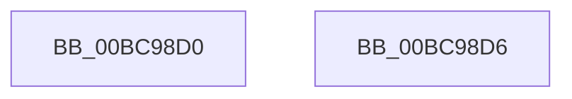

# HvpGetBinContextInitialize

- RVA: `0x00BC98D0`–`0x00BC98D7` (길이 `7` bytes)
- VA: `0x0000000140BC98D0`
- 실행 섹션: `PAGECMRC`
- PDB 이름 있음: `예`; PDB Function 태그: `아니요`
- unwind 정보 RVA: `0x000DB714`
- 디코드: `4`개 명령, `7/7` bytes 표시
- 미해석 바이트: `0` (있으면 어셈블리에 `.byte`로 보존)

> 이 문서는 커널 이미지의 기계어와 PDB 기호를 분석해 생성했습니다. 4번과 5번은 함수 원형과 자료형을 바이너리 사용 방식에서 추정한 C 해석이며 원본 소스 복구 결과는 아닙니다.

## 1. Dependencies

- 직접 호출 지점: **0**; 고유 호출 대상: **0**
- 직접 호출자로 확인된 함수: **18**
- RIP 상대 이미지 참조: **0**

### Outgoing calls
- 직접 디코드된 call 명령이 없습니다.

### Direct callers
- [HvIsCellAllocated](../../page/85/HvIsCellAllocated_function_00855D60.md) at `0x00855D8D`
- [HvpGetCellContextInitialize](../../page/85/HvpGetCellContextInitialize_function_00855F10.md) at `0x00855F23`
- [sub_00859517](../../page/85/Unknown_function_00859517.md) at `0x00859530`
- [HvpFindFreeCell](../../page/85/HvpFindFreeCell_function_00859920.md) at `0x0085994C`
- [HvpGetBinContextMove](../../page/85/HvpGetBinContextMove_function_00859F84.md) at `0x00859F91`
- [HvpRemoveFreeCellHint](../../page/85/HvpRemoveFreeCellHint_function_0085A270.md) at `0x0085A294`
- [HvpEnlistFreeCell](../../page/85/HvpEnlistFreeCell_function_0085A430.md) at `0x0085A4A3`
- [HvFreeCell](../../page/85/HvFreeCell_function_0085A72C.md) at `0x0085A75C`
- [sub_0085AC29](../../page/85/Unknown_function_0085AC29.md) at `0x0085AD81`
- [HvCheckAndUpdateHiveBackupTimeStamp](../../page/87/HvCheckAndUpdateHiveBackupTimeStamp_function_0087BE90.md) at `0x0087BEAD`
- [HvCheckHive](../../page/96/HvCheckHive_function_0096D550.md) at `0x0096D57F`
- [HvpFindNextDirtyBlock](../../page/9B/HvpFindNextDirtyBlock_function_009B5540.md) at `0x009B5583`
- [HvpFindNextDirtyBlock](../../page/9B/HvpFindNextDirtyBlock_function_009B5540.md) at `0x009B558C`
- [HvpSetRangeProtection](../../page/9B/HvpSetRangeProtection_function_009B58C0.md) at `0x009B58EF`
- [HvpCopyModifiedData](../../page/9B/HvpCopyModifiedData_function_009B70A8.md) at `0x009B70D7`
- [HvpDropPagedBins](../../page/9B/HvpDropPagedBins_function_009B7168.md) at `0x009B718D`
- [HvpRemapAndEnlistHiveBins](../../page/9B/HvpRemapAndEnlistHiveBins_function_009B8E0C.md) at `0x009B8E3F`
- [HvpRemapAndEnlistHiveBins](../../page/9B/HvpRemapAndEnlistHiveBins_function_009B8E0C.md) at `0x009B907D`
- [HvpRemapAndEnlistHiveBins](../../page/9B/HvpRemapAndEnlistHiveBins_function_009B8E0C.md) at `0x009B911C`
- [HvpRemapAndEnlistHiveBins](../../page/9B/HvpRemapAndEnlistHiveBins_function_009B8E0C.md) at `0x009B91EE`
- [HvpRemapAndEnlistHiveBins](../../page/9B/HvpRemapAndEnlistHiveBins_function_009B8E0C.md) at `0x009B93D4`
- [HvWriteExternal](../../page/A8/HvWriteExternal_function_00A83C20.md) at `0x00A83C52`
- [sub_00B2E0F0](../../page/B2/Unknown_function_00B2E0F0.md) at `0x00B2E24E`
- [sub_00B2E0F0](../../page/B2/Unknown_function_00B2E0F0.md) at `0x00B2E2D0`

### Static image references
- 디코드된 RIP-relative 메모리 참조가 없습니다.

## 2. Other-region calls and transfers

- 다른 실행 섹션으로 향하는 call: **0**
- 별도 외부 분기/꼬리 이동을 확인하지 못했습니다.

## 3. Assembly (complete function range)

```asm
00BC98D0  33 C0                           xor eax, eax
00BC98D2  66 89 01                        mov word ptr [rcx], ax
00BC98D5  C3                              ret
00BC98D6  CC                              int3
```

## 4. C-style interpretation (structured pseudocode)

```c
__int64 __fastcall HvpGetBinContextInitialize(__int64 a1)
{
    __int64 result;

    result = 0;
    *(unsigned __int16 *)(a1) = 0;
    return result;
}
```

## 5. (Beta) C Style

```c
int64_t HvpGetBinContextInitialize(void *Arg1)
{
    uint8_t *arg1 = (uint8_t *)Arg1;

    int64_t result;

    result = 0;
    *(uint16_t *)(arg1) = 0;
    return result;
}
```

### 관측된 메모리 오프셋

구조체 형식이 확인되지 않은 접근은 인자 기준의 오프셋으로만 기록했습니다.

| 기준 인자 | 오프셋 표현 | 폭 (bit) | 접근 |
|---|---:|---:|---|
| `Arg1` | `+ 0x0` | `16` | `W` |

## 6. Execution-region graph

[열기: 2D/3D 그래프와 함수 탐색 컨트롤 패널](../../../control-panel.html?section=pagecmrc&rva=0x00BC98D0&view=graph)

- 2D 그래프는 위에서 아래로 흐르고, 3D 그래프는 빈 공간을 드래그해 회전합니다. Shift+드래그는 이동, 휠은 확대·축소, 함수 노드 선택은 대상 보고서 이동입니다.

### Static fallback


