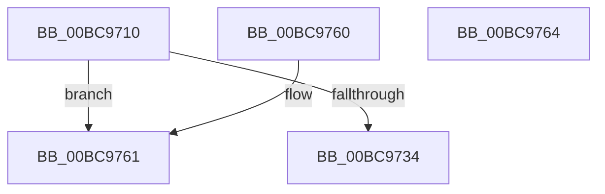

# HvpGetCellMap

- RVA: `0x00BC9710`–`0x00BC9765` (길이 `85` bytes)
- VA: `0x0000000140BC9710`
- 실행 섹션: `PAGECMRC`
- PDB 이름 있음: `예`; PDB Function 태그: `아니요`
- unwind 정보 RVA: `0x000DB714`
- 디코드: `24`개 명령, `85/85` bytes 표시
- 미해석 바이트: `0` (있으면 어셈블리에 `.byte`로 보존)

> 이 문서는 커널 이미지의 기계어와 PDB 기호를 분석해 생성했습니다. 4번과 5번은 함수 원형과 자료형을 바이너리 사용 방식에서 추정한 C 해석이며 원본 소스 복구 결과는 아닙니다.

## 1. Dependencies

- 직접 호출 지점: **0**; 고유 호출 대상: **0**
- 직접 호출자로 확인된 함수: **29**
- RIP 상대 이미지 참조: **0**

### Outgoing calls
- 직접 디코드된 call 명령이 없습니다.

### Direct callers
- [HvpShrinkMap](../../page/7F/HvpShrinkMap_function_007F3D78.md) at `0x007F3DD5`
- [HvHiveCleanup](../../page/84/HvHiveCleanup_function_0084D918.md) at `0x0084D98F`
- [sub_00855DFB](../../page/85/Unknown_function_00855DFB.md) at `0x00855E03`
- [HvpReleaseCellPaged](../../page/85/HvpReleaseCellPaged_function_00855F40.md) at `0x00855F50`
- [sub_008580BF](../../page/85/Unknown_function_008580BF.md) at `0x00858139`
- [sub_00859517](../../page/85/Unknown_function_00859517.md) at `0x008595FF`
- [sub_00859517](../../page/85/Unknown_function_00859517.md) at `0x0085963E`
- [HvMarkCellDirty](../../page/85/HvMarkCellDirty_function_00859758.md) at `0x008597D5`
- [HvpFindFreeCell](../../page/85/HvpFindFreeCell_function_00859920.md) at `0x00859A0A`
- [HvpFindFreeCell](../../page/85/HvpFindFreeCell_function_00859920.md) at `0x00859B07`
- [HvpRemoveFreeCellHint](../../page/85/HvpRemoveFreeCellHint_function_0085A270.md) at `0x0085A29C`
- [HvpEnlistFreeCell](../../page/85/HvpEnlistFreeCell_function_0085A430.md) at `0x0085A451`
- [HvpEnlistFreeCell](../../page/85/HvpEnlistFreeCell_function_0085A430.md) at `0x0085A465`
- [HvpEnlistFreeCell](../../page/85/HvpEnlistFreeCell_function_0085A430.md) at `0x0085A4AD`
- [HvpEnlistFreeCell](../../page/85/HvpEnlistFreeCell_function_0085A430.md) at `0x0085A58E`
- [HvFreeCell](../../page/85/HvFreeCell_function_0085A72C.md) at `0x0085A76F`
- [HvFreeCell](../../page/85/HvFreeCell_function_0085A72C.md) at `0x0085A950`
- [sub_0085AC29](../../page/85/Unknown_function_0085AC29.md) at `0x0085AD1E`
- [sub_0085AC29](../../page/85/Unknown_function_0085AC29.md) at `0x0085AD32`
- [sub_0085AC29](../../page/85/Unknown_function_0085AC29.md) at `0x0085AD8B`
- [sub_0085AE2B](../../page/85/Unknown_function_0085AE2B.md) at `0x0085AEFD`
- [HvCheckAndUpdateHiveBackupTimeStamp](../../page/87/HvCheckAndUpdateHiveBackupTimeStamp_function_0087BE90.md) at `0x0087BEB7`
- [HvCheckHive](../../page/96/HvCheckHive_function_0096D550.md) at `0x0096D5CE`
- [HvpFindNextDirtyBlock](../../page/9B/HvpFindNextDirtyBlock_function_009B5540.md) at `0x009B55EA`
- [HvpFindNextDirtyBlock](../../page/9B/HvpFindNextDirtyBlock_function_009B5540.md) at `0x009B56D2`
- [HvpSetRangeProtection](../../page/9B/HvpSetRangeProtection_function_009B58C0.md) at `0x009B5926`
- [HvpSetRangeProtection](../../page/9B/HvpSetRangeProtection_function_009B58C0.md) at `0x009B5964`
- [HvpTruncateBins](../../page/9B/HvpTruncateBins_function_009B64F0.md) at `0x009B654D`
- [HvpCopyModifiedData](../../page/9B/HvpCopyModifiedData_function_009B70A8.md) at `0x009B7107`
- [HvpDropPagedBins](../../page/9B/HvpDropPagedBins_function_009B7168.md) at `0x009B71CC`
- [HvpPointMapEntriesToBuffer](../../page/9B/HvpPointMapEntriesToBuffer_function_009B7328.md) at `0x009B7355`
- [HvpRemapAndEnlistHiveBins](../../page/9B/HvpRemapAndEnlistHiveBins_function_009B8E0C.md) at `0x009B8EA3`
- [HvpRemapAndEnlistHiveBins](../../page/9B/HvpRemapAndEnlistHiveBins_function_009B8E0C.md) at `0x009B9019`
- [HvpRemapAndEnlistHiveBins](../../page/9B/HvpRemapAndEnlistHiveBins_function_009B8E0C.md) at `0x009B902E`
- [HvpRemapAndEnlistHiveBins](../../page/9B/HvpRemapAndEnlistHiveBins_function_009B8E0C.md) at `0x009B9088`
- [HvpRemapAndEnlistHiveBins](../../page/9B/HvpRemapAndEnlistHiveBins_function_009B8E0C.md) at `0x009B9239`
- [HvpRemapAndEnlistHiveBins](../../page/9B/HvpRemapAndEnlistHiveBins_function_009B8E0C.md) at `0x009B92E6`
- [HvpRemapAndEnlistHiveBins](../../page/9B/HvpRemapAndEnlistHiveBins_function_009B8E0C.md) at `0x009B9361`
- [HvpMapHiveImageFromViewMap](../../page/9B/HvpMapHiveImageFromViewMap_function_009B97F4.md) at `0x009B9848`
- [HvTrimHive](../../page/A4/HvTrimHive_function_00A4F38C.md) at `0x00A4F3C9`
- [HvWriteExternal](../../page/A8/HvWriteExternal_function_00A83C20.md) at `0x00A83C98`
- [HvWriteExternal](../../page/A8/HvWriteExternal_function_00A83C20.md) at `0x00A83D99`
- [HvpAddBin](../../page/AF/HvpAddBin_function_00AF7D48.md) at `0x00AF7FCB`
- [sub_00B2E0F0](../../page/B2/Unknown_function_00B2E0F0.md) at `0x00B2E299`
- [sub_00B3E78C](../../page/B3/Unknown_function_00B3E78C.md) at `0x00B3E795`
- [sub_00B3E78C](../../page/B3/Unknown_function_00B3E78C.md) at `0x00B3E80F`
- [HvSnapshotHiveToOffsetArray](HvSnapshotHiveToOffsetArray_function_00BC9508.md) at `0x00BC9545`
- [HvSnapshotHiveToOffsetArray](HvSnapshotHiveToOffsetArray_function_00BC9508.md) at `0x00BC9641`

### Static image references
- 디코드된 RIP-relative 메모리 참조가 없습니다.

## 2. Other-region calls and transfers

- 다른 실행 섹션으로 향하는 call: **0**
- 별도 외부 분기/꼬리 이동을 확인하지 못했습니다.

## 3. Assembly (complete function range)

```asm
00BC9710  44 8B CA                        mov r9d, edx
00BC9713  41 C1 E9 1F                     shr r9d, 0x1f
00BC9717  41 8B C1                        mov eax, r9d
00BC971A  48 69 C0 78 02 00 00            imul rax, rax, 0x278
00BC9721  41 C1 E1 1F                     shl r9d, 0x1f
00BC9725  48 03 C1                        add rax, rcx
00BC9728  44 03 CA                        add r9d, edx
00BC972B  44 3B 88 18 01 00 00            cmp r9d, dword ptr [rax + 0x118]
00BC9732  73 2D                           jae 0x140bc9761
00BC9734  48 8B 80 20 01 00 00            mov rax, qword ptr [rax + 0x120]
00BC973B  8B CA                           mov ecx, edx
00BC973D  8B D2                           mov edx, edx
00BC973F  48 C1 EA 15                     shr rdx, 0x15
00BC9743  81 E2 FF 03 00 00               and edx, 0x3ff
00BC9749  48 C1 E9 0C                     shr rcx, 0xc
00BC974D  81 E1 FF 01 00 00               and ecx, 0x1ff
00BC9753  48 8B 04 D0                     mov rax, qword ptr [rax + rdx*8]
00BC9757  48 8D 0C 49                     lea rcx, [rcx + rcx*2]
00BC975B  48 8D 04 C8                     lea rax, [rax + rcx*8]
00BC975F  C3                              ret
00BC9760  CC                              int3
00BC9761  33 C0                           xor eax, eax
00BC9763  C3                              ret
00BC9764  CC                              int3
```

## 4. C-style interpretation (structured pseudocode)

```c
__int64 __fastcall HvpGetCellMap(__int64 a1, int a2)
{
    __int64 result;

    a4 = (unsigned int)(((unsigned int)(a2)) >> (31));
    result = ((unsigned int)((unsigned int)(a4))) * ((unsigned int)((unsigned int)(a4)));
    a4 = (unsigned int)((a4) << (31));
    result = (result) + (a1);
    a4 = (unsigned int)((a4) + (a2));
    if (((unsigned int)(a4)) >= (*(unsigned int *)(result + 280))) goto loc_00BC9761;
    a2 = ((unsigned int)(a2)) >> (21);
    a2 = (unsigned int)((a2) & (0x3FFULL));
    a1 = ((unsigned int)(a2)) >> (12);
    a1 = (unsigned int)((a1) & (511));
    return *(unsigned __int64 *)(*(unsigned __int64 *)(result + 288) + a2 * 8) + a1 + a1 * 2 * 8;
loc_00BC9761:
    result = 0;
    return result;
}
```

## 5. (Beta) C Style

```c
int64_t HvpGetCellMap(int64_t Arg1, int32_t Arg2)
{
    int64_t result;

    a4 = (uint32_t)(((uint32_t)(Arg2)) >> (31));
    result = ((uint32_t)((uint32_t)(a4))) * ((uint32_t)((uint32_t)(a4)));
    a4 = (uint32_t)((a4) << (31));
    result = (result) + (Arg1);
    a4 = (uint32_t)((a4) + (Arg2));
    if (((uint32_t)(a4)) >= (*(uint32_t *)(result + 0x118))) goto loc_00BC9761;
    Arg2 = ((uint32_t)(Arg2)) >> (21);
    Arg2 = (uint32_t)((Arg2) & (0x3FFULL));
    Arg1 = ((uint32_t)(Arg2)) >> (12);
    Arg1 = (uint32_t)((Arg1) & (511));
    return *(uint64_t *)(*(uint64_t *)(result + 0x120) + Arg2 * 8) + Arg1 + Arg1 * 2 * 8;
loc_00BC9761:
    result = 0;
    return result;
}
```

## 6. Execution-region graph

[열기: 2D/3D 그래프와 함수 탐색 컨트롤 패널](../../../control-panel.html?section=pagecmrc&rva=0x00BC9710&view=graph)

- 2D 그래프는 위에서 아래로 흐르고, 3D 그래프는 빈 공간을 드래그해 회전합니다. Shift+드래그는 이동, 휠은 확대·축소, 함수 노드 선택은 대상 보고서 이동입니다.

### Static fallback


