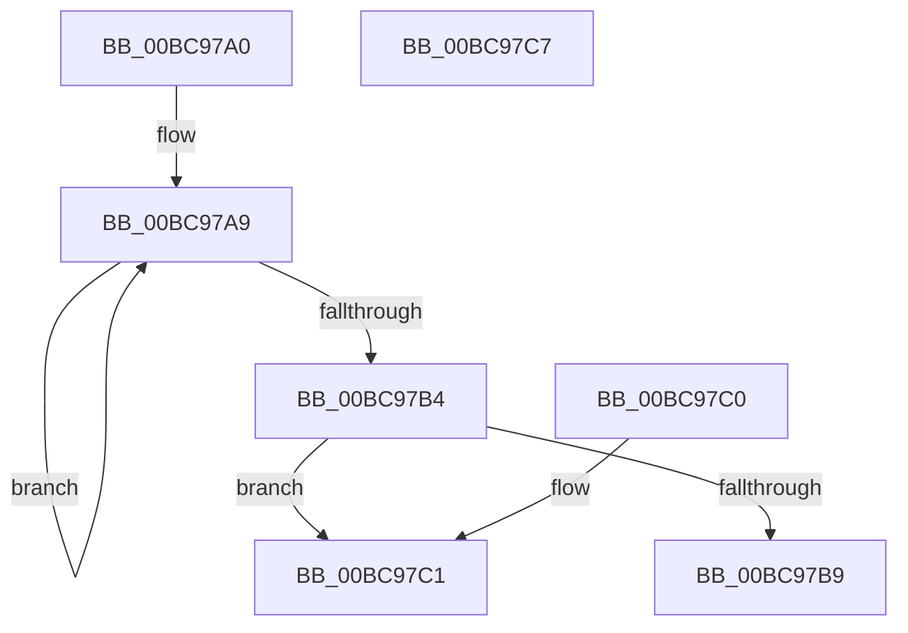

# HvpHeaderCheckSum

- RVA: `0x00BC97A0`–`0x00BC97C8` (길이 `40` bytes)
- VA: `0x0000000140BC97A0`
- 실행 섹션: `PAGECMRC`
- PDB 이름 있음: `예`; PDB Function 태그: `아니요`
- unwind 정보 RVA: `0x000DB714`
- 디코드: `16`개 명령, `40/40` bytes 표시
- 미해석 바이트: `0` (있으면 어셈블리에 `.byte`로 보존)

> 이 문서는 커널 이미지의 기계어와 PDB 기호를 분석해 생성했습니다. 4번과 5번은 함수 원형과 자료형을 바이너리 사용 방식에서 추정한 C 해석이며 원본 소스 복구 결과는 아닙니다.

## 1. Dependencies

- 직접 호출 지점: **0**; 고유 호출 대상: **0**
- 직접 호출자로 확인된 함수: **13**
- RIP 상대 이미지 참조: **0**

### Outgoing calls
- 직접 디코드된 call 명령이 없습니다.

### Direct callers
- [HvpGenerateLogEntryHeader](../../text/48/HvpGenerateLogEntryHeader_function_00481A60.md) at `0x00481B40`
- [HvRecoverFlushProtocolStateFromFiles](../../page/7E/HvRecoverFlushProtocolStateFromFiles_function_007EF224.md) at `0x007EF49D`
- [HvIsInPlaceBaseBlockValid](../../page/7F/HvIsInPlaceBaseBlockValid_function_007F19D4.md) at `0x007F1A15`
- [HvApplyLogFiles](../../page/7F/HvApplyLogFiles_function_007F65E8.md) at `0x007F6698`
- [HvHiveStartMemoryBacked](../../page/87/HvHiveStartMemoryBacked_function_0087BF38.md) at `0x0087C3E7`
- [HvWriteHivePrimaryFile](../../page/9B/HvWriteHivePrimaryFile_function_009B2374.md) at `0x009B23E4`
- [HvValidateOrInvalidatePrimaryFileHeader](../../page/9B/HvValidateOrInvalidatePrimaryFileHeader_function_009B27A8.md) at `0x009B280F`
- [HvpGetHiveHeader](../../page/9B/HvpGetHiveHeader_function_009B8758.md) at `0x009B87EB`
- [HvpLogInvalidLogHeader](../../page/9B/HvpLogInvalidLogHeader_function_009BA3E8.md) at `0x009BA50F`
- [HvWriteExternal](../../page/A8/HvWriteExternal_function_00A83C20.md) at `0x00A83D45`
- [sub_00B2DE6C](../../page/B2/Unknown_function_00B2DE6C.md) at `0x00B2DF23`
- [sub_00B2E3D0](../../page/B2/Unknown_function_00B2E3D0.md) at `0x00B2E3F1`
- [HvSnapshotHiveToOffsetArray](HvSnapshotHiveToOffsetArray_function_00BC9508.md) at `0x00BC95B5`

### Static image references
- 디코드된 RIP-relative 메모리 참조가 없습니다.

## 2. Other-region calls and transfers

- 다른 실행 섹션으로 향하는 call: **0**
- 별도 외부 분기/꼬리 이동을 확인하지 못했습니다.

## 3. Assembly (complete function range)

```asm
00BC97A0  33 C0                           xor eax, eax
00BC97A2  8D 50 7F                        lea edx, [rax + 0x7f]
00BC97A5  44 8D 40 01                     lea r8d, [rax + 1]
00BC97A9  33 01                           xor eax, dword ptr [rcx]
00BC97AB  48 8D 49 04                     lea rcx, [rcx + 4]
00BC97AF  49 2B D0                        sub rdx, r8
00BC97B2  75 F5                           jne 0x140bc97a9
00BC97B4  83 F8 FF                        cmp eax, -1
00BC97B7  74 08                           je 0x140bc97c1
00BC97B9  85 C0                           test eax, eax
00BC97BB  41 0F 44 C0                     cmove eax, r8d
00BC97BF  C3                              ret
00BC97C0  CC                              int3
00BC97C1  B8 FE FF FF FF                  mov eax, 0xfffffffe
00BC97C6  C3                              ret
00BC97C7  CC                              int3
```

## 4. C-style interpretation (structured pseudocode)

```c
__int64 __fastcall HvpHeaderCheckSum(__int64 a1)
{
    __int64 result;

    result = 0;
loc_00BC97A9:
    result = (unsigned int)((result) ^ (*(unsigned int *)(a1)));
    a2 = (result + 127) - (result + 1);
    if (condition_is_not_equal) goto loc_00BC97A9;
    if (((unsigned int)(result)) == -1) goto loc_00BC97C1;
    if ((unsigned int)(result) == 0) { result = (unsigned int)(result + 1); }
    return result;
loc_00BC97C1:
    return (unsigned int)(0xFFFFFFFEULL);
}
```

## 5. (Beta) C Style

```c
int64_t HvpHeaderCheckSum(void *Arg1)
{
    uint8_t *arg1 = (uint8_t *)Arg1;

    int64_t result;

    result = 0;
loc_00BC97A9:
    result = (uint32_t)((result) ^ (*(uint32_t *)(arg1)));
    a2 = (result + 127) - (result + 1);
    if (condition_is_not_equal) goto loc_00BC97A9;
    if (((uint32_t)(result)) == -1) goto loc_00BC97C1;
    if ((uint32_t)(result) == 0) { result = (uint32_t)(result + 1); }
    return result;
loc_00BC97C1:
    return (uint32_t)(0xFFFFFFFEULL);
}
```

### 관측된 메모리 오프셋

구조체 형식이 확인되지 않은 접근은 인자 기준의 오프셋으로만 기록했습니다.

| 기준 인자 | 오프셋 표현 | 폭 (bit) | 접근 |
|---|---:|---:|---|
| `Arg1` | `+ 0x0` | `32` | `R` |
| `Arg1` | `+ 0x4` | `64` | `R` |

## 6. Execution-region graph

[열기: 2D/3D 그래프와 함수 탐색 컨트롤 패널](../../../control-panel.html?section=pagecmrc&rva=0x00BC97A0&view=graph)

- 2D 그래프는 위에서 아래로 흐르고, 3D 그래프는 빈 공간을 드래그해 회전합니다. Shift+드래그는 이동, 휠은 확대·축소, 함수 노드 선택은 대상 보고서 이동입니다.

### Static fallback


