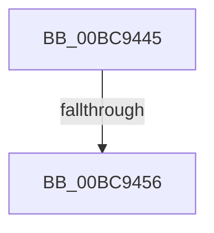

# sub_00BC9445

- RVA: `0x00BC9445`–`0x00BC945D` (길이 `24` bytes)
- VA: `0x0000000140BC9445`
- 실행 섹션: `PAGECMRC`
- PDB 이름 있음: `아니요`; PDB Function 태그: `아니요`
- unwind 정보 RVA: `0x000973A0`
- 디코드: `7`개 명령, `24/24` bytes 표시
- 미해석 바이트: `0` (있으면 어셈블리에 `.byte`로 보존)

> 이 문서는 커널 이미지의 기계어와 PDB 기호를 분석해 생성했습니다. 4번과 5번은 함수 원형과 자료형을 바이너리 사용 방식에서 추정한 C 해석이며 원본 소스 복구 결과는 아닙니다.

## 1. Dependencies

- 직접 호출 지점: **1**; 고유 호출 대상: **1**
- 직접 호출자로 확인된 함수: **0**
- RIP 상대 이미지 참조: **0**

### Outgoing calls
- `0x00BC944A` → [ExfAcquireRundownProtection](../../text/34/ExfAcquireRundownProtection_function_0034C050.md) (function, `0x0034C050`)

### Direct callers
- 이 함수 시작 RVA로 연결되는 직접 call은 확인되지 않았습니다. 간접 호출은 완전히 역산할 수 없습니다.

### Static image references
- 디코드된 RIP-relative 메모리 참조가 없습니다.

## 2. Other-region calls and transfers

- 다른 실행 섹션으로 향하는 call: **1**
  - `0x00BC944A` → [ExfAcquireRundownProtection](../../text/34/ExfAcquireRundownProtection_function_0034C050.md) (`PAGECMRC` → `.text`)
- call이 아닌 외부 분기/꼬리 이동: **2**
  - `0x00BC9454` → [sub_00BC945D](Unknown_function_00BC945D.md) (`tail-transfer`)
  - `0x00BC945B` → [CmpAcquireShutdownRundown + 0x38](CmpAcquireShutdownRundown_function_00BC9400.md) (`tail-transfer`)

## 3. Assembly (complete function range)

```asm
00BC9445  48 89 5C 24 20                  mov qword ptr [rsp + 0x20], rbx
00BC944A  E8 01 2C 78 FF                  call 0x14034c050
00BC944F  0F B6 D8                        movzx ebx, al
00BC9452  84 C0                           test al, al
00BC9454  74 07                           je 0x140bc945d
00BC9456  48 8B 5C 24 20                  mov rbx, qword ptr [rsp + 0x20]
00BC945B  EB DB                           jmp 0x140bc9438
```

## 4. C-style interpretation (structured pseudocode)

```c
__int64 __fastcall sub_00BC9445(void)
{
    __int64 result;
    unsigned __int64 v_stack_p20;

    v_stack_p20 = v_rbx;
    result = ExfAcquireRundownProtection(a1, a2, a3, a4);
}
```

## 5. (Beta) C Style

```c
void sub_00BC9445(void)
{
    int64_t result;
    uint64_t v_stack_p20;

    v_stack_p20 = local_rbx;
    result = ExfAcquireRundownProtection(a1, a2, a3, a4);
}
```

## 6. Execution-region graph

[열기: 2D/3D 그래프와 함수 탐색 컨트롤 패널](../../../control-panel.html?section=pagecmrc&rva=0x00BC9445&view=graph)

- 2D 그래프는 위에서 아래로 흐르고, 3D 그래프는 빈 공간을 드래그해 회전합니다. Shift+드래그는 이동, 휠은 확대·축소, 함수 노드 선택은 대상 보고서 이동입니다.

### Static fallback


