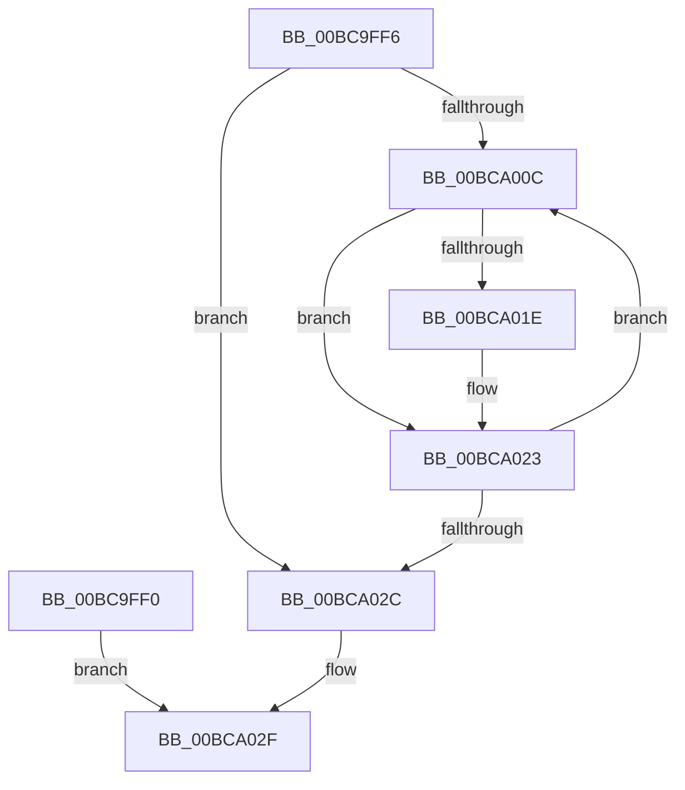

# sub_00BC9FF0

- RVA: `0x00BC9FF0`–`0x00BCA03A` (길이 `74` bytes)
- VA: `0x0000000140BC9FF0`
- 실행 섹션: `PAGECMRC`
- PDB 이름 있음: `아니요`; PDB Function 태그: `아니요`
- unwind 정보 RVA: `0x000ABB9C`
- 디코드: `21`개 명령, `74/74` bytes 표시
- 미해석 바이트: `0` (있으면 어셈블리에 `.byte`로 보존)

> 이 문서는 커널 이미지의 기계어와 PDB 기호를 분석해 생성했습니다. 4번과 5번은 함수 원형과 자료형을 바이너리 사용 방식에서 추정한 C 해석이며 원본 소스 복구 결과는 아닙니다.

## 1. Dependencies

- 직접 호출 지점: **2**; 고유 호출 대상: **2**
- 직접 호출자로 확인된 함수: **0**
- RIP 상대 이미지 참조: **1**

### Outgoing calls
- `0x00BCA01E` → [ExfTryToWakePushLock](../../text/26/ExfTryToWakePushLock_function_00265DD0.md) (function, `0x00265DD0`)
- `0x00BCA02F` → [KeAbPostRelease](../../text/2E/KeAbPostRelease_function_002E1600.md) (function, `0x002E1600`)

### Direct callers
- 이 함수 시작 RVA로 연결되는 직접 call은 확인되지 않았습니다. 간접 호출은 완전히 역산할 수 없습니다.

### Static image references
- `0x00BC9FF6` → RVA `0x00EF7110` (`.data`; read)

## 2. Other-region calls and transfers

- 다른 실행 섹션으로 향하는 call: **2**
  - `0x00BCA01E` → [ExfTryToWakePushLock](../../text/26/ExfTryToWakePushLock_function_00265DD0.md) (`PAGECMRC` → `.text`)
  - `0x00BCA02F` → [KeAbPostRelease](../../text/2E/KeAbPostRelease_function_002E1600.md) (`PAGECMRC` → `.text`)
- call이 아닌 외부 분기/꼬리 이동: **1**
  - `0x00BCA035` → [CmpUnlockRegistry + 0x28](CmpUnlockRegistry_function_00BC9A84.md) (`tail-transfer`)

## 3. Assembly (complete function range)

```asm
00BC9FF0  48 8B 4B 10                     mov rcx, qword ptr [rbx + 0x10]
00BC9FF4  EB 39                           jmp 0x140bca02f
00BC9FF6  48 8B 1D 13 D1 32 00            mov rbx, qword ptr [rip + 0x32d113]
00BC9FFD  48 8B FB                        mov rdi, rbx
00BCA000  48 8D B3 00 01 00 00            lea rsi, [rbx + 0x100]
00BCA007  48 3B DE                        cmp rbx, rsi
00BCA00A  73 20                           jae 0x140bca02c
00BCA00C  48 8B 0F                        mov rcx, qword ptr [rdi]
00BCA00F  48 83 C8 FF                     or rax, 0xffffffffffffffff
00BCA013  F0 48 0F C1 01                  lock xadd qword ptr [rcx], rax
00BCA018  24 06                           and al, 6
00BCA01A  3C 02                           cmp al, 2
00BCA01C  75 05                           jne 0x140bca023
00BCA01E  E8 AD BD 69 FF                  call 0x140265dd0
00BCA023  48 83 C7 08                     add rdi, 8
00BCA027  48 3B FE                        cmp rdi, rsi
00BCA02A  72 E0                           jb 0x140bca00c
00BCA02C  48 8B CB                        mov rcx, rbx
00BCA02F  E8 CC 75 71 FF                  call 0x1402e1600
00BCA034  90                              nop
00BCA035  E9 72 FA FF FF                  jmp 0x140bc9aac
```

## 4. C-style interpretation (structured pseudocode)

```c
__int64 __fastcall sub_00BC9FF0(void)
{
    __int64 result;

    goto loc_00BCA02F;
loc_00BCA02F:
    result = KeAbPostRelease(*(unsigned __int64 *)(v_rbx + 16), a2, a3, a4);
}
```

## 5. (Beta) C Style

```c
void sub_00BC9FF0(void)
{
    int64_t result;

    goto loc_00BCA02F;
loc_00BCA02F:
    result = KeAbPostRelease(*(uint64_t *)(local_rbx + 0x10), a2, a3, a4);
}
```

## 6. Execution-region graph

[열기: 2D/3D 그래프와 함수 탐색 컨트롤 패널](../../../control-panel.html?section=pagecmrc&rva=0x00BC9FF0&view=graph)

- 2D 그래프는 위에서 아래로 흐르고, 3D 그래프는 빈 공간을 드래그해 회전합니다. Shift+드래그는 이동, 휠은 확대·축소, 함수 노드 선택은 대상 보고서 이동입니다.

### Static fallback


