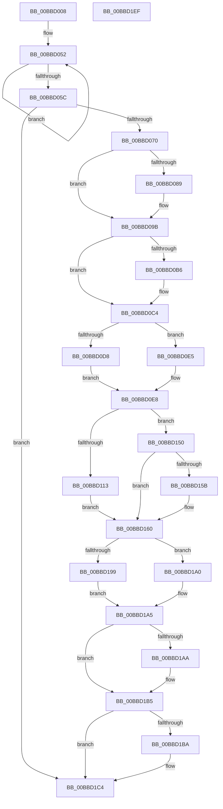

# HdlspAddLogEntry

- RVA: `0x00BBD008`–`0x00BBD1F0` (길이 `488` bytes)
- VA: `0x0000000140BBD008`
- 실행 섹션: `PAGEHDLS`
- PDB 이름 있음: `예`; PDB Function 태그: `아니요`
- unwind 정보 RVA: `0x000D4C10`
- 디코드: `131`개 명령, `488/488` bytes 표시
- 미해석 바이트: `0` (있으면 어셈블리에 `.byte`로 보존)

> 이 문서는 커널 이미지의 기계어와 PDB 기호를 분석해 생성했습니다. 4번과 5번은 함수 원형과 자료형을 바이너리 사용 방식에서 추정한 C 해석이며 원본 소스 복구 결과는 아닙니다.

## 1. Dependencies

- 직접 호출 지점: **8**; 고유 호출 대상: **8**
- 직접 호출자로 확인된 함수: **1**
- RIP 상대 이미지 참조: **3**

### Outgoing calls
- `0x00BBD080` → [ZwQuerySystemInformation](../../text/6A/ZwQuerySystemInformation_function_006AD790.md) (function, `0x006AD790`)
- `0x00BBD0A9` → [ExAllocatePool2](../../poolcode/B8/ExAllocatePool2_function_00B820F0.md) (function, `0x00B820F0`)
- `0x00BBD0BF` → [memcpy](../../text/6C/memcpy_function_006C6840.md) (function, `0x006C6840`)
- `0x00BBD0DB` → [KeAcquireSpinLockRaiseToDpc](../../text/20/KeAcquireSpinLockRaiseToDpc_function_00208470.md) (function, `0x00208470`)
- `0x00BBD126` → [wcscmp](../../text/50/wcscmp_function_00501AF0.md) (function, `0x00501AF0`)
- `0x00BBD1B0` → [KeReleaseSpinLock](../../text/39/KeReleaseSpinLock_function_00392BA0.md) (function, `0x00392BA0`)
- `0x00BBD1BF` → [ExFreePoolWithTag](../../poolcode/B8/ExFreePoolWithTag_function_00B82870.md) (function, `0x00B82870`)
- `0x00BBD1CC` → [_security_check_cookie](../../text/6A/_security_check_cookie_function_006AC640.md) (function, `0x006AC640`)

### Direct callers
- [HdlspDispatch](HdlspDispatch_function_00BBD320.md) at `0x00BBD8EE`

### Static image references
- `0x00BBD024` → RVA `0x00E0A740` (`.data`; read)
- `0x00BBD0C4` → RVA `0x00E68578` (`.data`; read)
- `0x00BBD0EF` → RVA `0x00BBEA80` (` ?? ::CIFEBFPJ::`string'`; read)

## 2. Other-region calls and transfers

- 다른 실행 섹션으로 향하는 call: **8**
  - `0x00BBD080` → [ZwQuerySystemInformation](../../text/6A/ZwQuerySystemInformation_function_006AD790.md) (`PAGEHDLS` → `.text`)
  - `0x00BBD0A9` → [ExAllocatePool2](../../poolcode/B8/ExAllocatePool2_function_00B820F0.md) (`PAGEHDLS` → `POOLCODE`)
  - `0x00BBD0BF` → [memcpy](../../text/6C/memcpy_function_006C6840.md) (`PAGEHDLS` → `.text`)
  - `0x00BBD0DB` → [KeAcquireSpinLockRaiseToDpc](../../text/20/KeAcquireSpinLockRaiseToDpc_function_00208470.md) (`PAGEHDLS` → `.text`)
  - `0x00BBD126` → [wcscmp](../../text/50/wcscmp_function_00501AF0.md) (`PAGEHDLS` → `.text`)
  - `0x00BBD1B0` → [KeReleaseSpinLock](../../text/39/KeReleaseSpinLock_function_00392BA0.md) (`PAGEHDLS` → `.text`)
  - `0x00BBD1BF` → [ExFreePoolWithTag](../../poolcode/B8/ExFreePoolWithTag_function_00B82870.md) (`PAGEHDLS` → `POOLCODE`)
  - `0x00BBD1CC` → [_security_check_cookie](../../text/6A/_security_check_cookie_function_006AC640.md) (`PAGEHDLS` → `.text`)
- 별도 외부 분기/꼬리 이동을 확인하지 못했습니다.

## 3. Assembly (complete function range)

```asm
00BBD008  48 89 5C 24 10                  mov qword ptr [rsp + 0x10], rbx
00BBD00D  48 89 6C 24 18                  mov qword ptr [rsp + 0x18], rbp
00BBD012  48 89 74 24 20                  mov qword ptr [rsp + 0x20], rsi
00BBD017  57                              push rdi
00BBD018  41 54                           push r12
00BBD01A  41 55                           push r13
00BBD01C  41 56                           push r14
00BBD01E  41 57                           push r15
00BBD020  48 83 EC 60                     sub rsp, 0x60
00BBD024  48 8B 05 15 D7 24 00            mov rax, qword ptr [rip + 0x24d715]
00BBD02B  48 33 C4                        xor rax, rsp
00BBD02E  48 89 44 24 50                  mov qword ptr [rsp + 0x50], rax
00BBD033  0F 57 C0                        xorps xmm0, xmm0
00BBD036  45 33 ED                        xor r13d, r13d
00BBD039  45 8B E5                        mov r12d, r13d
00BBD03C  48 83 C8 FF                     or rax, 0xffffffffffffffff
00BBD040  0F 11 44 24 20                  movups xmmword ptr [rsp + 0x20], xmm0
00BBD045  48 8B F9                        mov rdi, rcx
00BBD048  0F 11 44 24 30                  movups xmmword ptr [rsp + 0x30], xmm0
00BBD04D  0F 11 44 24 40                  movups xmmword ptr [rsp + 0x40], xmm0
00BBD052  48 FF C0                        inc rax
00BBD055  66 44 39 2C 41                  cmp word ptr [rcx + rax*2], r13w
00BBD05A  75 F6                           jne 0x140bbd052
00BBD05C  48 8D 1C 45 02 00 00 00         lea rbx, [rax*2 + 2]
00BBD064  44 0F 20 C0                     mov rax, cr8
00BBD068  3C 02                           cmp al, 2
00BBD06A  0F 83 54 01 00 00               jae 0x140bbd1c4
00BBD070  45 33 C9                        xor r9d, r9d
00BBD073  48 8D 54 24 20                  lea rdx, [rsp + 0x20]
00BBD078  45 8D 41 30                     lea r8d, [r9 + 0x30]
00BBD07C  41 8D 49 03                     lea ecx, [r9 + 3]
00BBD080  E8 0B 07 AF FF                  call 0x1406ad790
00BBD085  85 C0                           test eax, eax
00BBD087  79 12                           jns 0x140bbd09b
00BBD089  0F 57 C0                        xorps xmm0, xmm0
00BBD08C  0F 11 44 24 20                  movups xmmword ptr [rsp + 0x20], xmm0
00BBD091  0F 11 44 24 30                  movups xmmword ptr [rsp + 0x30], xmm0
00BBD096  0F 11 44 24 40                  movups xmmword ptr [rsp + 0x40], xmm0
00BBD09B  41 B8 48 64 6C 73               mov r8d, 0x736c6448
00BBD0A1  48 8B D3                        mov rdx, rbx
00BBD0A4  B9 40 00 00 00                  mov ecx, 0x40
00BBD0A9  E8 42 50 FC FF                  call 0x140b820f0
00BBD0AE  4C 8B F0                        mov r14, rax
00BBD0B1  48 85 C0                        test rax, rax
00BBD0B4  74 0E                           je 0x140bbd0c4
00BBD0B6  4C 8B C3                        mov r8, rbx
00BBD0B9  48 8B D7                        mov rdx, rdi
00BBD0BC  48 8B C8                        mov rcx, rax
00BBD0BF  E8 7C 97 B0 FF                  call 0x1406c6840
00BBD0C4  48 8B 05 AD B4 2A 00            mov rax, qword ptr [rip + 0x2ab4ad]
00BBD0CB  BB FF 00 00 00                  mov ebx, 0xff
00BBD0D0  8B 48 30                        mov ecx, dword ptr [rax + 0x30]
00BBD0D3  F6 C1 02                        test cl, 2
00BBD0D6  75 0D                           jne 0x140bbd0e5
00BBD0D8  48 8B C8                        mov rcx, rax
00BBD0DB  E8 90 B3 64 FF                  call 0x140208470
00BBD0E0  40 8A E8                        mov bpl, al
00BBD0E3  EB 03                           jmp 0x140bbd0e8
00BBD0E5  40 8A EB                        mov bpl, bl
00BBD0E8  48 8B 3D 89 B4 2A 00            mov rdi, qword ptr [rip + 0x2ab489]
00BBD0EF  4C 8D 05 8A 19 00 00            lea r8, [rip + 0x198a]
00BBD0F6  0F B7 77 60                     movzx esi, word ptr [rdi + 0x60]
00BBD0FA  83 4F 30 04                     or dword ptr [rdi + 0x30], 4
00BBD0FE  66 FF C6                        inc si
00BBD101  44 0F B7 7F 62                  movzx r15d, word ptr [rdi + 0x62]
00BBD106  66 23 F3                        and si, bx
00BBD109  66 89 77 60                     mov word ptr [rdi + 0x60], si
00BBD10D  66 41 3B F7                     cmp si, r15w
00BBD111  75 3D                           jne 0x140bbd150
00BBD113  48 8B 47 10                     mov rax, qword ptr [rdi + 0x10]
00BBD117  49 8B D0                        mov rdx, r8
00BBD11A  49 6B CF 38                     imul rcx, r15, 0x38
00BBD11E  48 8B 5C 01 30                  mov rbx, qword ptr [rcx + rax + 0x30]
00BBD123  48 8B CB                        mov rcx, rbx
00BBD126  E8 C5 49 94 FF                  call 0x140501af0
00BBD12B  66 41 FF C7                     inc r15w
00BBD12F  4C 8D 05 4A 19 00 00            lea r8, [rip + 0x194a]
00BBD136  B9 FF 00 00 00                  mov ecx, 0xff
00BBD13B  66 44 23 F9                     and r15w, cx
00BBD13F  F7 D8                           neg eax
00BBD141  66 44 89 7F 62                  mov word ptr [rdi + 0x62], r15w
00BBD146  4D 1B E4                        sbb r12, r12
00BBD149  4C 23 E3                        and r12, rbx
00BBD14C  8B D9                           mov ebx, ecx
00BBD14E  EB 10                           jmp 0x140bbd160
00BBD150  B8 FF FF 00 00                  mov eax, 0xffff
00BBD155  66 44 3B F8                     cmp r15w, ax
00BBD159  75 05                           jne 0x140bbd160
00BBD15B  66 44 89 6F 62                  mov word ptr [rdi + 0x62], r13w
00BBD160  0F 10 44 24 20                  movups xmm0, xmmword ptr [rsp + 0x20]
00BBD165  0F B7 C6                        movzx eax, si
00BBD168  48 6B C8 38                     imul rcx, rax, 0x38
00BBD16C  48 8B 47 10                     mov rax, qword ptr [rdi + 0x10]
00BBD170  0F 11 04 01                     movups xmmword ptr [rcx + rax], xmm0
00BBD174  0F 10 4C 24 30                  movups xmm1, xmmword ptr [rsp + 0x30]
00BBD179  0F 11 4C 01 10                  movups xmmword ptr [rcx + rax + 0x10], xmm1
00BBD17E  0F 10 44 24 40                  movups xmm0, xmmword ptr [rsp + 0x40]
00BBD183  0F 11 44 01 20                  movups xmmword ptr [rcx + rax + 0x20], xmm0
00BBD188  0F B7 47 60                     movzx eax, word ptr [rdi + 0x60]
00BBD18C  48 8B 57 10                     mov rdx, qword ptr [rdi + 0x10]
00BBD190  48 6B C8 38                     imul rcx, rax, 0x38
00BBD194  4D 85 F6                        test r14, r14
00BBD197  75 07                           jne 0x140bbd1a0
00BBD199  4C 89 44 11 30                  mov qword ptr [rcx + rdx + 0x30], r8
00BBD19E  EB 05                           jmp 0x140bbd1a5
00BBD1A0  4C 89 74 11 30                  mov qword ptr [rcx + rdx + 0x30], r14
00BBD1A5  40 3A EB                        cmp bpl, bl
00BBD1A8  74 0B                           je 0x140bbd1b5
00BBD1AA  40 8A D5                        mov dl, bpl
00BBD1AD  48 8B CF                        mov rcx, rdi
00BBD1B0  E8 EB 59 7D FF                  call 0x140392ba0
00BBD1B5  4D 85 E4                        test r12, r12
00BBD1B8  74 0A                           je 0x140bbd1c4
00BBD1BA  33 D2                           xor edx, edx
00BBD1BC  49 8B CC                        mov rcx, r12
00BBD1BF  E8 AC 56 FC FF                  call 0x140b82870
00BBD1C4  48 8B 4C 24 50                  mov rcx, qword ptr [rsp + 0x50]
00BBD1C9  48 33 CC                        xor rcx, rsp
00BBD1CC  E8 6F F4 AE FF                  call 0x1406ac640
00BBD1D1  4C 8D 5C 24 60                  lea r11, [rsp + 0x60]
00BBD1D6  49 8B 5B 38                     mov rbx, qword ptr [r11 + 0x38]
00BBD1DA  49 8B 6B 40                     mov rbp, qword ptr [r11 + 0x40]
00BBD1DE  49 8B 73 48                     mov rsi, qword ptr [r11 + 0x48]
00BBD1E2  49 8B E3                        mov rsp, r11
00BBD1E5  41 5F                           pop r15
00BBD1E7  41 5E                           pop r14
00BBD1E9  41 5D                           pop r13
00BBD1EB  41 5C                           pop r12
00BBD1ED  5F                              pop rdi
00BBD1EE  C3                              ret
00BBD1EF  CC                              int3
```

## 4. C-style interpretation (structured pseudocode)

```c
__int64 __fastcall HdlspAddLogEntry(__int64 a1, __int64 a2, __int64 a3, int a4)
{
    __int64 result;
    __int64 v_r12;
    __int64 v_r13;
    __int64 v_r15;
    __int64 v_rsi;
    __int64 v_rsp;
    unsigned __int64 v_stack_m28;
    unsigned __int64 v_stack_m38;
    unsigned __int64 v_stack_m48;
    unsigned __int64 v_stack_m58;
    unsigned __int64 v_stack_m68;
    unsigned __int64 v_stack_p10;
    unsigned __int64 v_stack_p18;
    unsigned __int64 v_stack_p20;

    v_stack_p10 = v_rbx;
    v_stack_p18 = v_rbp;
    v_stack_p20 = v_rsi;
    v_rsp = (v_rsp) - (96);
    result = (*(unsigned __int64 *)(v_rip + 2414357)) ^ (v_rsp);
    v_stack_m38 = result;
    v_r13 = 0;
    result = (result) | (-1);
    v_stack_m68 = v_xmm0;
    v_stack_m58 = v_xmm0;
    v_stack_m48 = v_xmm0;
loc_00BBD052:
    result = (result) + 1;
    if ((*(unsigned __int16 *)(a1 + result * 2)) != 0) goto loc_00BBD052;
    if (((unsigned __int8)(v_cr8)) >= 2) goto loc_00BBD1C4;
    a4 = 0;
    result = ZwQuerySystemInformation(a4 + 3, v_stack_m68, a4 + 48, a4);
    if (sign_flag) {
        v_stack_m68 = v_xmm0;
        v_stack_m58 = v_xmm0;
        v_stack_m48 = v_xmm0;
    }
    result = ExAllocatePool2(64, result * 2 + 2, (unsigned int)(0x736C6448ULL), a4);
    if (result != 0) {
        a3 = result * 2 + 2;
        a2 = a1;
        a1 = result;
        result = memcpy(a1, a2, a3, a4);
    }
    if ((((unsigned __int8)((unsigned int)(*(unsigned int *)(*(unsigned __int64 *)(v_rip + 2798765) + 48)))) & (2)) != 0) goto loc_00BBD0E5;
    result = KeAcquireSpinLockRaiseToDpc(*(unsigned __int64 *)(v_rip + 2798765), a2, a3, a4);
    goto loc_00BBD0E8;
loc_00BBD0E5:
loc_00BBD0E8:
    v_rsi = (unsigned __int16)((*(unsigned __int16 *)(*(unsigned __int64 *)(v_rip + 2798729) + 96)) + 1);
    v_rsi = (unsigned __int16)((v_rsi) & (255));
    *(unsigned __int16 *)(*(unsigned __int64 *)(v_rip + 2798729) + 96) = (unsigned __int16)(v_rsi);
    if (((unsigned __int16)(v_rsi)) != ((unsigned __int16)(*(unsigned __int16 *)(*(unsigned __int64 *)(v_rip + 2798729) + 98)))) goto loc_00BBD150;
    a1 = (*(unsigned __int64 *)(v_rip + 2798765)) * (*(unsigned __int16 *)(*(unsigned __int64 *)(v_rip + 2798729) + 98));
    result = wcscmp(*(unsigned __int64 *)(a1 + *(unsigned __int64 *)(*(unsigned __int64 *)(v_rip + 2798729) + 16) * 1 + 48), v_rip + 6538, v_rip + 6538, a4);
    v_r15 = (unsigned __int16)((*(unsigned __int16 *)(*(unsigned __int64 *)(v_rip + 2798729) + 98)) + 1);
    v_r15 = (unsigned __int16)((v_r15) & (255));
    result = (unsigned int)(-(result));
    *(unsigned __int16 *)(*(unsigned __int64 *)(v_rip + 2798729) + 98) = (unsigned __int16)(v_r15);
    v_r12 = (0) & (*(unsigned __int64 *)(a1 + *(unsigned __int64 *)(*(unsigned __int64 *)(v_rip + 2798729) + 16) * 1 + 48));
    goto loc_00BBD160;
loc_00BBD150:
    if (((unsigned __int16)(v_r15)) == ((unsigned __int16)((unsigned int)(0xFFFFULL)))) {
        *(unsigned __int16 *)(*(unsigned __int64 *)(v_rip + 2798729) + 98) = 0;
    }
    a1 = (255) * ((unsigned __int16)(v_rsi));
    *(unsigned __int64 *)(a1 + *(unsigned __int64 *)(*(unsigned __int64 *)(v_rip + 2798729) + 16) * 1) = v_xmm0;
    *(unsigned __int64 *)(a1 + *(unsigned __int64 *)(*(unsigned __int64 *)(v_rip + 2798729) + 16) * 1 + 16) = v_xmm1;
    *(unsigned __int64 *)(a1 + *(unsigned __int64 *)(*(unsigned __int64 *)(v_rip + 2798729) + 16) * 1 + 32) = v_xmm0;
    a1 = (a1) * (*(unsigned __int16 *)(*(unsigned __int64 *)(v_rip + 2798729) + 96));
    if (result != 0) goto loc_00BBD1A0;
    *(unsigned __int64 *)(a1 + *(unsigned __int64 *)(*(unsigned __int64 *)(v_rip + 2798729) + 16) * 1 + 48) = v_rip + 6474;
    goto loc_00BBD1A5;
loc_00BBD1A0:
    *(unsigned __int64 *)(a1 + *(unsigned __int64 *)(*(unsigned __int64 *)(v_rip + 2798729) + 16) * 1 + 48) = result;
loc_00BBD1A5:
    result = *(unsigned __int16 *)(*(unsigned __int64 *)(v_rip + 2798729) + 96);
    if (255 != 255) {
        a2 = 255;
        a1 = *(unsigned __int64 *)(v_rip + 2798729);
        result = KeReleaseSpinLock(a1, a2, v_rip + 6474, a4);
    }
    if (v_r12 != 0) {
        a2 = 0;
        a1 = v_r12;
        result = ExFreePoolWithTag(a1, a2, v_rip + 6474, a4);
    }
    a1 = (v_stack_m38) ^ (v_rsp);
    result = _security_check_cookie(a1, a2, v_rip + 6474, a4);
    return result;
}
```

## 5. (Beta) C Style

```c
int64_t HdlspAddLogEntry(void *Arg1, int64_t Arg2, int64_t Arg3, int32_t Arg4)
{
    uint8_t *arg1 = (uint8_t *)Arg1;

    int64_t result;
    int64_t local_r12;
    int64_t local_r13;
    int64_t local_r15;
    int64_t local_rsi;
    int64_t local_rsp;
    uint64_t v_stack_m28;
    uint64_t v_stack_m38;
    uint64_t v_stack_m48;
    uint64_t v_stack_m58;
    uint64_t v_stack_m68;
    uint64_t v_stack_p10;
    uint64_t v_stack_p18;
    uint64_t v_stack_p20;

    v_stack_p10 = local_rbx;
    v_stack_p18 = local_rbp;
    v_stack_p20 = local_rsi;
    local_rsp = (local_rsp) - (96);
    result = (*(uint64_t *)(v_rip + 0x24D715)) ^ (local_rsp);
    v_stack_m38 = result;
    local_r13 = 0;
    result = (result) | (-1);
    v_stack_m68 = v_xmm0;
    v_stack_m58 = v_xmm0;
    v_stack_m48 = v_xmm0;
loc_00BBD052:
    result = (result) + 1;
    if ((*(uint16_t *)(arg1 + result * 2)) != 0) goto loc_00BBD052;
    if (((uint8_t)(v_cr8)) >= 2) goto loc_00BBD1C4;
    Arg4 = 0;
    result = ZwQuerySystemInformation(Arg4 + 3, v_stack_m68, Arg4 + 48, Arg4);
    if (sign_flag) {
        v_stack_m68 = v_xmm0;
        v_stack_m58 = v_xmm0;
        v_stack_m48 = v_xmm0;
    }
    result = ExAllocatePool2(64, result * 2 + 2, (uint32_t)(0x736C6448ULL), Arg4);
    if (result != 0) {
        Arg3 = result * 2 + 2;
        Arg2 = Arg1;
        Arg1 = result;
        result = memcpy(Arg1, Arg2, Arg3, Arg4);
    }
    if ((((uint8_t)((uint32_t)(*(uint32_t *)(*(uint64_t *)(v_rip + 0x2AB4AD) + 0x30)))) & (2)) != 0) goto loc_00BBD0E5;
    result = KeAcquireSpinLockRaiseToDpc(*(uint64_t *)(v_rip + 0x2AB4AD), Arg2, Arg3, Arg4);
    goto loc_00BBD0E8;
loc_00BBD0E5:
loc_00BBD0E8:
    local_rsi = (uint16_t)((*(uint16_t *)(*(uint64_t *)(v_rip + 0x2AB489) + 0x60)) + 1);
    local_rsi = (uint16_t)((local_rsi) & (255));
    *(uint16_t *)(*(uint64_t *)(v_rip + 0x2AB489) + 0x60) = (uint16_t)(local_rsi);
    if (((uint16_t)(local_rsi)) != ((uint16_t)(*(uint16_t *)(*(uint64_t *)(v_rip + 0x2AB489) + 0x62)))) goto loc_00BBD150;
    Arg1 = (*(uint64_t *)(v_rip + 0x2AB4AD)) * (*(uint16_t *)(*(uint64_t *)(v_rip + 0x2AB489) + 0x62));
    result = wcscmp(*(uint64_t *)(arg1 + *(uint64_t *)(*(uint64_t *)(v_rip + 0x2AB489) + 0x10) * 1 + 0x30), v_rip + 6538, v_rip + 6538, Arg4);
    local_r15 = (uint16_t)((*(uint16_t *)(*(uint64_t *)(v_rip + 0x2AB489) + 0x62)) + 1);
    local_r15 = (uint16_t)((local_r15) & (255));
    result = (uint32_t)(-(result));
    *(uint16_t *)(*(uint64_t *)(v_rip + 0x2AB489) + 0x62) = (uint16_t)(local_r15);
    local_r12 = (0) & (*(uint64_t *)(arg1 + *(uint64_t *)(*(uint64_t *)(v_rip + 0x2AB489) + 0x10) * 1 + 0x30));
    goto loc_00BBD160;
loc_00BBD150:
    if (((uint16_t)(local_r15)) == ((uint16_t)((uint32_t)(0xFFFFULL)))) {
        *(uint16_t *)(*(uint64_t *)(v_rip + 0x2AB489) + 0x62) = 0;
    }
    Arg1 = (255) * ((uint16_t)(local_rsi));
    *(uint64_t *)(arg1 + *(uint64_t *)(*(uint64_t *)(v_rip + 0x2AB489) + 0x10) * 1) = v_xmm0;
    *(uint64_t *)(arg1 + *(uint64_t *)(*(uint64_t *)(v_rip + 0x2AB489) + 0x10) * 1 + 0x10) = v_xmm1;
    *(uint64_t *)(arg1 + *(uint64_t *)(*(uint64_t *)(v_rip + 0x2AB489) + 0x10) * 1 + 0x20) = v_xmm0;
    Arg1 = (Arg1) * (*(uint16_t *)(*(uint64_t *)(v_rip + 0x2AB489) + 0x60));
    if (result != 0) goto loc_00BBD1A0;
    *(uint64_t *)(arg1 + *(uint64_t *)(*(uint64_t *)(v_rip + 0x2AB489) + 0x10) * 1 + 0x30) = v_rip + 6474;
    goto loc_00BBD1A5;
loc_00BBD1A0:
    *(uint64_t *)(arg1 + *(uint64_t *)(*(uint64_t *)(v_rip + 0x2AB489) + 0x10) * 1 + 0x30) = result;
loc_00BBD1A5:
    result = *(uint16_t *)(*(uint64_t *)(v_rip + 0x2AB489) + 0x60);
    if (255 != 255) {
        Arg2 = 255;
        Arg1 = *(uint64_t *)(v_rip + 0x2AB489);
        result = KeReleaseSpinLock(Arg1, Arg2, v_rip + 6474, Arg4);
    }
    if (local_r12 != 0) {
        Arg2 = 0;
        Arg1 = local_r12;
        result = ExFreePoolWithTag(Arg1, Arg2, v_rip + 6474, Arg4);
    }
    Arg1 = (v_stack_m38) ^ (local_rsp);
    result = _security_check_cookie(Arg1, Arg2, v_rip + 6474, Arg4);
    return result;
}
```

### 관측된 메모리 오프셋

구조체 형식이 확인되지 않은 접근은 인자 기준의 오프셋으로만 기록했습니다.

| 기준 인자 | 오프셋 표현 | 폭 (bit) | 접근 |
|---|---:|---:|---|
| `Arg1` | `+ 0x0 + rax*2` | `16` | `R` |

## 6. Execution-region graph

[열기: 2D/3D 그래프와 함수 탐색 컨트롤 패널](../../../control-panel.html?section=pagehdls&rva=0x00BBD008&view=graph)

- 2D 그래프는 위에서 아래로 흐르고, 3D 그래프는 빈 공간을 드래그해 회전합니다. Shift+드래그는 이동, 휠은 확대·축소, 함수 노드 선택은 대상 보고서 이동입니다.

### Static fallback


