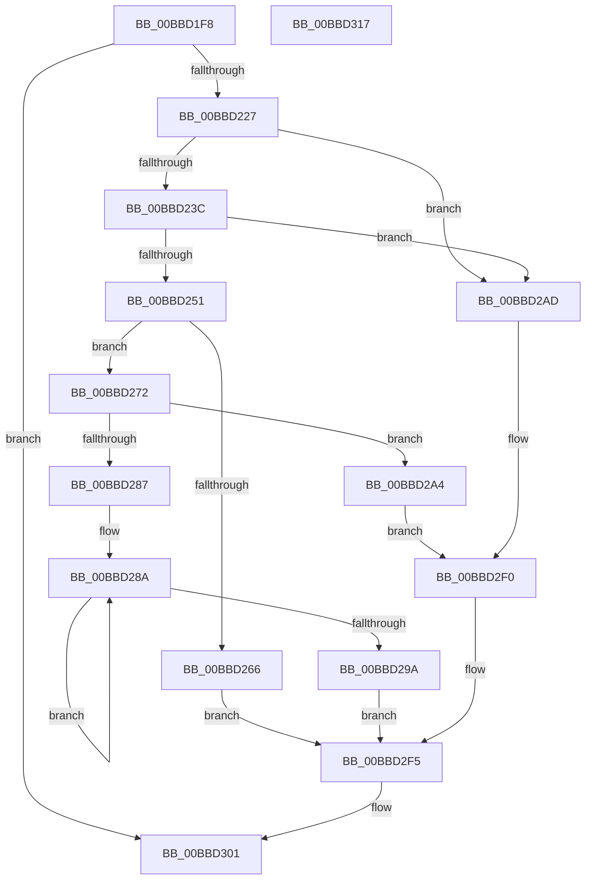

# HdlspBugCheckProcessing

- RVA: `0x00BBD1F8`–`0x00BBD318` (길이 `288` bytes)
- VA: `0x0000000140BBD1F8`
- 실행 섹션: `PAGEHDLS`
- PDB 이름 있음: `예`; PDB Function 태그: `아니요`
- unwind 정보 RVA: `0x00080C0C`
- 디코드: `64`개 명령, `288/288` bytes 표시
- 미해석 바이트: `0` (있으면 어셈블리에 `.byte`로 보존)

> 이 문서는 커널 이미지의 기계어와 PDB 기호를 분석해 생성했습니다. 4번과 5번은 함수 원형과 자료형을 바이너리 사용 방식에서 추정한 C 해석이며 원본 소스 복구 결과는 아닙니다.

## 1. Dependencies

- 직접 호출 지점: **16**; 고유 호출 대상: **7**
- 직접 호출자로 확인된 함수: **1**
- RIP 상대 이미지 참조: **12**

### Outgoing calls
- `0x00BBD21A` → [HdlspGetLine](HdlspGetLine_function_00BBDAA4.md) (function, `0x00BBDAA4`)
- `0x00BBD233` → [stricmp](../../text/4F/stricmp_function_004FFD80.md) (function, `0x004FFD80`)
- `0x00BBD248` → [stricmp](../../text/4F/stricmp_function_004FFD80.md) (function, `0x004FFD80`)
- `0x00BBD25D` → [stricmp](../../text/4F/stricmp_function_004FFD80.md) (function, `0x004FFD80`)
- `0x00BBD268` → [HdlspProcessDumpCommand](HdlspProcessDumpCommand_function_00BBDFDC.md) (function, `0x00BBDFDC`)
- `0x00BBD27E` → [stricmp](../../text/4F/stricmp_function_004FFD80.md) (function, `0x004FFD80`)
- `0x00BBD28F` → [KeStallExecutionProcessor](../../text/44/KeStallExecutionProcessor_function_0044F620.md) (function, `0x0044F620`)
- `0x00BBD29D` → [HalReturnToFirmware](../../text/54/HalReturnToFirmware_function_00546550.md) (function, `0x00546550`)
- `0x00BBD2B4` → [HdlspSendStringAtBaud](HdlspSendStringAtBaud_function_00BBE5CC.md) (function, `0x00BBE5CC`)
- `0x00BBD2C0` → [HdlspSendStringAtBaud](HdlspSendStringAtBaud_function_00BBE5CC.md) (function, `0x00BBE5CC`)
- `0x00BBD2CC` → [HdlspSendStringAtBaud](HdlspSendStringAtBaud_function_00BBE5CC.md) (function, `0x00BBE5CC`)
- `0x00BBD2D8` → [HdlspSendStringAtBaud](HdlspSendStringAtBaud_function_00BBE5CC.md) (function, `0x00BBE5CC`)
- `0x00BBD2E4` → [HdlspSendStringAtBaud](HdlspSendStringAtBaud_function_00BBE5CC.md) (function, `0x00BBE5CC`)
- `0x00BBD2F0` → [HdlspSendStringAtBaud](HdlspSendStringAtBaud_function_00BBE5CC.md) (function, `0x00BBE5CC`)
- `0x00BBD2FC` → [HdlspSendStringAtBaud](HdlspSendStringAtBaud_function_00BBE5CC.md) (function, `0x00BBE5CC`)
- `0x00BBD309` → [_security_check_cookie](../../text/6A/_security_check_cookie_function_006AC640.md) (function, `0x006AC640`)

### Direct callers
- [HdlspDispatch](HdlspDispatch_function_00BBD320.md) at `0x00BBD98C`

### Static image references
- `0x00BBD201` → RVA `0x00E0A740` (`.data`; read)
- `0x00BBD227` → RVA `0x00BBE920` (` ?? ::CIFEBFPJ::`string'`; read)
- `0x00BBD23C` → RVA `0x00BBE8A0` (` ?? ::CIFEBFPJ::`string'`; read)
- `0x00BBD251` → RVA `0x00BBEC40` (` ?? ::CIFEBFPJ::`string'`; read)
- `0x00BBD272` → RVA `0x00BBECA0` (` ?? ::CIFEBFPJ::`string'`; read)
- `0x00BBD2A4` → RVA `0x00BBEC70` (` ?? ::CIFEBFPJ::`string'`; read)
- `0x00BBD2AD` → RVA `0x00BBE970` (` ?? ::CIFEBFPJ::`string'`; read)
- `0x00BBD2B9` → RVA `0x00BBE860` (` ?? ::CIFEBFPJ::`string'`; read)
- `0x00BBD2C5` → RVA `0x00BBE8E0` (` ?? ::CIFEBFPJ::`string'`; read)
- `0x00BBD2D1` → RVA `0x00BBE8B0` (` ?? ::CIFEBFPJ::`string'`; read)
- `0x00BBD2DD` → RVA `0x00BBEC50` (` ?? ::CIFEBFPJ::`string'`; read)
- `0x00BBD2F5` → RVA `0x00BBE950` (` ?? ::CIFEBFPJ::`string'`; read)

## 2. Other-region calls and transfers

- 다른 실행 섹션으로 향하는 call: **7**
  - `0x00BBD233` → [stricmp](../../text/4F/stricmp_function_004FFD80.md) (`PAGEHDLS` → `.text`)
  - `0x00BBD248` → [stricmp](../../text/4F/stricmp_function_004FFD80.md) (`PAGEHDLS` → `.text`)
  - `0x00BBD25D` → [stricmp](../../text/4F/stricmp_function_004FFD80.md) (`PAGEHDLS` → `.text`)
  - `0x00BBD27E` → [stricmp](../../text/4F/stricmp_function_004FFD80.md) (`PAGEHDLS` → `.text`)
  - `0x00BBD28F` → [KeStallExecutionProcessor](../../text/44/KeStallExecutionProcessor_function_0044F620.md) (`PAGEHDLS` → `.text`)
  - `0x00BBD29D` → [HalReturnToFirmware](../../text/54/HalReturnToFirmware_function_00546550.md) (`PAGEHDLS` → `.text`)
  - `0x00BBD309` → [_security_check_cookie](../../text/6A/_security_check_cookie_function_006AC640.md) (`PAGEHDLS` → `.text`)
- 별도 외부 분기/꼬리 이동을 확인하지 못했습니다.

## 3. Assembly (complete function range)

```asm
00BBD1F8  40 53                           push rbx
00BBD1FA  48 81 EC 80 00 00 00            sub rsp, 0x80
00BBD201  48 8B 05 38 D5 24 00            mov rax, qword ptr [rip + 0x24d538]
00BBD208  48 33 C4                        xor rax, rsp
00BBD20B  48 89 44 24 70                  mov qword ptr [rsp + 0x70], rax
00BBD210  BA 50 00 00 00                  mov edx, 0x50
00BBD215  48 8D 4C 24 20                  lea rcx, [rsp + 0x20]
00BBD21A  E8 85 08 00 00                  call 0x140bbdaa4
00BBD21F  84 C0                           test al, al
00BBD221  0F 84 DA 00 00 00               je 0x140bbd301
00BBD227  48 8D 15 F2 16 00 00            lea rdx, [rip + 0x16f2]
00BBD22E  48 8D 4C 24 20                  lea rcx, [rsp + 0x20]
00BBD233  E8 48 2B 94 FF                  call 0x1404ffd80
00BBD238  85 C0                           test eax, eax
00BBD23A  74 71                           je 0x140bbd2ad
00BBD23C  48 8D 15 5D 16 00 00            lea rdx, [rip + 0x165d]
00BBD243  48 8D 4C 24 20                  lea rcx, [rsp + 0x20]
00BBD248  E8 33 2B 94 FF                  call 0x1404ffd80
00BBD24D  85 C0                           test eax, eax
00BBD24F  74 5C                           je 0x140bbd2ad
00BBD251  48 8D 15 E8 19 00 00            lea rdx, [rip + 0x19e8]
00BBD258  48 8D 4C 24 20                  lea rcx, [rsp + 0x20]
00BBD25D  E8 1E 2B 94 FF                  call 0x1404ffd80
00BBD262  85 C0                           test eax, eax
00BBD264  75 0C                           jne 0x140bbd272
00BBD266  B1 01                           mov cl, 1
00BBD268  E8 6F 0D 00 00                  call 0x140bbdfdc
00BBD26D  E9 83 00 00 00                  jmp 0x140bbd2f5
00BBD272  48 8D 15 27 1A 00 00            lea rdx, [rip + 0x1a27]
00BBD279  48 8D 4C 24 20                  lea rcx, [rsp + 0x20]
00BBD27E  E8 FD 2A 94 FF                  call 0x1404ffd80
00BBD283  85 C0                           test eax, eax
00BBD285  75 1D                           jne 0x140bbd2a4
00BBD287  8D 58 0A                        lea ebx, [rax + 0xa]
00BBD28A  B9 A0 86 01 00                  mov ecx, 0x186a0
00BBD28F  E8 8C 23 89 FF                  call 0x14044f620
00BBD294  48 83 EB 01                     sub rbx, 1
00BBD298  75 F0                           jne 0x140bbd28a
00BBD29A  8D 4B 03                        lea ecx, [rbx + 3]
00BBD29D  E8 AE 92 98 FF                  call 0x140546550
00BBD2A2  EB 51                           jmp 0x140bbd2f5
00BBD2A4  48 8D 0D C5 19 00 00            lea rcx, [rip + 0x19c5]
00BBD2AB  EB 43                           jmp 0x140bbd2f0
00BBD2AD  48 8D 0D BC 16 00 00            lea rcx, [rip + 0x16bc]
00BBD2B4  E8 13 13 00 00                  call 0x140bbe5cc
00BBD2B9  48 8D 0D A0 15 00 00            lea rcx, [rip + 0x15a0]
00BBD2C0  E8 07 13 00 00                  call 0x140bbe5cc
00BBD2C5  48 8D 0D 14 16 00 00            lea rcx, [rip + 0x1614]
00BBD2CC  E8 FB 12 00 00                  call 0x140bbe5cc
00BBD2D1  48 8D 0D D8 15 00 00            lea rcx, [rip + 0x15d8]
00BBD2D8  E8 EF 12 00 00                  call 0x140bbe5cc
00BBD2DD  48 8D 0D 6C 19 00 00            lea rcx, [rip + 0x196c]
00BBD2E4  E8 E3 12 00 00                  call 0x140bbe5cc
00BBD2E9  48 8D 0D 80 16 00 00            lea rcx, [rip + 0x1680]
00BBD2F0  E8 D7 12 00 00                  call 0x140bbe5cc
00BBD2F5  48 8D 0D 54 16 00 00            lea rcx, [rip + 0x1654]
00BBD2FC  E8 CB 12 00 00                  call 0x140bbe5cc
00BBD301  48 8B 4C 24 70                  mov rcx, qword ptr [rsp + 0x70]
00BBD306  48 33 CC                        xor rcx, rsp
00BBD309  E8 32 F3 AE FF                  call 0x1406ac640
00BBD30E  48 81 C4 80 00 00 00            add rsp, 0x80
00BBD315  5B                              pop rbx
00BBD316  C3                              ret
00BBD317  CC                              int3
```

## 4. C-style interpretation (structured pseudocode)

```c
__int64 __fastcall HdlspBugCheckProcessing(void)
{
    __int64 result;
    __int64 v_rbx;
    __int64 v_rsp;
    unsigned __int64 v_stack_m18;
    unsigned __int64 v_stack_m68;

    v_rsp = (v_rsp) - (128);
    result = (*(unsigned __int64 *)(v_rip + 2413880)) ^ (v_rsp);
    v_stack_m18 = result;
    result = HdlspGetLine(v_stack_m68, 80, a3, a4);
    if ((unsigned __int8)(result) == 0) goto loc_00BBD301;
    result = stricmp(v_stack_m68, v_rip + 5874, a3, a4);
    if ((unsigned int)(result) == 0) goto loc_00BBD2AD;
    result = stricmp(v_stack_m68, v_rip + 5725, a3, a4);
    if ((unsigned int)(result) == 0) goto loc_00BBD2AD;
    result = stricmp(v_stack_m68, v_rip + 6632, a3, a4);
    if ((unsigned int)(result) != 0) goto loc_00BBD272;
    result = HdlspProcessDumpCommand(1, v_rip + 6632, a3, a4);
    goto loc_00BBD2F5;
loc_00BBD272:
    result = stricmp(v_stack_m68, v_rip + 6695, a3, a4);
    if ((unsigned int)(result) != 0) goto loc_00BBD2A4;
loc_00BBD28A:
    result = KeStallExecutionProcessor((unsigned int)(0x186A0ULL), v_rip + 6695, a3, a4);
    v_rbx = (result + 10) - (1);
    if (condition_is_not_equal) goto loc_00BBD28A;
    result = HalReturnToFirmware(v_rbx + 3, v_rip + 6695, a3, a4);
    goto loc_00BBD2F5;
loc_00BBD2A4:
    goto loc_00BBD2F0;
loc_00BBD2AD:
    result = HdlspSendStringAtBaud(v_rip + 5820, v_rip + 6695, a3, a4);
    result = HdlspSendStringAtBaud(v_rip + 5536, v_rip + 6695, a3, a4);
    result = HdlspSendStringAtBaud(v_rip + 5652, v_rip + 6695, a3, a4);
    result = HdlspSendStringAtBaud(v_rip + 5592, v_rip + 6695, a3, a4);
    result = HdlspSendStringAtBaud(v_rip + 6508, v_rip + 6695, a3, a4);
loc_00BBD2F0:
    result = HdlspSendStringAtBaud(v_rip + 5760, v_rip + 6695, a3, a4);
loc_00BBD2F5:
    result = HdlspSendStringAtBaud(v_rip + 5716, v_rip + 6695, a3, a4);
loc_00BBD301:
    a1 = (v_stack_m18) ^ (v_rsp);
    result = _security_check_cookie(a1, v_rip + 6695, a3, a4);
    v_rsp = (v_rsp) + (128);
    return result;
}
```

## 5. (Beta) C Style

```c
void HdlspBugCheckProcessing(void)
{
    int64_t result;
    int64_t local_rbx;
    int64_t local_rsp;
    uint64_t v_stack_m18;
    uint64_t v_stack_m68;

    local_rsp = (local_rsp) - (128);
    result = (*(uint64_t *)(v_rip + 0x24D538)) ^ (local_rsp);
    v_stack_m18 = result;
    result = HdlspGetLine(v_stack_m68, 80, a3, a4);
    if ((uint8_t)(result) == 0) goto loc_00BBD301;
    result = stricmp(v_stack_m68, v_rip + 5874, a3, a4);
    if ((uint32_t)(result) == 0) goto loc_00BBD2AD;
    result = stricmp(v_stack_m68, v_rip + 5725, a3, a4);
    if ((uint32_t)(result) == 0) goto loc_00BBD2AD;
    result = stricmp(v_stack_m68, v_rip + 6632, a3, a4);
    if ((uint32_t)(result) != 0) goto loc_00BBD272;
    result = HdlspProcessDumpCommand(1, v_rip + 6632, a3, a4);
    goto loc_00BBD2F5;
loc_00BBD272:
    result = stricmp(v_stack_m68, v_rip + 6695, a3, a4);
    if ((uint32_t)(result) != 0) goto loc_00BBD2A4;
loc_00BBD28A:
    result = KeStallExecutionProcessor((uint32_t)(0x186A0ULL), v_rip + 6695, a3, a4);
    local_rbx = (result + 10) - (1);
    if (condition_is_not_equal) goto loc_00BBD28A;
    result = HalReturnToFirmware(local_rbx + 3, v_rip + 6695, a3, a4);
    goto loc_00BBD2F5;
loc_00BBD2A4:
    goto loc_00BBD2F0;
loc_00BBD2AD:
    result = HdlspSendStringAtBaud(v_rip + 5820, v_rip + 6695, a3, a4);
    result = HdlspSendStringAtBaud(v_rip + 5536, v_rip + 6695, a3, a4);
    result = HdlspSendStringAtBaud(v_rip + 5652, v_rip + 6695, a3, a4);
    result = HdlspSendStringAtBaud(v_rip + 5592, v_rip + 6695, a3, a4);
    result = HdlspSendStringAtBaud(v_rip + 6508, v_rip + 6695, a3, a4);
loc_00BBD2F0:
    result = HdlspSendStringAtBaud(v_rip + 5760, v_rip + 6695, a3, a4);
loc_00BBD2F5:
    result = HdlspSendStringAtBaud(v_rip + 5716, v_rip + 6695, a3, a4);
loc_00BBD301:
    a1 = (v_stack_m18) ^ (local_rsp);
    result = _security_check_cookie(a1, v_rip + 6695, a3, a4);
    local_rsp = (local_rsp) + (128);
    return result;
}
```

## 6. Execution-region graph

[열기: 2D/3D 그래프와 함수 탐색 컨트롤 패널](../../../control-panel.html?section=pagehdls&rva=0x00BBD1F8&view=graph)

- 2D 그래프는 위에서 아래로 흐르고, 3D 그래프는 빈 공간을 드래그해 회전합니다. Shift+드래그는 이동, 휠은 확대·축소, 함수 노드 선택은 대상 보고서 이동입니다.

### Static fallback


