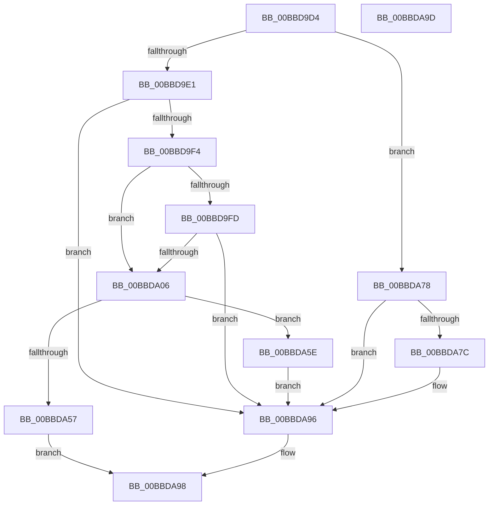

# HdlspEnableTerminal

- RVA: `0x00BBD9D4`–`0x00BBDA9E` (길이 `202` bytes)
- VA: `0x0000000140BBD9D4`
- 실행 섹션: `PAGEHDLS`
- PDB 이름 있음: `예`; PDB Function 태그: `아니요`
- unwind 정보 RVA: `0x00063458`
- 디코드: `53`개 명령, `202/202` bytes 표시
- 미해석 바이트: `0` (있으면 어셈블리에 `.byte`로 보존)

> 이 문서는 커널 이미지의 기계어와 PDB 기호를 분석해 생성했습니다. 4번과 5번은 함수 원형과 자료형을 바이너리 사용 방식에서 추정한 C 해석이며 원본 소스 복구 결과는 아닙니다.

## 1. Dependencies

- 직접 호출 지점: **4**; 고유 호출 대상: **3**
- 직접 호출자로 확인된 함수: **2**
- RIP 상대 이미지 참조: **3**

### Outgoing calls
- `0x00BBDA31` → [InbvPortInitialize](../../text/6A/InbvPortInitialize_function_006A8194.md) (function, `0x006A8194`)
- `0x00BBDA65` → [HdlspSendStringAtBaud](HdlspSendStringAtBaud_function_00BBE5CC.md) (function, `0x00BBE5CC`)
- `0x00BBDA71` → [HdlspSendStringAtBaud](HdlspSendStringAtBaud_function_00BBE5CC.md) (function, `0x00BBE5CC`)
- `0x00BBDA87` → [InbvPortTerminate](../../text/6A/InbvPortTerminate_function_006A83C8.md) (function, `0x006A83C8`)

### Direct callers
- [HdlspDispatch](HdlspDispatch_function_00BBD320.md) at `0x00BBD559`
- [HeadlessInit](../../init/C5/HeadlessInit_function_00C52C28.md) at `0x00C52E9E`

### Static image references
- `0x00BBD9E1` → RVA `0x00E68578` (`.data`; read)
- `0x00BBDA5E` → RVA `0x00BBF330` (` ?? ::CIFEBFPJ::`string'`; read)
- `0x00BBDA6A` → RVA `0x00BBE940` (` ?? ::CIFEBFPJ::`string'`; read)

## 2. Other-region calls and transfers

- 다른 실행 섹션으로 향하는 call: **2**
  - `0x00BBDA31` → [InbvPortInitialize](../../text/6A/InbvPortInitialize_function_006A8194.md) (`PAGEHDLS` → `.text`)
  - `0x00BBDA87` → [InbvPortTerminate](../../text/6A/InbvPortTerminate_function_006A83C8.md) (`PAGEHDLS` → `.text`)
- 별도 외부 분기/꼬리 이동을 확인하지 못했습니다.

## 3. Assembly (complete function range)

```asm
00BBD9D4  48 83 EC 48                     sub rsp, 0x48
00BBD9D8  80 F9 01                        cmp cl, 1
00BBD9DB  0F 85 97 00 00 00               jne 0x140bbda78
00BBD9E1  48 8B 0D 90 AB 2A 00            mov rcx, qword ptr [rip + 0x2aab90]
00BBD9E8  8B 51 30                        mov edx, dword ptr [rcx + 0x30]
00BBD9EB  F6 C2 01                        test dl, 1
00BBD9EE  0F 85 A2 00 00 00               jne 0x140bbda96
00BBD9F4  44 8A 41 74                     mov r8b, byte ptr [rcx + 0x74]
00BBD9F8  45 84 C0                        test r8b, r8b
00BBD9FB  74 09                           je 0x140bbda06
00BBD9FD  F6 C2 02                        test dl, 2
00BBDA00  0F 85 90 00 00 00               jne 0x140bbda96
00BBDA06  8A 41 57                        mov al, byte ptr [rcx + 0x57]
00BBDA09  4C 8D 49 38                     lea r9, [rcx + 0x38]
00BBDA0D  88 44 24 38                     mov byte ptr [rsp + 0x38], al
00BBDA11  8A 41 56                        mov al, byte ptr [rcx + 0x56]
00BBDA14  88 44 24 30                     mov byte ptr [rsp + 0x30], al
00BBDA18  8A 41 55                        mov al, byte ptr [rcx + 0x55]
00BBDA1B  88 44 24 28                     mov byte ptr [rsp + 0x28], al
00BBDA1F  44 88 44 24 20                  mov byte ptr [rsp + 0x20], r8b
00BBDA24  4C 8B 41 40                     mov r8, qword ptr [rcx + 0x40]
00BBDA28  8B 49 34                        mov ecx, dword ptr [rcx + 0x34]
00BBDA2B  C1 EA 09                        shr edx, 9
00BBDA2E  83 E2 07                        and edx, 7
00BBDA31  E8 5E A7 AE FF                  call 0x1406a8194
00BBDA36  48 8B 15 3B AB 2A 00            mov rdx, qword ptr [rip + 0x2aab3b]
00BBDA3D  44 0F B6 C0                     movzx r8d, al
00BBDA41  8B 42 30                        mov eax, dword ptr [rdx + 0x30]
00BBDA44  8B C8                           mov ecx, eax
00BBDA46  41 33 C8                        xor ecx, r8d
00BBDA49  83 E1 01                        and ecx, 1
00BBDA4C  33 C8                           xor ecx, eax
00BBDA4E  89 4A 30                        mov dword ptr [rdx + 0x30], ecx
00BBDA51  41 F6 C0 01                     test r8b, 1
00BBDA55  75 07                           jne 0x140bbda5e
00BBDA57  B8 01 00 00 C0                  mov eax, 0xc0000001
00BBDA5C  EB 3A                           jmp 0x140bbda98
00BBDA5E  48 8D 0D CB 18 00 00            lea rcx, [rip + 0x18cb]
00BBDA65  E8 62 0B 00 00                  call 0x140bbe5cc
00BBDA6A  48 8D 0D CF 0E 00 00            lea rcx, [rip + 0xecf]
00BBDA71  E8 56 0B 00 00                  call 0x140bbe5cc
00BBDA76  EB 1E                           jmp 0x140bbda96
00BBDA78  84 C9                           test cl, cl
00BBDA7A  75 1A                           jne 0x140bbda96
00BBDA7C  4C 8B 05 F5 AA 2A 00            mov r8, qword ptr [rip + 0x2aaaf5]
00BBDA83  41 8B 48 38                     mov ecx, dword ptr [r8 + 0x38]
00BBDA87  E8 3C A9 AE FF                  call 0x1406a83c8
00BBDA8C  41 83 60 38 00                  and dword ptr [r8 + 0x38], 0
00BBDA91  41 83 60 30 FE                  and dword ptr [r8 + 0x30], 0xfffffffe
00BBDA96  33 C0                           xor eax, eax
00BBDA98  48 83 C4 48                     add rsp, 0x48
00BBDA9C  C3                              ret
00BBDA9D  CC                              int3
```

## 4. C-style interpretation (structured pseudocode)

```c
__int64 __fastcall HdlspEnableTerminal(unsigned __int8 a1)
{
    __int64 result;
    __int64 v_rsp;
    unsigned __int8 v_stack_m10;
    unsigned __int8 v_stack_m18;
    unsigned __int8 v_stack_m20;
    unsigned __int8 v_stack_m28;

    v_rsp = (v_rsp) - (72);
    if (a1 != 1) goto loc_00BBDA78;
    if ((((unsigned __int8)((unsigned int)(*(unsigned int *)(*(unsigned __int64 *)(v_rip + 2796432) + 48)))) & (1)) != 0) goto loc_00BBDA96;
    if ((unsigned __int8)(*(unsigned __int8 *)(*(unsigned __int64 *)(v_rip + 2796432) + 116)) == 0) goto loc_00BBDA06;
    if ((((unsigned __int8)((unsigned int)(*(unsigned int *)(*(unsigned __int64 *)(v_rip + 2796432) + 48)))) & (2)) != 0) goto loc_00BBDA96;
loc_00BBDA06:
    v_stack_m10 = (unsigned __int8)(*(unsigned __int8 *)(*(unsigned __int64 *)(v_rip + 2796432) + 87));
    v_stack_m18 = (unsigned __int8)(*(unsigned __int8 *)(*(unsigned __int64 *)(v_rip + 2796432) + 86));
    v_stack_m20 = (unsigned __int8)(*(unsigned __int8 *)(*(unsigned __int64 *)(v_rip + 2796432) + 85));
    v_stack_m28 = (unsigned __int8)(*(unsigned __int8 *)(*(unsigned __int64 *)(v_rip + 2796432) + 116));
    a2 = (unsigned int)(((unsigned int)(*(unsigned int *)(*(unsigned __int64 *)(v_rip + 2796432) + 48))) >> (9));
    a2 = (unsigned int)((a2) & (7));
    result = InbvPortInitialize((unsigned int)(*(unsigned int *)(*(unsigned __int64 *)(v_rip + 2796432) + 52)), a2, *(unsigned __int64 *)(*(unsigned __int64 *)(v_rip + 2796432) + 64), *(unsigned __int64 *)(v_rip + 2796432) + 56);
    a1 = (unsigned int)(((unsigned int)((unsigned int)((unsigned int)(*(unsigned int *)(*(unsigned __int64 *)(v_rip + 2796347) + 48))))) ^ ((unsigned int)((unsigned __int8)(result))));
    a1 = (unsigned int)((a1) & (1));
    a1 = (unsigned int)((a1) ^ ((unsigned int)((unsigned int)(*(unsigned int *)(*(unsigned __int64 *)(v_rip + 2796347) + 48)))));
    *(unsigned int *)(*(unsigned __int64 *)(v_rip + 2796347) + 48) = a1;
    if ((((unsigned __int8)((unsigned __int8)(result))) & (1)) != 0) goto loc_00BBDA5E;
    goto loc_00BBDA98;
loc_00BBDA5E:
    result = HdlspSendStringAtBaud(v_rip + 6347, *(unsigned __int64 *)(v_rip + 2796347), (unsigned __int8)(result), *(unsigned __int64 *)(v_rip + 2796432) + 56);
    result = HdlspSendStringAtBaud(v_rip + 3791, *(unsigned __int64 *)(v_rip + 2796347), (unsigned __int8)(result), *(unsigned __int64 *)(v_rip + 2796432) + 56);
    goto loc_00BBDA96;
loc_00BBDA78:
    if ((unsigned __int8)(v_rip + 3791) == 0) {
        a3 = *(unsigned __int64 *)(v_rip + 2796277);
        a1 = *(unsigned int *)(a3 + 56);
        result = InbvPortTerminate(a1, *(unsigned __int64 *)(v_rip + 2796347), a3, *(unsigned __int64 *)(v_rip + 2796432) + 56);
    }
    result = 0;
loc_00BBDA98:
    v_rsp = (v_rsp) + (72);
    return result;
}
```

## 5. (Beta) C Style

```c
int64_t HdlspEnableTerminal(uint8_t Arg1)
{
    int64_t result;
    int64_t local_rsp;
    uint8_t v_stack_m10;
    uint8_t v_stack_m18;
    uint8_t v_stack_m20;
    uint8_t v_stack_m28;

    local_rsp = (local_rsp) - (72);
    if (Arg1 != 1) goto loc_00BBDA78;
    if ((((uint8_t)((uint32_t)(*(uint32_t *)(*(uint64_t *)(v_rip + 0x2AAB90) + 0x30)))) & (1)) != 0) goto loc_00BBDA96;
    if ((uint8_t)(*(uint8_t *)(*(uint64_t *)(v_rip + 0x2AAB90) + 0x74)) == 0) goto loc_00BBDA06;
    if ((((uint8_t)((uint32_t)(*(uint32_t *)(*(uint64_t *)(v_rip + 0x2AAB90) + 0x30)))) & (2)) != 0) goto loc_00BBDA96;
loc_00BBDA06:
    v_stack_m10 = (uint8_t)(*(uint8_t *)(*(uint64_t *)(v_rip + 0x2AAB90) + 0x57));
    v_stack_m18 = (uint8_t)(*(uint8_t *)(*(uint64_t *)(v_rip + 0x2AAB90) + 0x56));
    v_stack_m20 = (uint8_t)(*(uint8_t *)(*(uint64_t *)(v_rip + 0x2AAB90) + 0x55));
    v_stack_m28 = (uint8_t)(*(uint8_t *)(*(uint64_t *)(v_rip + 0x2AAB90) + 0x74));
    a2 = (uint32_t)(((uint32_t)(*(uint32_t *)(*(uint64_t *)(v_rip + 0x2AAB90) + 0x30))) >> (9));
    a2 = (uint32_t)((a2) & (7));
    result = InbvPortInitialize((uint32_t)(*(uint32_t *)(*(uint64_t *)(v_rip + 0x2AAB90) + 0x34)), a2, *(uint64_t *)(*(uint64_t *)(v_rip + 0x2AAB90) + 0x40), *(uint64_t *)(v_rip + 0x2AAB90) + 56);
    Arg1 = (uint32_t)(((uint32_t)((uint32_t)((uint32_t)(*(uint32_t *)(*(uint64_t *)(v_rip + 0x2AAB3B) + 0x30))))) ^ ((uint32_t)((uint8_t)(result))));
    Arg1 = (uint32_t)((Arg1) & (1));
    Arg1 = (uint32_t)((Arg1) ^ ((uint32_t)((uint32_t)(*(uint32_t *)(*(uint64_t *)(v_rip + 0x2AAB3B) + 0x30)))));
    *(uint32_t *)(*(uint64_t *)(v_rip + 0x2AAB3B) + 0x30) = Arg1;
    if ((((uint8_t)((uint8_t)(result))) & (1)) != 0) goto loc_00BBDA5E;
    goto loc_00BBDA98;
loc_00BBDA5E:
    result = HdlspSendStringAtBaud(v_rip + 6347, *(uint64_t *)(v_rip + 0x2AAB3B), (uint8_t)(result), *(uint64_t *)(v_rip + 0x2AAB90) + 56);
    result = HdlspSendStringAtBaud(v_rip + 3791, *(uint64_t *)(v_rip + 0x2AAB3B), (uint8_t)(result), *(uint64_t *)(v_rip + 0x2AAB90) + 56);
    goto loc_00BBDA96;
loc_00BBDA78:
    if ((uint8_t)(v_rip + 3791) == 0) {
        a3 = *(uint64_t *)(v_rip + 0x2AAAF5);
        Arg1 = *(uint32_t *)(a3 + 0x38);
        result = InbvPortTerminate(Arg1, *(uint64_t *)(v_rip + 0x2AAB3B), a3, *(uint64_t *)(v_rip + 0x2AAB90) + 56);
    }
    result = 0;
loc_00BBDA98:
    local_rsp = (local_rsp) + (72);
    return result;
}
```

## 6. Execution-region graph

[열기: 2D/3D 그래프와 함수 탐색 컨트롤 패널](../../../control-panel.html?section=pagehdls&rva=0x00BBD9D4&view=graph)

- 2D 그래프는 위에서 아래로 흐르고, 3D 그래프는 빈 공간을 드래그해 회전합니다. Shift+드래그는 이동, 휠은 확대·축소, 함수 노드 선택은 대상 보고서 이동입니다.

### Static fallback


