# HdlspGetLine

- RVA: `0x00BBDAA4`–`0x00BBDD6A` (길이 `710` bytes)
- VA: `0x0000000140BBDAA4`
- 실행 섹션: `PAGEHDLS`
- PDB 이름 있음: `예`; PDB Function 태그: `아니요`
- unwind 정보 RVA: `0x00060BC4`
- 디코드: `185`개 명령, `710/710` bytes 표시
- 미해석 바이트: `0` (있으면 어셈블리에 `.byte`로 보존)

> 이 문서는 커널 이미지의 기계어와 PDB 기호를 분석해 생성했습니다. 4번과 5번은 함수 원형과 자료형을 바이너리 사용 방식에서 추정한 C 해석이며 원본 소스 복구 결과는 아닙니다.

## 1. Dependencies

- 직접 호출 지점: **16**; 고유 호출 대상: **8**
- 직접 호출자로 확인된 함수: **3**
- RIP 상대 이미지 참조: **6**

### Outgoing calls
- `0x00BBDACC` → [KeAcquireSpinLockRaiseToDpc](../../text/20/KeAcquireSpinLockRaiseToDpc_function_00208470.md) (function, `0x00208470`)
- `0x00BBDAEA` → [KeReleaseSpinLock](../../text/39/KeReleaseSpinLock_function_00392BA0.md) (function, `0x00392BA0`)
- `0x00BBDB02` → [KeReleaseSpinLock](../../text/39/KeReleaseSpinLock_function_00392BA0.md) (function, `0x00392BA0`)
- `0x00BBDB29` → [InbvPortPollOnly](../../text/6A/InbvPortPollOnly_function_006A82E8.md) (function, `0x006A82E8`)
- `0x00BBDB41` → [InbvPortGetByte](../../text/6A/InbvPortGetByte_function_006A8134.md) (function, `0x006A8134`)
- `0x00BBDBDC` → [sprintf_s](../../text/50/sprintf_s_function_00505E40.md) (function, `0x00505E40`)
- `0x00BBDBEC` → [HdlspSendStringAtBaud](HdlspSendStringAtBaud_function_00BBE5CC.md) (function, `0x00BBE5CC`)
- `0x00BBDBFD` → [sprintf_s](../../text/50/sprintf_s_function_00505E40.md) (function, `0x00505E40`)
- `0x00BBDC0D` → [HdlspSendStringAtBaud](HdlspSendStringAtBaud_function_00BBE5CC.md) (function, `0x00BBE5CC`)
- `0x00BBDC34` → [HdlspSendStringAtBaud](HdlspSendStringAtBaud_function_00BBE5CC.md) (function, `0x00BBE5CC`)
- `0x00BBDC50` → [HdlspSendStringAtBaud](HdlspSendStringAtBaud_function_00BBE5CC.md) (function, `0x00BBE5CC`)
- `0x00BBDC7A` → [HdlspSendStringAtBaud](HdlspSendStringAtBaud_function_00BBE5CC.md) (function, `0x00BBE5CC`)
- `0x00BBDD03` → [strcpy_s](../../text/50/strcpy_s_function_00505FB0.md) (function, `0x00505FB0`)
- `0x00BBDD1F` → [memcpy](../../text/6C/memcpy_function_006C6840.md) (function, `0x006C6840`)
- `0x00BBDD32` → [memcpy](../../text/6C/memcpy_function_006C6840.md) (function, `0x006C6840`)
- `0x00BBDD46` → [memcpy](../../text/6C/memcpy_function_006C6840.md) (function, `0x006C6840`)

### Direct callers
- [HdlspBugCheckProcessing](HdlspBugCheckProcessing_function_00BBD1F8.md) at `0x00BBD21A`
- [HdlspDispatch](HdlspDispatch_function_00BBD320.md) at `0x00BBD4F5`
- [HdlspDispatch](HdlspDispatch_function_00BBD320.md) at `0x00BBD6D9`
- [HdlspPutMore](HdlspPutMore_function_00BBE214.md) at `0x00BBE256`
- [HdlspPutMore](HdlspPutMore_function_00BBE214.md) at `0x00BBE28E`
- [HdlspPutMore](HdlspPutMore_function_00BBE214.md) at `0x00BBE2C2`

### Static image references
- `0x00BBDABB` → RVA `0x00E68578` (`.data`; read)
- `0x00BBDBD5` → RVA `0x00BBE900` (` ?? ::CIFEBFPJ::`string'`; read)
- `0x00BBDBF6` → RVA `0x00BBE930` (` ?? ::CIFEBFPJ::`string'`; read)
- `0x00BBDC2D` → RVA `0x00BBE960` (` ?? ::CIFEBFPJ::`string'`; read)
- `0x00BBDC49` → RVA `0x00BBE910` (` ?? ::CIFEBFPJ::`string'`; read)
- `0x00BBDC73` → RVA `0x00BBE970` (` ?? ::CIFEBFPJ::`string'`; read)

## 2. Other-region calls and transfers

- 다른 실행 섹션으로 향하는 call: **11**
  - `0x00BBDACC` → [KeAcquireSpinLockRaiseToDpc](../../text/20/KeAcquireSpinLockRaiseToDpc_function_00208470.md) (`PAGEHDLS` → `.text`)
  - `0x00BBDAEA` → [KeReleaseSpinLock](../../text/39/KeReleaseSpinLock_function_00392BA0.md) (`PAGEHDLS` → `.text`)
  - `0x00BBDB02` → [KeReleaseSpinLock](../../text/39/KeReleaseSpinLock_function_00392BA0.md) (`PAGEHDLS` → `.text`)
  - `0x00BBDB29` → [InbvPortPollOnly](../../text/6A/InbvPortPollOnly_function_006A82E8.md) (`PAGEHDLS` → `.text`)
  - `0x00BBDB41` → [InbvPortGetByte](../../text/6A/InbvPortGetByte_function_006A8134.md) (`PAGEHDLS` → `.text`)
  - `0x00BBDBDC` → [sprintf_s](../../text/50/sprintf_s_function_00505E40.md) (`PAGEHDLS` → `.text`)
  - `0x00BBDBFD` → [sprintf_s](../../text/50/sprintf_s_function_00505E40.md) (`PAGEHDLS` → `.text`)
  - `0x00BBDD03` → [strcpy_s](../../text/50/strcpy_s_function_00505FB0.md) (`PAGEHDLS` → `.text`)
  - `0x00BBDD1F` → [memcpy](../../text/6C/memcpy_function_006C6840.md) (`PAGEHDLS` → `.text`)
  - `0x00BBDD32` → [memcpy](../../text/6C/memcpy_function_006C6840.md) (`PAGEHDLS` → `.text`)
  - `0x00BBDD46` → [memcpy](../../text/6C/memcpy_function_006C6840.md) (`PAGEHDLS` → `.text`)
- 별도 외부 분기/꼬리 이동을 확인하지 못했습니다.

## 3. Assembly (complete function range)

```asm
00BBDAA4  48 89 5C 24 08                  mov qword ptr [rsp + 8], rbx
00BBDAA9  48 89 74 24 10                  mov qword ptr [rsp + 0x10], rsi
00BBDAAE  57                              push rdi
00BBDAAF  48 83 EC 20                     sub rsp, 0x20
00BBDAB3  48 8B F1                        mov rsi, rcx
00BBDAB6  C6 44 24 40 00                  mov byte ptr [rsp + 0x40], 0
00BBDABB  48 8B 0D B6 AA 2A 00            mov rcx, qword ptr [rip + 0x2aaab6]
00BBDAC2  48 8B FA                        mov rdi, rdx
00BBDAC5  8B 41 30                        mov eax, dword ptr [rcx + 0x30]
00BBDAC8  A8 02                           test al, 2
00BBDACA  75 07                           jne 0x140bbdad3
00BBDACC  E8 9F A9 64 FF                  call 0x140208470
00BBDAD1  EB 02                           jmp 0x140bbdad5
00BBDAD3  B0 FF                           mov al, 0xff
00BBDAD5  48 8B 0D 9C AA 2A 00            mov rcx, qword ptr [rip + 0x2aaa9c]
00BBDADC  8B 51 30                        mov edx, dword ptr [rcx + 0x30]
00BBDADF  F6 C2 10                        test dl, 0x10
00BBDAE2  74 12                           je 0x140bbdaf6
00BBDAE4  3C FF                           cmp al, 0xff
00BBDAE6  74 07                           je 0x140bbdaef
00BBDAE8  8A D0                           mov dl, al
00BBDAEA  E8 B1 50 7D FF                  call 0x140392ba0
00BBDAEF  32 C0                           xor al, al
00BBDAF1  E9 63 02 00 00                  jmp 0x140bbdd59
00BBDAF6  83 CA 10                        or edx, 0x10
00BBDAF9  89 51 30                        mov dword ptr [rcx + 0x30], edx
00BBDAFC  3C FF                           cmp al, 0xff
00BBDAFE  74 07                           je 0x140bbdb07
00BBDB00  8A D0                           mov dl, al
00BBDB02  E8 99 50 7D FF                  call 0x140392ba0
00BBDB07  48 8B 05 6A AA 2A 00            mov rax, qword ptr [rip + 0x2aaa6a]
00BBDB0E  8B 48 30                        mov ecx, dword ptr [rax + 0x30]
00BBDB11  F6 C1 20                        test cl, 0x20
00BBDB14  0F 85 EE 01 00 00               jne 0x140bbdd08
00BBDB1A  BB 50 00 00 00                  mov ebx, 0x50
00BBDB1F  48 8B 0D 52 AA 2A 00            mov rcx, qword ptr [rip + 0x2aaa52]
00BBDB26  8B 49 38                        mov ecx, dword ptr [rcx + 0x38]
00BBDB29  E8 BA A7 AE FF                  call 0x1406a82e8
00BBDB2E  84 C0                           test al, al
00BBDB30  74 1E                           je 0x140bbdb50
00BBDB32  48 8B 0D 3F AA 2A 00            mov rcx, qword ptr [rip + 0x2aaa3f]
00BBDB39  48 8D 54 24 40                  lea rdx, [rsp + 0x40]
00BBDB3E  8B 49 38                        mov ecx, dword ptr [rcx + 0x38]
00BBDB41  E8 EE A5 AE FF                  call 0x1406a8134
00BBDB46  84 C0                           test al, al
00BBDB48  74 06                           je 0x140bbdb50
00BBDB4A  8A 54 24 40                     mov dl, byte ptr [rsp + 0x40]
00BBDB4E  EB 06                           jmp 0x140bbdb56
00BBDB50  32 D2                           xor dl, dl
00BBDB52  88 54 24 40                     mov byte ptr [rsp + 0x40], dl
00BBDB56  84 D2                           test dl, dl
00BBDB58  0F 84 F7 00 00 00               je 0x140bbdc55
00BBDB5E  4C 8B 15 13 AA 2A 00            mov r10, qword ptr [rip + 0x2aaa13]
00BBDB65  49 8B 42 58                     mov rax, qword ptr [r10 + 0x58]
00BBDB69  49 8B 4A 20                     mov rcx, qword ptr [r10 + 0x20]
00BBDB6D  88 14 01                        mov byte ptr [rcx + rax], dl
00BBDB70  41 80 7A 75 00                  cmp byte ptr [r10 + 0x75], 0
00BBDB75  8A 44 24 40                     mov al, byte ptr [rsp + 0x40]
00BBDB79  74 0B                           je 0x140bbdb86
00BBDB7B  3C 0A                           cmp al, 0xa
00BBDB7D  75 07                           jne 0x140bbdb86
00BBDB7F  41 C6 42 75 00                  mov byte ptr [r10 + 0x75], 0
00BBDB84  EB 99                           jmp 0x140bbdb1f
00BBDB86  3C 0D                           cmp al, 0xd
00BBDB88  0F 94 C0                        sete al
00BBDB8B  41 88 42 75                     mov byte ptr [r10 + 0x75], al
00BBDB8F  0F B6 44 24 40                  movzx eax, byte ptr [rsp + 0x40]
00BBDB94  3C 0A                           cmp al, 0xa
00BBDB96  0F 84 D7 00 00 00               je 0x140bbdc73
00BBDB9C  3C 0D                           cmp al, 0xd
00BBDB9E  0F 84 CF 00 00 00               je 0x140bbdc73
00BBDBA4  3C 08                           cmp al, 8
00BBDBA6  74 7A                           je 0x140bbdc22
00BBDBA8  3C 7F                           cmp al, 0x7f
00BBDBAA  74 76                           je 0x140bbdc22
00BBDBAC  3C 03                           cmp al, 3
00BBDBAE  0F 84 B1 00 00 00               je 0x140bbdc65
00BBDBB4  3C 09                           cmp al, 9
00BBDBB6  0F 84 8D 00 00 00               je 0x140bbdc49
00BBDBBC  3C 1B                           cmp al, 0x1b
00BBDBBE  0F 84 85 00 00 00               je 0x140bbdc49
00BBDBC4  49 83 7A 58 4E                  cmp qword ptr [r10 + 0x58], 0x4e
00BBDBC9  44 8B C8                        mov r9d, eax
00BBDBCC  49 8B 4A 18                     mov rcx, qword ptr [r10 + 0x18]
00BBDBD0  48 8B D3                        mov rdx, rbx
00BBDBD3  75 21                           jne 0x140bbdbf6
00BBDBD5  4C 8D 05 24 0D 00 00            lea r8, [rip + 0xd24]
00BBDBDC  E8 5F 82 94 FF                  call 0x140505e40
00BBDBE1  48 8B 0D 90 A9 2A 00            mov rcx, qword ptr [rip + 0x2aa990]
00BBDBE8  48 8B 49 18                     mov rcx, qword ptr [rcx + 0x18]
00BBDBEC  E8 DB 09 00 00                  call 0x140bbe5cc
00BBDBF1  E9 29 FF FF FF                  jmp 0x140bbdb1f
00BBDBF6  4C 8D 05 33 0D 00 00            lea r8, [rip + 0xd33]
00BBDBFD  E8 3E 82 94 FF                  call 0x140505e40
00BBDC02  48 8B 0D 6F A9 2A 00            mov rcx, qword ptr [rip + 0x2aa96f]
00BBDC09  48 8B 49 18                     mov rcx, qword ptr [rcx + 0x18]
00BBDC0D  E8 BA 09 00 00                  call 0x140bbe5cc
00BBDC12  48 8B 05 5F A9 2A 00            mov rax, qword ptr [rip + 0x2aa95f]
00BBDC19  48 FF 40 58                     inc qword ptr [rax + 0x58]
00BBDC1D  E9 FD FE FF FF                  jmp 0x140bbdb1f
00BBDC22  49 83 7A 58 00                  cmp qword ptr [r10 + 0x58], 0
00BBDC27  0F 86 F2 FE FF FF               jbe 0x140bbdb1f
00BBDC2D  48 8D 0D 2C 0D 00 00            lea rcx, [rip + 0xd2c]
00BBDC34  E8 93 09 00 00                  call 0x140bbe5cc
00BBDC39  48 8B 05 38 A9 2A 00            mov rax, qword ptr [rip + 0x2aa938]
00BBDC40  48 FF 48 58                     dec qword ptr [rax + 0x58]
00BBDC44  E9 D6 FE FF FF                  jmp 0x140bbdb1f
00BBDC49  48 8D 0D C0 0C 00 00            lea rcx, [rip + 0xcc0]
00BBDC50  E8 77 09 00 00                  call 0x140bbe5cc
00BBDC55  48 8B 05 1C A9 2A 00            mov rax, qword ptr [rip + 0x2aa91c]
00BBDC5C  83 60 30 EF                     and dword ptr [rax + 0x30], 0xffffffef
00BBDC60  E9 8A FE FF FF                  jmp 0x140bbdaef
00BBDC65  49 FF 42 58                     inc qword ptr [r10 + 0x58]
00BBDC69  49 8B 4A 58                     mov rcx, qword ptr [r10 + 0x58]
00BBDC6D  49 8B 42 20                     mov rax, qword ptr [r10 + 0x20]
00BBDC71  EB 1B                           jmp 0x140bbdc8e
00BBDC73  48 8D 0D F6 0C 00 00            lea rcx, [rip + 0xcf6]
00BBDC7A  E8 4D 09 00 00                  call 0x140bbe5cc
00BBDC7F  4C 8B 15 F2 A8 2A 00            mov r10, qword ptr [rip + 0x2aa8f2]
00BBDC86  49 8B 4A 20                     mov rcx, qword ptr [r10 + 0x20]
00BBDC8A  49 8B 42 58                     mov rax, qword ptr [r10 + 0x58]
00BBDC8E  C6 04 01 00                     mov byte ptr [rcx + rax], 0
00BBDC92  49 FF 42 58                     inc qword ptr [r10 + 0x58]
00BBDC96  49 8B 4A 58                     mov rcx, qword ptr [r10 + 0x58]
00BBDC9A  48 83 E9 01                     sub rcx, 1
00BBDC9E  74 22                           je 0x140bbdcc2
00BBDCA0  49 8B 52 20                     mov rdx, qword ptr [r10 + 0x20]
00BBDCA4  0F B6 04 0A                     movzx eax, byte ptr [rdx + rcx]
00BBDCA8  3C 20                           cmp al, 0x20
00BBDCAA  77 16                           ja 0x140bbdcc2
00BBDCAC  49 B8 01 02 00 00 01 00 00 00   movabs r8, 0x100000201
00BBDCB6  49 0F A3 C0                     bt r8, rax
00BBDCBA  73 06                           jae 0x140bbdcc2
00BBDCBC  48 83 E9 01                     sub rcx, 1
00BBDCC0  75 E2                           jne 0x140bbdca4
00BBDCC2  48 8B 15 AF A8 2A 00            mov rdx, qword ptr [rip + 0x2aa8af]
00BBDCC9  48 8B 42 20                     mov rax, qword ptr [rdx + 0x20]
00BBDCCD  80 3C 08 00                     cmp byte ptr [rax + rcx], 0
00BBDCD1  74 05                           je 0x140bbdcd8
00BBDCD3  C6 44 08 01 00                  mov byte ptr [rax + rcx + 1], 0
00BBDCD8  48 8B 4A 20                     mov rcx, qword ptr [rdx + 0x20]
00BBDCDC  45 33 C0                        xor r8d, r8d
00BBDCDF  8A 01                           mov al, byte ptr [rcx]
00BBDCE1  84 C0                           test al, al
00BBDCE3  74 23                           je 0x140bbdd08
00BBDCE5  3C 09                           cmp al, 9
00BBDCE7  74 04                           je 0x140bbdced
00BBDCE9  3C 20                           cmp al, 0x20
00BBDCEB  75 0B                           jne 0x140bbdcf8
00BBDCED  49 FF C0                        inc r8
00BBDCF0  42 8A 04 01                     mov al, byte ptr [rcx + r8]
00BBDCF4  84 C0                           test al, al
00BBDCF6  75 ED                           jne 0x140bbdce5
00BBDCF8  4D 85 C0                        test r8, r8
00BBDCFB  74 0B                           je 0x140bbdd08
00BBDCFD  4C 03 C1                        add r8, rcx
00BBDD00  48 8B D3                        mov rdx, rbx
00BBDD03  E8 A8 82 94 FF                  call 0x140505fb0
00BBDD08  48 8B 1D 69 A8 2A 00            mov rbx, qword ptr [rip + 0x2aa869]
00BBDD0F  48 8B CE                        mov rcx, rsi
00BBDD12  4C 8B 43 58                     mov r8, qword ptr [rbx + 0x58]
00BBDD16  48 8B 53 20                     mov rdx, qword ptr [rbx + 0x20]
00BBDD1A  49 3B F8                        cmp rdi, r8
00BBDD1D  72 10                           jb 0x140bbdd2f
00BBDD1F  E8 1C 8B B0 FF                  call 0x1406c6840
00BBDD24  48 83 63 58 00                  and qword ptr [rbx + 0x58], 0
00BBDD29  83 63 30 DF                     and dword ptr [rbx + 0x30], 0xffffffdf
00BBDD2D  EB 24                           jmp 0x140bbdd53
00BBDD2F  4C 8B C7                        mov r8, rdi
00BBDD32  E8 09 8B B0 FF                  call 0x1406c6840
00BBDD37  48 8B 4B 20                     mov rcx, qword ptr [rbx + 0x20]
00BBDD3B  4C 8B 43 58                     mov r8, qword ptr [rbx + 0x58]
00BBDD3F  4C 2B C7                        sub r8, rdi
00BBDD42  48 8D 14 39                     lea rdx, [rcx + rdi]
00BBDD46  E8 F5 8A B0 FF                  call 0x1406c6840
00BBDD4B  83 4B 30 20                     or dword ptr [rbx + 0x30], 0x20
00BBDD4F  48 29 7B 58                     sub qword ptr [rbx + 0x58], rdi
00BBDD53  83 63 30 EF                     and dword ptr [rbx + 0x30], 0xffffffef
00BBDD57  B0 01                           mov al, 1
00BBDD59  48 8B 5C 24 30                  mov rbx, qword ptr [rsp + 0x30]
00BBDD5E  48 8B 74 24 38                  mov rsi, qword ptr [rsp + 0x38]
00BBDD63  48 83 C4 20                     add rsp, 0x20
00BBDD67  5F                              pop rdi
00BBDD68  C3                              ret
00BBDD69  CC                              int3
```

## 4. C-style interpretation (structured pseudocode)

```c
__int64 __fastcall HdlspGetLine(__int64 a1, __int64 a2)
{
    __int64 result;
    __int64 v_rsp;
    unsigned __int64 v_stack_p10;
    unsigned __int8 v_stack_p18;
    unsigned __int64 v_stack_p8;

    v_stack_p8 = v_rbx;
    v_stack_p10 = v_rsi;
    v_rsp = (v_rsp) - (32);
    v_stack_p18 = 0;
    if ((((unsigned __int8)((unsigned int)(*(unsigned int *)(*(unsigned __int64 *)(v_rip + 2796214) + 48)))) & (2)) != 0) goto loc_00BBDAD3;
    result = KeAcquireSpinLockRaiseToDpc(*(unsigned __int64 *)(v_rip + 2796214), a2, a3, a4);
    goto loc_00BBDAD5;
loc_00BBDAD3:
loc_00BBDAD5:
    if ((((unsigned __int8)((unsigned int)(*(unsigned int *)(*(unsigned __int64 *)(v_rip + 2796188) + 48)))) & (16)) == 0) goto loc_00BBDAF6;
    result = 255;
    if (255 != 255) {
        a2 = 255;
        result = KeReleaseSpinLock(*(unsigned __int64 *)(v_rip + 2796188), a2, a3, a4);
    }
    result = 0;
    goto loc_00BBDD59;
loc_00BBDAF6:
    a2 = (unsigned int)((a2) | (16));
    *(unsigned int *)(*(unsigned __int64 *)(v_rip + 2796188) + 48) = (unsigned int)(a2);
    if (0 != 255) {
        a2 = 0;
        result = KeReleaseSpinLock(*(unsigned __int64 *)(v_rip + 2796188), a2, a3, a4);
    }
    if ((((unsigned __int8)((unsigned int)(*(unsigned int *)(*(unsigned __int64 *)(v_rip + 2796138) + 48)))) & (32)) != 0) goto loc_00BBDD08;
loc_00BBDB1F:
    result = InbvPortPollOnly((unsigned int)(*(unsigned int *)(*(unsigned __int64 *)(v_rip + 2796114) + 56)), a2, a3, a4);
    if ((unsigned __int8)(result) == 0) goto loc_00BBDB50;
    result = InbvPortGetByte((unsigned int)(*(unsigned int *)(*(unsigned __int64 *)(v_rip + 2796095) + 56)), v_stack_p18, a3, a4);
    if ((unsigned __int8)(result) == 0) goto loc_00BBDB50;
    goto loc_00BBDB56;
loc_00BBDB50:
    a2 = 0;
    v_stack_p18 = 0;
loc_00BBDB56:
    if (0 == 0) goto loc_00BBDC55;
    *(unsigned __int8 *)(*(unsigned __int64 *)(*(unsigned __int64 *)(v_rip + 2796051) + 32) + *(unsigned __int64 *)(*(unsigned __int64 *)(v_rip + 2796051) + 88) * 1) = 0;
    if ((*(unsigned __int8 *)(*(unsigned __int64 *)(v_rip + 2796051) + 117)) == 0) goto loc_00BBDB86;
    if (((unsigned __int8)(v_stack_p18)) != 10) goto loc_00BBDB86;
    *(unsigned __int8 *)(*(unsigned __int64 *)(v_rip + 2796051) + 117) = 0;
    goto loc_00BBDB1F;
loc_00BBDB86:
    result = (((unsigned __int8)(v_stack_p18)) == 13) ? 1 : 0;
    *(unsigned __int8 *)(*(unsigned __int64 *)(v_rip + 2796051) + 117) = (unsigned __int8)(result);
    if (((unsigned __int8)(v_stack_p18)) == 10) goto loc_00BBDC73;
    if (((unsigned __int8)(v_stack_p18)) == 13) goto loc_00BBDC73;
    if (((unsigned __int8)(v_stack_p18)) == 8) goto loc_00BBDC22;
    if (((unsigned __int8)(v_stack_p18)) == 127) goto loc_00BBDC22;
    if (((unsigned __int8)(v_stack_p18)) == 3) goto loc_00BBDC65;
    if (((unsigned __int8)(v_stack_p18)) == 9) goto loc_00BBDC49;
    if (((unsigned __int8)(v_stack_p18)) == 27) goto loc_00BBDC49;
    if ((*(unsigned __int64 *)(*(unsigned __int64 *)(v_rip + 2796051) + 88)) != 78) goto loc_00BBDBF6;
    result = sprintf_s(*(unsigned __int64 *)(*(unsigned __int64 *)(v_rip + 2796051) + 24), 80, v_rip + 3364, (unsigned int)((unsigned int)(v_stack_p18)));
    result = HdlspSendStringAtBaud(*(unsigned __int64 *)(*(unsigned __int64 *)(v_rip + 2795920) + 24), 80, v_rip + 3364, (unsigned int)((unsigned int)(v_stack_p18)));
    goto loc_00BBDB1F;
loc_00BBDBF6:
    result = sprintf_s(*(unsigned __int64 *)(*(unsigned __int64 *)(v_rip + 2795920) + 24), 80, v_rip + 3379, (unsigned int)((unsigned int)(v_stack_p18)));
    result = HdlspSendStringAtBaud(*(unsigned __int64 *)(*(unsigned __int64 *)(v_rip + 2795887) + 24), 80, v_rip + 3379, (unsigned int)((unsigned int)(v_stack_p18)));
    goto loc_00BBDB1F;
loc_00BBDC22:
    if ((*(unsigned __int64 *)(*(unsigned __int64 *)(v_rip + 2796051) + 88)) <= 0) goto loc_00BBDB1F;
    result = HdlspSendStringAtBaud(v_rip + 3372, 80, v_rip + 3379, (unsigned int)((unsigned int)(v_stack_p18)));
    goto loc_00BBDB1F;
loc_00BBDC49:
    result = HdlspSendStringAtBaud(v_rip + 3264, 80, v_rip + 3379, (unsigned int)((unsigned int)(v_stack_p18)));
loc_00BBDC55:
    goto loc_00BBDAEF;
loc_00BBDC65:
    goto loc_00BBDC8E;
loc_00BBDC73:
    result = HdlspSendStringAtBaud(v_rip + 3318, 80, v_rip + 3379, (unsigned int)((unsigned int)(v_stack_p18)));
loc_00BBDC8E:
    *(unsigned __int8 *)(*(unsigned __int64 *)(*(unsigned __int64 *)(v_rip + 2795762) + 32) + *(unsigned __int64 *)(*(unsigned __int64 *)(v_rip + 2795762) + 88) * 1) = 0;
    a1 = (*(unsigned __int64 *)(*(unsigned __int64 *)(v_rip + 2795762) + 88)) - (1);
    if (condition_is_equal) goto loc_00BBDCC2;
loc_00BBDCA4:
    if (((unsigned __int8)(*(unsigned __int8 *)(*(unsigned __int64 *)(*(unsigned __int64 *)(v_rip + 2795762) + 32) + a1 * 1))) > 32) goto loc_00BBDCC2;
    if (((unsigned __int8)(*(unsigned __int8 *)(*(unsigned __int64 *)(*(unsigned __int64 *)(v_rip + 2795762) + 32) + a1 * 1))) >= 32) goto loc_00BBDCC2;
    a1 = (a1) - (1);
    if (condition_is_not_equal) goto loc_00BBDCA4;
loc_00BBDCC2:
    if ((*(unsigned __int8 *)(*(unsigned __int64 *)(*(unsigned __int64 *)(v_rip + 2795695) + 32) + a1 * 1)) != 0) {
        *(unsigned __int8 *)(*(unsigned __int64 *)(*(unsigned __int64 *)(v_rip + 2795695) + 32) + a1 * 1 + 1) = 0;
    }
    a3 = 0;
    if ((unsigned __int8)(*(unsigned __int8 *)(*(unsigned __int64 *)(*(unsigned __int64 *)(v_rip + 2795695) + 32))) == 0) goto loc_00BBDD08;
loc_00BBDCE5:
    if (((unsigned __int8)(*(unsigned __int8 *)(*(unsigned __int64 *)(*(unsigned __int64 *)(v_rip + 2795695) + 32)))) == 9) goto loc_00BBDCED;
    if (((unsigned __int8)(*(unsigned __int8 *)(*(unsigned __int64 *)(*(unsigned __int64 *)(v_rip + 2795695) + 32)))) != 32) goto loc_00BBDCF8;
loc_00BBDCED:
    a3 = (a3) + 1;
    if ((unsigned __int8)(*(unsigned __int8 *)(*(unsigned __int64 *)(*(unsigned __int64 *)(v_rip + 2795695) + 32) + a3 * 1)) != 0) goto loc_00BBDCE5;
loc_00BBDCF8:
    result = *(unsigned __int8 *)(*(unsigned __int64 *)(*(unsigned __int64 *)(v_rip + 2795695) + 32) + a3 * 1);
    if (a3 != 0) {
        a3 = (a3) + (*(unsigned __int64 *)(*(unsigned __int64 *)(v_rip + 2795695) + 32));
        a2 = 80;
        result = strcpy_s(*(unsigned __int64 *)(*(unsigned __int64 *)(v_rip + 2795695) + 32), a2, a3, (unsigned int)((unsigned int)(v_stack_p18)));
    }
    if (a2 < (*(unsigned __int64 *)(*(unsigned __int64 *)(v_rip + 2795625) + 88))) goto loc_00BBDD2F;
    result = memcpy(a1, *(unsigned __int64 *)(*(unsigned __int64 *)(v_rip + 2795625) + 32), *(unsigned __int64 *)(*(unsigned __int64 *)(v_rip + 2795625) + 88), (unsigned int)((unsigned int)(v_stack_p18)));
    goto loc_00BBDD53;
loc_00BBDD2F:
    result = memcpy(a1, *(unsigned __int64 *)(*(unsigned __int64 *)(v_rip + 2795625) + 32), a2, (unsigned int)((unsigned int)(v_stack_p18)));
    a3 = (*(unsigned __int64 *)(*(unsigned __int64 *)(v_rip + 2795625) + 88)) - (a2);
    result = memcpy(*(unsigned __int64 *)(*(unsigned __int64 *)(v_rip + 2795625) + 32), *(unsigned __int64 *)(*(unsigned __int64 *)(v_rip + 2795625) + 32) + a2 * 1, a3, (unsigned int)((unsigned int)(v_stack_p18)));
loc_00BBDD53:
loc_00BBDD59:
    v_rsp = (v_rsp) + (32);
    return 1;
}
```

## 5. (Beta) C Style

```c
int64_t HdlspGetLine(int64_t Arg1, int64_t Arg2)
{
    int64_t result;
    int64_t local_rsp;
    uint64_t v_stack_p10;
    uint8_t v_stack_p18;
    uint64_t v_stack_p8;

    v_stack_p8 = local_rbx;
    v_stack_p10 = local_rsi;
    local_rsp = (local_rsp) - (32);
    v_stack_p18 = 0;
    if ((((uint8_t)((uint32_t)(*(uint32_t *)(*(uint64_t *)(v_rip + 0x2AAAB6) + 0x30)))) & (2)) != 0) goto loc_00BBDAD3;
    result = KeAcquireSpinLockRaiseToDpc(*(uint64_t *)(v_rip + 0x2AAAB6), Arg2, a3, a4);
    goto loc_00BBDAD5;
loc_00BBDAD3:
loc_00BBDAD5:
    if ((((uint8_t)((uint32_t)(*(uint32_t *)(*(uint64_t *)(v_rip + 0x2AAA9C) + 0x30)))) & (16)) == 0) goto loc_00BBDAF6;
    result = 255;
    if (255 != 255) {
        Arg2 = 255;
        result = KeReleaseSpinLock(*(uint64_t *)(v_rip + 0x2AAA9C), Arg2, a3, a4);
    }
    result = 0;
    goto loc_00BBDD59;
loc_00BBDAF6:
    Arg2 = (uint32_t)((Arg2) | (16));
    *(uint32_t *)(*(uint64_t *)(v_rip + 0x2AAA9C) + 0x30) = (uint32_t)(Arg2);
    if (0 != 255) {
        Arg2 = 0;
        result = KeReleaseSpinLock(*(uint64_t *)(v_rip + 0x2AAA9C), Arg2, a3, a4);
    }
    if ((((uint8_t)((uint32_t)(*(uint32_t *)(*(uint64_t *)(v_rip + 0x2AAA6A) + 0x30)))) & (32)) != 0) goto loc_00BBDD08;
loc_00BBDB1F:
    result = InbvPortPollOnly((uint32_t)(*(uint32_t *)(*(uint64_t *)(v_rip + 0x2AAA52) + 0x38)), Arg2, a3, a4);
    if ((uint8_t)(result) == 0) goto loc_00BBDB50;
    result = InbvPortGetByte((uint32_t)(*(uint32_t *)(*(uint64_t *)(v_rip + 0x2AAA3F) + 0x38)), v_stack_p18, a3, a4);
    if ((uint8_t)(result) == 0) goto loc_00BBDB50;
    goto loc_00BBDB56;
loc_00BBDB50:
    Arg2 = 0;
    v_stack_p18 = 0;
loc_00BBDB56:
    if (0 == 0) goto loc_00BBDC55;
    *(uint8_t *)(*(uint64_t *)(*(uint64_t *)(v_rip + 0x2AAA13) + 0x20) + *(uint64_t *)(*(uint64_t *)(v_rip + 0x2AAA13) + 0x58) * 1) = 0;
    if ((*(uint8_t *)(*(uint64_t *)(v_rip + 0x2AAA13) + 0x75)) == 0) goto loc_00BBDB86;
    if (((uint8_t)(v_stack_p18)) != 10) goto loc_00BBDB86;
    *(uint8_t *)(*(uint64_t *)(v_rip + 0x2AAA13) + 0x75) = 0;
    goto loc_00BBDB1F;
loc_00BBDB86:
    result = (((uint8_t)(v_stack_p18)) == 13) ? 1 : 0;
    *(uint8_t *)(*(uint64_t *)(v_rip + 0x2AAA13) + 0x75) = (uint8_t)(result);
    if (((uint8_t)(v_stack_p18)) == 10) goto loc_00BBDC73;
    if (((uint8_t)(v_stack_p18)) == 13) goto loc_00BBDC73;
    if (((uint8_t)(v_stack_p18)) == 8) goto loc_00BBDC22;
    if (((uint8_t)(v_stack_p18)) == 127) goto loc_00BBDC22;
    if (((uint8_t)(v_stack_p18)) == 3) goto loc_00BBDC65;
    if (((uint8_t)(v_stack_p18)) == 9) goto loc_00BBDC49;
    if (((uint8_t)(v_stack_p18)) == 27) goto loc_00BBDC49;
    if ((*(uint64_t *)(*(uint64_t *)(v_rip + 0x2AAA13) + 0x58)) != 78) goto loc_00BBDBF6;
    result = sprintf_s(*(uint64_t *)(*(uint64_t *)(v_rip + 0x2AAA13) + 0x18), 80, v_rip + 3364, (uint32_t)((uint32_t)(v_stack_p18)));
    result = HdlspSendStringAtBaud(*(uint64_t *)(*(uint64_t *)(v_rip + 0x2AA990) + 0x18), 80, v_rip + 3364, (uint32_t)((uint32_t)(v_stack_p18)));
    goto loc_00BBDB1F;
loc_00BBDBF6:
    result = sprintf_s(*(uint64_t *)(*(uint64_t *)(v_rip + 0x2AA990) + 0x18), 80, v_rip + 3379, (uint32_t)((uint32_t)(v_stack_p18)));
    result = HdlspSendStringAtBaud(*(uint64_t *)(*(uint64_t *)(v_rip + 0x2AA96F) + 0x18), 80, v_rip + 3379, (uint32_t)((uint32_t)(v_stack_p18)));
    goto loc_00BBDB1F;
loc_00BBDC22:
    if ((*(uint64_t *)(*(uint64_t *)(v_rip + 0x2AAA13) + 0x58)) <= 0) goto loc_00BBDB1F;
    result = HdlspSendStringAtBaud(v_rip + 3372, 80, v_rip + 3379, (uint32_t)((uint32_t)(v_stack_p18)));
    goto loc_00BBDB1F;
loc_00BBDC49:
    result = HdlspSendStringAtBaud(v_rip + 3264, 80, v_rip + 3379, (uint32_t)((uint32_t)(v_stack_p18)));
loc_00BBDC55:
    goto loc_00BBDAEF;
loc_00BBDC65:
    goto loc_00BBDC8E;
loc_00BBDC73:
    result = HdlspSendStringAtBaud(v_rip + 3318, 80, v_rip + 3379, (uint32_t)((uint32_t)(v_stack_p18)));
loc_00BBDC8E:
    *(uint8_t *)(*(uint64_t *)(*(uint64_t *)(v_rip + 0x2AA8F2) + 0x20) + *(uint64_t *)(*(uint64_t *)(v_rip + 0x2AA8F2) + 0x58) * 1) = 0;
    Arg1 = (*(uint64_t *)(*(uint64_t *)(v_rip + 0x2AA8F2) + 0x58)) - (1);
    if (condition_is_equal) goto loc_00BBDCC2;
loc_00BBDCA4:
    if (((uint8_t)(*(uint8_t *)(*(uint64_t *)(*(uint64_t *)(v_rip + 0x2AA8F2) + 0x20) + Arg1 * 1))) > 32) goto loc_00BBDCC2;
    if (((uint8_t)(*(uint8_t *)(*(uint64_t *)(*(uint64_t *)(v_rip + 0x2AA8F2) + 0x20) + Arg1 * 1))) >= 32) goto loc_00BBDCC2;
    Arg1 = (Arg1) - (1);
    if (condition_is_not_equal) goto loc_00BBDCA4;
loc_00BBDCC2:
    if ((*(uint8_t *)(*(uint64_t *)(*(uint64_t *)(v_rip + 0x2AA8AF) + 0x20) + Arg1 * 1)) != 0) {
        *(uint8_t *)(*(uint64_t *)(*(uint64_t *)(v_rip + 0x2AA8AF) + 0x20) + Arg1 * 1 + 0x1) = 0;
    }
    a3 = 0;
    if ((uint8_t)(*(uint8_t *)(*(uint64_t *)(*(uint64_t *)(v_rip + 0x2AA8AF) + 0x20))) == 0) goto loc_00BBDD08;
loc_00BBDCE5:
    if (((uint8_t)(*(uint8_t *)(*(uint64_t *)(*(uint64_t *)(v_rip + 0x2AA8AF) + 0x20)))) == 9) goto loc_00BBDCED;
    if (((uint8_t)(*(uint8_t *)(*(uint64_t *)(*(uint64_t *)(v_rip + 0x2AA8AF) + 0x20)))) != 32) goto loc_00BBDCF8;
loc_00BBDCED:
    a3 = (a3) + 1;
    if ((uint8_t)(*(uint8_t *)(*(uint64_t *)(*(uint64_t *)(v_rip + 0x2AA8AF) + 0x20) + a3 * 1)) != 0) goto loc_00BBDCE5;
loc_00BBDCF8:
    result = *(uint8_t *)(*(uint64_t *)(*(uint64_t *)(v_rip + 0x2AA8AF) + 0x20) + a3 * 1);
    if (a3 != 0) {
        a3 = (a3) + (*(uint64_t *)(*(uint64_t *)(v_rip + 0x2AA8AF) + 0x20));
        Arg2 = 80;
        result = strcpy_s(*(uint64_t *)(*(uint64_t *)(v_rip + 0x2AA8AF) + 0x20), Arg2, a3, (uint32_t)((uint32_t)(v_stack_p18)));
    }
    if (Arg2 < (*(uint64_t *)(*(uint64_t *)(v_rip + 0x2AA869) + 0x58))) goto loc_00BBDD2F;
    result = memcpy(Arg1, *(uint64_t *)(*(uint64_t *)(v_rip + 0x2AA869) + 0x20), *(uint64_t *)(*(uint64_t *)(v_rip + 0x2AA869) + 0x58), (uint32_t)((uint32_t)(v_stack_p18)));
    goto loc_00BBDD53;
loc_00BBDD2F:
    result = memcpy(Arg1, *(uint64_t *)(*(uint64_t *)(v_rip + 0x2AA869) + 0x20), Arg2, (uint32_t)((uint32_t)(v_stack_p18)));
    a3 = (*(uint64_t *)(*(uint64_t *)(v_rip + 0x2AA869) + 0x58)) - (Arg2);
    result = memcpy(*(uint64_t *)(*(uint64_t *)(v_rip + 0x2AA869) + 0x20), *(uint64_t *)(*(uint64_t *)(v_rip + 0x2AA869) + 0x20) + Arg2 * 1, a3, (uint32_t)((uint32_t)(v_stack_p18)));
loc_00BBDD53:
loc_00BBDD59:
    local_rsp = (local_rsp) + (32);
    return 1;
}
```

## 6. Execution-region graph

[열기: 2D/3D 그래프와 함수 탐색 컨트롤 패널](../../../control-panel.html?section=pagehdls&rva=0x00BBDAA4&view=graph)

- 2D 그래프는 위에서 아래로 흐르고, 3D 그래프는 빈 공간을 드래그해 회전합니다. Shift+드래그는 이동, 휠은 확대·축소, 함수 노드 선택은 대상 보고서 이동입니다.

### Static fallback

```mermaid
flowchart TD
  bb_00BBDAA4[BB_00BBDAA4]
  bb_00BBDACC[BB_00BBDACC]
  bb_00BBDAD3[BB_00BBDAD3]
  bb_00BBDAD5[BB_00BBDAD5]
  bb_00BBDAE4[BB_00BBDAE4]
  bb_00BBDAE8[BB_00BBDAE8]
  bb_00BBDAEF[BB_00BBDAEF]
  bb_00BBDAF6[BB_00BBDAF6]
  bb_00BBDB00[BB_00BBDB00]
  bb_00BBDB07[BB_00BBDB07]
  bb_00BBDB1A[BB_00BBDB1A]
  bb_00BBDB1F[BB_00BBDB1F]
  bb_00BBDB32[BB_00BBDB32]
  bb_00BBDB4A[BB_00BBDB4A]
  bb_00BBDB50[BB_00BBDB50]
  bb_00BBDB56[BB_00BBDB56]
  bb_00BBDB5E[BB_00BBDB5E]
  bb_00BBDB7B[BB_00BBDB7B]
  bb_00BBDB7F[BB_00BBDB7F]
  bb_00BBDB86[BB_00BBDB86]
  bb_00BBDB9C[BB_00BBDB9C]
  bb_00BBDBA4[BB_00BBDBA4]
  bb_00BBDBA8[BB_00BBDBA8]
  bb_00BBDBAC[BB_00BBDBAC]
  bb_00BBDBB4[BB_00BBDBB4]
  bb_00BBDBBC[BB_00BBDBBC]
  bb_00BBDBC4[BB_00BBDBC4]
  bb_00BBDBD5[BB_00BBDBD5]
  bb_00BBDBF6[BB_00BBDBF6]
  bb_00BBDC22[BB_00BBDC22]
  bb_00BBDC2D[BB_00BBDC2D]
  bb_00BBDC49[BB_00BBDC49]
  bb_00BBDC55[BB_00BBDC55]
  bb_00BBDC65[BB_00BBDC65]
  bb_00BBDC73[BB_00BBDC73]
  bb_00BBDC8E[BB_00BBDC8E]
  bb_00BBDCA0[BB_00BBDCA0]
  bb_00BBDCA4[BB_00BBDCA4]
  bb_00BBDCAC[BB_00BBDCAC]
  bb_00BBDCBC[BB_00BBDCBC]
  bb_00BBDCC2[BB_00BBDCC2]
  bb_00BBDCD3[BB_00BBDCD3]
  bb_00BBDCD8[BB_00BBDCD8]
  bb_00BBDCE5[BB_00BBDCE5]
  bb_00BBDCE9[BB_00BBDCE9]
  bb_00BBDCED[BB_00BBDCED]
  bb_00BBDCF8[BB_00BBDCF8]
  bb_00BBDCFD[BB_00BBDCFD]
  bb_00BBDD08[BB_00BBDD08]
  bb_00BBDD1F[BB_00BBDD1F]
  bb_00BBDD2F[BB_00BBDD2F]
  bb_00BBDD53[BB_00BBDD53]
  bb_00BBDD59[BB_00BBDD59]
  bb_00BBDD69[BB_00BBDD69]
  bb_00BBDAA4 -->|branch| bb_00BBDAD3
  bb_00BBDAA4 -->|fallthrough| bb_00BBDACC
  bb_00BBDACC -->|branch| bb_00BBDAD5
  bb_00BBDAD3 -->|flow| bb_00BBDAD5
  bb_00BBDAD5 -->|branch| bb_00BBDAF6
  bb_00BBDAD5 -->|fallthrough| bb_00BBDAE4
  bb_00BBDAE4 -->|branch| bb_00BBDAEF
  bb_00BBDAE4 -->|fallthrough| bb_00BBDAE8
  bb_00BBDAE8 -->|flow| bb_00BBDAEF
  bb_00BBDAEF -->|branch| bb_00BBDD59
  bb_00BBDAF6 -->|branch| bb_00BBDB07
  bb_00BBDAF6 -->|fallthrough| bb_00BBDB00
  bb_00BBDB00 -->|flow| bb_00BBDB07
  bb_00BBDB07 -->|branch| bb_00BBDD08
  bb_00BBDB07 -->|fallthrough| bb_00BBDB1A
  bb_00BBDB1A -->|flow| bb_00BBDB1F
  bb_00BBDB1F -->|branch| bb_00BBDB50
  bb_00BBDB1F -->|fallthrough| bb_00BBDB32
  bb_00BBDB32 -->|branch| bb_00BBDB50
  bb_00BBDB32 -->|fallthrough| bb_00BBDB4A
  bb_00BBDB4A -->|branch| bb_00BBDB56
  bb_00BBDB50 -->|flow| bb_00BBDB56
  bb_00BBDB56 -->|branch| bb_00BBDC55
  bb_00BBDB56 -->|fallthrough| bb_00BBDB5E
  bb_00BBDB5E -->|branch| bb_00BBDB86
  bb_00BBDB5E -->|fallthrough| bb_00BBDB7B
  bb_00BBDB7B -->|branch| bb_00BBDB86
  bb_00BBDB7B -->|fallthrough| bb_00BBDB7F
  bb_00BBDB7F -->|branch| bb_00BBDB1F
  bb_00BBDB86 -->|branch| bb_00BBDC73
  bb_00BBDB86 -->|fallthrough| bb_00BBDB9C
  bb_00BBDB9C -->|branch| bb_00BBDC73
  bb_00BBDB9C -->|fallthrough| bb_00BBDBA4
  bb_00BBDBA4 -->|branch| bb_00BBDC22
  bb_00BBDBA4 -->|fallthrough| bb_00BBDBA8
  bb_00BBDBA8 -->|branch| bb_00BBDC22
  bb_00BBDBA8 -->|fallthrough| bb_00BBDBAC
  bb_00BBDBAC -->|branch| bb_00BBDC65
  bb_00BBDBAC -->|fallthrough| bb_00BBDBB4
  bb_00BBDBB4 -->|branch| bb_00BBDC49
  bb_00BBDBB4 -->|fallthrough| bb_00BBDBBC
  bb_00BBDBBC -->|branch| bb_00BBDC49
  bb_00BBDBBC -->|fallthrough| bb_00BBDBC4
  bb_00BBDBC4 -->|branch| bb_00BBDBF6
  bb_00BBDBC4 -->|fallthrough| bb_00BBDBD5
  bb_00BBDBD5 -->|branch| bb_00BBDB1F
  bb_00BBDBF6 -->|branch| bb_00BBDB1F
  bb_00BBDC22 -->|branch| bb_00BBDB1F
  bb_00BBDC22 -->|fallthrough| bb_00BBDC2D
  bb_00BBDC2D -->|branch| bb_00BBDB1F
  bb_00BBDC49 -->|flow| bb_00BBDC55
  bb_00BBDC55 -->|branch| bb_00BBDAEF
  bb_00BBDC65 -->|branch| bb_00BBDC8E
  bb_00BBDC73 -->|flow| bb_00BBDC8E
  bb_00BBDC8E -->|branch| bb_00BBDCC2
  bb_00BBDC8E -->|fallthrough| bb_00BBDCA0
  bb_00BBDCA0 -->|flow| bb_00BBDCA4
  bb_00BBDCA4 -->|branch| bb_00BBDCC2
  bb_00BBDCA4 -->|fallthrough| bb_00BBDCAC
  bb_00BBDCAC -->|branch| bb_00BBDCC2
  bb_00BBDCAC -->|fallthrough| bb_00BBDCBC
  bb_00BBDCBC -->|branch| bb_00BBDCA4
  bb_00BBDCBC -->|fallthrough| bb_00BBDCC2
  bb_00BBDCC2 -->|branch| bb_00BBDCD8
  bb_00BBDCC2 -->|fallthrough| bb_00BBDCD3
  bb_00BBDCD3 -->|flow| bb_00BBDCD8
  bb_00BBDCD8 -->|branch| bb_00BBDD08
  bb_00BBDCD8 -->|fallthrough| bb_00BBDCE5
  bb_00BBDCE5 -->|branch| bb_00BBDCED
  bb_00BBDCE5 -->|fallthrough| bb_00BBDCE9
  bb_00BBDCE9 -->|branch| bb_00BBDCF8
  bb_00BBDCE9 -->|fallthrough| bb_00BBDCED
  bb_00BBDCED -->|branch| bb_00BBDCE5
  bb_00BBDCED -->|fallthrough| bb_00BBDCF8
  bb_00BBDCF8 -->|branch| bb_00BBDD08
  bb_00BBDCF8 -->|fallthrough| bb_00BBDCFD
  bb_00BBDCFD -->|flow| bb_00BBDD08
  bb_00BBDD08 -->|branch| bb_00BBDD2F
  bb_00BBDD08 -->|fallthrough| bb_00BBDD1F
  bb_00BBDD1F -->|branch| bb_00BBDD53
  bb_00BBDD2F -->|flow| bb_00BBDD53
  bb_00BBDD53 -->|flow| bb_00BBDD59
```


