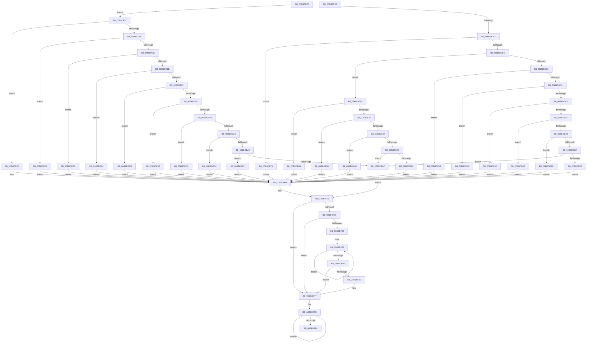

# HdlspKernelAddLogEntry

- RVA: `0x00BBDD70`–`0x00BBDFD6` (길이 `614` bytes)
- VA: `0x0000000140BBDD70`
- 실행 섹션: `PAGEHDLS`
- PDB 이름 있음: `예`; PDB Function 태그: `아니요`
- unwind 정보 RVA: `0x000D4BE4`
- 디코드: `158`개 명령, `614/614` bytes 표시
- 미해석 바이트: `0` (있으면 어셈블리에 `.byte`로 보존)

> 이 문서는 커널 이미지의 기계어와 PDB 기호를 분석해 생성했습니다. 4번과 5번은 함수 원형과 자료형을 바이너리 사용 방식에서 추정한 C 해석이며 원본 소스 복구 결과는 아닙니다.

## 1. Dependencies

- 직접 호출 지점: **4**; 고유 호출 대상: **4**
- 직접 호출자로 확인된 함수: **1**
- RIP 상대 이미지 참조: **21**

### Outgoing calls
- `0x00BBDF11` → [wcscpy_s](../../text/50/wcscpy_s_function_005064B0.md) (function, `0x005064B0`)
- `0x00BBDF60` → [memcpy](../../text/6C/memcpy_function_006C6840.md) (function, `0x006C6840`)
- `0x00BBDF9F` → [HdlspDispatch](HdlspDispatch_function_00BBD320.md) (function, `0x00BBD320`)
- `0x00BBDFAF` → [_security_check_cookie](../../text/6A/_security_check_cookie_function_006AC640.md) (function, `0x006AC640`)

### Direct callers
- [HeadlessKernelAddLogEntry](../../text/4B/HeadlessKernelAddLogEntry_function_004B7DEC.md) at `0x004B7E09`

### Static image references
- `0x00BBDD8F` → RVA `0x00E0A740` (`.data`; read)
- `0x00BBDDE3` → RVA `0x00BBF220` (` ?? ::CIFEBFPJ::`string'`; read)
- `0x00BBDDEF` → RVA `0x00BBF150` (` ?? ::CIFEBFPJ::`string'`; read)
- `0x00BBDDFB` → RVA `0x00BBF190` (` ?? ::CIFEBFPJ::`string'`; read)
- `0x00BBDE07` → RVA `0x00BBEA30` (` ?? ::CIFEBFPJ::`string'`; read)
- `0x00BBDE13` → RVA `0x00BBEA60` (` ?? ::CIFEBFPJ::`string'`; read)
- `0x00BBDE1F` → RVA `0x00BBF1C0` (` ?? ::CIFEBFPJ::`string'`; read)
- `0x00BBDE41` → RVA `0x00BBF0A0` (` ?? ::CIFEBFPJ::`string'`; read)
- `0x00BBDE4D` → RVA `0x00BBF0F0` (` ?? ::CIFEBFPJ::`string'`; read)
- `0x00BBDE59` → RVA `0x00BBEFA0` (` ?? ::CIFEBFPJ::`string'`; read)
- `0x00BBDE65` → RVA `0x00BBF020` (` ?? ::CIFEBFPJ::`string'`; read)
- `0x00BBDE71` → RVA `0x00BBEE80` (` ?? ::CIFEBFPJ::`string'`; read)
- `0x00BBDEB7` → RVA `0x00BBF270` (` ?? ::CIFEBFPJ::`string'`; read)
- `0x00BBDEC0` → RVA `0x00BBF2C0` (` ?? ::CIFEBFPJ::`string'`; read)
- `0x00BBDEC9` → RVA `0x00BBED60` (` ?? ::CIFEBFPJ::`string'`; read)
- `0x00BBDED2` → RVA `0x00BBEDC0` (` ?? ::CIFEBFPJ::`string'`; read)
- `0x00BBDEDB` → RVA `0x00BBECB0` (` ?? ::CIFEBFPJ::`string'`; read)
- `0x00BBDEE4` → RVA `0x00BBED00` (` ?? ::CIFEBFPJ::`string'`; read)
- `0x00BBDEED` → RVA `0x00BBEEE0` (` ?? ::CIFEBFPJ::`string'`; read)
- `0x00BBDEF6` → RVA `0x00BBEF40` (` ?? ::CIFEBFPJ::`string'`; read)
- `0x00BBDEFF` → RVA `0x00BBEE30` (` ?? ::CIFEBFPJ::`string'`; read)

## 2. Other-region calls and transfers

- 다른 실행 섹션으로 향하는 call: **3**
  - `0x00BBDF11` → [wcscpy_s](../../text/50/wcscpy_s_function_005064B0.md) (`PAGEHDLS` → `.text`)
  - `0x00BBDF60` → [memcpy](../../text/6C/memcpy_function_006C6840.md) (`PAGEHDLS` → `.text`)
  - `0x00BBDFAF` → [_security_check_cookie](../../text/6A/_security_check_cookie_function_006AC640.md) (`PAGEHDLS` → `.text`)
- 별도 외부 분기/꼬리 이동을 확인하지 못했습니다.

## 3. Assembly (complete function range)

```asm
00BBDD70  48 89 5C 24 08                  mov qword ptr [rsp + 8], rbx
00BBDD75  48 89 6C 24 18                  mov qword ptr [rsp + 0x18], rbp
00BBDD7A  48 89 74 24 20                  mov qword ptr [rsp + 0x20], rsi
00BBDD7F  57                              push rdi
00BBDD80  41 54                           push r12
00BBDD82  41 55                           push r13
00BBDD84  41 56                           push r14
00BBDD86  41 57                           push r15
00BBDD88  48 81 EC F0 00 00 00            sub rsp, 0xf0
00BBDD8F  48 8B 05 AA C9 24 00            mov rax, qword ptr [rip + 0x24c9aa]
00BBDD96  48 33 C4                        xor rax, rsp
00BBDD99  48 89 84 24 E0 00 00 00         mov qword ptr [rsp + 0xe0], rax
00BBDDA1  45 33 E4                        xor r12d, r12d
00BBDDA4  4C 8B EA                        mov r13, rdx
00BBDDA7  8B F9                           mov edi, ecx
00BBDDA9  BD 50 00 00 00                  mov ebp, 0x50
00BBDDAE  83 F9 0B                        cmp ecx, 0xb
00BBDDB1  0F 87 C6 00 00 00               ja 0x140bbde7d
00BBDDB7  0F 84 B4 00 00 00               je 0x140bbde71
00BBDDBD  83 F9 06                        cmp ecx, 6
00BBDDC0  77 69                           ja 0x140bbde2b
00BBDDC2  74 5B                           je 0x140bbde1f
00BBDDC4  8B C1                           mov eax, ecx
00BBDDC6  83 E8 01                        sub eax, 1
00BBDDC9  74 48                           je 0x140bbde13
00BBDDCB  83 E8 01                        sub eax, 1
00BBDDCE  74 37                           je 0x140bbde07
00BBDDD0  83 E8 01                        sub eax, 1
00BBDDD3  74 26                           je 0x140bbddfb
00BBDDD5  83 E8 01                        sub eax, 1
00BBDDD8  74 15                           je 0x140bbddef
00BBDDDA  83 F8 01                        cmp eax, 1
00BBDDDD  0F 85 C9 00 00 00               jne 0x140bbdeac
00BBDDE3  48 8D 1D 36 14 00 00            lea rbx, [rip + 0x1436]
00BBDDEA  E9 17 01 00 00                  jmp 0x140bbdf06
00BBDDEF  48 8D 1D 5A 13 00 00            lea rbx, [rip + 0x135a]
00BBDDF6  E9 0B 01 00 00                  jmp 0x140bbdf06
00BBDDFB  48 8D 1D 8E 13 00 00            lea rbx, [rip + 0x138e]
00BBDE02  E9 FF 00 00 00                  jmp 0x140bbdf06
00BBDE07  48 8D 1D 22 0C 00 00            lea rbx, [rip + 0xc22]
00BBDE0E  E9 F3 00 00 00                  jmp 0x140bbdf06
00BBDE13  48 8D 1D 46 0C 00 00            lea rbx, [rip + 0xc46]
00BBDE1A  E9 E7 00 00 00                  jmp 0x140bbdf06
00BBDE1F  48 8D 1D 9A 13 00 00            lea rbx, [rip + 0x139a]
00BBDE26  E9 DB 00 00 00                  jmp 0x140bbdf06
00BBDE2B  8B C7                           mov eax, edi
00BBDE2D  83 E8 07                        sub eax, 7
00BBDE30  74 33                           je 0x140bbde65
00BBDE32  83 E8 01                        sub eax, 1
00BBDE35  74 22                           je 0x140bbde59
00BBDE37  83 E8 01                        sub eax, 1
00BBDE3A  74 11                           je 0x140bbde4d
00BBDE3C  83 F8 01                        cmp eax, 1
00BBDE3F  75 6B                           jne 0x140bbdeac
00BBDE41  48 8D 1D 58 12 00 00            lea rbx, [rip + 0x1258]
00BBDE48  E9 B9 00 00 00                  jmp 0x140bbdf06
00BBDE4D  48 8D 1D 9C 12 00 00            lea rbx, [rip + 0x129c]
00BBDE54  E9 AD 00 00 00                  jmp 0x140bbdf06
00BBDE59  48 8D 1D 40 11 00 00            lea rbx, [rip + 0x1140]
00BBDE60  E9 A1 00 00 00                  jmp 0x140bbdf06
00BBDE65  48 8D 1D B4 11 00 00            lea rbx, [rip + 0x11b4]
00BBDE6C  E9 95 00 00 00                  jmp 0x140bbdf06
00BBDE71  48 8D 1D 08 10 00 00            lea rbx, [rip + 0x1008]
00BBDE78  E9 89 00 00 00                  jmp 0x140bbdf06
00BBDE7D  8B C7                           mov eax, edi
00BBDE7F  83 E8 0C                        sub eax, 0xc
00BBDE82  74 7B                           je 0x140bbdeff
00BBDE84  83 E8 01                        sub eax, 1
00BBDE87  74 6D                           je 0x140bbdef6
00BBDE89  83 E8 01                        sub eax, 1
00BBDE8C  74 5F                           je 0x140bbdeed
00BBDE8E  83 E8 01                        sub eax, 1
00BBDE91  74 51                           je 0x140bbdee4
00BBDE93  83 E8 01                        sub eax, 1
00BBDE96  74 43                           je 0x140bbdedb
00BBDE98  83 E8 02                        sub eax, 2
00BBDE9B  74 35                           je 0x140bbded2
00BBDE9D  83 E8 01                        sub eax, 1
00BBDEA0  74 27                           je 0x140bbdec9
00BBDEA2  83 E8 01                        sub eax, 1
00BBDEA5  74 19                           je 0x140bbdec0
00BBDEA7  83 F8 01                        cmp eax, 1
00BBDEAA  74 0B                           je 0x140bbdeb7
00BBDEAC  49 8B DC                        mov rbx, r12
00BBDEAF  66 44 89 64 24 30               mov word ptr [rsp + 0x30], r12w
00BBDEB5  EB 5F                           jmp 0x140bbdf16
00BBDEB7  48 8D 1D B2 13 00 00            lea rbx, [rip + 0x13b2]
00BBDEBE  EB 46                           jmp 0x140bbdf06
00BBDEC0  48 8D 1D F9 13 00 00            lea rbx, [rip + 0x13f9]
00BBDEC7  EB 3D                           jmp 0x140bbdf06
00BBDEC9  48 8D 1D 90 0E 00 00            lea rbx, [rip + 0xe90]
00BBDED0  EB 34                           jmp 0x140bbdf06
00BBDED2  48 8D 1D E7 0E 00 00            lea rbx, [rip + 0xee7]
00BBDED9  EB 2B                           jmp 0x140bbdf06
00BBDEDB  48 8D 1D CE 0D 00 00            lea rbx, [rip + 0xdce]
00BBDEE2  EB 22                           jmp 0x140bbdf06
00BBDEE4  48 8D 1D 15 0E 00 00            lea rbx, [rip + 0xe15]
00BBDEEB  EB 19                           jmp 0x140bbdf06
00BBDEED  48 8D 1D EC 0F 00 00            lea rbx, [rip + 0xfec]
00BBDEF4  EB 10                           jmp 0x140bbdf06
00BBDEF6  48 8D 1D 43 10 00 00            lea rbx, [rip + 0x1043]
00BBDEFD  EB 07                           jmp 0x140bbdf06
00BBDEFF  48 8D 1D 2A 0F 00 00            lea rbx, [rip + 0xf2a]
00BBDF06  4C 8B C3                        mov r8, rbx
00BBDF09  48 8D 4C 24 30                  lea rcx, [rsp + 0x30]
00BBDF0E  48 8B D5                        mov rdx, rbp
00BBDF11  E8 9A 85 94 FF                  call 0x1405064b0
00BBDF16  48 83 CE FF                     or rsi, 0xffffffffffffffff
00BBDF1A  83 FF 01                        cmp edi, 1
00BBDF1D  75 58                           jne 0x140bbdf77
00BBDF1F  4D 85 ED                        test r13, r13
00BBDF22  74 53                           je 0x140bbdf77
00BBDF24  4C 8B F6                        mov r14, rsi
00BBDF27  49 FF C6                        inc r14
00BBDF2A  66 46 39 24 73                  cmp word ptr [rbx + r14*2], r12w
00BBDF2F  75 F6                           jne 0x140bbdf27
00BBDF31  41 0F B7 7D 00                  movzx edi, word ptr [r13]
00BBDF36  48 8D 4C 24 30                  lea rcx, [rsp + 0x30]
00BBDF3B  49 8B 5D 08                     mov rbx, qword ptr [r13 + 8]
00BBDF3F  4A 8D 0C 71                     lea rcx, [rcx + r14*2]
00BBDF43  48 D1 EF                        shr rdi, 1
00BBDF46  41 BF 4F 00 00 00               mov r15d, 0x4f
00BBDF4C  4D 2B FE                        sub r15, r14
00BBDF4F  49 2B EE                        sub rbp, r14
00BBDF52  48 3B FD                        cmp rdi, rbp
00BBDF55  48 8B D3                        mov rdx, rbx
00BBDF58  4C 0F 42 FF                     cmovb r15, rdi
00BBDF5C  4F 8D 04 3F                     lea r8, [r15 + r15]
00BBDF60  E8 DB 88 B0 FF                  call 0x1406c6840
00BBDF65  66 44 39 64 7B FE               cmp word ptr [rbx + rdi*2 - 2], r12w
00BBDF6B  74 0A                           je 0x140bbdf77
00BBDF6D  4B 8D 04 37                     lea rax, [r15 + r14]
00BBDF71  66 44 89 64 44 30               mov word ptr [rsp + rax*2 + 0x30], r12w
00BBDF77  48 8D 44 24 30                  lea rax, [rsp + 0x30]
00BBDF7C  48 FF C6                        inc rsi
00BBDF7F  66 44 39 24 70                  cmp word ptr [rax + rsi*2], r12w
00BBDF84  75 F6                           jne 0x140bbdf7c
00BBDF86  45 33 C9                        xor r9d, r9d
00BBDF89  4C 89 64 24 20                  mov qword ptr [rsp + 0x20], r12
00BBDF8E  4C 8D 04 75 02 00 00 00         lea r8, [rsi*2 + 2]
00BBDF96  48 8D 54 24 30                  lea rdx, [rsp + 0x30]
00BBDF9B  41 8D 49 11                     lea ecx, [r9 + 0x11]
00BBDF9F  E8 7C F3 FF FF                  call 0x140bbd320
00BBDFA4  48 8B 8C 24 E0 00 00 00         mov rcx, qword ptr [rsp + 0xe0]
00BBDFAC  48 33 CC                        xor rcx, rsp
00BBDFAF  E8 8C E6 AE FF                  call 0x1406ac640
00BBDFB4  4C 8D 9C 24 F0 00 00 00         lea r11, [rsp + 0xf0]
00BBDFBC  49 8B 5B 30                     mov rbx, qword ptr [r11 + 0x30]
00BBDFC0  49 8B 6B 40                     mov rbp, qword ptr [r11 + 0x40]
00BBDFC4  49 8B 73 48                     mov rsi, qword ptr [r11 + 0x48]
00BBDFC8  49 8B E3                        mov rsp, r11
00BBDFCB  41 5F                           pop r15
00BBDFCD  41 5E                           pop r14
00BBDFCF  41 5D                           pop r13
00BBDFD1  41 5C                           pop r12
00BBDFD3  5F                              pop rdi
00BBDFD4  C3                              ret
00BBDFD5  CC                              int3
```

## 4. C-style interpretation (structured pseudocode)

```c
__int64 __fastcall HdlspKernelAddLogEntry(int a1, __int64 a2, __int64 a3, int a4)
{
    __int64 result;
    __int64 v_r12;
    __int64 v_r14;
    __int64 v_r15;
    __int64 v_rbp;
    __int64 v_rdi;
    __int64 v_rsi;
    __int64 v_rsp;
    unsigned __int64 v_stack_m28;
    unsigned __int64 v_stack_m38;
    unsigned __int16 v_stack_mE8;
    unsigned __int64 v_stack_mF8;
    unsigned __int64 v_stack_p18;
    unsigned __int64 v_stack_p20;
    unsigned __int64 v_stack_p8;

    v_stack_p8 = v_rbx;
    v_stack_p18 = v_rbp;
    v_stack_p20 = v_rsi;
    v_rsp = (v_rsp) - (240);
    result = (*(unsigned __int64 *)(v_rip + 2410922)) ^ (v_rsp);
    v_stack_m38 = result;
    v_r12 = 0;
    if (a1 > 11) goto loc_00BBDE7D;
    if (a1 == 11) goto loc_00BBDE71;
    if (a1 > 6) goto loc_00BBDE2B;
    if (a1 == 6) goto loc_00BBDE1F;
    result = (unsigned int)(((unsigned int)(a1)) - (1));
    if (condition_is_equal) goto loc_00BBDE13;
    result = (unsigned int)((result) - (1));
    if (condition_is_equal) goto loc_00BBDE07;
    result = (unsigned int)((result) - (1));
    if (condition_is_equal) goto loc_00BBDDFB;
    result = (unsigned int)((result) - (1));
    if (condition_is_equal) goto loc_00BBDDEF;
    if (((unsigned int)(result)) != 1) goto loc_00BBDEAC;
    goto loc_00BBDF06;
loc_00BBDDEF:
    goto loc_00BBDF06;
loc_00BBDDFB:
    goto loc_00BBDF06;
loc_00BBDE07:
    goto loc_00BBDF06;
loc_00BBDE13:
    goto loc_00BBDF06;
loc_00BBDE1F:
    goto loc_00BBDF06;
loc_00BBDE2B:
    result = (unsigned int)(((unsigned int)((unsigned int)((unsigned int)(a1)))) - (7));
    if (condition_is_equal) goto loc_00BBDE65;
    result = (unsigned int)((result) - (1));
    if (condition_is_equal) goto loc_00BBDE59;
    result = (unsigned int)((result) - (1));
    if (condition_is_equal) goto loc_00BBDE4D;
    if (((unsigned int)(result)) != 1) goto loc_00BBDEAC;
    goto loc_00BBDF06;
loc_00BBDE4D:
    goto loc_00BBDF06;
loc_00BBDE59:
    goto loc_00BBDF06;
loc_00BBDE65:
    goto loc_00BBDF06;
loc_00BBDE71:
    goto loc_00BBDF06;
loc_00BBDE7D:
    result = (unsigned int)(((unsigned int)((unsigned int)((unsigned int)(a1)))) - (12));
    if (condition_is_equal) goto loc_00BBDEFF;
    result = (unsigned int)((result) - (1));
    if (condition_is_equal) goto loc_00BBDEF6;
    result = (unsigned int)((result) - (1));
    if (condition_is_equal) goto loc_00BBDEED;
    result = (unsigned int)((result) - (1));
    if (condition_is_equal) goto loc_00BBDEE4;
    result = (unsigned int)((result) - (1));
    if (condition_is_equal) goto loc_00BBDEDB;
    result = (unsigned int)((result) - (2));
    if (condition_is_equal) goto loc_00BBDED2;
    result = (unsigned int)((result) - (1));
    if (condition_is_equal) goto loc_00BBDEC9;
    result = (unsigned int)((result) - (1));
    if (condition_is_equal) goto loc_00BBDEC0;
    if (((unsigned int)(result)) == 1) goto loc_00BBDEB7;
loc_00BBDEAC:
    v_stack_mE8 = 0;
    goto loc_00BBDF16;
loc_00BBDEB7:
    goto loc_00BBDF06;
loc_00BBDEC0:
    goto loc_00BBDF06;
loc_00BBDEC9:
    goto loc_00BBDF06;
loc_00BBDED2:
    goto loc_00BBDF06;
loc_00BBDEDB:
    goto loc_00BBDF06;
loc_00BBDEE4:
    goto loc_00BBDF06;
loc_00BBDEED:
    goto loc_00BBDF06;
loc_00BBDEF6:
    goto loc_00BBDF06;
loc_00BBDEFF:
loc_00BBDF06:
    result = wcscpy_s(v_stack_mE8, 80, v_rip + 3882, a4);
loc_00BBDF16:
    v_rsi = (v_rsi) | (-1);
    if (((unsigned int)((unsigned int)(a1))) != 1) goto loc_00BBDF77;
    if (a2 == 0) goto loc_00BBDF77;
loc_00BBDF27:
    v_r14 = (v_rsi) + 1;
    if ((*(unsigned __int16 *)(v_rip + 3882 + v_r14 * 2)) != 0) goto loc_00BBDF27;
    v_rdi = (*(unsigned __int16 *)(a2)) >> (1);
    v_r15 = (79) - (v_r14);
    v_rbp = (80) - (v_r14);
    if (v_rdi < v_rbp) { v_r15 = v_rdi; }
    result = memcpy(v_stack_mE8 + v_r14 * 2, *(unsigned __int64 *)(a2 + 8), v_r15 + v_r15 * 1, a4);
    if ((*(unsigned __int16 *)(*(unsigned __int64 *)(a2 + 8) + v_rdi * 2 - 2)) != 0) {
        result = v_r15 + v_r14 * 1;
        *(unsigned __int16 *)(v_rsp + result * 2 + 48) = 0;
    }
loc_00BBDF7C:
    v_rsi = (v_rsi) + 1;
    if ((*(unsigned __int16 *)(v_stack_mE8 + v_rsi * 2)) != 0) goto loc_00BBDF7C;
    a4 = 0;
    v_stack_mF8 = 0;
    result = HdlspDispatch(a4 + 17, v_stack_mE8, v_rsi * 2 + 2, a4);
    a1 = (v_stack_m38) ^ (v_rsp);
    result = _security_check_cookie(a1, v_stack_mE8, v_rsi * 2 + 2, a4);
    return result;
}
```

## 5. (Beta) C Style

```c
int64_t HdlspKernelAddLogEntry(int32_t Arg1, int64_t Arg2, int64_t Arg3, int32_t Arg4)
{
    int64_t result;
    int64_t local_r12;
    int64_t local_r14;
    int64_t local_r15;
    int64_t local_rbp;
    int64_t local_rdi;
    int64_t local_rsi;
    int64_t local_rsp;
    uint64_t v_stack_m28;
    uint64_t v_stack_m38;
    uint16_t v_stack_mE8;
    uint64_t v_stack_mF8;
    uint64_t v_stack_p18;
    uint64_t v_stack_p20;
    uint64_t v_stack_p8;

    v_stack_p8 = local_rbx;
    v_stack_p18 = local_rbp;
    v_stack_p20 = local_rsi;
    local_rsp = (local_rsp) - (240);
    result = (*(uint64_t *)(v_rip + 0x24C9AA)) ^ (local_rsp);
    v_stack_m38 = result;
    local_r12 = 0;
    if (Arg1 > 11) goto loc_00BBDE7D;
    if (Arg1 == 11) goto loc_00BBDE71;
    if (Arg1 > 6) goto loc_00BBDE2B;
    if (Arg1 == 6) goto loc_00BBDE1F;
    result = (uint32_t)(((uint32_t)(Arg1)) - (1));
    if (condition_is_equal) goto loc_00BBDE13;
    result = (uint32_t)((result) - (1));
    if (condition_is_equal) goto loc_00BBDE07;
    result = (uint32_t)((result) - (1));
    if (condition_is_equal) goto loc_00BBDDFB;
    result = (uint32_t)((result) - (1));
    if (condition_is_equal) goto loc_00BBDDEF;
    if (((uint32_t)(result)) != 1) goto loc_00BBDEAC;
    goto loc_00BBDF06;
loc_00BBDDEF:
    goto loc_00BBDF06;
loc_00BBDDFB:
    goto loc_00BBDF06;
loc_00BBDE07:
    goto loc_00BBDF06;
loc_00BBDE13:
    goto loc_00BBDF06;
loc_00BBDE1F:
    goto loc_00BBDF06;
loc_00BBDE2B:
    result = (uint32_t)(((uint32_t)((uint32_t)((uint32_t)(Arg1)))) - (7));
    if (condition_is_equal) goto loc_00BBDE65;
    result = (uint32_t)((result) - (1));
    if (condition_is_equal) goto loc_00BBDE59;
    result = (uint32_t)((result) - (1));
    if (condition_is_equal) goto loc_00BBDE4D;
    if (((uint32_t)(result)) != 1) goto loc_00BBDEAC;
    goto loc_00BBDF06;
loc_00BBDE4D:
    goto loc_00BBDF06;
loc_00BBDE59:
    goto loc_00BBDF06;
loc_00BBDE65:
    goto loc_00BBDF06;
loc_00BBDE71:
    goto loc_00BBDF06;
loc_00BBDE7D:
    result = (uint32_t)(((uint32_t)((uint32_t)((uint32_t)(Arg1)))) - (12));
    if (condition_is_equal) goto loc_00BBDEFF;
    result = (uint32_t)((result) - (1));
    if (condition_is_equal) goto loc_00BBDEF6;
    result = (uint32_t)((result) - (1));
    if (condition_is_equal) goto loc_00BBDEED;
    result = (uint32_t)((result) - (1));
    if (condition_is_equal) goto loc_00BBDEE4;
    result = (uint32_t)((result) - (1));
    if (condition_is_equal) goto loc_00BBDEDB;
    result = (uint32_t)((result) - (2));
    if (condition_is_equal) goto loc_00BBDED2;
    result = (uint32_t)((result) - (1));
    if (condition_is_equal) goto loc_00BBDEC9;
    result = (uint32_t)((result) - (1));
    if (condition_is_equal) goto loc_00BBDEC0;
    if (((uint32_t)(result)) == 1) goto loc_00BBDEB7;
loc_00BBDEAC:
    v_stack_mE8 = 0;
    goto loc_00BBDF16;
loc_00BBDEB7:
    goto loc_00BBDF06;
loc_00BBDEC0:
    goto loc_00BBDF06;
loc_00BBDEC9:
    goto loc_00BBDF06;
loc_00BBDED2:
    goto loc_00BBDF06;
loc_00BBDEDB:
    goto loc_00BBDF06;
loc_00BBDEE4:
    goto loc_00BBDF06;
loc_00BBDEED:
    goto loc_00BBDF06;
loc_00BBDEF6:
    goto loc_00BBDF06;
loc_00BBDEFF:
loc_00BBDF06:
    result = wcscpy_s(v_stack_mE8, 80, v_rip + 3882, Arg4);
loc_00BBDF16:
    local_rsi = (local_rsi) | (-1);
    if (((uint32_t)((uint32_t)(Arg1))) != 1) goto loc_00BBDF77;
    if (Arg2 == 0) goto loc_00BBDF77;
loc_00BBDF27:
    local_r14 = (local_rsi) + 1;
    if ((*(uint16_t *)(v_rip + 0xF2A + local_r14 * 2)) != 0) goto loc_00BBDF27;
    local_rdi = (*(uint16_t *)(Arg2)) >> (1);
    local_r15 = (79) - (local_r14);
    local_rbp = (80) - (local_r14);
    if (local_rdi < local_rbp) { local_r15 = local_rdi; }
    result = memcpy(v_stack_mE8 + local_r14 * 2, *(uint64_t *)(Arg2 + 0x8), local_r15 + local_r15 * 1, Arg4);
    if ((*(uint16_t *)(*(uint64_t *)(Arg2 + 0x8) + local_rdi * 2 - 0x2)) != 0) {
        result = local_r15 + local_r14 * 1;
        *(uint16_t *)(local_rsp + result * 2 + 0x30) = 0;
    }
loc_00BBDF7C:
    local_rsi = (local_rsi) + 1;
    if ((*(uint16_t *)(v_stack_mE8 + local_rsi * 2)) != 0) goto loc_00BBDF7C;
    Arg4 = 0;
    v_stack_mF8 = 0;
    result = HdlspDispatch(Arg4 + 17, v_stack_mE8, local_rsi * 2 + 2, Arg4);
    Arg1 = (v_stack_m38) ^ (local_rsp);
    result = _security_check_cookie(Arg1, v_stack_mE8, local_rsi * 2 + 2, Arg4);
    return result;
}
```

## 6. Execution-region graph

[열기: 2D/3D 그래프와 함수 탐색 컨트롤 패널](../../../control-panel.html?section=pagehdls&rva=0x00BBDD70&view=graph)

- 2D 그래프는 위에서 아래로 흐르고, 3D 그래프는 빈 공간을 드래그해 회전합니다. Shift+드래그는 이동, 휠은 확대·축소, 함수 노드 선택은 대상 보고서 이동입니다.

### Static fallback


