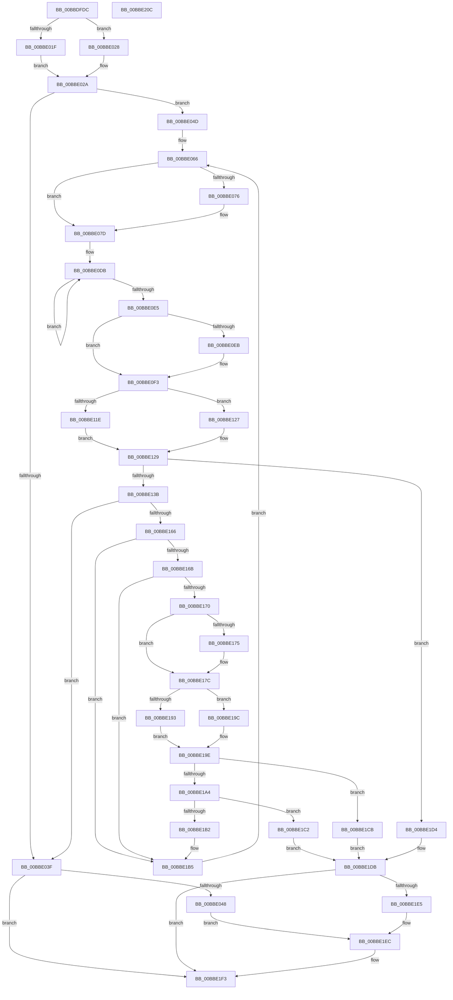

# HdlspProcessDumpCommand

- RVA: `0x00BBDFDC`–`0x00BBE20D` (길이 `561` bytes)
- VA: `0x0000000140BBDFDC`
- 실행 섹션: `PAGEHDLS`
- PDB 이름 있음: `예`; PDB Function 태그: `아니요`
- unwind 정보 RVA: `0x000D4C54`
- 디코드: `150`개 명령, `561/561` bytes 표시
- 미해석 바이트: `0` (있으면 어셈블리에 `.byte`로 보존)

> 이 문서는 커널 이미지의 기계어와 PDB 기호를 분석해 생성했습니다. 4번과 5번은 함수 원형과 자료형을 바이너리 사용 방식에서 추정한 C 해석이며 원본 소스 복구 결과는 아닙니다.

## 1. Dependencies

- 직접 호출 지점: **15**; 고유 호출 대상: **8**
- 직접 호출자로 확인된 함수: **2**
- RIP 상대 이미지 참조: **5**

### Outgoing calls
- `0x00BBE01F` → [KeAcquireSpinLockRaiseToDpc](../../text/20/KeAcquireSpinLockRaiseToDpc_function_00208470.md) (function, `0x00208470`)
- `0x00BBE078` → [KeReleaseSpinLock](../../text/39/KeReleaseSpinLock_function_00392BA0.md) (function, `0x00392BA0`)
- `0x00BBE085` → [RtlTimeToTimeFields](../../text/42/RtlTimeToTimeFields_function_0042E0F0.md) (function, `0x0042E0F0`)
- `0x00BBE0BE` → [sprintf_s](../../text/50/sprintf_s_function_00505E40.md) (function, `0x00505E40`)
- `0x00BBE0CE` → [HdlspPutString](HdlspPutString_function_00BBE2F0.md) (function, `0x00BBE2F0`)
- `0x00BBE0FB` → [RtlInitUnicodeString](../../text/42/RtlInitUnicodeString_function_0042A780.md) (function, `0x0042A780`)
- `0x00BBE10B` → [RtlUnicodeStringToAnsiString](../../page/90/RtlUnicodeStringToAnsiString_function_0090D1F0.md) (function, `0x0090D1F0`)
- `0x00BBE11E` → [KeAcquireSpinLockRaiseToDpc](../../text/20/KeAcquireSpinLockRaiseToDpc_function_00208470.md) (function, `0x00208470`)
- `0x00BBE13F` → [HdlspPutString](HdlspPutString_function_00BBE2F0.md) (function, `0x00BBE2F0`)
- `0x00BBE14B` → [HdlspPutString](HdlspPutString_function_00BBE2F0.md) (function, `0x00BBE2F0`)
- `0x00BBE177` → [KeReleaseSpinLock](../../text/39/KeReleaseSpinLock_function_00392BA0.md) (function, `0x00392BA0`)
- `0x00BBE180` → [HdlspPutMore](HdlspPutMore_function_00BBE214.md) (function, `0x00BBE214`)
- `0x00BBE193` → [KeAcquireSpinLockRaiseToDpc](../../text/20/KeAcquireSpinLockRaiseToDpc_function_00208470.md) (function, `0x00208470`)
- `0x00BBE1DB` → [HdlspPutString](HdlspPutString_function_00BBE2F0.md) (function, `0x00BBE2F0`)
- `0x00BBE1EE` → [KeReleaseSpinLock](../../text/39/KeReleaseSpinLock_function_00392BA0.md) (function, `0x00392BA0`)

### Direct callers
- [HdlspBugCheckProcessing](HdlspBugCheckProcessing_function_00BBD1F8.md) at `0x00BBD268`
- [HdlspDispatch](HdlspDispatch_function_00BBD320.md) at `0x00BBD8D2`

### Static image references
- `0x00BBDFFB` → RVA `0x00E68578` (`.data`; read)
- `0x00BBE08E` → RVA `0x00BBEBB0` (` ?? ::CIFEBFPJ::`string'`; read)
- `0x00BBE144` → RVA `0x00BBE970` (` ?? ::CIFEBFPJ::`string'`; read)
- `0x00BBE1C2` → RVA `0x00BBEBF0` (` ?? ::CIFEBFPJ::`string'`; read)
- `0x00BBE1D4` → RVA `0x00BBEB70` (` ?? ::CIFEBFPJ::`string'`; read)

## 2. Other-region calls and transfers

- 다른 실행 섹션으로 향하는 call: **10**
  - `0x00BBE01F` → [KeAcquireSpinLockRaiseToDpc](../../text/20/KeAcquireSpinLockRaiseToDpc_function_00208470.md) (`PAGEHDLS` → `.text`)
  - `0x00BBE078` → [KeReleaseSpinLock](../../text/39/KeReleaseSpinLock_function_00392BA0.md) (`PAGEHDLS` → `.text`)
  - `0x00BBE085` → [RtlTimeToTimeFields](../../text/42/RtlTimeToTimeFields_function_0042E0F0.md) (`PAGEHDLS` → `.text`)
  - `0x00BBE0BE` → [sprintf_s](../../text/50/sprintf_s_function_00505E40.md) (`PAGEHDLS` → `.text`)
  - `0x00BBE0FB` → [RtlInitUnicodeString](../../text/42/RtlInitUnicodeString_function_0042A780.md) (`PAGEHDLS` → `.text`)
  - `0x00BBE10B` → [RtlUnicodeStringToAnsiString](../../page/90/RtlUnicodeStringToAnsiString_function_0090D1F0.md) (`PAGEHDLS` → `PAGE`)
  - `0x00BBE11E` → [KeAcquireSpinLockRaiseToDpc](../../text/20/KeAcquireSpinLockRaiseToDpc_function_00208470.md) (`PAGEHDLS` → `.text`)
  - `0x00BBE177` → [KeReleaseSpinLock](../../text/39/KeReleaseSpinLock_function_00392BA0.md) (`PAGEHDLS` → `.text`)
  - `0x00BBE193` → [KeAcquireSpinLockRaiseToDpc](../../text/20/KeAcquireSpinLockRaiseToDpc_function_00208470.md) (`PAGEHDLS` → `.text`)
  - `0x00BBE1EE` → [KeReleaseSpinLock](../../text/39/KeReleaseSpinLock_function_00392BA0.md) (`PAGEHDLS` → `.text`)
- 별도 외부 분기/꼬리 이동을 확인하지 못했습니다.

## 3. Assembly (complete function range)

```asm
00BBDFDC  48 89 5C 24 08                  mov qword ptr [rsp + 8], rbx
00BBDFE1  48 89 74 24 18                  mov qword ptr [rsp + 0x18], rsi
00BBDFE6  55                              push rbp
00BBDFE7  57                              push rdi
00BBDFE8  41 55                           push r13
00BBDFEA  41 56                           push r14
00BBDFEC  41 57                           push r15
00BBDFEE  48 8B EC                        mov rbp, rsp
00BBDFF1  48 83 EC 70                     sub rsp, 0x70
00BBDFF5  45 33 ED                        xor r13d, r13d
00BBDFF8  44 8A F9                        mov r15b, cl
00BBDFFB  48 8B 0D 76 A5 2A 00            mov rcx, qword ptr [rip + 0x2aa576]
00BBE002  0F 57 C0                        xorps xmm0, xmm0
00BBE005  0F 57 C9                        xorps xmm1, xmm1
00BBE008  44 89 6D E4                     mov dword ptr [rbp - 0x1c], r13d
00BBE00C  0F 11 45 D0                     movups xmmword ptr [rbp - 0x30], xmm0
00BBE010  44 88 6D 38                     mov byte ptr [rbp + 0x38], r13b
00BBE014  8B 41 30                        mov eax, dword ptr [rcx + 0x30]
00BBE017  0F 11 4D F0                     movups xmmword ptr [rbp - 0x10], xmm1
00BBE01B  A8 02                           test al, 2
00BBE01D  75 09                           jne 0x140bbe028
00BBE01F  E8 4C A4 64 FF                  call 0x140208470
00BBE024  8A D8                           mov bl, al
00BBE026  EB 02                           jmp 0x140bbe02a
00BBE028  B3 FF                           mov bl, 0xff
00BBE02A  48 8B 0D 47 A5 2A 00            mov rcx, qword ptr [rip + 0x2aa547]
00BBE031  B8 FF FF 00 00                  mov eax, 0xffff
00BBE036  0F B7 51 62                     movzx edx, word ptr [rcx + 0x62]
00BBE03A  66 3B D0                        cmp dx, ax
00BBE03D  75 0E                           jne 0x140bbe04d
00BBE03F  80 FB FF                        cmp bl, 0xff
00BBE042  0F 84 AB 01 00 00               je 0x140bbe1f3
00BBE048  E9 9F 01 00 00                  jmp 0x140bbe1ec
00BBE04D  48 8B 41 18                     mov rax, qword ptr [rcx + 0x18]
00BBE051  44 8B F2                        mov r14d, edx
00BBE054  83 61 30 FB                     and dword ptr [rcx + 0x30], 0xfffffffb
00BBE058  41 8B F5                        mov esi, r13d
00BBE05B  48 89 45 E8                     mov qword ptr [rbp - 0x18], rax
00BBE05F  C7 45 E0 00 00 50 00            mov dword ptr [rbp - 0x20], 0x500000
00BBE066  41 8B C6                        mov eax, r14d
00BBE069  48 6B F8 38                     imul rdi, rax, 0x38
00BBE06D  48 03 79 10                     add rdi, qword ptr [rcx + 0x10]
00BBE071  80 FB FF                        cmp bl, 0xff
00BBE074  74 07                           je 0x140bbe07d
00BBE076  8A D3                           mov dl, bl
00BBE078  E8 23 4B 7D FF                  call 0x140392ba0
00BBE07D  48 8D 4F 08                     lea rcx, [rdi + 8]
00BBE081  48 8D 55 D0                     lea rdx, [rbp - 0x30]
00BBE085  E8 66 00 87 FF                  call 0x14042e0f0
00BBE08A  0F BF 45 DC                     movsx eax, word ptr [rbp - 0x24]
00BBE08E  4C 8D 05 1B 0B 00 00            lea r8, [rip + 0xb1b]
00BBE095  0F BF 4D DA                     movsx ecx, word ptr [rbp - 0x26]
00BBE099  0F BF 55 D8                     movsx edx, word ptr [rbp - 0x28]
00BBE09D  44 0F BF 4D D6                  movsx r9d, word ptr [rbp - 0x2a]
00BBE0A2  89 44 24 30                     mov dword ptr [rsp + 0x30], eax
00BBE0A6  89 4C 24 28                     mov dword ptr [rsp + 0x28], ecx
00BBE0AA  48 8B 0D C7 A4 2A 00            mov rcx, qword ptr [rip + 0x2aa4c7]
00BBE0B1  89 54 24 20                     mov dword ptr [rsp + 0x20], edx
00BBE0B5  BA 50 00 00 00                  mov edx, 0x50
00BBE0BA  48 8B 49 18                     mov rcx, qword ptr [rcx + 0x18]
00BBE0BE  E8 7D 7D 94 FF                  call 0x140505e40
00BBE0C3  48 8B 0D AE A4 2A 00            mov rcx, qword ptr [rip + 0x2aa4ae]
00BBE0CA  48 8B 49 18                     mov rcx, qword ptr [rcx + 0x18]
00BBE0CE  E8 1D 02 00 00                  call 0x140bbe2f0
00BBE0D3  48 8B 4F 30                     mov rcx, qword ptr [rdi + 0x30]
00BBE0D7  48 83 C8 FF                     or rax, 0xffffffffffffffff
00BBE0DB  48 FF C0                        inc rax
00BBE0DE  66 44 39 2C 41                  cmp word ptr [rcx + rax*2], r13w
00BBE0E3  75 F6                           jne 0x140bbe0db
00BBE0E5  48 83 F8 4F                     cmp rax, 0x4f
00BBE0E9  72 08                           jb 0x140bbe0f3
00BBE0EB  66 44 89 A9 9E 00 00 00         mov word ptr [rcx + 0x9e], r13w
00BBE0F3  48 8B 57 30                     mov rdx, qword ptr [rdi + 0x30]
00BBE0F7  48 8D 4D F0                     lea rcx, [rbp - 0x10]
00BBE0FB  E8 80 C6 86 FF                  call 0x14042a780
00BBE100  45 33 C0                        xor r8d, r8d
00BBE103  48 8D 55 F0                     lea rdx, [rbp - 0x10]
00BBE107  48 8D 4D E0                     lea rcx, [rbp - 0x20]
00BBE10B  E8 E0 F0 D4 FF                  call 0x14090d1f0
00BBE110  48 8B 0D 61 A4 2A 00            mov rcx, qword ptr [rip + 0x2aa461]
00BBE117  8B 41 30                        mov eax, dword ptr [rcx + 0x30]
00BBE11A  A8 02                           test al, 2
00BBE11C  75 09                           jne 0x140bbe127
00BBE11E  E8 4D A3 64 FF                  call 0x140208470
00BBE123  8A D8                           mov bl, al
00BBE125  EB 02                           jmp 0x140bbe129
00BBE127  B3 FF                           mov bl, 0xff
00BBE129  48 8B 0D 48 A4 2A 00            mov rcx, qword ptr [rip + 0x2aa448]
00BBE130  8B 41 30                        mov eax, dword ptr [rcx + 0x30]
00BBE133  A8 04                           test al, 4
00BBE135  0F 85 99 00 00 00               jne 0x140bbe1d4
00BBE13B  48 8B 49 18                     mov rcx, qword ptr [rcx + 0x18]
00BBE13F  E8 AC 01 00 00                  call 0x140bbe2f0
00BBE144  48 8D 0D 25 08 00 00            lea rcx, [rip + 0x825]
00BBE14B  E8 A0 01 00 00                  call 0x140bbe2f0
00BBE150  48 8B 0D 21 A4 2A 00            mov rcx, qword ptr [rip + 0x2aa421]
00BBE157  FF C6                           inc esi
00BBE159  0F B7 41 60                     movzx eax, word ptr [rcx + 0x60]
00BBE15D  44 3B F0                        cmp r14d, eax
00BBE160  0F 84 D9 FE FF FF               je 0x140bbe03f
00BBE166  45 84 FF                        test r15b, r15b
00BBE169  74 4A                           je 0x140bbe1b5
00BBE16B  83 FE 14                        cmp esi, 0x14
00BBE16E  76 45                           jbe 0x140bbe1b5
00BBE170  80 FB FF                        cmp bl, 0xff
00BBE173  74 07                           je 0x140bbe17c
00BBE175  8A D3                           mov dl, bl
00BBE177  E8 24 4A 7D FF                  call 0x140392ba0
00BBE17C  48 8D 4D 38                     lea rcx, [rbp + 0x38]
00BBE180  E8 8F 00 00 00                  call 0x140bbe214
00BBE185  48 8B 0D EC A3 2A 00            mov rcx, qword ptr [rip + 0x2aa3ec]
00BBE18C  8B 41 30                        mov eax, dword ptr [rcx + 0x30]
00BBE18F  A8 02                           test al, 2
00BBE191  75 09                           jne 0x140bbe19c
00BBE193  E8 D8 A2 64 FF                  call 0x140208470
00BBE198  8A D8                           mov bl, al
00BBE19A  EB 02                           jmp 0x140bbe19e
00BBE19C  B3 FF                           mov bl, 0xff
00BBE19E  44 38 6D 38                     cmp byte ptr [rbp + 0x38], r13b
00BBE1A2  75 27                           jne 0x140bbe1cb
00BBE1A4  48 8B 0D CD A3 2A 00            mov rcx, qword ptr [rip + 0x2aa3cd]
00BBE1AB  8B 41 30                        mov eax, dword ptr [rcx + 0x30]
00BBE1AE  A8 04                           test al, 4
00BBE1B0  75 10                           jne 0x140bbe1c2
00BBE1B2  41 8B F5                        mov esi, r13d
00BBE1B5  41 8D 46 01                     lea eax, [r14 + 1]
00BBE1B9  44 0F B6 F0                     movzx r14d, al
00BBE1BD  E9 A4 FE FF FF                  jmp 0x140bbe066
00BBE1C2  48 8D 0D 27 0A 00 00            lea rcx, [rip + 0xa27]
00BBE1C9  EB 10                           jmp 0x140bbe1db
00BBE1CB  48 8D 0D 9E 07 00 00            lea rcx, [rip + 0x79e]
00BBE1D2  EB 07                           jmp 0x140bbe1db
00BBE1D4  48 8D 0D 95 09 00 00            lea rcx, [rip + 0x995]
00BBE1DB  E8 10 01 00 00                  call 0x140bbe2f0
00BBE1E0  80 FB FF                        cmp bl, 0xff
00BBE1E3  74 0E                           je 0x140bbe1f3
00BBE1E5  48 8B 0D 8C A3 2A 00            mov rcx, qword ptr [rip + 0x2aa38c]
00BBE1EC  8A D3                           mov dl, bl
00BBE1EE  E8 AD 49 7D FF                  call 0x140392ba0
00BBE1F3  4C 8D 5C 24 70                  lea r11, [rsp + 0x70]
00BBE1F8  49 8B 5B 30                     mov rbx, qword ptr [r11 + 0x30]
00BBE1FC  49 8B 73 40                     mov rsi, qword ptr [r11 + 0x40]
00BBE200  49 8B E3                        mov rsp, r11
00BBE203  41 5F                           pop r15
00BBE205  41 5E                           pop r14
00BBE207  41 5D                           pop r13
00BBE209  5F                              pop rdi
00BBE20A  5D                              pop rbp
00BBE20B  C3                              ret
00BBE20C  CC                              int3
```

## 4. C-style interpretation (structured pseudocode)

```c
__int64 __fastcall HdlspProcessDumpCommand(unsigned __int8 a1)
{
    __int64 result;
    __int64 v_r13;
    __int64 v_rdi;
    __int64 v_rsi;
    __int64 v_rsp;
    unsigned __int64 v_stack_m28;
    unsigned __int64 v_stack_m38;
    unsigned __int64 v_stack_m40;
    unsigned int v_stack_m44;
    unsigned int v_stack_m48;
    unsigned __int16 v_stack_m4C;
    unsigned __int16 v_stack_m4E;
    unsigned __int16 v_stack_m50;
    unsigned __int16 v_stack_m52;
    unsigned __int64 v_stack_m58;
    unsigned int v_stack_m68;
    unsigned int v_stack_m70;
    unsigned int v_stack_m78;
    unsigned __int8 v_stack_p10;
    unsigned __int64 v_stack_p18;
    unsigned __int64 v_stack_p8;

    v_stack_p8 = v_rbx;
    v_stack_p18 = v_rsi;
    v_rsp = (v_rsp) - (112);
    v_r13 = 0;
    v_stack_m44 = 0;
    v_stack_m58 = v_xmm0;
    v_stack_p10 = 0;
    v_stack_m38 = v_xmm1;
    if ((((unsigned __int8)((unsigned int)(*(unsigned int *)(*(unsigned __int64 *)(v_rip + 2794870) + 48)))) & (2)) != 0) goto loc_00BBE028;
    result = KeAcquireSpinLockRaiseToDpc(*(unsigned __int64 *)(v_rip + 2794870), a2, a3, a4);
    goto loc_00BBE02A;
loc_00BBE028:
loc_00BBE02A:
    if (((unsigned __int16)(*(unsigned __int16 *)(*(unsigned __int64 *)(v_rip + 2794823) + 98))) != ((unsigned __int16)((unsigned int)(0xFFFFULL)))) goto loc_00BBE04D;
loc_00BBE03F:
    if (255 == 255) goto loc_00BBE1F3;
    goto loc_00BBE1EC;
loc_00BBE04D:
    v_stack_m40 = *(unsigned __int64 *)(*(unsigned __int64 *)(v_rip + 2794823) + 24);
    v_stack_m48 = 0x500000ULL;
loc_00BBE066:
    v_rdi = (v_rdi) * ((unsigned int)((unsigned int)((unsigned int)((unsigned int)(*(unsigned __int16 *)(*(unsigned __int64 *)(v_rip + 2794823) + 98))))));
    v_rdi = (v_rdi) + (*(unsigned __int64 *)(*(unsigned __int64 *)(v_rip + 2794823) + 16));
    result = (unsigned int)((unsigned int)((unsigned int)((unsigned int)(*(unsigned __int16 *)(*(unsigned __int64 *)(v_rip + 2794823) + 98)))));
    if (255 != 255) {
        a2 = 255;
        result = KeReleaseSpinLock(*(unsigned __int64 *)(v_rip + 2794823), a2, a3, a4);
    }
    result = RtlTimeToTimeFields(v_rdi + 8, v_stack_m58, a3, a4);
    v_stack_m68 = (unsigned int)((__int16)(v_stack_m4C));
    v_stack_m70 = (unsigned int)((__int16)(v_stack_m4E));
    v_stack_m78 = (unsigned int)((__int16)(v_stack_m50));
    result = sprintf_s(*(unsigned __int64 *)(*(unsigned __int64 *)(v_rip + 2794695) + 24), 80, v_rip + 2843, (__int16)(v_stack_m52));
    result = HdlspPutString(*(unsigned __int64 *)(*(unsigned __int64 *)(v_rip + 2794670) + 24), 80, v_rip + 2843, (__int16)(v_stack_m52));
    result = (result) | (-1);
loc_00BBE0DB:
    result = (result) + 1;
    if ((*(unsigned __int16 *)(*(unsigned __int64 *)(v_rdi + 48) + result * 2)) != 0) goto loc_00BBE0DB;
    if (result >= 79) {
        *(unsigned __int16 *)(*(unsigned __int64 *)(v_rdi + 48) + 158) = 0;
    }
    result = RtlInitUnicodeString(v_stack_m38, *(unsigned __int64 *)(v_rdi + 48), v_rip + 2843, (__int16)(v_stack_m52));
    a3 = 0;
    result = RtlUnicodeStringToAnsiString(v_stack_m48, v_stack_m38, a3, (__int16)(v_stack_m52));
    if ((((unsigned __int8)((unsigned int)(*(unsigned int *)(*(unsigned __int64 *)(v_rip + 2794593) + 48)))) & (2)) != 0) goto loc_00BBE127;
    result = KeAcquireSpinLockRaiseToDpc(*(unsigned __int64 *)(v_rip + 2794593), v_stack_m38, a3, (__int16)(v_stack_m52));
    goto loc_00BBE129;
loc_00BBE127:
loc_00BBE129:
    if ((((unsigned __int8)((unsigned int)(*(unsigned int *)(*(unsigned __int64 *)(v_rip + 2794568) + 48)))) & (4)) != 0) goto loc_00BBE1D4;
    result = HdlspPutString(*(unsigned __int64 *)(*(unsigned __int64 *)(v_rip + 2794568) + 24), v_stack_m38, a3, (__int16)(v_stack_m52));
    result = HdlspPutString(v_rip + 2085, v_stack_m38, a3, (__int16)(v_stack_m52));
    v_rsi = (unsigned int)((0) + 1);
    if (((unsigned int)((unsigned int)((unsigned int)(*(unsigned __int16 *)(*(unsigned __int64 *)(v_rip + 2794823) + 98))))) == ((unsigned int)(*(unsigned __int16 *)(*(unsigned __int64 *)(v_rip + 2794529) + 96)))) goto loc_00BBE03F;
    if (a1 == 0) goto loc_00BBE1B5;
    if (((unsigned int)(v_rsi)) <= 20) goto loc_00BBE1B5;
    result = *(unsigned __int16 *)(*(unsigned __int64 *)(v_rip + 2794529) + 96);
    if (255 != 255) {
        a2 = 255;
        result = KeReleaseSpinLock(*(unsigned __int64 *)(v_rip + 2794529), a2, a3, (__int16)(v_stack_m52));
    }
    result = HdlspPutMore(v_stack_p10, a2, a3, (__int16)(v_stack_m52));
    if ((((unsigned __int8)((unsigned int)(*(unsigned int *)(*(unsigned __int64 *)(v_rip + 2794476) + 48)))) & (2)) != 0) goto loc_00BBE19C;
    result = KeAcquireSpinLockRaiseToDpc(*(unsigned __int64 *)(v_rip + 2794476), a2, a3, (__int16)(v_stack_m52));
    goto loc_00BBE19E;
loc_00BBE19C:
loc_00BBE19E:
    if (v_stack_p10 != 0) goto loc_00BBE1CB;
    if ((((unsigned __int8)((unsigned int)(*(unsigned int *)(*(unsigned __int64 *)(v_rip + 2794445) + 48)))) & (4)) != 0) goto loc_00BBE1C2;
loc_00BBE1B5:
    goto loc_00BBE066;
loc_00BBE1C2:
    goto loc_00BBE1DB;
loc_00BBE1CB:
    goto loc_00BBE1DB;
loc_00BBE1D4:
loc_00BBE1DB:
    result = HdlspPutString(v_rip + 2453, a2, a3, (__int16)(v_stack_m52));
    if (255 == 255) goto loc_00BBE1F3;
loc_00BBE1EC:
    result = KeReleaseSpinLock(*(unsigned __int64 *)(v_rip + 2794380), 255, a3, (__int16)(v_stack_m52));
loc_00BBE1F3:
    return result;
}
```

## 5. (Beta) C Style

```c
int64_t HdlspProcessDumpCommand(uint8_t Arg1)
{
    int64_t result;
    int64_t local_r13;
    int64_t local_rdi;
    int64_t local_rsi;
    int64_t local_rsp;
    uint64_t v_stack_m28;
    uint64_t v_stack_m38;
    uint64_t v_stack_m40;
    uint32_t v_stack_m44;
    uint32_t v_stack_m48;
    uint16_t v_stack_m4C;
    uint16_t v_stack_m4E;
    uint16_t v_stack_m50;
    uint16_t v_stack_m52;
    uint64_t v_stack_m58;
    uint32_t v_stack_m68;
    uint32_t v_stack_m70;
    uint32_t v_stack_m78;
    uint8_t v_stack_p10;
    uint64_t v_stack_p18;
    uint64_t v_stack_p8;

    v_stack_p8 = local_rbx;
    v_stack_p18 = local_rsi;
    local_rsp = (local_rsp) - (112);
    local_r13 = 0;
    v_stack_m44 = 0;
    v_stack_m58 = v_xmm0;
    v_stack_p10 = 0;
    v_stack_m38 = v_xmm1;
    if ((((uint8_t)((uint32_t)(*(uint32_t *)(*(uint64_t *)(v_rip + 0x2AA576) + 0x30)))) & (2)) != 0) goto loc_00BBE028;
    result = KeAcquireSpinLockRaiseToDpc(*(uint64_t *)(v_rip + 0x2AA576), a2, a3, a4);
    goto loc_00BBE02A;
loc_00BBE028:
loc_00BBE02A:
    if (((uint16_t)(*(uint16_t *)(*(uint64_t *)(v_rip + 0x2AA547) + 0x62))) != ((uint16_t)((uint32_t)(0xFFFFULL)))) goto loc_00BBE04D;
loc_00BBE03F:
    if (255 == 255) goto loc_00BBE1F3;
    goto loc_00BBE1EC;
loc_00BBE04D:
    v_stack_m40 = *(uint64_t *)(*(uint64_t *)(v_rip + 0x2AA547) + 0x18);
    v_stack_m48 = 0x500000ULL;
loc_00BBE066:
    local_rdi = (local_rdi) * ((uint32_t)((uint32_t)((uint32_t)((uint32_t)(*(uint16_t *)(*(uint64_t *)(v_rip + 0x2AA547) + 0x62))))));
    local_rdi = (local_rdi) + (*(uint64_t *)(*(uint64_t *)(v_rip + 0x2AA547) + 0x10));
    result = (uint32_t)((uint32_t)((uint32_t)((uint32_t)(*(uint16_t *)(*(uint64_t *)(v_rip + 0x2AA547) + 0x62)))));
    if (255 != 255) {
        a2 = 255;
        result = KeReleaseSpinLock(*(uint64_t *)(v_rip + 0x2AA547), a2, a3, a4);
    }
    result = RtlTimeToTimeFields(local_rdi + 8, v_stack_m58, a3, a4);
    v_stack_m68 = (uint32_t)((int16_t)(v_stack_m4C));
    v_stack_m70 = (uint32_t)((int16_t)(v_stack_m4E));
    v_stack_m78 = (uint32_t)((int16_t)(v_stack_m50));
    result = sprintf_s(*(uint64_t *)(*(uint64_t *)(v_rip + 0x2AA4C7) + 0x18), 80, v_rip + 2843, (int16_t)(v_stack_m52));
    result = HdlspPutString(*(uint64_t *)(*(uint64_t *)(v_rip + 0x2AA4AE) + 0x18), 80, v_rip + 2843, (int16_t)(v_stack_m52));
    result = (result) | (-1);
loc_00BBE0DB:
    result = (result) + 1;
    if ((*(uint16_t *)(*(uint64_t *)(local_rdi + 0x30) + result * 2)) != 0) goto loc_00BBE0DB;
    if (result >= 79) {
        *(uint16_t *)(*(uint64_t *)(local_rdi + 0x30) + 0x9E) = 0;
    }
    result = RtlInitUnicodeString(v_stack_m38, *(uint64_t *)(local_rdi + 0x30), v_rip + 2843, (int16_t)(v_stack_m52));
    a3 = 0;
    result = RtlUnicodeStringToAnsiString(v_stack_m48, v_stack_m38, a3, (int16_t)(v_stack_m52));
    if ((((uint8_t)((uint32_t)(*(uint32_t *)(*(uint64_t *)(v_rip + 0x2AA461) + 0x30)))) & (2)) != 0) goto loc_00BBE127;
    result = KeAcquireSpinLockRaiseToDpc(*(uint64_t *)(v_rip + 0x2AA461), v_stack_m38, a3, (int16_t)(v_stack_m52));
    goto loc_00BBE129;
loc_00BBE127:
loc_00BBE129:
    if ((((uint8_t)((uint32_t)(*(uint32_t *)(*(uint64_t *)(v_rip + 0x2AA448) + 0x30)))) & (4)) != 0) goto loc_00BBE1D4;
    result = HdlspPutString(*(uint64_t *)(*(uint64_t *)(v_rip + 0x2AA448) + 0x18), v_stack_m38, a3, (int16_t)(v_stack_m52));
    result = HdlspPutString(v_rip + 2085, v_stack_m38, a3, (int16_t)(v_stack_m52));
    local_rsi = (uint32_t)((0) + 1);
    if (((uint32_t)((uint32_t)((uint32_t)(*(uint16_t *)(*(uint64_t *)(v_rip + 0x2AA547) + 0x62))))) == ((uint32_t)(*(uint16_t *)(*(uint64_t *)(v_rip + 0x2AA421) + 0x60)))) goto loc_00BBE03F;
    if (Arg1 == 0) goto loc_00BBE1B5;
    if (((uint32_t)(local_rsi)) <= 20) goto loc_00BBE1B5;
    result = *(uint16_t *)(*(uint64_t *)(v_rip + 0x2AA421) + 0x60);
    if (255 != 255) {
        a2 = 255;
        result = KeReleaseSpinLock(*(uint64_t *)(v_rip + 0x2AA421), a2, a3, (int16_t)(v_stack_m52));
    }
    result = HdlspPutMore(v_stack_p10, a2, a3, (int16_t)(v_stack_m52));
    if ((((uint8_t)((uint32_t)(*(uint32_t *)(*(uint64_t *)(v_rip + 0x2AA3EC) + 0x30)))) & (2)) != 0) goto loc_00BBE19C;
    result = KeAcquireSpinLockRaiseToDpc(*(uint64_t *)(v_rip + 0x2AA3EC), a2, a3, (int16_t)(v_stack_m52));
    goto loc_00BBE19E;
loc_00BBE19C:
loc_00BBE19E:
    if (v_stack_p10 != 0) goto loc_00BBE1CB;
    if ((((uint8_t)((uint32_t)(*(uint32_t *)(*(uint64_t *)(v_rip + 0x2AA3CD) + 0x30)))) & (4)) != 0) goto loc_00BBE1C2;
loc_00BBE1B5:
    goto loc_00BBE066;
loc_00BBE1C2:
    goto loc_00BBE1DB;
loc_00BBE1CB:
    goto loc_00BBE1DB;
loc_00BBE1D4:
loc_00BBE1DB:
    result = HdlspPutString(v_rip + 2453, a2, a3, (int16_t)(v_stack_m52));
    if (255 == 255) goto loc_00BBE1F3;
loc_00BBE1EC:
    result = KeReleaseSpinLock(*(uint64_t *)(v_rip + 0x2AA38C), 255, a3, (int16_t)(v_stack_m52));
loc_00BBE1F3:
    return result;
}
```

## 6. Execution-region graph

[열기: 2D/3D 그래프와 함수 탐색 컨트롤 패널](../../../control-panel.html?section=pagehdls&rva=0x00BBDFDC&view=graph)

- 2D 그래프는 위에서 아래로 흐르고, 3D 그래프는 빈 공간을 드래그해 회전합니다. Shift+드래그는 이동, 휠은 확대·축소, 함수 노드 선택은 대상 보고서 이동입니다.

### Static fallback


