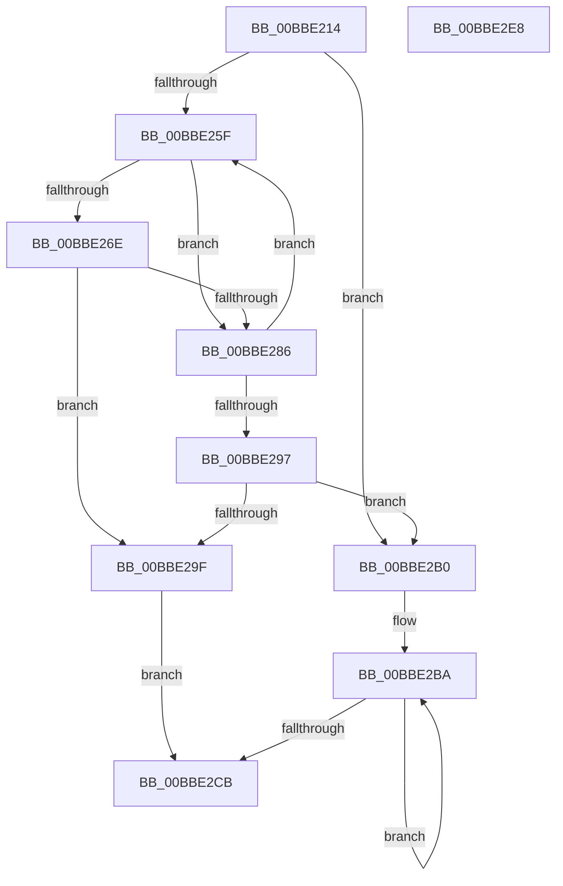

# HdlspPutMore

- RVA: `0x00BBE214`–`0x00BBE2E9` (길이 `213` bytes)
- VA: `0x0000000140BBE214`
- 실행 섹션: `PAGEHDLS`
- PDB 이름 있음: `예`; PDB Function 태그: `아니요`
- unwind 정보 RVA: `0x000D4C38`
- 디코드: `57`개 명령, `213/213` bytes 표시
- 미해석 바이트: `0` (있으면 어셈블리에 `.byte`로 보존)

> 이 문서는 커널 이미지의 기계어와 PDB 기호를 분석해 생성했습니다. 4번과 5번은 함수 원형과 자료형을 바이너리 사용 방식에서 추정한 C 해석이며 원본 소스 복구 결과는 아닙니다.

## 1. Dependencies

- 직접 호출 지점: **7**; 고유 호출 대상: **4**
- 직접 호출자로 확인된 함수: **1**
- RIP 상대 이미지 참조: **4**

### Outgoing calls
- `0x00BBE247` → [HdlspPutString](HdlspPutString_function_00BBE2F0.md) (function, `0x00BBE2F0`)
- `0x00BBE256` → [HdlspGetLine](HdlspGetLine_function_00BBDAA4.md) (function, `0x00BBDAA4`)
- `0x00BBE277` → [KeDelayExecutionThread](../../text/20/KeDelayExecutionThread_function_00209550.md) (function, `0x00209550`)
- `0x00BBE28E` → [HdlspGetLine](HdlspGetLine_function_00BBDAA4.md) (function, `0x00BBDAA4`)
- `0x00BBE2A6` → [HdlspPutString](HdlspPutString_function_00BBE2F0.md) (function, `0x00BBE2F0`)
- `0x00BBE2C2` → [HdlspGetLine](HdlspGetLine_function_00BBDAA4.md) (function, `0x00BBDAA4`)
- `0x00BBE2D3` → [_security_check_cookie](../../text/6A/_security_check_cookie_function_006AC640.md) (function, `0x006AC640`)

### Direct callers
- [HdlspProcessDumpCommand](HdlspProcessDumpCommand_function_00BBDFDC.md) at `0x00BBE180`

### Static image references
- `0x00BBE223` → RVA `0x00E0A740` (`.data`; read)
- `0x00BBE23E` → RVA `0x00BBEBD0` (` ?? ::CIFEBFPJ::`string'`; read)
- `0x00BBE25F` → RVA `0x00E68578` (`.data`; read)
- `0x00BBE29F` → RVA `0x00BBEAF0` (` ?? ::CIFEBFPJ::`string'`; read)

## 2. Other-region calls and transfers

- 다른 실행 섹션으로 향하는 call: **2**
  - `0x00BBE277` → [KeDelayExecutionThread](../../text/20/KeDelayExecutionThread_function_00209550.md) (`PAGEHDLS` → `.text`)
  - `0x00BBE2D3` → [_security_check_cookie](../../text/6A/_security_check_cookie_function_006AC640.md) (`PAGEHDLS` → `.text`)
- 별도 외부 분기/꼬리 이동을 확인하지 못했습니다.

## 3. Assembly (complete function range)

```asm
00BBE214  48 89 5C 24 10                  mov qword ptr [rsp + 0x10], rbx
00BBE219  48 89 6C 24 18                  mov qword ptr [rsp + 0x18], rbp
00BBE21E  57                              push rdi
00BBE21F  48 83 EC 40                     sub rsp, 0x40
00BBE223  48 8B 05 16 C5 24 00            mov rax, qword ptr [rip + 0x24c516]
00BBE22A  48 33 C4                        xor rax, rsp
00BBE22D  48 89 44 24 38                  mov qword ptr [rsp + 0x38], rax
00BBE232  48 8B F9                        mov rdi, rcx
00BBE235  48 C7 44 24 20 60 79 FE FF      mov qword ptr [rsp + 0x20], 0xfffffffffffe7960
00BBE23E  48 8D 0D 8B 09 00 00            lea rcx, [rip + 0x98b]
00BBE245  33 DB                           xor ebx, ebx
00BBE247  E8 A4 00 00 00                  call 0x140bbe2f0
00BBE24C  8D 6B 0A                        lea ebp, [rbx + 0xa]
00BBE24F  8B D5                           mov edx, ebp
00BBE251  48 8D 4C 24 28                  lea rcx, [rsp + 0x28]
00BBE256  E8 49 F8 FF FF                  call 0x140bbdaa4
00BBE25B  84 C0                           test al, al
00BBE25D  75 51                           jne 0x140bbe2b0
00BBE25F  48 8B 05 12 A3 2A 00            mov rax, qword ptr [rip + 0x2aa312]
00BBE266  8B 48 30                        mov ecx, dword ptr [rax + 0x30]
00BBE269  F6 C1 02                        test cl, 2
00BBE26C  75 18                           jne 0x140bbe286
00BBE26E  4C 8D 44 24 20                  lea r8, [rsp + 0x20]
00BBE273  33 D2                           xor edx, edx
00BBE275  33 C9                           xor ecx, ecx
00BBE277  E8 D4 B2 64 FF                  call 0x140209550
00BBE27C  FF C3                           inc ebx
00BBE27E  81 FB 70 17 00 00               cmp ebx, 0x1770
00BBE284  77 19                           ja 0x140bbe29f
00BBE286  48 8B D5                        mov rdx, rbp
00BBE289  48 8D 4C 24 28                  lea rcx, [rsp + 0x28]
00BBE28E  E8 11 F8 FF FF                  call 0x140bbdaa4
00BBE293  84 C0                           test al, al
00BBE295  74 C8                           je 0x140bbe25f
00BBE297  81 FB 70 17 00 00               cmp ebx, 0x1770
00BBE29D  76 11                           jbe 0x140bbe2b0
00BBE29F  48 8D 0D 4A 08 00 00            lea rcx, [rip + 0x84a]
00BBE2A6  E8 45 00 00 00                  call 0x140bbe2f0
00BBE2AB  C6 07 00                        mov byte ptr [rdi], 0
00BBE2AE  EB 1B                           jmp 0x140bbe2cb
00BBE2B0  80 7C 24 28 03                  cmp byte ptr [rsp + 0x28], 3
00BBE2B5  0F 94 C0                        sete al
00BBE2B8  88 07                           mov byte ptr [rdi], al
00BBE2BA  48 8B D5                        mov rdx, rbp
00BBE2BD  48 8D 4C 24 28                  lea rcx, [rsp + 0x28]
00BBE2C2  E8 DD F7 FF FF                  call 0x140bbdaa4
00BBE2C7  84 C0                           test al, al
00BBE2C9  75 EF                           jne 0x140bbe2ba
00BBE2CB  48 8B 4C 24 38                  mov rcx, qword ptr [rsp + 0x38]
00BBE2D0  48 33 CC                        xor rcx, rsp
00BBE2D3  E8 68 E3 AE FF                  call 0x1406ac640
00BBE2D8  48 8B 5C 24 58                  mov rbx, qword ptr [rsp + 0x58]
00BBE2DD  48 8B 6C 24 60                  mov rbp, qword ptr [rsp + 0x60]
00BBE2E2  48 83 C4 40                     add rsp, 0x40
00BBE2E6  5F                              pop rdi
00BBE2E7  C3                              ret
00BBE2E8  CC                              int3
```

## 4. C-style interpretation (structured pseudocode)

```c
__int64 __fastcall HdlspPutMore(__int64 a1)
{
    __int64 result;
    __int64 v_rbx;
    __int64 v_rsp;
    unsigned __int64 v_stack_m10;
    unsigned __int64 v_stack_m20;
    unsigned __int64 v_stack_m28;
    unsigned __int64 v_stack_p10;
    unsigned __int64 v_stack_p18;

    v_stack_p10 = v_rbx;
    v_stack_p18 = v_rbp;
    v_rsp = (v_rsp) - (64);
    result = (*(unsigned __int64 *)(v_rip + 2409750)) ^ (v_rsp);
    v_stack_m10 = result;
    v_stack_m28 = 0xFFFFFFFFFFFE7960ULL;
    v_rbx = 0;
    result = HdlspPutString(v_rip + 2443, a2, a3, a4);
    result = HdlspGetLine(v_stack_m20, (unsigned int)((unsigned int)(v_rbx + 10)), a3, a4);
    if ((unsigned __int8)(result) != 0) goto loc_00BBE2B0;
loc_00BBE25F:
    if ((((unsigned __int8)((unsigned int)(*(unsigned int *)(*(unsigned __int64 *)(v_rip + 2794258) + 48)))) & (2)) != 0) goto loc_00BBE286;
    a2 = 0;
    a1 = 0;
    result = KeDelayExecutionThread(a1, a2, v_stack_m28, a4);
    v_rbx = (unsigned int)((v_rbx) + 1);
    if (((unsigned int)(v_rbx)) > 0x1770ULL) goto loc_00BBE29F;
loc_00BBE286:
    result = HdlspGetLine(v_stack_m20, v_rbx + 10, v_stack_m28, a4);
    if ((unsigned __int8)(result) == 0) goto loc_00BBE25F;
    if (((unsigned int)(v_rbx)) <= 0x1770ULL) goto loc_00BBE2B0;
loc_00BBE29F:
    result = HdlspPutString(v_rip + 2122, v_rbx + 10, v_stack_m28, a4);
    *(unsigned __int8 *)(a1) = 0;
    goto loc_00BBE2CB;
loc_00BBE2B0:
    result = (v_stack_m20 == 3) ? 1 : 0;
    *(unsigned __int8 *)(a1) = (unsigned __int8)(result);
loc_00BBE2BA:
    result = HdlspGetLine(v_stack_m20, v_rbx + 10, v_stack_m28, a4);
    if ((unsigned __int8)(result) != 0) goto loc_00BBE2BA;
loc_00BBE2CB:
    a1 = (v_stack_m10) ^ (v_rsp);
    result = _security_check_cookie(a1, v_rbx + 10, v_stack_m28, a4);
    v_rsp = (v_rsp) + (64);
    return result;
}
```

## 5. (Beta) C Style

```c
int64_t HdlspPutMore(void *Arg1)
{
    uint8_t *arg1 = (uint8_t *)Arg1;

    int64_t result;
    int64_t local_rbx;
    int64_t local_rsp;
    uint64_t v_stack_m10;
    uint64_t v_stack_m20;
    uint64_t v_stack_m28;
    uint64_t v_stack_p10;
    uint64_t v_stack_p18;

    v_stack_p10 = local_rbx;
    v_stack_p18 = local_rbp;
    local_rsp = (local_rsp) - (64);
    result = (*(uint64_t *)(v_rip + 0x24C516)) ^ (local_rsp);
    v_stack_m10 = result;
    v_stack_m28 = 0xFFFFFFFFFFFE7960ULL;
    local_rbx = 0;
    result = HdlspPutString(v_rip + 2443, a2, a3, a4);
    result = HdlspGetLine(v_stack_m20, (uint32_t)((uint32_t)(local_rbx + 10)), a3, a4);
    if ((uint8_t)(result) != 0) goto loc_00BBE2B0;
loc_00BBE25F:
    if ((((uint8_t)((uint32_t)(*(uint32_t *)(*(uint64_t *)(v_rip + 0x2AA312) + 0x30)))) & (2)) != 0) goto loc_00BBE286;
    a2 = 0;
    Arg1 = 0;
    result = KeDelayExecutionThread(Arg1, a2, v_stack_m28, a4);
    local_rbx = (uint32_t)((local_rbx) + 1);
    if (((uint32_t)(local_rbx)) > 0x1770ULL) goto loc_00BBE29F;
loc_00BBE286:
    result = HdlspGetLine(v_stack_m20, local_rbx + 10, v_stack_m28, a4);
    if ((uint8_t)(result) == 0) goto loc_00BBE25F;
    if (((uint32_t)(local_rbx)) <= 0x1770ULL) goto loc_00BBE2B0;
loc_00BBE29F:
    result = HdlspPutString(v_rip + 2122, local_rbx + 10, v_stack_m28, a4);
    *(uint8_t *)(arg1) = 0;
    goto loc_00BBE2CB;
loc_00BBE2B0:
    result = (v_stack_m20 == 3) ? 1 : 0;
    *(uint8_t *)(arg1) = (uint8_t)(result);
loc_00BBE2BA:
    result = HdlspGetLine(v_stack_m20, local_rbx + 10, v_stack_m28, a4);
    if ((uint8_t)(result) != 0) goto loc_00BBE2BA;
loc_00BBE2CB:
    Arg1 = (v_stack_m10) ^ (local_rsp);
    result = _security_check_cookie(Arg1, local_rbx + 10, v_stack_m28, a4);
    local_rsp = (local_rsp) + (64);
    return result;
}
```

### 관측된 메모리 오프셋

구조체 형식이 확인되지 않은 접근은 인자 기준의 오프셋으로만 기록했습니다.

| 기준 인자 | 오프셋 표현 | 폭 (bit) | 접근 |
|---|---:|---:|---|
| `Arg1` | `+ 0x0` | `8` | `W` |

## 6. Execution-region graph

[열기: 2D/3D 그래프와 함수 탐색 컨트롤 패널](../../../control-panel.html?section=pagehdls&rva=0x00BBE214&view=graph)

- 2D 그래프는 위에서 아래로 흐르고, 3D 그래프는 빈 공간을 드래그해 회전합니다. Shift+드래그는 이동, 휠은 확대·축소, 함수 노드 선택은 대상 보고서 이동입니다.

### Static fallback


