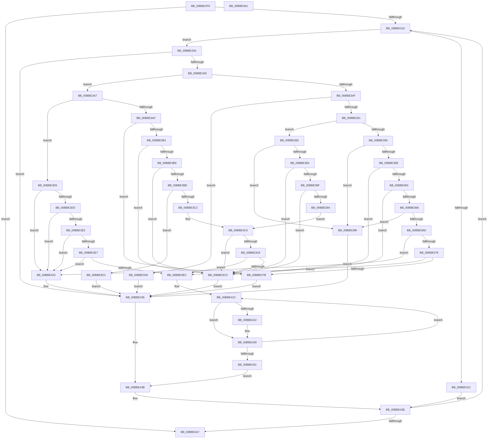

# HdlspPutString

- RVA: `0x00BBE2F0`–`0x00BBE462` (길이 `370` bytes)
- VA: `0x0000000140BBE2F0`
- 실행 섹션: `PAGEHDLS`
- PDB 이름 있음: `예`; PDB Function 태그: `아니요`
- unwind 정보 RVA: `0x0005CF00`
- 디코드: `112`개 명령, `370/370` bytes 표시
- 미해석 바이트: `0` (있으면 어셈블리에 `.byte`로 보존)

> 이 문서는 커널 이미지의 기계어와 PDB 기호를 분석해 생성했습니다. 4번과 5번은 함수 원형과 자료형을 바이너리 사용 방식에서 추정한 C 해석이며 원본 소스 복구 결과는 아닙니다.

## 1. Dependencies

- 직접 호출 지점: **3**; 고유 호출 대상: **2**
- 직접 호출자로 확인된 함수: **3**
- RIP 상대 이미지 참조: **2**

### Outgoing calls
- `0x00BBE322` → [HdlspSendStringAtBaud](HdlspSendStringAtBaud_function_00BBE5CC.md) (function, `0x00BBE5CC`)
- `0x00BBE40D` → [HdlspUTF8Encode](../../text/65/HdlspUTF8Encode_function_00655BF0.md) (function, `0x00655BF0`)
- `0x00BBE456` → [HdlspSendStringAtBaud](HdlspSendStringAtBaud_function_00BBE5CC.md) (function, `0x00BBE5CC`)

### Direct callers
- [HdlspDispatch](HdlspDispatch_function_00BBD320.md) at `0x00BBD4B3`
- [HdlspProcessDumpCommand](HdlspProcessDumpCommand_function_00BBDFDC.md) at `0x00BBE0CE`
- [HdlspProcessDumpCommand](HdlspProcessDumpCommand_function_00BBDFDC.md) at `0x00BBE13F`
- [HdlspProcessDumpCommand](HdlspProcessDumpCommand_function_00BBDFDC.md) at `0x00BBE14B`
- [HdlspProcessDumpCommand](HdlspProcessDumpCommand_function_00BBDFDC.md) at `0x00BBE1DB`
- [HdlspPutMore](HdlspPutMore_function_00BBE214.md) at `0x00BBE247`
- [HdlspPutMore](HdlspPutMore_function_00BBE214.md) at `0x00BBE2A6`

### Static image references
- `0x00BBE2F6` → RVA `0x00E68578` (`.data`; read)
- `0x00BBE402` → RVA `0x00038FF0` (`.rdata`; read)

## 2. Other-region calls and transfers

- 다른 실행 섹션으로 향하는 call: **1**
  - `0x00BBE40D` → [HdlspUTF8Encode](../../text/65/HdlspUTF8Encode_function_00655BF0.md) (`PAGEHDLS` → `.text`)
- 별도 외부 분기/꼬리 이동을 확인하지 못했습니다.

## 3. Assembly (complete function range)

```asm
00BBE2F0  40 53                           push rbx
00BBE2F2  48 83 EC 20                     sub rsp, 0x20
00BBE2F6  4C 8B 15 7B A2 2A 00            mov r10, qword ptr [rip + 0x2aa27b]
00BBE2FD  48 8B D9                        mov rbx, rcx
00BBE300  49 83 C2 18                     add r10, 0x18
00BBE304  80 39 00                        cmp byte ptr [rcx], 0
00BBE307  4D 8B 0A                        mov r9, qword ptr [r10]
00BBE30A  0F 84 37 01 00 00               je 0x140bbe447
00BBE310  49 8B 02                        mov rax, qword ptr [r10]
00BBE313  48 83 C0 4F                     add rax, 0x4f
00BBE317  4C 3B C8                        cmp r9, rax
00BBE31A  72 1E                           jb 0x140bbe33a
00BBE31C  C6 00 00                        mov byte ptr [rax], 0
00BBE31F  49 8B 0A                        mov rcx, qword ptr [r10]
00BBE322  E8 A5 02 00 00                  call 0x140bbe5cc
00BBE327  4C 8B 15 4A A2 2A 00            mov r10, qword ptr [rip + 0x2aa24a]
00BBE32E  49 83 C2 18                     add r10, 0x18
00BBE332  4D 8B 0A                        mov r9, qword ptr [r10]
00BBE335  E9 04 01 00 00                  jmp 0x140bbe43e
00BBE33A  0F B6 13                        movzx edx, byte ptr [rbx]
00BBE33D  84 D2                           test dl, dl
00BBE33F  0F 89 F0 00 00 00               jns 0x140bbe435
00BBE345  8B CA                           mov ecx, edx
00BBE347  81 FA C4 00 00 00               cmp edx, 0xc4
00BBE34D  77 58                           ja 0x140bbe3a7
00BBE34F  74 4F                           je 0x140bbe3a0
00BBE351  81 FA B3 00 00 00               cmp edx, 0xb3
00BBE357  77 29                           ja 0x140bbe382
00BBE359  74 3E                           je 0x140bbe399
00BBE35B  81 E9 A9 00 00 00               sub ecx, 0xa9
00BBE361  74 6A                           je 0x140bbe3cd
00BBE363  83 E9 01                        sub ecx, 1
00BBE366  74 65                           je 0x140bbe3cd
00BBE368  83 E9 06                        sub ecx, 6
00BBE36B  74 2C                           je 0x140bbe399
00BBE36D  83 E9 01                        sub ecx, 1
00BBE370  0F 84 BD 00 00 00               je 0x140bbe433
00BBE376  83 F9 01                        cmp ecx, 1
00BBE379  75 71                           jne 0x140bbe3ec
00BBE37B  B2 23                           mov dl, 0x23
00BBE37D  E9 B3 00 00 00                  jmp 0x140bbe435
00BBE382  81 E9 BA 00 00 00               sub ecx, 0xba
00BBE388  74 0F                           je 0x140bbe399
00BBE38A  83 E9 01                        sub ecx, 1
00BBE38D  74 3E                           je 0x140bbe3cd
00BBE38F  83 E9 01                        sub ecx, 1
00BBE392  74 39                           je 0x140bbe3cd
00BBE394  83 E9 03                        sub ecx, 3
00BBE397  EB 2D                           jmp 0x140bbe3c6
00BBE399  B2 7C                           mov dl, 0x7c
00BBE39B  E9 95 00 00 00                  jmp 0x140bbe435
00BBE3A0  B2 2D                           mov dl, 0x2d
00BBE3A2  E9 8E 00 00 00                  jmp 0x140bbe435
00BBE3A7  81 F9 DB 00 00 00               cmp ecx, 0xdb
00BBE3AD  77 26                           ja 0x140bbe3d5
00BBE3AF  74 CA                           je 0x140bbe37b
00BBE3B1  81 E9 C8 00 00 00               sub ecx, 0xc8
00BBE3B7  74 14                           je 0x140bbe3cd
00BBE3B9  83 E9 01                        sub ecx, 1
00BBE3BC  74 0F                           je 0x140bbe3cd
00BBE3BE  83 E9 04                        sub ecx, 4
00BBE3C1  74 0E                           je 0x140bbe3d1
00BBE3C3  83 E9 0C                        sub ecx, 0xc
00BBE3C6  74 05                           je 0x140bbe3cd
00BBE3C8  83 F9 01                        cmp ecx, 1
00BBE3CB  75 1F                           jne 0x140bbe3ec
00BBE3CD  B2 2B                           mov dl, 0x2b
00BBE3CF  EB 64                           jmp 0x140bbe435
00BBE3D1  B2 3D                           mov dl, 0x3d
00BBE3D3  EB 60                           jmp 0x140bbe435
00BBE3D5  81 E9 DC 00 00 00               sub ecx, 0xdc
00BBE3DB  74 56                           je 0x140bbe433
00BBE3DD  83 E9 01                        sub ecx, 1
00BBE3E0  74 51                           je 0x140bbe433
00BBE3E2  83 E9 01                        sub ecx, 1
00BBE3E5  74 4C                           je 0x140bbe433
00BBE3E7  83 F9 01                        cmp ecx, 1
00BBE3EA  74 47                           je 0x140bbe433
00BBE3EC  48 8B CA                        mov rcx, rdx
00BBE3EF  33 C0                           xor eax, eax
00BBE3F1  83 E1 7F                        and ecx, 0x7f
00BBE3F4  66 89 44 24 30                  mov word ptr [rsp + 0x30], ax
00BBE3F9  88 44 24 32                     mov byte ptr [rsp + 0x32], al
00BBE3FD  48 8D 54 24 30                  lea rdx, [rsp + 0x30]
00BBE402  48 8D 05 E7 AB 47 FF            lea rax, [rip - 0xb85419]
00BBE409  0F B7 0C 48                     movzx ecx, word ptr [rax + rcx*2]
00BBE40D  E8 DE 77 A9 FF                  call 0x140655bf0
00BBE412  B9 03 00 00 00                  mov ecx, 3
00BBE417  48 8D 54 24 30                  lea rdx, [rsp + 0x30]
00BBE41C  8A 02                           mov al, byte ptr [rdx]
00BBE41E  84 C0                           test al, al
00BBE420  74 06                           je 0x140bbe428
00BBE422  41 88 01                        mov byte ptr [r9], al
00BBE425  49 FF C1                        inc r9
00BBE428  48 FF C2                        inc rdx
00BBE42B  48 83 E9 01                     sub rcx, 1
00BBE42F  75 EB                           jne 0x140bbe41c
00BBE431  EB 08                           jmp 0x140bbe43b
00BBE433  B2 25                           mov dl, 0x25
00BBE435  41 88 11                        mov byte ptr [r9], dl
00BBE438  49 FF C1                        inc r9
00BBE43B  48 FF C3                        inc rbx
00BBE43E  80 3B 00                        cmp byte ptr [rbx], 0
00BBE441  0F 85 C9 FE FF FF               jne 0x140bbe310
00BBE447  48 8B 0D 2A A1 2A 00            mov rcx, qword ptr [rip + 0x2aa12a]
00BBE44E  41 C6 01 00                     mov byte ptr [r9], 0
00BBE452  48 8B 49 18                     mov rcx, qword ptr [rcx + 0x18]
00BBE456  E8 71 01 00 00                  call 0x140bbe5cc
00BBE45B  48 83 C4 20                     add rsp, 0x20
00BBE45F  5B                              pop rbx
00BBE460  C3                              ret
00BBE461  CC                              int3
```

## 4. C-style interpretation (structured pseudocode)

```c
__int64 __fastcall HdlspPutString(__int64 a1)
{
    __int64 result;
    __int64 v_r10;
    __int64 v_rbx;
    __int64 v_rsp;
    unsigned __int16 v_stack_p8;
    unsigned __int8 v_stack_pA;

    v_rsp = (v_rsp) - (32);
    v_r10 = (*(unsigned __int64 *)(v_rip + 2794107)) + (24);
    if ((*(unsigned __int8 *)(a1)) == 0) goto loc_00BBE447;
loc_00BBE310:
    result = (*(unsigned __int64 *)(v_r10)) + (79);
    if ((*(unsigned __int64 *)(v_r10)) < result) goto loc_00BBE33A;
    *(unsigned __int8 *)(result) = 0;
    result = HdlspSendStringAtBaud(*(unsigned __int64 *)(v_r10), a2, a3, *(unsigned __int64 *)(v_r10));
    v_r10 = (*(unsigned __int64 *)(v_rip + 2794058)) + (24);
    goto loc_00BBE43E;
loc_00BBE33A:
    if (!sign_flag) goto loc_00BBE435;
    if (((unsigned int)(*(unsigned __int8 *)(a1))) > 196) goto loc_00BBE3A7;
    if (((unsigned int)(*(unsigned __int8 *)(a1))) == 196) goto loc_00BBE3A0;
    if (((unsigned int)(*(unsigned __int8 *)(a1))) > 179) goto loc_00BBE382;
    if (((unsigned int)(*(unsigned __int8 *)(a1))) == 179) goto loc_00BBE399;
    a1 = (unsigned int)(((unsigned int)((unsigned int)(*(unsigned __int8 *)(a1)))) - (169));
    if (condition_is_equal) goto loc_00BBE3CD;
    a1 = (unsigned int)((a1) - (1));
    if (condition_is_equal) goto loc_00BBE3CD;
    a1 = (unsigned int)((a1) - (6));
    if (condition_is_equal) goto loc_00BBE399;
    a1 = (unsigned int)((a1) - (1));
    if (condition_is_equal) goto loc_00BBE433;
    if (((unsigned int)(a1)) != 1) goto loc_00BBE3EC;
loc_00BBE37B:
    goto loc_00BBE435;
loc_00BBE382:
    a1 = (unsigned int)((a1) - (186));
    if (condition_is_equal) goto loc_00BBE399;
    a1 = (unsigned int)((a1) - (1));
    if (condition_is_equal) goto loc_00BBE3CD;
    a1 = (unsigned int)((a1) - (1));
    if (condition_is_equal) goto loc_00BBE3CD;
    a1 = (unsigned int)((a1) - (3));
    goto loc_00BBE3C6;
loc_00BBE399:
    goto loc_00BBE435;
loc_00BBE3A0:
    goto loc_00BBE435;
loc_00BBE3A7:
    if (((unsigned int)(a1)) > 219) goto loc_00BBE3D5;
    if (((unsigned int)(a1)) == 219) goto loc_00BBE37B;
    a1 = (unsigned int)((a1) - (200));
    if (condition_is_equal) goto loc_00BBE3CD;
    a1 = (unsigned int)((a1) - (1));
    if (condition_is_equal) goto loc_00BBE3CD;
    a1 = (unsigned int)((a1) - (4));
    if (condition_is_equal) goto loc_00BBE3D1;
    a1 = (unsigned int)((a1) - (12));
loc_00BBE3C6:
    if (condition_is_equal) goto loc_00BBE3CD;
    if (((unsigned int)(a1)) != 1) goto loc_00BBE3EC;
loc_00BBE3CD:
    goto loc_00BBE435;
loc_00BBE3D1:
    goto loc_00BBE435;
loc_00BBE3D5:
    a1 = (unsigned int)((a1) - (220));
    if (condition_is_equal) goto loc_00BBE433;
    a1 = (unsigned int)((a1) - (1));
    if (condition_is_equal) goto loc_00BBE433;
    a1 = (unsigned int)((a1) - (1));
    if (condition_is_equal) goto loc_00BBE433;
    if (((unsigned int)(a1)) == 1) goto loc_00BBE433;
loc_00BBE3EC:
    result = 0;
    a1 = (unsigned int)((61) & (127));
    v_stack_p8 = 0;
    v_stack_pA = 0;
    result = HdlspUTF8Encode(*(unsigned __int16 *)(v_rip - 12080153 + a1 * 2), v_stack_p8, a3, *(unsigned __int64 *)(v_r10));
loc_00BBE41C:
    if ((unsigned __int8)(*(unsigned __int8 *)(v_stack_p8)) != 0) {
        *(unsigned __int8 *)(*(unsigned __int64 *)(v_r10)) = (unsigned __int8)(*(unsigned __int8 *)(v_stack_p8));
        a4 = (*(unsigned __int64 *)(v_r10)) + 1;
    }
    a2 = (v_stack_p8) + 1;
    a1 = (3) - (1);
    if (condition_is_not_equal) goto loc_00BBE41C;
    goto loc_00BBE43B;
loc_00BBE433:
loc_00BBE435:
    *(unsigned __int8 *)(a4) = 37;
    a4 = (a4) + 1;
loc_00BBE43B:
    v_rbx = (a1) + 1;
loc_00BBE43E:
    if ((*(unsigned __int8 *)(v_rbx)) != 0) goto loc_00BBE310;
loc_00BBE447:
    *(unsigned __int8 *)(a4) = 0;
    result = HdlspSendStringAtBaud(*(unsigned __int64 *)(*(unsigned __int64 *)(v_rip + 2793770) + 24), 37, a3, a4);
    v_rsp = (v_rsp) + (32);
    return result;
}
```

## 5. (Beta) C Style

```c
int64_t HdlspPutString(void *Arg1)
{
    uint8_t *arg1 = (uint8_t *)Arg1;

    int64_t result;
    int64_t local_r10;
    int64_t local_rbx;
    int64_t local_rsp;
    uint16_t v_stack_p8;
    uint8_t v_stack_pA;

    local_rsp = (local_rsp) - (32);
    local_r10 = (*(uint64_t *)(v_rip + 0x2AA27B)) + (24);
    if ((*(uint8_t *)(arg1)) == 0) goto loc_00BBE447;
loc_00BBE310:
    result = (*(uint64_t *)(local_r10)) + (79);
    if ((*(uint64_t *)(local_r10)) < result) goto loc_00BBE33A;
    *(uint8_t *)(result) = 0;
    result = HdlspSendStringAtBaud(*(uint64_t *)(local_r10), a2, a3, *(uint64_t *)(local_r10));
    local_r10 = (*(uint64_t *)(v_rip + 0x2AA24A)) + (24);
    goto loc_00BBE43E;
loc_00BBE33A:
    if (!sign_flag) goto loc_00BBE435;
    if (((uint32_t)(*(uint8_t *)(arg1))) > 196) goto loc_00BBE3A7;
    if (((uint32_t)(*(uint8_t *)(arg1))) == 196) goto loc_00BBE3A0;
    if (((uint32_t)(*(uint8_t *)(arg1))) > 179) goto loc_00BBE382;
    if (((uint32_t)(*(uint8_t *)(arg1))) == 179) goto loc_00BBE399;
    Arg1 = (uint32_t)(((uint32_t)((uint32_t)(*(uint8_t *)(arg1)))) - (169));
    if (condition_is_equal) goto loc_00BBE3CD;
    Arg1 = (uint32_t)((Arg1) - (1));
    if (condition_is_equal) goto loc_00BBE3CD;
    Arg1 = (uint32_t)((Arg1) - (6));
    if (condition_is_equal) goto loc_00BBE399;
    Arg1 = (uint32_t)((Arg1) - (1));
    if (condition_is_equal) goto loc_00BBE433;
    if (((uint32_t)(Arg1)) != 1) goto loc_00BBE3EC;
loc_00BBE37B:
    goto loc_00BBE435;
loc_00BBE382:
    Arg1 = (uint32_t)((Arg1) - (186));
    if (condition_is_equal) goto loc_00BBE399;
    Arg1 = (uint32_t)((Arg1) - (1));
    if (condition_is_equal) goto loc_00BBE3CD;
    Arg1 = (uint32_t)((Arg1) - (1));
    if (condition_is_equal) goto loc_00BBE3CD;
    Arg1 = (uint32_t)((Arg1) - (3));
    goto loc_00BBE3C6;
loc_00BBE399:
    goto loc_00BBE435;
loc_00BBE3A0:
    goto loc_00BBE435;
loc_00BBE3A7:
    if (((uint32_t)(Arg1)) > 219) goto loc_00BBE3D5;
    if (((uint32_t)(Arg1)) == 219) goto loc_00BBE37B;
    Arg1 = (uint32_t)((Arg1) - (200));
    if (condition_is_equal) goto loc_00BBE3CD;
    Arg1 = (uint32_t)((Arg1) - (1));
    if (condition_is_equal) goto loc_00BBE3CD;
    Arg1 = (uint32_t)((Arg1) - (4));
    if (condition_is_equal) goto loc_00BBE3D1;
    Arg1 = (uint32_t)((Arg1) - (12));
loc_00BBE3C6:
    if (condition_is_equal) goto loc_00BBE3CD;
    if (((uint32_t)(Arg1)) != 1) goto loc_00BBE3EC;
loc_00BBE3CD:
    goto loc_00BBE435;
loc_00BBE3D1:
    goto loc_00BBE435;
loc_00BBE3D5:
    Arg1 = (uint32_t)((Arg1) - (220));
    if (condition_is_equal) goto loc_00BBE433;
    Arg1 = (uint32_t)((Arg1) - (1));
    if (condition_is_equal) goto loc_00BBE433;
    Arg1 = (uint32_t)((Arg1) - (1));
    if (condition_is_equal) goto loc_00BBE433;
    if (((uint32_t)(Arg1)) == 1) goto loc_00BBE433;
loc_00BBE3EC:
    result = 0;
    Arg1 = (uint32_t)((61) & (127));
    v_stack_p8 = 0;
    v_stack_pA = 0;
    result = HdlspUTF8Encode(*(uint16_t *)(v_rip - 0xB85419 + arg1 * 2), v_stack_p8, a3, *(uint64_t *)(local_r10));
loc_00BBE41C:
    if ((uint8_t)(*(uint8_t *)(v_stack_p8)) != 0) {
        *(uint8_t *)(*(uint64_t *)(local_r10)) = (uint8_t)(*(uint8_t *)(v_stack_p8));
        a4 = (*(uint64_t *)(local_r10)) + 1;
    }
    a2 = (v_stack_p8) + 1;
    Arg1 = (3) - (1);
    if (condition_is_not_equal) goto loc_00BBE41C;
    goto loc_00BBE43B;
loc_00BBE433:
loc_00BBE435:
    *(uint8_t *)(a4) = 37;
    a4 = (a4) + 1;
loc_00BBE43B:
    local_rbx = (Arg1) + 1;
loc_00BBE43E:
    if ((*(uint8_t *)(local_rbx)) != 0) goto loc_00BBE310;
loc_00BBE447:
    *(uint8_t *)(a4) = 0;
    result = HdlspSendStringAtBaud(*(uint64_t *)(*(uint64_t *)(v_rip + 0x2AA12A) + 0x18), 37, a3, a4);
    local_rsp = (local_rsp) + (32);
    return result;
}
```

### 관측된 메모리 오프셋

구조체 형식이 확인되지 않은 접근은 인자 기준의 오프셋으로만 기록했습니다.

| 기준 인자 | 오프셋 표현 | 폭 (bit) | 접근 |
|---|---:|---:|---|
| `Arg1` | `+ 0x0` | `8` | `R` |

## 6. Execution-region graph

[열기: 2D/3D 그래프와 함수 탐색 컨트롤 패널](../../../control-panel.html?section=pagehdls&rva=0x00BBE2F0&view=graph)

- 2D 그래프는 위에서 아래로 흐르고, 3D 그래프는 빈 공간을 드래그해 회전합니다. Shift+드래그는 이동, 휠은 확대·축소, 함수 노드 선택은 대상 보고서 이동입니다.

### Static fallback


