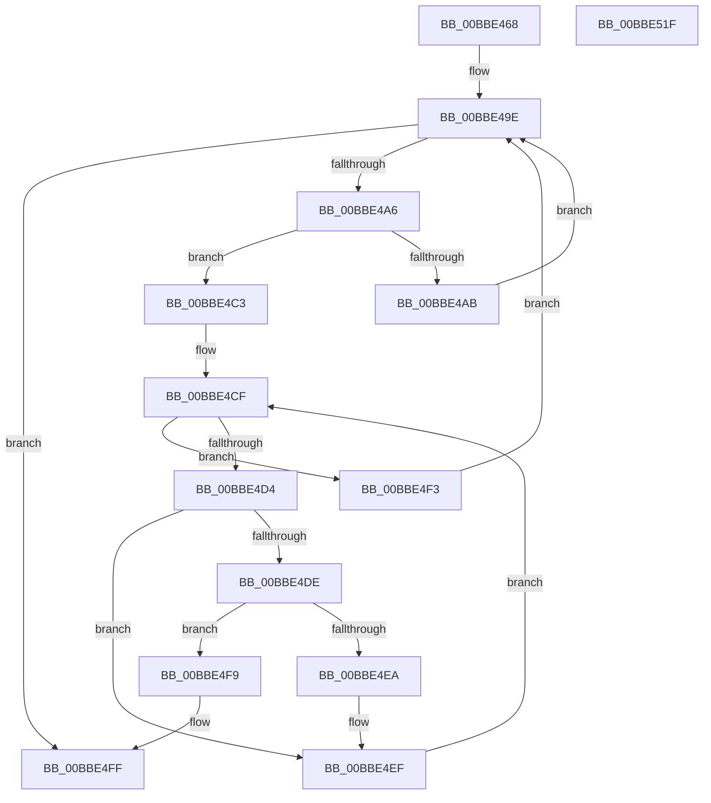

# HdlspPutWideString

- RVA: `0x00BBE468`–`0x00BBE520` (길이 `184` bytes)
- VA: `0x0000000140BBE468`
- 실행 섹션: `PAGEHDLS`
- PDB 이름 있음: `예`; PDB Function 태그: `아니요`
- unwind 정보 RVA: `0x0006C8E8`
- 디코드: `55`개 명령, `184/184` bytes 표시
- 미해석 바이트: `0` (있으면 어셈블리에 `.byte`로 보존)

> 이 문서는 커널 이미지의 기계어와 PDB 기호를 분석해 생성했습니다. 4번과 5번은 함수 원형과 자료형을 바이너리 사용 방식에서 추정한 C 해석이며 원본 소스 복구 결과는 아닙니다.

## 1. Dependencies

- 직접 호출 지점: **4**; 고유 호출 대상: **3**
- 직접 호출자로 확인된 함수: **1**
- RIP 상대 이미지 참조: **1**

### Outgoing calls
- `0x00BBE4B1` → [HdlspSendStringAtBaud](HdlspSendStringAtBaud_function_00BBE5CC.md) (function, `0x00BBE5CC`)
- `0x00BBE4C8` → [HdlspUTF8Encode](../../text/65/HdlspUTF8Encode_function_00655BF0.md) (function, `0x00655BF0`)
- `0x00BBE4F9` → [_report_rangecheckfailure](../../text/4F/_report_rangecheckfailure_function_004F5FDC.md) (function, `0x004F5FDC`)
- `0x00BBE505` → [HdlspSendStringAtBaud](HdlspSendStringAtBaud_function_00BBE5CC.md) (function, `0x00BBE5CC`)

### Direct callers
- [HdlspDispatch](HdlspDispatch_function_00BBD320.md) at `0x00BBD78E`

### Static image references
- `0x00BBE48C` → RVA `0x00E68578` (`.data`; read)

## 2. Other-region calls and transfers

- 다른 실행 섹션으로 향하는 call: **2**
  - `0x00BBE4C8` → [HdlspUTF8Encode](../../text/65/HdlspUTF8Encode_function_00655BF0.md) (`PAGEHDLS` → `.text`)
  - `0x00BBE4F9` → [_report_rangecheckfailure](../../text/4F/_report_rangecheckfailure_function_004F5FDC.md) (`PAGEHDLS` → `.text`)
- 별도 외부 분기/꼬리 이동을 확인하지 못했습니다.

## 3. Assembly (complete function range)

```asm
00BBE468  48 89 5C 24 10                  mov qword ptr [rsp + 0x10], rbx
00BBE46D  48 89 6C 24 18                  mov qword ptr [rsp + 0x18], rbp
00BBE472  48 89 74 24 20                  mov qword ptr [rsp + 0x20], rsi
00BBE477  57                              push rdi
00BBE478  48 83 EC 20                     sub rsp, 0x20
00BBE47C  33 C0                           xor eax, eax
00BBE47E  48 8B F9                        mov rdi, rcx
00BBE481  66 89 44 24 30                  mov word ptr [rsp + 0x30], ax
00BBE486  33 ED                           xor ebp, ebp
00BBE488  88 44 24 32                     mov byte ptr [rsp + 0x32], al
00BBE48C  48 8B 05 E5 A0 2A 00            mov rax, qword ptr [rip + 0x2aa0e5]
00BBE493  48 8B 58 18                     mov rbx, qword ptr [rax + 0x18]
00BBE497  4C 8B CB                        mov r9, rbx
00BBE49A  48 8D 73 4F                     lea rsi, [rbx + 0x4f]
00BBE49E  0F B7 0F                        movzx ecx, word ptr [rdi]
00BBE4A1  66 85 C9                        test cx, cx
00BBE4A4  74 59                           je 0x140bbe4ff
00BBE4A6  4C 3B CE                        cmp r9, rsi
00BBE4A9  72 18                           jb 0x140bbe4c3
00BBE4AB  48 8B CB                        mov rcx, rbx
00BBE4AE  40 88 2E                        mov byte ptr [rsi], bpl
00BBE4B1  E8 16 01 00 00                  call 0x140bbe5cc
00BBE4B6  48 8B 05 BB A0 2A 00            mov rax, qword ptr [rip + 0x2aa0bb]
00BBE4BD  4C 8B 48 18                     mov r9, qword ptr [rax + 0x18]
00BBE4C1  EB DB                           jmp 0x140bbe49e
00BBE4C3  48 8D 54 24 30                  lea rdx, [rsp + 0x30]
00BBE4C8  E8 23 77 A9 FF                  call 0x140655bf0
00BBE4CD  8B D5                           mov edx, ebp
00BBE4CF  83 FA 03                        cmp edx, 3
00BBE4D2  73 1F                           jae 0x140bbe4f3
00BBE4D4  8B C2                           mov eax, edx
00BBE4D6  8A 4C 04 30                     mov cl, byte ptr [rsp + rax + 0x30]
00BBE4DA  84 C9                           test cl, cl
00BBE4DC  74 11                           je 0x140bbe4ef
00BBE4DE  41 88 09                        mov byte ptr [r9], cl
00BBE4E1  49 FF C1                        inc r9
00BBE4E4  48 83 F8 03                     cmp rax, 3
00BBE4E8  73 0F                           jae 0x140bbe4f9
00BBE4EA  40 88 6C 04 30                  mov byte ptr [rsp + rax + 0x30], bpl
00BBE4EF  FF C2                           inc edx
00BBE4F1  EB DC                           jmp 0x140bbe4cf
00BBE4F3  48 83 C7 02                     add rdi, 2
00BBE4F7  EB A5                           jmp 0x140bbe49e
00BBE4F9  E8 DE 7A 93 FF                  call 0x1404f5fdc
00BBE4FE  CC                              int3
00BBE4FF  48 8B CB                        mov rcx, rbx
00BBE502  41 88 29                        mov byte ptr [r9], bpl
00BBE505  E8 C2 00 00 00                  call 0x140bbe5cc
00BBE50A  48 8B 5C 24 38                  mov rbx, qword ptr [rsp + 0x38]
00BBE50F  48 8B 6C 24 40                  mov rbp, qword ptr [rsp + 0x40]
00BBE514  48 8B 74 24 48                  mov rsi, qword ptr [rsp + 0x48]
00BBE519  48 83 C4 20                     add rsp, 0x20
00BBE51D  5F                              pop rdi
00BBE51E  C3                              ret
00BBE51F  CC                              int3
```

## 4. C-style interpretation (structured pseudocode)

```c
__int64 __fastcall HdlspPutWideString(__int64 a1)
{
    __int64 result;
    __int64 v_rbp;
    __int64 v_rdi;
    __int64 v_rsp;
    unsigned __int64 v_stack_p10;
    unsigned __int64 v_stack_p18;
    unsigned __int64 v_stack_p20;
    unsigned __int16 v_stack_p8;
    unsigned __int8 v_stack_pA;

    v_stack_p10 = v_rbx;
    v_stack_p18 = v_rbp;
    v_stack_p20 = v_rsi;
    v_rsp = (v_rsp) - (32);
    result = 0;
    v_stack_p8 = 0;
    v_rbp = 0;
    v_stack_pA = 0;
loc_00BBE49E:
    if ((unsigned __int16)(*(unsigned __int16 *)(a1)) == 0) goto loc_00BBE4FF;
    if ((*(unsigned __int64 *)(*(unsigned __int64 *)(v_rip + 2793701) + 24)) < (*(unsigned __int64 *)(*(unsigned __int64 *)(v_rip + 2793701) + 24) + 79)) goto loc_00BBE4C3;
    *(unsigned __int8 *)(*(unsigned __int64 *)(*(unsigned __int64 *)(v_rip + 2793701) + 24) + 79) = 0;
    result = HdlspSendStringAtBaud(*(unsigned __int64 *)(*(unsigned __int64 *)(v_rip + 2793701) + 24), a2, a3, *(unsigned __int64 *)(*(unsigned __int64 *)(v_rip + 2793701) + 24));
    goto loc_00BBE49E;
loc_00BBE4C3:
    result = HdlspUTF8Encode(*(unsigned __int64 *)(*(unsigned __int64 *)(v_rip + 2793701) + 24), v_stack_p8, a3, *(unsigned __int64 *)(*(unsigned __int64 *)(v_rip + 2793659) + 24));
loc_00BBE4CF:
    if (0 >= 3) goto loc_00BBE4F3;
    if ((unsigned __int8)(*(unsigned __int8 *)(v_rsp + 0 * 1 + 48)) == 0) goto loc_00BBE4EF;
    *(unsigned __int8 *)(*(unsigned __int64 *)(*(unsigned __int64 *)(v_rip + 2793659) + 24)) = (unsigned __int8)(*(unsigned __int8 *)(v_rsp + 0 * 1 + 48));
    a4 = (*(unsigned __int64 *)(*(unsigned __int64 *)(v_rip + 2793659) + 24)) + 1;
    if (0 >= 3) goto loc_00BBE4F9;
    *(unsigned __int8 *)(v_rsp + 0 * 1 + 48) = 0;
loc_00BBE4EF:
    a2 = (unsigned int)((0) + 1);
    goto loc_00BBE4CF;
loc_00BBE4F3:
    v_rdi = (a1) + (2);
    goto loc_00BBE49E;
loc_00BBE4F9:
    result = _report_rangecheckfailure(*(unsigned __int8 *)(v_rsp + 0 * 1 + 48), a2, a3, a4);
loc_00BBE4FF:
    *(unsigned __int8 *)(a4) = 0;
    result = HdlspSendStringAtBaud(*(unsigned __int64 *)(*(unsigned __int64 *)(v_rip + 2793701) + 24), a2, a3, a4);
    v_rsp = (v_rsp) + (32);
    return result;
}
```

## 5. (Beta) C Style

```c
int64_t HdlspPutWideString(void *Arg1)
{
    uint8_t *arg1 = (uint8_t *)Arg1;

    int64_t result;
    int64_t local_rbp;
    int64_t local_rdi;
    int64_t local_rsp;
    uint64_t v_stack_p10;
    uint64_t v_stack_p18;
    uint64_t v_stack_p20;
    uint16_t v_stack_p8;
    uint8_t v_stack_pA;

    v_stack_p10 = local_rbx;
    v_stack_p18 = local_rbp;
    v_stack_p20 = local_rsi;
    local_rsp = (local_rsp) - (32);
    result = 0;
    v_stack_p8 = 0;
    local_rbp = 0;
    v_stack_pA = 0;
loc_00BBE49E:
    if ((uint16_t)(*(uint16_t *)(arg1)) == 0) goto loc_00BBE4FF;
    if ((*(uint64_t *)(*(uint64_t *)(v_rip + 0x2AA0E5) + 0x18)) < (*(uint64_t *)(*(uint64_t *)(v_rip + 0x2AA0E5) + 0x18) + 79)) goto loc_00BBE4C3;
    *(uint8_t *)(*(uint64_t *)(*(uint64_t *)(v_rip + 0x2AA0E5) + 0x18) + 0x4F) = 0;
    result = HdlspSendStringAtBaud(*(uint64_t *)(*(uint64_t *)(v_rip + 0x2AA0E5) + 0x18), a2, a3, *(uint64_t *)(*(uint64_t *)(v_rip + 0x2AA0E5) + 0x18));
    goto loc_00BBE49E;
loc_00BBE4C3:
    result = HdlspUTF8Encode(*(uint64_t *)(*(uint64_t *)(v_rip + 0x2AA0E5) + 0x18), v_stack_p8, a3, *(uint64_t *)(*(uint64_t *)(v_rip + 0x2AA0BB) + 0x18));
loc_00BBE4CF:
    if (0 >= 3) goto loc_00BBE4F3;
    if ((uint8_t)(*(uint8_t *)(local_rsp + 0x0 * 1 + 0x30)) == 0) goto loc_00BBE4EF;
    *(uint8_t *)(*(uint64_t *)(*(uint64_t *)(v_rip + 0x2AA0BB) + 0x18)) = (uint8_t)(*(uint8_t *)(local_rsp + 0x0 * 1 + 0x30));
    a4 = (*(uint64_t *)(*(uint64_t *)(v_rip + 0x2AA0BB) + 0x18)) + 1;
    if (0 >= 3) goto loc_00BBE4F9;
    *(uint8_t *)(local_rsp + 0x0 * 1 + 0x30) = 0;
loc_00BBE4EF:
    a2 = (uint32_t)((0) + 1);
    goto loc_00BBE4CF;
loc_00BBE4F3:
    local_rdi = (Arg1) + (2);
    goto loc_00BBE49E;
loc_00BBE4F9:
    result = _report_rangecheckfailure(*(uint8_t *)(local_rsp + 0x0 * 1 + 0x30), a2, a3, a4);
loc_00BBE4FF:
    *(uint8_t *)(a4) = 0;
    result = HdlspSendStringAtBaud(*(uint64_t *)(*(uint64_t *)(v_rip + 0x2AA0E5) + 0x18), a2, a3, a4);
    local_rsp = (local_rsp) + (32);
    return result;
}
```

### 관측된 메모리 오프셋

구조체 형식이 확인되지 않은 접근은 인자 기준의 오프셋으로만 기록했습니다.

| 기준 인자 | 오프셋 표현 | 폭 (bit) | 접근 |
|---|---:|---:|---|
| `Arg1` | `+ 0x0` | `16` | `R` |

## 6. Execution-region graph

[열기: 2D/3D 그래프와 함수 탐색 컨트롤 패널](../../../control-panel.html?section=pagehdls&rva=0x00BBE468&view=graph)

- 2D 그래프는 위에서 아래로 흐르고, 3D 그래프는 빈 공간을 드래그해 회전합니다. Shift+드래그는 이동, 휠은 확대·축소, 함수 노드 선택은 대상 보고서 이동입니다.

### Static fallback


