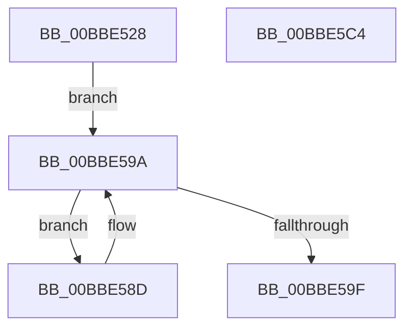

# HdlspSendBlueScreenInfo

- RVA: `0x00BBE528`–`0x00BBE5C5` (길이 `157` bytes)
- VA: `0x0000000140BBE528`
- 실행 섹션: `PAGEHDLS`
- PDB 이름 있음: `예`; PDB Function 태그: `아니요`
- unwind 정보 RVA: `0x000A1158`
- 디코드: `34`개 명령, `157/157` bytes 표시
- 미해석 바이트: `0` (있으면 어셈블리에 `.byte`로 보존)

> 이 문서는 커널 이미지의 기계어와 PDB 기호를 분석해 생성했습니다. 4번과 5번은 함수 원형과 자료형을 바이너리 사용 방식에서 추정한 C 해석이며 원본 소스 복구 결과는 아닙니다.

## 1. Dependencies

- 직접 호출 지점: **7**; 고유 호출 대상: **3**
- 직접 호출자로 확인된 함수: **1**
- RIP 상대 이미지 참조: **6**

### Outgoing calls
- `0x00BBE54C` → [HdlspSendStringAtBaud](HdlspSendStringAtBaud_function_00BBE5CC.md) (function, `0x00BBE5CC`)
- `0x00BBE558` → [HdlspSendStringAtBaud](HdlspSendStringAtBaud_function_00BBE5CC.md) (function, `0x00BBE5CC`)
- `0x00BBE571` → [sprintf_s](../../text/50/sprintf_s_function_00505E40.md) (function, `0x00505E40`)
- `0x00BBE57B` → [HdlspSendStringAtBaud](HdlspSendStringAtBaud_function_00BBE5CC.md) (function, `0x00BBE5CC`)
- `0x00BBE591` → [HdlspSendStringAtBaud](HdlspSendStringAtBaud_function_00BBE5CC.md) (function, `0x00BBE5CC`)
- `0x00BBE5A6` → [HdlspSendStringAtBaud](HdlspSendStringAtBaud_function_00BBE5CC.md) (function, `0x00BBE5CC`)
- `0x00BBE5B6` → [_security_check_cookie](../../text/6A/_security_check_cookie_function_006AC640.md) (function, `0x006AC640`)

### Direct callers
- [HdlspDispatch](HdlspDispatch_function_00BBD320.md) at `0x00BBD847`

### Static image references
- `0x00BBE531` → RVA `0x00E0A740` (`.data`; read)
- `0x00BBE545` → RVA `0x00BBEB60` (` ?? ::CIFEBFPJ::`string'`; read)
- `0x00BBE551` → RVA `0x00BBEB30` (` ?? ::CIFEBFPJ::`string'`; read)
- `0x00BBE560` → RVA `0x00BBE9E0` (` ?? ::CIFEBFPJ::`string'`; read)
- `0x00BBE580` → RVA `0x00E68578` (`.data`; read)
- `0x00BBE59F` → RVA `0x00BBE9C0` (` ?? ::CIFEBFPJ::`string'`; read)

## 2. Other-region calls and transfers

- 다른 실행 섹션으로 향하는 call: **2**
  - `0x00BBE571` → [sprintf_s](../../text/50/sprintf_s_function_00505E40.md) (`PAGEHDLS` → `.text`)
  - `0x00BBE5B6` → [_security_check_cookie](../../text/6A/_security_check_cookie_function_006AC640.md) (`PAGEHDLS` → `.text`)
- 별도 외부 분기/꼬리 이동을 확인하지 못했습니다.

## 3. Assembly (complete function range)

```asm
00BBE528  40 53                           push rbx
00BBE52A  48 81 EC D0 00 00 00            sub rsp, 0xd0
00BBE531  48 8B 05 08 C2 24 00            mov rax, qword ptr [rip + 0x24c208]
00BBE538  48 33 C4                        xor rax, rsp
00BBE53B  48 89 84 24 C0 00 00 00         mov qword ptr [rsp + 0xc0], rax
00BBE543  8B D9                           mov ebx, ecx
00BBE545  48 8D 0D 14 06 00 00            lea rcx, [rip + 0x614]
00BBE54C  E8 7B 00 00 00                  call 0x140bbe5cc
00BBE551  48 8D 0D D8 05 00 00            lea rcx, [rip + 0x5d8]
00BBE558  E8 6F 00 00 00                  call 0x140bbe5cc
00BBE55D  44 8B CB                        mov r9d, ebx
00BBE560  4C 8D 05 79 04 00 00            lea r8, [rip + 0x479]
00BBE567  BA A0 00 00 00                  mov edx, 0xa0
00BBE56C  48 8D 4C 24 20                  lea rcx, [rsp + 0x20]
00BBE571  E8 CA 78 94 FF                  call 0x140505e40
00BBE576  48 8D 4C 24 20                  lea rcx, [rsp + 0x20]
00BBE57B  E8 4C 00 00 00                  call 0x140bbe5cc
00BBE580  48 8B 05 F1 9F 2A 00            mov rax, qword ptr [rip + 0x2a9ff1]
00BBE587  48 8B 58 28                     mov rbx, qword ptr [rax + 0x28]
00BBE58B  EB 0D                           jmp 0x140bbe59a
00BBE58D  48 8B 4B 08                     mov rcx, qword ptr [rbx + 8]
00BBE591  E8 36 00 00 00                  call 0x140bbe5cc
00BBE596  48 8B 5B 10                     mov rbx, qword ptr [rbx + 0x10]
00BBE59A  48 85 DB                        test rbx, rbx
00BBE59D  75 EE                           jne 0x140bbe58d
00BBE59F  48 8D 0D 1A 04 00 00            lea rcx, [rip + 0x41a]
00BBE5A6  E8 21 00 00 00                  call 0x140bbe5cc
00BBE5AB  48 8B 8C 24 C0 00 00 00         mov rcx, qword ptr [rsp + 0xc0]
00BBE5B3  48 33 CC                        xor rcx, rsp
00BBE5B6  E8 85 E0 AE FF                  call 0x1406ac640
00BBE5BB  48 81 C4 D0 00 00 00            add rsp, 0xd0
00BBE5C2  5B                              pop rbx
00BBE5C3  C3                              ret
00BBE5C4  CC                              int3
```

## 4. C-style interpretation (structured pseudocode)

```c
__int64 __fastcall HdlspSendBlueScreenInfo(int a1)
{
    __int64 result;
    __int64 v_rsp;
    unsigned __int64 v_stack_m18;
    unsigned __int64 v_stack_mB8;

    v_rsp = (v_rsp) - (208);
    result = (*(unsigned __int64 *)(v_rip + 2408968)) ^ (v_rsp);
    v_stack_m18 = result;
    result = HdlspSendStringAtBaud(v_rip + 1556, a2, a3, a4);
    result = HdlspSendStringAtBaud(v_rip + 1496, a2, a3, a4);
    result = sprintf_s(v_stack_mB8, 160, v_rip + 1145, (unsigned int)((unsigned int)((unsigned int)(a1))));
    result = HdlspSendStringAtBaud(v_stack_mB8, 160, v_rip + 1145, (unsigned int)((unsigned int)((unsigned int)(a1))));
    goto loc_00BBE59A;
loc_00BBE58D:
    result = HdlspSendStringAtBaud(*(unsigned __int64 *)(*(unsigned __int64 *)(*(unsigned __int64 *)(v_rip + 2793457) + 40) + 8), 160, v_rip + 1145, (unsigned int)((unsigned int)((unsigned int)(a1))));
loc_00BBE59A:
    if (*(unsigned __int64 *)(*(unsigned __int64 *)(*(unsigned __int64 *)(v_rip + 2793457) + 40) + 16) != 0) goto loc_00BBE58D;
    result = HdlspSendStringAtBaud(v_rip + 1050, 160, v_rip + 1145, (unsigned int)((unsigned int)((unsigned int)(a1))));
    a1 = (v_stack_m18) ^ (v_rsp);
    result = _security_check_cookie(a1, 160, v_rip + 1145, (unsigned int)((unsigned int)((unsigned int)(a1))));
    v_rsp = (v_rsp) + (208);
    return result;
}
```

## 5. (Beta) C Style

```c
int64_t HdlspSendBlueScreenInfo(int32_t Arg1)
{
    int64_t result;
    int64_t local_rsp;
    uint64_t v_stack_m18;
    uint64_t v_stack_mB8;

    local_rsp = (local_rsp) - (208);
    result = (*(uint64_t *)(v_rip + 0x24C208)) ^ (local_rsp);
    v_stack_m18 = result;
    result = HdlspSendStringAtBaud(v_rip + 1556, a2, a3, a4);
    result = HdlspSendStringAtBaud(v_rip + 1496, a2, a3, a4);
    result = sprintf_s(v_stack_mB8, 160, v_rip + 1145, (uint32_t)((uint32_t)((uint32_t)(Arg1))));
    result = HdlspSendStringAtBaud(v_stack_mB8, 160, v_rip + 1145, (uint32_t)((uint32_t)((uint32_t)(Arg1))));
    goto loc_00BBE59A;
loc_00BBE58D:
    result = HdlspSendStringAtBaud(*(uint64_t *)(*(uint64_t *)(*(uint64_t *)(v_rip + 0x2A9FF1) + 0x28) + 0x8), 160, v_rip + 1145, (uint32_t)((uint32_t)((uint32_t)(Arg1))));
loc_00BBE59A:
    if (*(uint64_t *)(*(uint64_t *)(*(uint64_t *)(v_rip + 0x2A9FF1) + 0x28) + 0x10) != 0) goto loc_00BBE58D;
    result = HdlspSendStringAtBaud(v_rip + 1050, 160, v_rip + 1145, (uint32_t)((uint32_t)((uint32_t)(Arg1))));
    Arg1 = (v_stack_m18) ^ (local_rsp);
    result = _security_check_cookie(Arg1, 160, v_rip + 1145, (uint32_t)((uint32_t)((uint32_t)(Arg1))));
    local_rsp = (local_rsp) + (208);
    return result;
}
```

## 6. Execution-region graph

[열기: 2D/3D 그래프와 함수 탐색 컨트롤 패널](../../../control-panel.html?section=pagehdls&rva=0x00BBE528&view=graph)

- 2D 그래프는 위에서 아래로 흐르고, 3D 그래프는 빈 공간을 드래그해 회전합니다. Shift+드래그는 이동, 휠은 확대·축소, 함수 노드 선택은 대상 보고서 이동입니다.

### Static fallback


