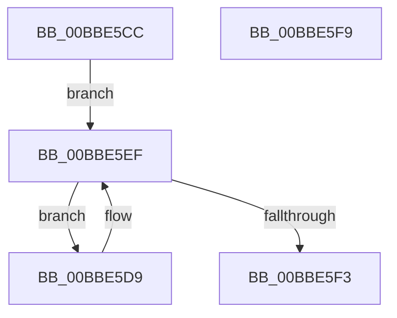

# HdlspSendStringAtBaud

- RVA: `0x00BBE5CC`–`0x00BBE5FA` (길이 `46` bytes)
- VA: `0x0000000140BBE5CC`
- 실행 섹션: `PAGEHDLS`
- PDB 이름 있음: `예`; PDB Function 태그: `아니요`
- unwind 정보 RVA: `0x0005CF00`
- 디코드: `17`개 명령, `46/46` bytes 표시
- 미해석 바이트: `0` (있으면 어셈블리에 `.byte`로 보존)

> 이 문서는 커널 이미지의 기계어와 PDB 기호를 분석해 생성했습니다. 4번과 5번은 함수 원형과 자료형을 바이너리 사용 방식에서 추정한 C 해석이며 원본 소스 복구 결과는 아닙니다.

## 1. Dependencies

- 직접 호출 지점: **1**; 고유 호출 대상: **1**
- 직접 호출자로 확인된 함수: **7**
- RIP 상대 이미지 참조: **1**

### Outgoing calls
- `0x00BBE5E5` → [InbvPortPutByte](../../text/6A/InbvPortPutByte_function_006A8350.md) (function, `0x006A8350`)

### Direct callers
- [HdlspBugCheckProcessing](HdlspBugCheckProcessing_function_00BBD1F8.md) at `0x00BBD2B4`
- [HdlspBugCheckProcessing](HdlspBugCheckProcessing_function_00BBD1F8.md) at `0x00BBD2C0`
- [HdlspBugCheckProcessing](HdlspBugCheckProcessing_function_00BBD1F8.md) at `0x00BBD2CC`
- [HdlspBugCheckProcessing](HdlspBugCheckProcessing_function_00BBD1F8.md) at `0x00BBD2D8`
- [HdlspBugCheckProcessing](HdlspBugCheckProcessing_function_00BBD1F8.md) at `0x00BBD2E4`
- [HdlspBugCheckProcessing](HdlspBugCheckProcessing_function_00BBD1F8.md) at `0x00BBD2F0`
- [HdlspBugCheckProcessing](HdlspBugCheckProcessing_function_00BBD1F8.md) at `0x00BBD2FC`
- [HdlspDispatch](HdlspDispatch_function_00BBD320.md) at `0x00BBD690`
- [HdlspDispatch](HdlspDispatch_function_00BBD320.md) at `0x00BBD853`
- [HdlspEnableTerminal](HdlspEnableTerminal_function_00BBD9D4.md) at `0x00BBDA65`
- [HdlspEnableTerminal](HdlspEnableTerminal_function_00BBD9D4.md) at `0x00BBDA71`
- [HdlspGetLine](HdlspGetLine_function_00BBDAA4.md) at `0x00BBDBEC`
- [HdlspGetLine](HdlspGetLine_function_00BBDAA4.md) at `0x00BBDC0D`
- [HdlspGetLine](HdlspGetLine_function_00BBDAA4.md) at `0x00BBDC34`
- [HdlspGetLine](HdlspGetLine_function_00BBDAA4.md) at `0x00BBDC50`
- [HdlspGetLine](HdlspGetLine_function_00BBDAA4.md) at `0x00BBDC7A`
- [HdlspPutString](HdlspPutString_function_00BBE2F0.md) at `0x00BBE322`
- [HdlspPutString](HdlspPutString_function_00BBE2F0.md) at `0x00BBE456`
- [HdlspPutWideString](HdlspPutWideString_function_00BBE468.md) at `0x00BBE4B1`
- [HdlspPutWideString](HdlspPutWideString_function_00BBE468.md) at `0x00BBE505`
- [HdlspSendBlueScreenInfo](HdlspSendBlueScreenInfo_function_00BBE528.md) at `0x00BBE54C`
- [HdlspSendBlueScreenInfo](HdlspSendBlueScreenInfo_function_00BBE528.md) at `0x00BBE558`
- [HdlspSendBlueScreenInfo](HdlspSendBlueScreenInfo_function_00BBE528.md) at `0x00BBE57B`
- [HdlspSendBlueScreenInfo](HdlspSendBlueScreenInfo_function_00BBE528.md) at `0x00BBE591`
- [HdlspSendBlueScreenInfo](HdlspSendBlueScreenInfo_function_00BBE528.md) at `0x00BBE5A6`

### Static image references
- `0x00BBE5D9` → RVA `0x00E68578` (`.data`; read)

## 2. Other-region calls and transfers

- 다른 실행 섹션으로 향하는 call: **1**
  - `0x00BBE5E5` → [InbvPortPutByte](../../text/6A/InbvPortPutByte_function_006A8350.md) (`PAGEHDLS` → `.text`)
- 별도 외부 분기/꼬리 이동을 확인하지 못했습니다.

## 3. Assembly (complete function range)

```asm
00BBE5CC  40 53                           push rbx
00BBE5CE  48 83 EC 20                     sub rsp, 0x20
00BBE5D2  8A 01                           mov al, byte ptr [rcx]
00BBE5D4  48 8B D9                        mov rbx, rcx
00BBE5D7  EB 16                           jmp 0x140bbe5ef
00BBE5D9  48 8B 0D 98 9F 2A 00            mov rcx, qword ptr [rip + 0x2a9f98]
00BBE5E0  8A D0                           mov dl, al
00BBE5E2  8B 49 38                        mov ecx, dword ptr [rcx + 0x38]
00BBE5E5  E8 66 9D AE FF                  call 0x1406a8350
00BBE5EA  48 FF C3                        inc rbx
00BBE5ED  8A 03                           mov al, byte ptr [rbx]
00BBE5EF  84 C0                           test al, al
00BBE5F1  75 E6                           jne 0x140bbe5d9
00BBE5F3  48 83 C4 20                     add rsp, 0x20
00BBE5F7  5B                              pop rbx
00BBE5F8  C3                              ret
00BBE5F9  CC                              int3
```

## 4. C-style interpretation (structured pseudocode)

```c
__int64 __fastcall HdlspSendStringAtBaud(__int64 a1)
{
    __int64 result;
    __int64 v_rbx;
    __int64 v_rsp;

    v_rsp = (v_rsp) - (32);
    goto loc_00BBE5EF;
loc_00BBE5D9:
    result = InbvPortPutByte((unsigned int)(*(unsigned int *)(*(unsigned __int64 *)(v_rip + 2793368) + 56)), (unsigned __int8)(*(unsigned __int8 *)(a1)), a3, a4);
    v_rbx = (a1) + 1;
loc_00BBE5EF:
    if ((unsigned __int8)(*(unsigned __int8 *)(v_rbx)) != 0) goto loc_00BBE5D9;
    v_rsp = (v_rsp) + (32);
    return *(unsigned __int8 *)(v_rbx);
}
```

## 5. (Beta) C Style

```c
int64_t HdlspSendStringAtBaud(void *Arg1)
{
    uint8_t *arg1 = (uint8_t *)Arg1;

    int64_t result;
    int64_t local_rbx;
    int64_t local_rsp;

    local_rsp = (local_rsp) - (32);
    goto loc_00BBE5EF;
loc_00BBE5D9:
    result = InbvPortPutByte((uint32_t)(*(uint32_t *)(*(uint64_t *)(v_rip + 0x2A9F98) + 0x38)), (uint8_t)(*(uint8_t *)(arg1)), a3, a4);
    local_rbx = (Arg1) + 1;
loc_00BBE5EF:
    if ((uint8_t)(*(uint8_t *)(local_rbx)) != 0) goto loc_00BBE5D9;
    local_rsp = (local_rsp) + (32);
    return *(uint8_t *)(local_rbx);
}
```

### 관측된 메모리 오프셋

구조체 형식이 확인되지 않은 접근은 인자 기준의 오프셋으로만 기록했습니다.

| 기준 인자 | 오프셋 표현 | 폭 (bit) | 접근 |
|---|---:|---:|---|
| `Arg1` | `+ 0x0` | `8` | `R` |

## 6. Execution-region graph

[열기: 2D/3D 그래프와 함수 탐색 컨트롤 패널](../../../control-panel.html?section=pagehdls&rva=0x00BBE5CC&view=graph)

- 2D 그래프는 위에서 아래로 흐르고, 3D 그래프는 빈 공간을 드래그해 회전합니다. Shift+드래그는 이동, 휠은 확대·축소, 함수 노드 선택은 대상 보고서 이동입니다.

### Static fallback


