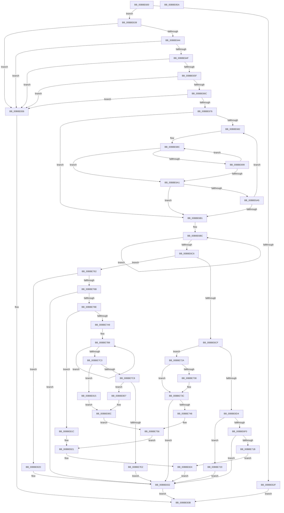

# HdlspSetBlueScreenInformation

- RVA: `0x00BBE600`–`0x00BBE85B` (길이 `603` bytes)
- VA: `0x0000000140BBE600`
- 실행 섹션: `PAGEHDLS`
- PDB 이름 있음: `예`; PDB Function 태그: `아니요`
- unwind 정보 RVA: `0x000C4D00`
- 디코드: `162`개 명령, `603/603` bytes 표시
- 미해석 바이트: `0` (있으면 어셈블리에 `.byte`로 보존)

> 이 문서는 커널 이미지의 기계어와 PDB 기호를 분석해 생성했습니다. 4번과 5번은 함수 원형과 자료형을 바이너리 사용 방식에서 추정한 C 해석이며 원본 소스 복구 결과는 아닙니다.

## 1. Dependencies

- 직접 호출 지점: **10**; 고유 호출 대상: **3**
- 직접 호출자로 확인된 함수: **1**
- RIP 상대 이미지 참조: **1**

### Outgoing calls
- `0x00BBE6E3` → [ExAllocatePool2](../../poolcode/B8/ExAllocatePool2_function_00B820F0.md) (function, `0x00B820F0`)
- `0x00BBE6FB` → [strcpy_s](../../text/50/strcpy_s_function_00505FB0.md) (function, `0x00505FB0`)
- `0x00BBE74E` → [ExFreePoolWithTag](../../poolcode/B8/ExFreePoolWithTag_function_00B82870.md) (function, `0x00B82870`)
- `0x00BBE758` → [ExFreePoolWithTag](../../poolcode/B8/ExFreePoolWithTag_function_00B82870.md) (function, `0x00B82870`)
- `0x00BBE77D` → [ExAllocatePool2](../../poolcode/B8/ExAllocatePool2_function_00B820F0.md) (function, `0x00B820F0`)
- `0x00BBE79B` → [ExAllocatePool2](../../poolcode/B8/ExAllocatePool2_function_00B820F0.md) (function, `0x00B820F0`)
- `0x00BBE7B4` → [strcpy_s](../../text/50/strcpy_s_function_00505FB0.md) (function, `0x00505FB0`)
- `0x00BBE7D5` → [ExAllocatePool2](../../poolcode/B8/ExAllocatePool2_function_00B820F0.md) (function, `0x00B820F0`)
- `0x00BBE7ED` → [strcpy_s](../../text/50/strcpy_s_function_00505FB0.md) (function, `0x00505FB0`)
- `0x00BBE826` → [ExFreePoolWithTag](../../poolcode/B8/ExFreePoolWithTag_function_00B82870.md) (function, `0x00B82870`)

### Direct callers
- [HdlspDispatch](HdlspDispatch_function_00BBD320.md) at `0x00BBD6FD`

### Static image references
- `0x00BBE61D` → RVA `0x00E68578` (`.data`; read)

## 2. Other-region calls and transfers

- 다른 실행 섹션으로 향하는 call: **10**
  - `0x00BBE6E3` → [ExAllocatePool2](../../poolcode/B8/ExAllocatePool2_function_00B820F0.md) (`PAGEHDLS` → `POOLCODE`)
  - `0x00BBE6FB` → [strcpy_s](../../text/50/strcpy_s_function_00505FB0.md) (`PAGEHDLS` → `.text`)
  - `0x00BBE74E` → [ExFreePoolWithTag](../../poolcode/B8/ExFreePoolWithTag_function_00B82870.md) (`PAGEHDLS` → `POOLCODE`)
  - `0x00BBE758` → [ExFreePoolWithTag](../../poolcode/B8/ExFreePoolWithTag_function_00B82870.md) (`PAGEHDLS` → `POOLCODE`)
  - `0x00BBE77D` → [ExAllocatePool2](../../poolcode/B8/ExAllocatePool2_function_00B820F0.md) (`PAGEHDLS` → `POOLCODE`)
  - `0x00BBE79B` → [ExAllocatePool2](../../poolcode/B8/ExAllocatePool2_function_00B820F0.md) (`PAGEHDLS` → `POOLCODE`)
  - `0x00BBE7B4` → [strcpy_s](../../text/50/strcpy_s_function_00505FB0.md) (`PAGEHDLS` → `.text`)
  - `0x00BBE7D5` → [ExAllocatePool2](../../poolcode/B8/ExAllocatePool2_function_00B820F0.md) (`PAGEHDLS` → `POOLCODE`)
  - `0x00BBE7ED` → [strcpy_s](../../text/50/strcpy_s_function_00505FB0.md) (`PAGEHDLS` → `.text`)
  - `0x00BBE826` → [ExFreePoolWithTag](../../poolcode/B8/ExFreePoolWithTag_function_00B82870.md) (`PAGEHDLS` → `POOLCODE`)
- 별도 외부 분기/꼬리 이동을 확인하지 못했습니다.

## 3. Assembly (complete function range)

```asm
00BBE600  48 8B C4                        mov rax, rsp
00BBE603  48 89 58 08                     mov qword ptr [rax + 8], rbx
00BBE607  48 89 68 10                     mov qword ptr [rax + 0x10], rbp
00BBE60B  48 89 70 18                     mov qword ptr [rax + 0x18], rsi
00BBE60F  48 89 78 20                     mov qword ptr [rax + 0x20], rdi
00BBE613  41 54                           push r12
00BBE615  41 55                           push r13
00BBE617  41 56                           push r14
00BBE619  48 83 EC 20                     sub rsp, 0x20
00BBE61D  4C 8B 05 54 9F 2A 00            mov r8, qword ptr [rip + 0x2a9f54]
00BBE624  48 8B F1                        mov rsi, rcx
00BBE627  41 8B 40 30                     mov eax, dword ptr [r8 + 0x30]
00BBE62B  A8 02                           test al, 2
00BBE62D  74 0A                           je 0x140bbe639
00BBE62F  B8 01 00 00 C0                  mov eax, 0xc0000001
00BBE634  E9 02 02 00 00                  jmp 0x140bbe83b
00BBE639  33 DB                           xor ebx, ebx
00BBE63B  48 85 F6                        test rsi, rsi
00BBE63E  0F 84 F2 01 00 00               je 0x140bbe836
00BBE644  8B 09                           mov ecx, dword ptr [rcx]
00BBE646  83 F9 02                        cmp ecx, 2
00BBE649  0F 82 E7 01 00 00               jb 0x140bbe836
00BBE64F  48 8D 42 F8                     lea rax, [rdx - 8]
00BBE653  44 8B D9                        mov r11d, ecx
00BBE656  48 3B C8                        cmp rcx, rax
00BBE659  0F 83 D7 01 00 00               jae 0x140bbe836
00BBE65F  8D 41 FF                        lea eax, [rcx - 1]
00BBE662  38 5C 30 04                     cmp byte ptr [rax + rsi + 4], bl
00BBE666  0F 85 CA 01 00 00               jne 0x140bbe836
00BBE66C  38 5C 16 FC                     cmp byte ptr [rsi + rdx - 4], bl
00BBE670  0F 85 C0 01 00 00               jne 0x140bbe836
00BBE676  49 8B 48 28                     mov rcx, qword ptr [r8 + 0x28]
00BBE67A  48 8B F9                        mov rdi, rcx
00BBE67D  48 85 C9                        test rcx, rcx
00BBE680  74 2F                           je 0x140bbe6b1
00BBE682  48 8B 07                        mov rax, qword ptr [rdi]
00BBE685  4C 8D 56 04                     lea r10, [rsi + 4]
00BBE689  4C 2B D0                        sub r10, rax
00BBE68C  0F B6 10                        movzx edx, byte ptr [rax]
00BBE68F  46 0F B6 0C 10                  movzx r9d, byte ptr [rax + r10]
00BBE694  41 2B D1                        sub edx, r9d
00BBE697  75 08                           jne 0x140bbe6a1
00BBE699  48 FF C0                        inc rax
00BBE69C  45 85 C9                        test r9d, r9d
00BBE69F  75 EB                           jne 0x140bbe68c
00BBE6A1  85 D2                           test edx, edx
00BBE6A3  74 0C                           je 0x140bbe6b1
00BBE6A5  48 8B CF                        mov rcx, rdi
00BBE6A8  48 8B 7F 10                     mov rdi, qword ptr [rdi + 0x10]
00BBE6AC  48 85 FF                        test rdi, rdi
00BBE6AF  75 D1                           jne 0x140bbe682
00BBE6B1  49 83 CE FF                     or r14, 0xffffffffffffffff
00BBE6B5  4D 8D 2C 33                     lea r13, [r11 + rsi]
00BBE6B9  49 8B EE                        mov rbp, r14
00BBE6BC  48 FF C5                        inc rbp
00BBE6BF  42 38 5C 2D 04                  cmp byte ptr [rbp + r13 + 4], bl
00BBE6C4  75 F6                           jne 0x140bbe6bc
00BBE6C6  48 85 FF                        test rdi, rdi
00BBE6C9  0F 84 93 00 00 00               je 0x140bbe762
00BBE6CF  48 85 ED                        test rbp, rbp
00BBE6D2  74 56                           je 0x140bbe72a
00BBE6D4  41 B8 48 64 6C 73               mov r8d, 0x736c6448
00BBE6DA  48 8D 55 01                     lea rdx, [rbp + 1]
00BBE6DE  B9 40 00 00 00                  mov ecx, 0x40
00BBE6E3  E8 08 3A FC FF                  call 0x140b820f0
00BBE6E8  48 8B F0                        mov rsi, rax
00BBE6EB  48 85 C0                        test rax, rax
00BBE6EE  74 30                           je 0x140bbe720
00BBE6F0  4D 8D 45 04                     lea r8, [r13 + 4]
00BBE6F4  48 8B C8                        mov rcx, rax
00BBE6F7  48 8D 55 01                     lea rdx, [rbp + 1]
00BBE6FB  E8 B0 78 94 FF                  call 0x140505fb0
00BBE700  48 8B 05 71 9E 2A 00            mov rax, qword ptr [rip + 0x2a9e71]
00BBE707  48 8B 4F 08                     mov rcx, qword ptr [rdi + 8]
00BBE70B  48 89 77 08                     mov qword ptr [rdi + 8], rsi
00BBE70F  8B 50 30                        mov edx, dword ptr [rax + 0x30]
00BBE712  F6 C2 02                        test dl, 2
00BBE715  0F 85 17 01 00 00               jne 0x140bbe832
00BBE71B  E9 04 01 00 00                  jmp 0x140bbe824
00BBE720  BB 17 00 00 C0                  mov ebx, 0xc0000017
00BBE725  E9 08 01 00 00                  jmp 0x140bbe832
00BBE72A  48 8B 47 10                     mov rax, qword ptr [rdi + 0x10]
00BBE72E  48 89 41 10                     mov qword ptr [rcx + 0x10], rax
00BBE732  49 39 78 28                     cmp qword ptr [r8 + 0x28], rdi
00BBE736  75 04                           jne 0x140bbe73c
00BBE738  49 89 40 28                     mov qword ptr [r8 + 0x28], rax
00BBE73C  41 8B 40 30                     mov eax, dword ptr [r8 + 0x30]
00BBE740  A8 02                           test al, 2
00BBE742  0F 85 EA 00 00 00               jne 0x140bbe832
00BBE748  48 8B 4F 08                     mov rcx, qword ptr [rdi + 8]
00BBE74C  33 D2                           xor edx, edx
00BBE74E  E8 1D 41 FC FF                  call 0x140b82870
00BBE753  48 8B 0F                        mov rcx, qword ptr [rdi]
00BBE756  33 D2                           xor edx, edx
00BBE758  E8 13 41 FC FF                  call 0x140b82870
00BBE75D  E9 BF 00 00 00                  jmp 0x140bbe821
00BBE762  48 85 ED                        test rbp, rbp
00BBE765  0F 84 C2 00 00 00               je 0x140bbe82d
00BBE76B  BA 18 00 00 00                  mov edx, 0x18
00BBE770  41 B8 48 64 6C 73               mov r8d, 0x736c6448
00BBE776  44 8D 62 28                     lea r12d, [rdx + 0x28]
00BBE77A  41 8B CC                        mov ecx, r12d
00BBE77D  E8 6E 39 FC FF                  call 0x140b820f0
00BBE782  48 8B F8                        mov rdi, rax
00BBE785  48 85 C0                        test rax, rax
00BBE788  0F 84 A4 00 00 00               je 0x140bbe832
00BBE78E  41 B8 48 64 6C 73               mov r8d, 0x736c6448
00BBE794  48 8D 55 01                     lea rdx, [rbp + 1]
00BBE798  41 8B CC                        mov ecx, r12d
00BBE79B  E8 50 39 FC FF                  call 0x140b820f0
00BBE7A0  48 89 47 08                     mov qword ptr [rdi + 8], rax
00BBE7A4  48 85 C0                        test rax, rax
00BBE7A7  74 73                           je 0x140bbe81c
00BBE7A9  4D 8D 45 04                     lea r8, [r13 + 4]
00BBE7AD  48 8B C8                        mov rcx, rax
00BBE7B0  48 8D 55 01                     lea rdx, [rbp + 1]
00BBE7B4  E8 F7 77 94 FF                  call 0x140505fb0
00BBE7B9  49 FF C6                        inc r14
00BBE7BC  42 38 5C 36 04                  cmp byte ptr [rsi + r14 + 4], bl
00BBE7C1  75 F6                           jne 0x140bbe7b9
00BBE7C3  4D 85 F6                        test r14, r14
00BBE7C6  74 4D                           je 0x140bbe815
00BBE7C8  41 B8 48 64 6C 73               mov r8d, 0x736c6448
00BBE7CE  49 8D 56 01                     lea rdx, [r14 + 1]
00BBE7D2  49 8B CC                        mov rcx, r12
00BBE7D5  E8 16 39 FC FF                  call 0x140b820f0
00BBE7DA  48 89 07                        mov qword ptr [rdi], rax
00BBE7DD  48 85 C0                        test rax, rax
00BBE7E0  74 25                           je 0x140bbe807
00BBE7E2  4C 8D 46 04                     lea r8, [rsi + 4]
00BBE7E6  48 8B C8                        mov rcx, rax
00BBE7E9  49 8D 56 01                     lea rdx, [r14 + 1]
00BBE7ED  E8 BE 77 94 FF                  call 0x140505fb0
00BBE7F2  48 8B 0D 7F 9D 2A 00            mov rcx, qword ptr [rip + 0x2a9d7f]
00BBE7F9  48 8B 41 28                     mov rax, qword ptr [rcx + 0x28]
00BBE7FD  48 89 47 10                     mov qword ptr [rdi + 0x10], rax
00BBE801  48 89 79 28                     mov qword ptr [rcx + 0x28], rdi
00BBE805  EB 2B                           jmp 0x140bbe832
00BBE807  BB 17 00 00 C0                  mov ebx, 0xc0000017
00BBE80C  48 8B 4F 08                     mov rcx, qword ptr [rdi + 8]
00BBE810  E9 41 FF FF FF                  jmp 0x140bbe756
00BBE815  BB 0D 00 00 C0                  mov ebx, 0xc000000d
00BBE81A  EB F0                           jmp 0x140bbe80c
00BBE81C  BB 17 00 00 C0                  mov ebx, 0xc0000017
00BBE821  48 8B CF                        mov rcx, rdi
00BBE824  33 D2                           xor edx, edx
00BBE826  E8 45 40 FC FF                  call 0x140b82870
00BBE82B  EB 05                           jmp 0x140bbe832
00BBE82D  BB 0D 00 00 C0                  mov ebx, 0xc000000d
00BBE832  8B C3                           mov eax, ebx
00BBE834  EB 05                           jmp 0x140bbe83b
00BBE836  B8 0D 00 00 C0                  mov eax, 0xc000000d
00BBE83B  48 8B 5C 24 40                  mov rbx, qword ptr [rsp + 0x40]
00BBE840  48 8B 6C 24 48                  mov rbp, qword ptr [rsp + 0x48]
00BBE845  48 8B 74 24 50                  mov rsi, qword ptr [rsp + 0x50]
00BBE84A  48 8B 7C 24 58                  mov rdi, qword ptr [rsp + 0x58]
00BBE84F  48 83 C4 20                     add rsp, 0x20
00BBE853  41 5E                           pop r14
00BBE855  41 5D                           pop r13
00BBE857  41 5C                           pop r12
00BBE859  C3                              ret
00BBE85A  CC                              int3
```

## 4. C-style interpretation (structured pseudocode)

```c
__int64 __fastcall HdlspSetBlueScreenInformation(__int64 a1, __int64 a2)
{
    __int64 result;
    __int64 v_r10;
    __int64 v_r14;
    __int64 v_rbp;
    __int64 v_rbx;
    __int64 v_rsp;
    unsigned __int64 v_stack_p10;
    unsigned __int64 v_stack_p18;
    unsigned __int64 v_stack_p20;
    unsigned __int64 v_stack_p8;

    *(unsigned __int64 *)(v_rsp + 8) = v_rbx;
    *(unsigned __int64 *)(v_rsp + 16) = v_rbp;
    *(unsigned __int64 *)(v_rsp + 24) = v_rsi;
    *(unsigned __int64 *)(v_rsp + 32) = v_rdi;
    v_rsp = (v_rsp) - (32);
    if ((((unsigned __int8)((unsigned int)(*(unsigned int *)(*(unsigned __int64 *)(v_rip + 2793300) + 48)))) & (2)) == 0) goto loc_00BBE639;
    goto loc_00BBE83B;
loc_00BBE639:
    v_rbx = 0;
    if (a1 == 0) goto loc_00BBE836;
    if (((unsigned int)((unsigned int)(*(unsigned int *)(a1)))) < 2) goto loc_00BBE836;
    if (((unsigned int)(*(unsigned int *)(a1))) >= (a2 - 8)) goto loc_00BBE836;
    if ((*(unsigned __int8 *)((unsigned int)(*(unsigned int *)(a1)) - 1 + a1 * 1 + 4)) != 0) goto loc_00BBE836;
    if ((*(unsigned __int8 *)(a1 + a2 * 1 - 4)) != 0) goto loc_00BBE836;
    if (*(unsigned __int64 *)(*(unsigned __int64 *)(v_rip + 2793300) + 40) == 0) goto loc_00BBE6B1;
loc_00BBE682:
    v_r10 = (a1 + 4) - (*(unsigned __int64 *)(*(unsigned __int64 *)(*(unsigned __int64 *)(v_rip + 2793300) + 40)));
loc_00BBE68C:
    a2 = (unsigned int)((*(unsigned __int8 *)(*(unsigned __int64 *)(*(unsigned __int64 *)(*(unsigned __int64 *)(v_rip + 2793300) + 40)))) - ((unsigned int)(*(unsigned __int8 *)(*(unsigned __int64 *)(*(unsigned __int64 *)(*(unsigned __int64 *)(v_rip + 2793300) + 40)) + v_r10 * 1))));
    if (condition_is_not_equal) goto loc_00BBE6A1;
    result = (*(unsigned __int64 *)(*(unsigned __int64 *)(*(unsigned __int64 *)(v_rip + 2793300) + 40))) + 1;
    if ((unsigned int)(*(unsigned __int8 *)(*(unsigned __int64 *)(*(unsigned __int64 *)(*(unsigned __int64 *)(v_rip + 2793300) + 40)) + v_r10 * 1)) != 0) goto loc_00BBE68C;
loc_00BBE6A1:
    if ((unsigned int)(a2) == 0) goto loc_00BBE6B1;
    if (*(unsigned __int64 *)(*(unsigned __int64 *)(*(unsigned __int64 *)(v_rip + 2793300) + 40) + 16) != 0) goto loc_00BBE682;
loc_00BBE6B1:
    v_r14 = (v_r14) | (-1);
loc_00BBE6BC:
    v_rbp = (v_r14) + 1;
    if ((*(unsigned __int8 *)(v_rbp + (unsigned int)((unsigned int)((unsigned int)(*(unsigned int *)(a1)))) + a1 * 1 * 1 + 4)) != 0) goto loc_00BBE6BC;
    if (*(unsigned __int64 *)(*(unsigned __int64 *)(*(unsigned __int64 *)(v_rip + 2793300) + 40) + 16) == 0) goto loc_00BBE762;
    if (v_rbp == 0) goto loc_00BBE72A;
    result = ExAllocatePool2(64, v_rbp + 1, (unsigned int)(0x736C6448ULL), *(unsigned __int8 *)(*(unsigned __int64 *)(*(unsigned __int64 *)(*(unsigned __int64 *)(v_rip + 2793300) + 40)) + v_r10 * 1));
    if (result == 0) goto loc_00BBE720;
    result = strcpy_s(result, v_rbp + 1, (unsigned int)((unsigned int)((unsigned int)(*(unsigned int *)(a1)))) + a1 * 1 + 4, *(unsigned __int8 *)(*(unsigned __int64 *)(*(unsigned __int64 *)(*(unsigned __int64 *)(v_rip + 2793300) + 40)) + v_r10 * 1));
    *(unsigned __int64 *)(*(unsigned __int64 *)(*(unsigned __int64 *)(*(unsigned __int64 *)(v_rip + 2793300) + 40) + 16) + 8) = result;
    if ((((unsigned __int8)((unsigned int)(*(unsigned int *)(*(unsigned __int64 *)(v_rip + 2793073) + 48)))) & (2)) != 0) goto loc_00BBE832;
    goto loc_00BBE824;
loc_00BBE720:
    goto loc_00BBE832;
loc_00BBE72A:
    *(unsigned __int64 *)(*(unsigned __int64 *)(*(unsigned __int64 *)(*(unsigned __int64 *)(*(unsigned __int64 *)(v_rip + 2793300) + 40) + 16) + 8) + 16) = *(unsigned __int64 *)(*(unsigned __int64 *)(*(unsigned __int64 *)(*(unsigned __int64 *)(v_rip + 2793300) + 40) + 16) + 16);
    if ((*(unsigned __int64 *)((unsigned int)((unsigned int)((unsigned int)(*(unsigned int *)(a1)))) + a1 * 1 + 4 + 40)) == (*(unsigned __int64 *)(*(unsigned __int64 *)(*(unsigned __int64 *)(v_rip + 2793300) + 40) + 16))) {
        *(unsigned __int64 *)((unsigned int)((unsigned int)((unsigned int)(*(unsigned int *)(a1)))) + a1 * 1 + 4 + 40) = *(unsigned __int64 *)(*(unsigned __int64 *)(*(unsigned __int64 *)(*(unsigned __int64 *)(v_rip + 2793300) + 40) + 16) + 16);
    }
    if ((((unsigned __int8)((unsigned int)(*(unsigned int *)((unsigned int)((unsigned int)((unsigned int)(*(unsigned int *)(a1)))) + a1 * 1 + 4 + 48)))) & (2)) != 0) goto loc_00BBE832;
    a2 = 0;
    result = ExFreePoolWithTag(*(unsigned __int64 *)(*(unsigned __int64 *)(*(unsigned __int64 *)(*(unsigned __int64 *)(v_rip + 2793300) + 40) + 16) + 8), a2, (unsigned int)((unsigned int)((unsigned int)(*(unsigned int *)(a1)))) + a1 * 1 + 4, *(unsigned __int8 *)(*(unsigned __int64 *)(*(unsigned __int64 *)(*(unsigned __int64 *)(v_rip + 2793300) + 40)) + v_r10 * 1));
loc_00BBE756:
    a2 = 0;
    result = ExFreePoolWithTag(*(unsigned __int64 *)(*(unsigned __int64 *)(*(unsigned __int64 *)(*(unsigned __int64 *)(v_rip + 2793300) + 40) + 16)), a2, (unsigned int)((unsigned int)((unsigned int)(*(unsigned int *)(a1)))) + a1 * 1 + 4, *(unsigned __int8 *)(*(unsigned __int64 *)(*(unsigned __int64 *)(*(unsigned __int64 *)(v_rip + 2793300) + 40)) + v_r10 * 1));
    goto loc_00BBE821;
loc_00BBE762:
    if (v_rbp == 0) goto loc_00BBE82D;
    result = ExAllocatePool2((unsigned int)((unsigned int)(24 + 40)), 24, (unsigned int)(0x736C6448ULL), *(unsigned __int8 *)(*(unsigned __int64 *)(*(unsigned __int64 *)(*(unsigned __int64 *)(v_rip + 2793300) + 40)) + v_r10 * 1));
    if (result == 0) goto loc_00BBE832;
    result = ExAllocatePool2((unsigned int)((unsigned int)(24 + 40)), v_rbp + 1, (unsigned int)(0x736C6448ULL), *(unsigned __int8 *)(*(unsigned __int64 *)(*(unsigned __int64 *)(*(unsigned __int64 *)(v_rip + 2793300) + 40)) + v_r10 * 1));
    *(unsigned __int64 *)(result + 8) = result;
    if (result == 0) goto loc_00BBE81C;
    result = strcpy_s(result, v_rbp + 1, (unsigned int)((unsigned int)((unsigned int)(*(unsigned int *)(a1)))) + a1 * 1 + 4, *(unsigned __int8 *)(*(unsigned __int64 *)(*(unsigned __int64 *)(*(unsigned __int64 *)(v_rip + 2793300) + 40)) + v_r10 * 1));
loc_00BBE7B9:
    v_r14 = (v_r14) + 1;
    if ((*(unsigned __int8 *)(result + v_r14 * 1 + 4)) != ((unsigned __int8)((unsigned int)(0xC0000017ULL)))) goto loc_00BBE7B9;
    if (v_r14 == 0) goto loc_00BBE815;
    result = ExAllocatePool2(24 + 40, v_r14 + 1, (unsigned int)(0x736C6448ULL), *(unsigned __int8 *)(*(unsigned __int64 *)(*(unsigned __int64 *)(*(unsigned __int64 *)(v_rip + 2793300) + 40)) + v_r10 * 1));
    *(unsigned __int64 *)(result) = result;
    if (result == 0) goto loc_00BBE807;
    result = strcpy_s(result, v_r14 + 1, result + 4, *(unsigned __int8 *)(*(unsigned __int64 *)(*(unsigned __int64 *)(*(unsigned __int64 *)(v_rip + 2793300) + 40)) + v_r10 * 1));
    *(unsigned __int64 *)(result + 16) = *(unsigned __int64 *)(*(unsigned __int64 *)(v_rip + 2792831) + 40);
    *(unsigned __int64 *)(*(unsigned __int64 *)(v_rip + 2792831) + 40) = result;
    goto loc_00BBE832;
loc_00BBE807:
loc_00BBE80C:
    goto loc_00BBE756;
loc_00BBE815:
    goto loc_00BBE80C;
loc_00BBE81C:
loc_00BBE821:
loc_00BBE824:
    a2 = 0;
    result = ExFreePoolWithTag(result, a2, result + 4, *(unsigned __int8 *)(*(unsigned __int64 *)(*(unsigned __int64 *)(*(unsigned __int64 *)(v_rip + 2793300) + 40)) + v_r10 * 1));
    goto loc_00BBE832;
loc_00BBE82D:
loc_00BBE832:
    goto loc_00BBE83B;
loc_00BBE836:
loc_00BBE83B:
    v_rsp = (v_rsp) + (32);
    return (unsigned int)(0xC000000DULL);
}
```

## 5. (Beta) C Style

```c
int64_t HdlspSetBlueScreenInformation(void *Arg1, void *Arg2)
{
    uint8_t *arg1 = (uint8_t *)Arg1;
    uint8_t *arg2 = (uint8_t *)Arg2;

    int64_t result;
    int64_t local_r10;
    int64_t local_r14;
    int64_t local_rbp;
    int64_t local_rbx;
    int64_t local_rsp;
    uint64_t v_stack_p10;
    uint64_t v_stack_p18;
    uint64_t v_stack_p20;
    uint64_t v_stack_p8;

    *(uint64_t *)(local_rsp + 0x8) = local_rbx;
    *(uint64_t *)(local_rsp + 0x10) = local_rbp;
    *(uint64_t *)(local_rsp + 0x18) = local_rsi;
    *(uint64_t *)(local_rsp + 0x20) = local_rdi;
    local_rsp = (local_rsp) - (32);
    if ((((uint8_t)((uint32_t)(*(uint32_t *)(*(uint64_t *)(v_rip + 0x2A9F54) + 0x30)))) & (2)) == 0) goto loc_00BBE639;
    goto loc_00BBE83B;
loc_00BBE639:
    local_rbx = 0;
    if (Arg1 == NULL) goto loc_00BBE836;
    if (((uint32_t)((uint32_t)(*(uint32_t *)(arg1)))) < 2) goto loc_00BBE836;
    if (((uint32_t)(*(uint32_t *)(arg1))) >= (Arg2 - 8)) goto loc_00BBE836;
    if ((*(uint8_t *)((uint32_t)(*(uint32_t *)(arg1)) - 0x1 + arg1 * 1 + 0x4)) != 0) goto loc_00BBE836;
    if ((*(uint8_t *)(arg1 + arg2 * 1 - 0x4)) != 0) goto loc_00BBE836;
    if (*(uint64_t *)(*(uint64_t *)(v_rip + 0x2A9F54) + 0x28) == 0) goto loc_00BBE6B1;
loc_00BBE682:
    local_r10 = (Arg1 + 4) - (*(uint64_t *)(*(uint64_t *)(*(uint64_t *)(v_rip + 0x2A9F54) + 0x28)));
loc_00BBE68C:
    Arg2 = (uint32_t)((*(uint8_t *)(*(uint64_t *)(*(uint64_t *)(*(uint64_t *)(v_rip + 0x2A9F54) + 0x28)))) - ((uint32_t)(*(uint8_t *)(*(uint64_t *)(*(uint64_t *)(*(uint64_t *)(v_rip + 0x2A9F54) + 0x28)) + local_r10 * 1))));
    if (condition_is_not_equal) goto loc_00BBE6A1;
    result = (*(uint64_t *)(*(uint64_t *)(*(uint64_t *)(v_rip + 0x2A9F54) + 0x28))) + 1;
    if ((uint32_t)(*(uint8_t *)(*(uint64_t *)(*(uint64_t *)(*(uint64_t *)(v_rip + 0x2A9F54) + 0x28)) + local_r10 * 1)) != 0) goto loc_00BBE68C;
loc_00BBE6A1:
    if ((uint32_t)(Arg2) == 0) goto loc_00BBE6B1;
    if (*(uint64_t *)(*(uint64_t *)(*(uint64_t *)(v_rip + 0x2A9F54) + 0x28) + 0x10) != 0) goto loc_00BBE682;
loc_00BBE6B1:
    local_r14 = (local_r14) | (-1);
loc_00BBE6BC:
    local_rbp = (local_r14) + 1;
    if ((*(uint8_t *)(local_rbp + (uint32_t)((uint32_t)((uint32_t)(*(uint32_t *)(arg1)))) + arg1 * 1 * 1 + 0x4)) != 0) goto loc_00BBE6BC;
    if (*(uint64_t *)(*(uint64_t *)(*(uint64_t *)(v_rip + 0x2A9F54) + 0x28) + 0x10) == 0) goto loc_00BBE762;
    if (local_rbp == 0) goto loc_00BBE72A;
    result = ExAllocatePool2(64, local_rbp + 1, (uint32_t)(0x736C6448ULL), *(uint8_t *)(*(uint64_t *)(*(uint64_t *)(*(uint64_t *)(v_rip + 0x2A9F54) + 0x28)) + local_r10 * 1));
    if (result == 0) goto loc_00BBE720;
    result = strcpy_s(result, local_rbp + 1, (uint32_t)((uint32_t)((uint32_t)(*(uint32_t *)(arg1)))) + Arg1 * 1 + 4, *(uint8_t *)(*(uint64_t *)(*(uint64_t *)(*(uint64_t *)(v_rip + 0x2A9F54) + 0x28)) + local_r10 * 1));
    *(uint64_t *)(*(uint64_t *)(*(uint64_t *)(*(uint64_t *)(v_rip + 0x2A9F54) + 0x28) + 0x10) + 0x8) = result;
    if ((((uint8_t)((uint32_t)(*(uint32_t *)(*(uint64_t *)(v_rip + 0x2A9E71) + 0x30)))) & (2)) != 0) goto loc_00BBE832;
    goto loc_00BBE824;
loc_00BBE720:
    goto loc_00BBE832;
loc_00BBE72A:
    *(uint64_t *)(*(uint64_t *)(*(uint64_t *)(*(uint64_t *)(*(uint64_t *)(v_rip + 0x2A9F54) + 0x28) + 0x10) + 0x8) + 0x10) = *(uint64_t *)(*(uint64_t *)(*(uint64_t *)(*(uint64_t *)(v_rip + 0x2A9F54) + 0x28) + 0x10) + 0x10);
    if ((*(uint64_t *)((uint32_t)((uint32_t)((uint32_t)(*(uint32_t *)(arg1)))) + arg1 * 1 + 0x4 + 0x28)) == (*(uint64_t *)(*(uint64_t *)(*(uint64_t *)(v_rip + 0x2A9F54) + 0x28) + 0x10))) {
        *(uint64_t *)((uint32_t)((uint32_t)((uint32_t)(*(uint32_t *)(arg1)))) + arg1 * 1 + 0x4 + 0x28) = *(uint64_t *)(*(uint64_t *)(*(uint64_t *)(*(uint64_t *)(v_rip + 0x2A9F54) + 0x28) + 0x10) + 0x10);
    }
    if ((((uint8_t)((uint32_t)(*(uint32_t *)((uint32_t)((uint32_t)((uint32_t)(*(uint32_t *)(arg1)))) + arg1 * 1 + 0x4 + 0x30)))) & (2)) != 0) goto loc_00BBE832;
    Arg2 = 0;
    result = ExFreePoolWithTag(*(uint64_t *)(*(uint64_t *)(*(uint64_t *)(*(uint64_t *)(v_rip + 0x2A9F54) + 0x28) + 0x10) + 0x8), Arg2, (uint32_t)((uint32_t)((uint32_t)(*(uint32_t *)(arg1)))) + Arg1 * 1 + 4, *(uint8_t *)(*(uint64_t *)(*(uint64_t *)(*(uint64_t *)(v_rip + 0x2A9F54) + 0x28)) + local_r10 * 1));
loc_00BBE756:
    Arg2 = 0;
    result = ExFreePoolWithTag(*(uint64_t *)(*(uint64_t *)(*(uint64_t *)(*(uint64_t *)(v_rip + 0x2A9F54) + 0x28) + 0x10)), Arg2, (uint32_t)((uint32_t)((uint32_t)(*(uint32_t *)(arg1)))) + Arg1 * 1 + 4, *(uint8_t *)(*(uint64_t *)(*(uint64_t *)(*(uint64_t *)(v_rip + 0x2A9F54) + 0x28)) + local_r10 * 1));
    goto loc_00BBE821;
loc_00BBE762:
    if (local_rbp == 0) goto loc_00BBE82D;
    result = ExAllocatePool2((uint32_t)((uint32_t)(24 + 40)), 24, (uint32_t)(0x736C6448ULL), *(uint8_t *)(*(uint64_t *)(*(uint64_t *)(*(uint64_t *)(v_rip + 0x2A9F54) + 0x28)) + local_r10 * 1));
    if (result == 0) goto loc_00BBE832;
    result = ExAllocatePool2((uint32_t)((uint32_t)(24 + 40)), local_rbp + 1, (uint32_t)(0x736C6448ULL), *(uint8_t *)(*(uint64_t *)(*(uint64_t *)(*(uint64_t *)(v_rip + 0x2A9F54) + 0x28)) + local_r10 * 1));
    *(uint64_t *)(result + 0x8) = result;
    if (result == 0) goto loc_00BBE81C;
    result = strcpy_s(result, local_rbp + 1, (uint32_t)((uint32_t)((uint32_t)(*(uint32_t *)(arg1)))) + Arg1 * 1 + 4, *(uint8_t *)(*(uint64_t *)(*(uint64_t *)(*(uint64_t *)(v_rip + 0x2A9F54) + 0x28)) + local_r10 * 1));
loc_00BBE7B9:
    local_r14 = (local_r14) + 1;
    if ((*(uint8_t *)(result + local_r14 * 1 + 0x4)) != ((uint8_t)((uint32_t)(0xC0000017ULL)))) goto loc_00BBE7B9;
    if (local_r14 == 0) goto loc_00BBE815;
    result = ExAllocatePool2(24 + 40, local_r14 + 1, (uint32_t)(0x736C6448ULL), *(uint8_t *)(*(uint64_t *)(*(uint64_t *)(*(uint64_t *)(v_rip + 0x2A9F54) + 0x28)) + local_r10 * 1));
    *(uint64_t *)(result) = result;
    if (result == 0) goto loc_00BBE807;
    result = strcpy_s(result, local_r14 + 1, result + 4, *(uint8_t *)(*(uint64_t *)(*(uint64_t *)(*(uint64_t *)(v_rip + 0x2A9F54) + 0x28)) + local_r10 * 1));
    *(uint64_t *)(result + 0x10) = *(uint64_t *)(*(uint64_t *)(v_rip + 0x2A9D7F) + 0x28);
    *(uint64_t *)(*(uint64_t *)(v_rip + 0x2A9D7F) + 0x28) = result;
    goto loc_00BBE832;
loc_00BBE807:
loc_00BBE80C:
    goto loc_00BBE756;
loc_00BBE815:
    goto loc_00BBE80C;
loc_00BBE81C:
loc_00BBE821:
loc_00BBE824:
    Arg2 = 0;
    result = ExFreePoolWithTag(result, Arg2, result + 4, *(uint8_t *)(*(uint64_t *)(*(uint64_t *)(*(uint64_t *)(v_rip + 0x2A9F54) + 0x28)) + local_r10 * 1));
    goto loc_00BBE832;
loc_00BBE82D:
loc_00BBE832:
    goto loc_00BBE83B;
loc_00BBE836:
loc_00BBE83B:
    local_rsp = (local_rsp) + (32);
    return (uint32_t)(0xC000000DULL);
}
```

### 관측된 메모리 오프셋

구조체 형식이 확인되지 않은 접근은 인자 기준의 오프셋으로만 기록했습니다.

| 기준 인자 | 오프셋 표현 | 폭 (bit) | 접근 |
|---|---:|---:|---|
| `Arg1` | `+ 0x0` | `32` | `R` |
| `Arg2` | `- 0x8` | `64` | `R` |

## 6. Execution-region graph

[열기: 2D/3D 그래프와 함수 탐색 컨트롤 패널](../../../control-panel.html?section=pagehdls&rva=0x00BBE600&view=graph)

- 2D 그래프는 위에서 아래로 흐르고, 3D 그래프는 빈 공간을 드래그해 회전합니다. Shift+드래그는 이동, 휠은 확대·축소, 함수 노드 선택은 대상 보고서 이동입니다.

### Static fallback


