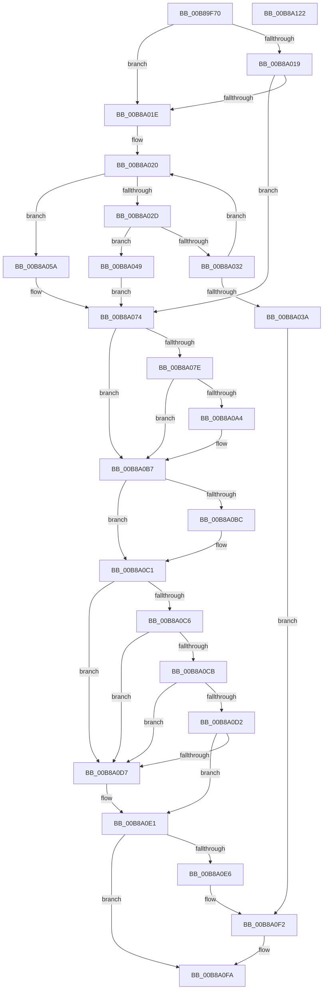

# ExpDebuggerWorker

- RVA: `0x00B89F70`–`0x00B8A123` (길이 `435` bytes)
- VA: `0x0000000140B89F70`
- 실행 섹션: `PAGEKD`
- PDB 이름 있음: `예`; PDB Function 태그: `아니요`
- unwind 정보 RVA: `0x000D5498`
- 디코드: `109`개 명령, `435/435` bytes 표시
- 미해석 바이트: `0` (있으면 어셈블리에 `.byte`로 보존)

> 이 문서는 커널 이미지의 기계어와 PDB 기호를 분석해 생성했습니다. 4번과 5번은 함수 원형과 자료형을 바이너리 사용 방식에서 추정한 C 해석이며 원본 소스 복구 결과는 아닙니다.

## 1. Dependencies

- 직접 호출 지점: **13**; 고유 호출 대상: **12**
- 직접 호출자로 확인된 함수: **0**
- RIP 상대 이미지 참조: **11**

### Outgoing calls
- `0x00B89FBF` → [KeQueryHeteroCpuPolicyThread](../../text/48/KeQueryHeteroCpuPolicyThread_function_00488A70.md) (function, `0x00488A70`)
- `0x00B8A00D` → [MmDbgMarkPfnModifiedWorker](../../text/68/MmDbgMarkPfnModifiedWorker_function_00686298.md) (function, `0x00686298`)
- `0x00B8A020` → [PsGetNextProcess](../../page/91/PsGetNextProcess_function_0091C900.md) (function, `0x0091C900`)
- `0x00B8A03F` → [PsTerminateProcess](../../page/90/PsTerminateProcess_function_00904C64.md) (function, `0x00904C64`)
- `0x00B8A053` → [KiStackAttachProcess](../../text/21/KiStackAttachProcess_function_00216820.md) (function, `0x00216820`)
- `0x00B8A06F` → [DbgPrintEx](../../text/35/DbgPrintEx_function_00359290.md) (function, `0x00359290`)
- `0x00B8A09B` → [MmPrefetchVirtualMemory](../../page/93/MmPrefetchVirtualMemory_function_0093A698.md) (function, `0x0093A698`)
- `0x00B8A0B2` → [DbgPrintEx](../../text/35/DbgPrintEx_function_00359290.md) (function, `0x00359290`)
- `0x00B8A0BC` → [EtwWmitraceWorker](../../page/7B/EtwWmitraceWorker_function_007BBD3C.md) (function, `0x007BBD3C`)
- `0x00B8A0DC` → [DbgBreakPointWithStatus](../../text/4F/DbgBreakPointWithStatus_function_004FE4E0.md) (function, `0x004FE4E0`)
- `0x00B8A0ED` → [KiUnstackDetachProcess](../../text/21/KiUnstackDetachProcess_function_00217D30.md) (function, `0x00217D30`)
- `0x00B8A0F5` → [PsQuitNextProcess](../../page/A8/PsQuitNextProcess_function_00A83210.md) (function, `0x00A83210`)
- `0x00B8A102` → [_security_check_cookie](../../text/6A/_security_check_cookie_function_006AC640.md) (function, `0x006AC640`)

### Direct callers
- 이 함수 시작 RVA로 연결되는 직접 call은 확인되지 않았습니다. 간접 호출은 완전히 역산할 수 없습니다.

### Static image references
- `0x00B89F89` → RVA `0x00E0A740` (`.data`; read)
- `0x00B89F98` → RVA `0x00EFAA80` (`.data`; read)
- `0x00B89FA2` → RVA `0x00EFAA98` (`.data`; read)
- `0x00B89FA9` → RVA `0x00EFF2A0` (`.data`; read)
- `0x00B89FC6` → RVA `0x00EFAA88` (`.data`; read)
- `0x00B89FE0` → RVA `0x00EFAA98` (`.data`; write)
- `0x00B89FF1` → RVA `0x00EFAA80` (`.data`; write)
- `0x00B89FFC` → RVA `0x00EFAA88` (`.data`; write)
- `0x00B8A007` → RVA `0x00E0EBC8` (`.data`; read/write)
- `0x00B8A05D` → RVA `0x00B8ADC0` (` ?? ::DFIOBLLK::`string'`; read)
- `0x00B8A0A7` → RVA `0x00B8AD80` (` ?? ::DFIOBLLK::`string'`; read)

## 2. Other-region calls and transfers

- 다른 실행 섹션으로 향하는 call: **13**
  - `0x00B89FBF` → [KeQueryHeteroCpuPolicyThread](../../text/48/KeQueryHeteroCpuPolicyThread_function_00488A70.md) (`PAGEKD` → `.text`)
  - `0x00B8A00D` → [MmDbgMarkPfnModifiedWorker](../../text/68/MmDbgMarkPfnModifiedWorker_function_00686298.md) (`PAGEKD` → `.text`)
  - `0x00B8A020` → [PsGetNextProcess](../../page/91/PsGetNextProcess_function_0091C900.md) (`PAGEKD` → `PAGE`)
  - `0x00B8A03F` → [PsTerminateProcess](../../page/90/PsTerminateProcess_function_00904C64.md) (`PAGEKD` → `PAGE`)
  - `0x00B8A053` → [KiStackAttachProcess](../../text/21/KiStackAttachProcess_function_00216820.md) (`PAGEKD` → `.text`)
  - `0x00B8A06F` → [DbgPrintEx](../../text/35/DbgPrintEx_function_00359290.md) (`PAGEKD` → `.text`)
  - `0x00B8A09B` → [MmPrefetchVirtualMemory](../../page/93/MmPrefetchVirtualMemory_function_0093A698.md) (`PAGEKD` → `PAGE`)
  - `0x00B8A0B2` → [DbgPrintEx](../../text/35/DbgPrintEx_function_00359290.md) (`PAGEKD` → `.text`)
  - `0x00B8A0BC` → [EtwWmitraceWorker](../../page/7B/EtwWmitraceWorker_function_007BBD3C.md) (`PAGEKD` → `PAGE`)
  - `0x00B8A0DC` → [DbgBreakPointWithStatus](../../text/4F/DbgBreakPointWithStatus_function_004FE4E0.md) (`PAGEKD` → `.text`)
  - `0x00B8A0ED` → [KiUnstackDetachProcess](../../text/21/KiUnstackDetachProcess_function_00217D30.md) (`PAGEKD` → `.text`)
  - `0x00B8A0F5` → [PsQuitNextProcess](../../page/A8/PsQuitNextProcess_function_00A83210.md) (`PAGEKD` → `PAGE`)
  - `0x00B8A102` → [_security_check_cookie](../../text/6A/_security_check_cookie_function_006AC640.md) (`PAGEKD` → `.text`)
- 별도 외부 분기/꼬리 이동을 확인하지 못했습니다.

## 3. Assembly (complete function range)

```asm
00B89F70  48 8B C4                        mov rax, rsp
00B89F73  48 89 58 08                     mov qword ptr [rax + 8], rbx
00B89F77  48 89 68 10                     mov qword ptr [rax + 0x10], rbp
00B89F7B  48 89 70 18                     mov qword ptr [rax + 0x18], rsi
00B89F7F  48 89 78 20                     mov qword ptr [rax + 0x20], rdi
00B89F83  41 56                           push r14
00B89F85  48 83 EC 70                     sub rsp, 0x70
00B89F89  48 8B 05 B0 07 28 00            mov rax, qword ptr [rip + 0x2807b0]
00B89F90  48 33 C4                        xor rax, rsp
00B89F93  48 89 44 24 60                  mov qword ptr [rsp + 0x60], rax
00B89F98  48 8B 35 E1 0A 37 00            mov rsi, qword ptr [rip + 0x370ae1]
00B89F9F  0F 57 C0                        xorps xmm0, xmm0
00B89FA2  48 8B 2D EF 0A 37 00            mov rbp, qword ptr [rip + 0x370aef]
00B89FA9  44 8A 35 F0 52 37 00            mov r14b, byte ptr [rip + 0x3752f0]
00B89FB0  0F 11 44 24 30                  movups xmmword ptr [rsp + 0x30], xmm0
00B89FB5  0F 11 44 24 40                  movups xmmword ptr [rsp + 0x40], xmm0
00B89FBA  0F 11 44 24 50                  movups xmmword ptr [rsp + 0x50], xmm0
00B89FBF  E8 AC EA 8F FF                  call 0x140488a70
00B89FC4  8B D8                           mov ebx, eax
00B89FC6  48 8B 05 BB 0A 37 00            mov rax, qword ptr [rip + 0x370abb]
00B89FCD  48 89 44 24 20                  mov qword ptr [rsp + 0x20], rax
00B89FD2  83 E3 07                        and ebx, 7
00B89FD5  48 C7 44 24 28 01 00 00 00      mov qword ptr [rsp + 0x28], 1
00B89FDE  33 C0                           xor eax, eax
00B89FE0  48 C7 05 AD 0A 37 00 00 00 00 00  mov qword ptr [rip + 0x370aad], 0
00B89FEB  81 CB B8 00 00 00               or ebx, 0xb8
00B89FF1  48 C7 05 84 0A 37 00 00 00 00 00  mov qword ptr [rip + 0x370a84], 0
00B89FFC  48 C7 05 81 0A 37 00 00 00 00 00  mov qword ptr [rip + 0x370a81], 0
00B8A007  87 05 BB 4B 28 00               xchg dword ptr [rip + 0x284bbb], eax
00B8A00D  E8 86 C2 AF FF                  call 0x140686298
00B8A012  33 FF                           xor edi, edi
00B8A014  48 85 F6                        test rsi, rsi
00B8A017  75 05                           jne 0x140b8a01e
00B8A019  48 85 ED                        test rbp, rbp
00B8A01C  74 56                           je 0x140b8a074
00B8A01E  33 C9                           xor ecx, ecx
00B8A020  E8 DB 28 D9 FF                  call 0x14091c900
00B8A025  48 8B F8                        mov rdi, rax
00B8A028  48 85 C0                        test rax, rax
00B8A02B  74 2D                           je 0x140b8a05a
00B8A02D  48 3B C6                        cmp rax, rsi
00B8A030  74 17                           je 0x140b8a049
00B8A032  48 8B C8                        mov rcx, rax
00B8A035  48 3B C5                        cmp rax, rbp
00B8A038  75 E6                           jne 0x140b8a020
00B8A03A  BA 04 00 01 40                  mov edx, 0x40010004
00B8A03F  E8 20 AC D7 FF                  call 0x140904c64
00B8A044  E9 A9 00 00 00                  jmp 0x140b8a0f2
00B8A049  4C 8D 44 24 30                  lea r8, [rsp + 0x30]
00B8A04E  33 D2                           xor edx, edx
00B8A050  48 8B CE                        mov rcx, rsi
00B8A053  E8 C8 C7 68 FF                  call 0x140216820
00B8A058  EB 1A                           jmp 0x140b8a074
00B8A05A  48 85 F6                        test rsi, rsi
00B8A05D  4C 8D 05 5C 0D 00 00            lea r8, [rip + 0xd5c]
00B8A064  4C 8B CE                        mov r9, rsi
00B8A067  4C 0F 44 CD                     cmove r9, rbp
00B8A06B  33 D2                           xor edx, edx
00B8A06D  33 C9                           xor ecx, ecx
00B8A06F  E8 1C F2 7C FF                  call 0x140359290
00B8A074  48 8B 44 24 20                  mov rax, qword ptr [rsp + 0x20]
00B8A079  48 85 C0                        test rax, rax
00B8A07C  74 39                           je 0x140b8a0b7
00B8A07E  48 B9 00 00 00 00 00 80 FF FF   movabs rcx, 0xffff800000000000
00B8A088  4C 8D 44 24 20                  lea r8, [rsp + 0x20]
00B8A08D  48 3B C1                        cmp rax, rcx
00B8A090  44 8B CB                        mov r9d, ebx
00B8A093  BA 01 00 00 00                  mov edx, 1
00B8A098  48 1B C9                        sbb rcx, rcx
00B8A09B  E8 F8 05 DB FF                  call 0x14093a698
00B8A0A0  85 C0                           test eax, eax
00B8A0A2  79 13                           jns 0x140b8a0b7
00B8A0A4  44 8B C8                        mov r9d, eax
00B8A0A7  4C 8D 05 D2 0C 00 00            lea r8, [rip + 0xcd2]
00B8A0AE  33 D2                           xor edx, edx
00B8A0B0  33 C9                           xor ecx, ecx
00B8A0B2  E8 D9 F1 7C FF                  call 0x140359290
00B8A0B7  45 84 F6                        test r14b, r14b
00B8A0BA  74 05                           je 0x140b8a0c1
00B8A0BC  E8 7B 1C C3 FF                  call 0x1407bbd3c
00B8A0C1  48 85 F6                        test rsi, rsi
00B8A0C4  75 11                           jne 0x140b8a0d7
00B8A0C6  48 85 ED                        test rbp, rbp
00B8A0C9  75 0C                           jne 0x140b8a0d7
00B8A0CB  48 39 6C 24 20                  cmp qword ptr [rsp + 0x20], rbp
00B8A0D0  75 05                           jne 0x140b8a0d7
00B8A0D2  45 84 F6                        test r14b, r14b
00B8A0D5  74 0A                           je 0x140b8a0e1
00B8A0D7  B9 07 00 00 00                  mov ecx, 7
00B8A0DC  E8 FF 43 97 FF                  call 0x1404fe4e0
00B8A0E1  48 85 FF                        test rdi, rdi
00B8A0E4  74 14                           je 0x140b8a0fa
00B8A0E6  33 D2                           xor edx, edx
00B8A0E8  48 8D 4C 24 30                  lea rcx, [rsp + 0x30]
00B8A0ED  E8 3E DC 68 FF                  call 0x140217d30
00B8A0F2  48 8B CF                        mov rcx, rdi
00B8A0F5  E8 16 91 EF FF                  call 0x140a83210
00B8A0FA  48 8B 4C 24 60                  mov rcx, qword ptr [rsp + 0x60]
00B8A0FF  48 33 CC                        xor rcx, rsp
00B8A102  E8 39 25 B2 FF                  call 0x1406ac640
00B8A107  4C 8D 5C 24 70                  lea r11, [rsp + 0x70]
00B8A10C  49 8B 5B 10                     mov rbx, qword ptr [r11 + 0x10]
00B8A110  49 8B 6B 18                     mov rbp, qword ptr [r11 + 0x18]
00B8A114  49 8B 73 20                     mov rsi, qword ptr [r11 + 0x20]
00B8A118  49 8B 7B 28                     mov rdi, qword ptr [r11 + 0x28]
00B8A11C  49 8B E3                        mov rsp, r11
00B8A11F  41 5E                           pop r14
00B8A121  C3                              ret
00B8A122  CC                              int3
```

## 4. C-style interpretation (structured pseudocode)

```c
__int64 __fastcall ExpDebuggerWorker(int a1)
{
    __int64 result;
    __int64 v_rbx;
    __int64 v_rdi;
    __int64 v_rsp;
    unsigned __int64 v_stack_m18;
    unsigned __int64 v_stack_m28;
    unsigned __int64 v_stack_m38;
    unsigned __int64 v_stack_m48;
    unsigned __int64 v_stack_m50;
    unsigned __int64 v_stack_m58;
    unsigned __int64 v_stack_m8;

    *(unsigned __int64 *)(v_rsp + 8) = v_rbx;
    *(unsigned __int64 *)(v_rsp + 16) = v_rbp;
    *(unsigned __int64 *)(v_rsp + 24) = v_rsi;
    *(unsigned __int64 *)(v_rsp + 32) = v_rdi;
    v_rsp = (v_rsp) - (112);
    result = (*(unsigned __int64 *)(v_rip + 2623408)) ^ (v_rsp);
    v_stack_m18 = result;
    v_stack_m48 = v_xmm0;
    v_stack_m38 = v_xmm0;
    v_stack_m28 = v_xmm0;
    result = KeQueryHeteroCpuPolicyThread(a1, a2, a3, a4);
    v_stack_m58 = *(unsigned __int64 *)(v_rip + 3607227);
    v_rbx = (unsigned int)(((unsigned int)((unsigned int)(result))) & (7));
    v_stack_m50 = 1;
    result = 0;
    *(unsigned __int64 *)(v_rip + 3607213) = 0;
    v_rbx = (unsigned int)((v_rbx) | (184));
    *(unsigned __int64 *)(v_rip + 3607172) = 0;
    *(unsigned __int64 *)(v_rip + 3607169) = 0;
    result = MmDbgMarkPfnModifiedWorker(a1, a2, a3, a4);
    v_rdi = 0;
    if (*(unsigned __int64 *)(v_rip + 3607265) != 0) goto loc_00B8A01E;
    if (*(unsigned __int64 *)(v_rip + 3607279) == 0) goto loc_00B8A074;
loc_00B8A01E:
    a1 = 0;
loc_00B8A020:
    result = PsGetNextProcess(a1, a2, a3, a4);
    if (result == 0) goto loc_00B8A05A;
    if (result == (*(unsigned __int64 *)(v_rip + 3607265))) goto loc_00B8A049;
    if (result != (*(unsigned __int64 *)(v_rip + 3607279))) goto loc_00B8A020;
    result = PsTerminateProcess(result, (unsigned int)(0x40010004ULL), a3, a4);
    goto loc_00B8A0F2;
loc_00B8A049:
    a2 = 0;
    result = KiStackAttachProcess(*(unsigned __int64 *)(v_rip + 3607265), a2, v_stack_m48, a4);
    goto loc_00B8A074;
loc_00B8A05A:
    a4 = *(unsigned __int64 *)(v_rip + 3607265);
    if (*(unsigned __int64 *)(v_rip + 3607265) == 0) { a4 = *(unsigned __int64 *)(v_rip + 3607279); }
    a2 = 0;
    a1 = 0;
    result = DbgPrintEx(a1, a2, v_rip + 3420, a4);
loc_00B8A074:
    if (v_stack_m58 == 0) goto loc_00B8A0B7;
    result = MmPrefetchVirtualMemory(a1, 1, v_stack_m58, (unsigned int)((unsigned int)(v_rbx)));
    if (sign_flag) {
        a4 = (unsigned int)(result);
        a3 = v_rip + 3282;
        a2 = 0;
        a1 = 0;
        result = DbgPrintEx(a1, a2, a3, a4);
    }
    if ((unsigned __int8)(*(unsigned __int8 *)(v_rip + 3625712)) != 0) {
        result = EtwWmitraceWorker(a1, a2, a3, a4);
    }
    if (*(unsigned __int64 *)(v_rip + 3607265) != 0) goto loc_00B8A0D7;
    if (*(unsigned __int64 *)(v_rip + 3607279) != 0) goto loc_00B8A0D7;
    if (v_stack_m58 != (*(unsigned __int64 *)(v_rip + 3607279))) goto loc_00B8A0D7;
    if ((unsigned __int8)(*(unsigned __int8 *)(v_rip + 3625712)) != 0) {
        a1 = 7;
        result = DbgBreakPointWithStatus(a1, a2, a3, a4);
    }
    if (result == 0) goto loc_00B8A0FA;
    a2 = 0;
    result = KiUnstackDetachProcess(v_stack_m48, a2, a3, a4);
loc_00B8A0F2:
    result = PsQuitNextProcess(result, a2, a3, a4);
loc_00B8A0FA:
    a1 = (v_stack_m18) ^ (v_rsp);
    result = _security_check_cookie(a1, a2, a3, a4);
    return result;
}
```

## 5. (Beta) C Style

```c
int64_t ExpDebuggerWorker(int32_t Arg1)
{
    int64_t result;
    int64_t local_rbx;
    int64_t local_rdi;
    int64_t local_rsp;
    uint64_t v_stack_m18;
    uint64_t v_stack_m28;
    uint64_t v_stack_m38;
    uint64_t v_stack_m48;
    uint64_t v_stack_m50;
    uint64_t v_stack_m58;
    uint64_t v_stack_m8;

    *(uint64_t *)(local_rsp + 0x8) = local_rbx;
    *(uint64_t *)(local_rsp + 0x10) = local_rbp;
    *(uint64_t *)(local_rsp + 0x18) = local_rsi;
    *(uint64_t *)(local_rsp + 0x20) = local_rdi;
    local_rsp = (local_rsp) - (112);
    result = (*(uint64_t *)(v_rip + 0x2807B0)) ^ (local_rsp);
    v_stack_m18 = result;
    v_stack_m48 = v_xmm0;
    v_stack_m38 = v_xmm0;
    v_stack_m28 = v_xmm0;
    result = KeQueryHeteroCpuPolicyThread(Arg1, a2, a3, a4);
    v_stack_m58 = *(uint64_t *)(v_rip + 0x370ABB);
    local_rbx = (uint32_t)(((uint32_t)((uint32_t)(result))) & (7));
    v_stack_m50 = 1;
    result = 0;
    *(uint64_t *)(v_rip + 0x370AAD) = 0;
    local_rbx = (uint32_t)((local_rbx) | (184));
    *(uint64_t *)(v_rip + 0x370A84) = 0;
    *(uint64_t *)(v_rip + 0x370A81) = 0;
    result = MmDbgMarkPfnModifiedWorker(Arg1, a2, a3, a4);
    local_rdi = 0;
    if (*(uint64_t *)(v_rip + 0x370AE1) != 0) goto loc_00B8A01E;
    if (*(uint64_t *)(v_rip + 0x370AEF) == 0) goto loc_00B8A074;
loc_00B8A01E:
    Arg1 = 0;
loc_00B8A020:
    result = PsGetNextProcess(Arg1, a2, a3, a4);
    if (result == 0) goto loc_00B8A05A;
    if (result == (*(uint64_t *)(v_rip + 0x370AE1))) goto loc_00B8A049;
    if (result != (*(uint64_t *)(v_rip + 0x370AEF))) goto loc_00B8A020;
    result = PsTerminateProcess(result, (uint32_t)(0x40010004ULL), a3, a4);
    goto loc_00B8A0F2;
loc_00B8A049:
    a2 = 0;
    result = KiStackAttachProcess(*(uint64_t *)(v_rip + 0x370AE1), a2, v_stack_m48, a4);
    goto loc_00B8A074;
loc_00B8A05A:
    a4 = *(uint64_t *)(v_rip + 0x370AE1);
    if (*(uint64_t *)(v_rip + 0x370AE1) == 0) { a4 = *(uint64_t *)(v_rip + 0x370AEF); }
    a2 = 0;
    Arg1 = 0;
    result = DbgPrintEx(Arg1, a2, v_rip + 3420, a4);
loc_00B8A074:
    if (v_stack_m58 == 0) goto loc_00B8A0B7;
    result = MmPrefetchVirtualMemory(Arg1, 1, v_stack_m58, (uint32_t)((uint32_t)(local_rbx)));
    if (sign_flag) {
        a4 = (uint32_t)(result);
        a3 = v_rip + 3282;
        a2 = 0;
        Arg1 = 0;
        result = DbgPrintEx(Arg1, a2, a3, a4);
    }
    if ((uint8_t)(*(uint8_t *)(v_rip + 0x3752F0)) != 0) {
        result = EtwWmitraceWorker(Arg1, a2, a3, a4);
    }
    if (*(uint64_t *)(v_rip + 0x370AE1) != 0) goto loc_00B8A0D7;
    if (*(uint64_t *)(v_rip + 0x370AEF) != 0) goto loc_00B8A0D7;
    if (v_stack_m58 != (*(uint64_t *)(v_rip + 0x370AEF))) goto loc_00B8A0D7;
    if ((uint8_t)(*(uint8_t *)(v_rip + 0x3752F0)) != 0) {
        Arg1 = 7;
        result = DbgBreakPointWithStatus(Arg1, a2, a3, a4);
    }
    if (result == 0) goto loc_00B8A0FA;
    a2 = 0;
    result = KiUnstackDetachProcess(v_stack_m48, a2, a3, a4);
loc_00B8A0F2:
    result = PsQuitNextProcess(result, a2, a3, a4);
loc_00B8A0FA:
    Arg1 = (v_stack_m18) ^ (local_rsp);
    result = _security_check_cookie(Arg1, a2, a3, a4);
    return result;
}
```

## 6. Execution-region graph

[열기: 2D/3D 그래프와 함수 탐색 컨트롤 패널](../../../control-panel.html?section=pagekd&rva=0x00B89F70&view=graph)

- 2D 그래프는 위에서 아래로 흐르고, 3D 그래프는 빈 공간을 드래그해 회전합니다. Shift+드래그는 이동, 휠은 확대·축소, 함수 노드 선택은 대상 보고서 이동입니다.

### Static fallback


