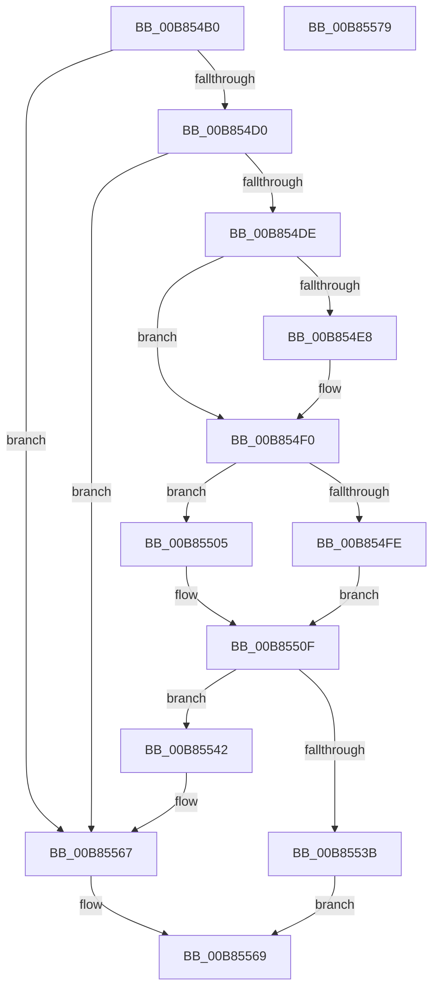

# HalpAllocateScratchMemory

- RVA: `0x00B854B0`–`0x00B8557A` (길이 `202` bytes)
- VA: `0x0000000140B854B0`
- 실행 섹션: `PAGEKD`
- PDB 이름 있음: `예`; PDB Function 태그: `아니요`
- unwind 정보 RVA: `0x0008E1D0`
- 디코드: `49`개 명령, `202/202` bytes 표시
- 미해석 바이트: `0` (있으면 어셈블리에 `.byte`로 보존)

> 이 문서는 커널 이미지의 기계어와 PDB 기호를 분석해 생성했습니다. 4번과 5번은 함수 원형과 자료형을 바이너리 사용 방식에서 추정한 C 해석이며 원본 소스 복구 결과는 아닙니다.

## 1. Dependencies

- 직접 호출 지점: **2**; 고유 호출 대상: **2**
- 직접 호출자로 확인된 함수: **1**
- RIP 상대 이미지 참조: **0**

### Outgoing calls
- `0x00B8552E` → [HalpAllocPhysicalMemory](../../init/BE/HalpAllocPhysicalMemory_function_00BEF210.md) (function, `0x00BEF210`)
- `0x00B85550` → [HalpMapPhysicalMemory64](../../text/3F/HalpMapPhysicalMemory64_function_003F88C8.md) (function, `0x003F88C8`)

### Direct callers
- [HalpKdSetupDebuggingDevice](HalpKdSetupDebuggingDevice_function_00B85A80.md) at `0x00B85B00`

### Static image references
- 디코드된 RIP-relative 메모리 참조가 없습니다.

## 2. Other-region calls and transfers

- 다른 실행 섹션으로 향하는 call: **2**
  - `0x00B8552E` → [HalpAllocPhysicalMemory](../../init/BE/HalpAllocPhysicalMemory_function_00BEF210.md) (`PAGEKD` → `INIT`)
  - `0x00B85550` → [HalpMapPhysicalMemory64](../../text/3F/HalpMapPhysicalMemory64_function_003F88C8.md) (`PAGEKD` → `.text`)
- 별도 외부 분기/꼬리 이동을 확인하지 못했습니다.

## 3. Assembly (complete function range)

```asm
00B854B0  48 89 5C 24 08                  mov qword ptr [rsp + 8], rbx
00B854B5  48 89 74 24 18                  mov qword ptr [rsp + 0x18], rsi
00B854BA  57                              push rdi
00B854BB  48 83 EC 20                     sub rsp, 0x20
00B854BF  48 8B FA                        mov rdi, rdx
00B854C2  8B 92 C0 00 00 00               mov edx, dword ptr [rdx + 0xc0]
00B854C8  85 D2                           test edx, edx
00B854CA  0F 84 97 00 00 00               je 0x140b85567
00B854D0  48 83 BF B8 00 00 00 00         cmp qword ptr [rdi + 0xb8], 0
00B854D8  0F 85 89 00 00 00               jne 0x140b85567
00B854DE  48 83 BF B0 00 00 00 00         cmp qword ptr [rdi + 0xb0], 0
00B854E6  75 08                           jne 0x140b854f0
00B854E8  48 83 8F B0 00 00 00 FF         or qword ptr [rdi + 0xb0], 0xffffffffffffffff
00B854F0  83 64 24 3C 00                  and dword ptr [rsp + 0x3c], 0
00B854F5  83 BF B4 00 00 00 00            cmp dword ptr [rdi + 0xb4], 0
00B854FC  74 07                           je 0x140b85505
00B854FE  83 4C 24 38 FF                  or dword ptr [rsp + 0x38], 0xffffffff
00B85503  EB 0A                           jmp 0x140b8550f
00B85505  8B 87 B0 00 00 00               mov eax, dword ptr [rdi + 0xb0]
00B8550B  89 44 24 38                     mov dword ptr [rsp + 0x38], eax
00B8550F  F7 C2 FF 0F 00 00               test edx, 0xfff
00B85515  BE 00 00 00 00                  mov esi, 0
00B8551A  40 0F 95 C6                     setne sil
00B8551E  C1 EA 0C                        shr edx, 0xc
00B85521  03 F2                           add esi, edx
00B85523  45 33 C9                        xor r9d, r9d
00B85526  44 8B C6                        mov r8d, esi
00B85529  48 8D 54 24 38                  lea rdx, [rsp + 0x38]
00B8552E  E8 DD 9C 06 00                  call 0x140bef210
00B85533  48 8B D8                        mov rbx, rax
00B85536  48 85 C0                        test rax, rax
00B85539  75 07                           jne 0x140b85542
00B8553B  B8 9A 00 00 C0                  mov eax, 0xc000009a
00B85540  EB 27                           jmp 0x140b85569
00B85542  41 B9 04 00 00 00               mov r9d, 4
00B85548  45 33 C0                        xor r8d, r8d
00B8554B  8B D6                           mov edx, esi
00B8554D  48 8B CB                        mov rcx, rbx
00B85550  E8 73 33 87 FF                  call 0x1403f88c8
00B85555  80 4F 11 01                     or byte ptr [rdi + 0x11], 1
00B85559  48 89 87 B8 00 00 00            mov qword ptr [rdi + 0xb8], rax
00B85560  48 89 9F A8 00 00 00            mov qword ptr [rdi + 0xa8], rbx
00B85567  33 C0                           xor eax, eax
00B85569  48 8B 5C 24 30                  mov rbx, qword ptr [rsp + 0x30]
00B8556E  48 8B 74 24 40                  mov rsi, qword ptr [rsp + 0x40]
00B85573  48 83 C4 20                     add rsp, 0x20
00B85577  5F                              pop rdi
00B85578  C3                              ret
00B85579  CC                              int3
```

## 4. C-style interpretation (structured pseudocode)

```c
__int64 __fastcall HalpAllocateScratchMemory(__int64 a1, __int64 a2, __int64 a3, int a4)
{
    __int64 result;
    __int64 v_rsi;
    __int64 v_rsp;
    unsigned int v_stack_p10;
    unsigned int v_stack_p14;
    unsigned __int64 v_stack_p18;
    unsigned __int64 v_stack_p8;

    v_stack_p8 = v_rbx;
    v_stack_p18 = v_rsi;
    v_rsp = (v_rsp) - (32);
    if ((unsigned int)((unsigned int)(*(unsigned int *)(a2 + 192))) == 0) goto loc_00B85567;
    if ((*(unsigned __int64 *)(a2 + 184)) != 0) goto loc_00B85567;
    if ((*(unsigned __int64 *)(a2 + 176)) == 0) {
    }
    if ((*(unsigned int *)(a2 + 180)) == 0) goto loc_00B85505;
    goto loc_00B8550F;
loc_00B85505:
    v_stack_p10 = (unsigned int)((unsigned int)(*(unsigned int *)(a2 + 176)));
loc_00B8550F:
    v_rsi = ((((unsigned int)((unsigned int)(*(unsigned int *)(a2 + 192)))) & (0xFFFULL)) != 0) ? 1 : 0;
    a2 = (unsigned int)(((unsigned int)(*(unsigned int *)(a2 + 192))) >> (12));
    v_rsi = (unsigned int)((v_rsi) + ((unsigned int)(a2)));
    a4 = 0;
    result = HalpAllocPhysicalMemory(a1, v_stack_p10, (unsigned int)((unsigned int)(v_rsi)), a4);
    if (result != 0) goto loc_00B85542;
    goto loc_00B85569;
loc_00B85542:
    a3 = 0;
    result = HalpMapPhysicalMemory64(result, (unsigned int)((unsigned int)(v_rsi)), a3, 4);
    *(unsigned __int64 *)(a2 + 184) = result;
    *(unsigned __int64 *)(a2 + 168) = result;
loc_00B85567:
    result = 0;
loc_00B85569:
    v_rsp = (v_rsp) + (32);
    return result;
}
```

## 5. (Beta) C Style

```c
int64_t HalpAllocateScratchMemory(int64_t Arg1, void *Arg2, int64_t Arg3, int32_t Arg4)
{
    uint8_t *arg2 = (uint8_t *)Arg2;

    int64_t result;
    int64_t local_rsi;
    int64_t local_rsp;
    uint32_t v_stack_p10;
    uint32_t v_stack_p14;
    uint64_t v_stack_p18;
    uint64_t v_stack_p8;

    v_stack_p8 = local_rbx;
    v_stack_p18 = local_rsi;
    local_rsp = (local_rsp) - (32);
    if ((uint32_t)((uint32_t)(*(uint32_t *)(arg2 + 0xC0))) == 0) goto loc_00B85567;
    if ((*(uint64_t *)(arg2 + 0xB8)) != 0) goto loc_00B85567;
    if ((*(uint64_t *)(arg2 + 0xB0)) == 0) {
    }
    if ((*(uint32_t *)(arg2 + 0xB4)) == 0) goto loc_00B85505;
    goto loc_00B8550F;
loc_00B85505:
    v_stack_p10 = (uint32_t)((uint32_t)(*(uint32_t *)(arg2 + 0xB0)));
loc_00B8550F:
    local_rsi = ((((uint32_t)((uint32_t)(*(uint32_t *)(arg2 + 0xC0)))) & (0xFFFULL)) != 0) ? 1 : 0;
    Arg2 = (uint32_t)(((uint32_t)(*(uint32_t *)(arg2 + 0xC0))) >> (12));
    local_rsi = (uint32_t)((local_rsi) + ((uint32_t)(Arg2)));
    Arg4 = 0;
    result = HalpAllocPhysicalMemory(Arg1, v_stack_p10, (uint32_t)((uint32_t)(local_rsi)), Arg4);
    if (result != 0) goto loc_00B85542;
    goto loc_00B85569;
loc_00B85542:
    Arg3 = 0;
    result = HalpMapPhysicalMemory64(result, (uint32_t)((uint32_t)(local_rsi)), Arg3, 4);
    *(uint64_t *)(arg2 + 0xB8) = result;
    *(uint64_t *)(arg2 + 0xA8) = result;
loc_00B85567:
    result = 0;
loc_00B85569:
    local_rsp = (local_rsp) + (32);
    return result;
}
```

### 관측된 메모리 오프셋

구조체 형식이 확인되지 않은 접근은 인자 기준의 오프셋으로만 기록했습니다.

| 기준 인자 | 오프셋 표현 | 폭 (bit) | 접근 |
|---|---:|---:|---|
| `Arg2` | `+ 0x11` | `8` | `R/W` |
| `Arg2` | `+ 0xA8` | `64` | `W` |
| `Arg2` | `+ 0xB0` | `32` | `R` |
| `Arg2` | `+ 0xB0` | `64` | `R` |
| `Arg2` | `+ 0xB0` | `64` | `R/W` |
| `Arg2` | `+ 0xB4` | `32` | `R` |
| `Arg2` | `+ 0xB8` | `64` | `R` |
| `Arg2` | `+ 0xB8` | `64` | `W` |
| `Arg2` | `+ 0xC0` | `32` | `R` |

## 6. Execution-region graph

[열기: 2D/3D 그래프와 함수 탐색 컨트롤 패널](../../../control-panel.html?section=pagekd&rva=0x00B854B0&view=graph)

- 2D 그래프는 위에서 아래로 흐르고, 3D 그래프는 빈 공간을 드래그해 회전합니다. Shift+드래그는 이동, 휠은 확대·축소, 함수 노드 선택은 대상 보고서 이동입니다.

### Static fallback


