# HalpDeviceEquals

- RVA: `0x00B85580`–`0x00B85768` (길이 `488` bytes)
- VA: `0x0000000140B85580`
- 실행 섹션: `PAGEKD`
- PDB 이름 있음: `예`; PDB Function 태그: `아니요`
- unwind 정보 RVA: `0x0005E6B4`
- 디코드: `151`개 명령, `488/488` bytes 표시
- 미해석 바이트: `0` (있으면 어셈블리에 `.byte`로 보존)

> 이 문서는 커널 이미지의 기계어와 PDB 기호를 분석해 생성했습니다. 4번과 5번은 함수 원형과 자료형을 바이너리 사용 방식에서 추정한 C 해석이며 원본 소스 복구 결과는 아닙니다.

## 1. Dependencies

- 직접 호출 지점: **1**; 고유 호출 대상: **1**
- 직접 호출자로 확인된 함수: **1**
- RIP 상대 이미지 참조: **1**

### Outgoing calls
- `0x00B856E3` → [wcsncmp](../../text/50/wcsncmp_function_00501CA0.md) (function, `0x00501CA0`)

### Direct callers
- [HalpKdEnumerateDebuggingDevices](HalpKdEnumerateDebuggingDevices_function_00B85850.md) at `0x00B85893`

### Static image references
- `0x00B85599` → RVA `0x00FC19A0` (`.data`; read)

## 2. Other-region calls and transfers

- 다른 실행 섹션으로 향하는 call: **1**
  - `0x00B856E3` → [wcsncmp](../../text/50/wcsncmp_function_00501CA0.md) (`PAGEKD` → `.text`)
- 별도 외부 분기/꼬리 이동을 확인하지 못했습니다.

## 3. Assembly (complete function range)

```asm
00B85580  48 8B C4                        mov rax, rsp
00B85583  48 89 58 08                     mov qword ptr [rax + 8], rbx
00B85587  48 89 68 10                     mov qword ptr [rax + 0x10], rbp
00B8558B  48 89 70 18                     mov qword ptr [rax + 0x18], rsi
00B8558F  48 89 78 20                     mov qword ptr [rax + 0x20], rdi
00B85593  41 56                           push r14
00B85595  48 83 EC 20                     sub rsp, 0x20
00B85599  48 8B 1D 00 C4 43 00            mov rbx, qword ptr [rip + 0x43c400]
00B855A0  48 8B FA                        mov rdi, rdx
00B855A3  8B 93 DC 00 00 00               mov edx, dword ptr [rbx + 0xdc]
00B855A9  8B B7 DC 00 00 00               mov esi, dword ptr [rdi + 0xdc]
00B855AF  83 FA 02                        cmp edx, 2
00B855B2  74 0F                           je 0x140b855c3
00B855B4  83 FE 02                        cmp esi, 2
00B855B7  74 08                           je 0x140b855c1
00B855B9  3B D6                           cmp edx, esi
00B855BB  0F 85 89 01 00 00               jne 0x140b8574a
00B855C1  8B F2                           mov esi, edx
00B855C3  41 83 C9 FF                     or r9d, 0xffffffff
00B855C7  BD 01 00 00 00                  mov ebp, 1
00B855CC  F7 C6 FD FF FF FF               test esi, 0xfffffffd
00B855D2  75 7B                           jne 0x140b8564f
00B855D4  8A 43 0E                        mov al, byte ptr [rbx + 0xe]
00B855D7  41 B0 FF                        mov r8b, 0xff
00B855DA  8A 4F 0E                        mov cl, byte ptr [rdi + 0xe]
00B855DD  3A C1                           cmp al, cl
00B855DF  74 14                           je 0x140b855f5
00B855E1  41 3A C0                        cmp al, r8b
00B855E4  74 09                           je 0x140b855ef
00B855E6  41 3A C8                        cmp cl, r8b
00B855E9  74 04                           je 0x140b855ef
00B855EB  33 C0                           xor eax, eax
00B855ED  EB 02                           jmp 0x140b855f1
00B855EF  8B C5                           mov eax, ebp
00B855F1  85 C0                           test eax, eax
00B855F3  74 5A                           je 0x140b8564f
00B855F5  8A 43 0F                        mov al, byte ptr [rbx + 0xf]
00B855F8  8A 4F 0F                        mov cl, byte ptr [rdi + 0xf]
00B855FB  3A C1                           cmp al, cl
00B855FD  74 14                           je 0x140b85613
00B855FF  41 3A C0                        cmp al, r8b
00B85602  74 09                           je 0x140b8560d
00B85604  41 3A C8                        cmp cl, r8b
00B85607  74 04                           je 0x140b8560d
00B85609  33 C0                           xor eax, eax
00B8560B  EB 02                           jmp 0x140b8560f
00B8560D  8B C5                           mov eax, ebp
00B8560F  85 C0                           test eax, eax
00B85611  74 3C                           je 0x140b8564f
00B85613  8B 03                           mov eax, dword ptr [rbx]
00B85615  8B 0F                           mov ecx, dword ptr [rdi]
00B85617  3B C1                           cmp eax, ecx
00B85619  74 14                           je 0x140b8562f
00B8561B  41 3B C1                        cmp eax, r9d
00B8561E  74 09                           je 0x140b85629
00B85620  41 3B C9                        cmp ecx, r9d
00B85623  74 04                           je 0x140b85629
00B85625  33 C0                           xor eax, eax
00B85627  EB 02                           jmp 0x140b8562b
00B85629  8B C5                           mov eax, ebp
00B8562B  85 C0                           test eax, eax
00B8562D  74 20                           je 0x140b8564f
00B8562F  8B 43 04                        mov eax, dword ptr [rbx + 4]
00B85632  8B 4F 04                        mov ecx, dword ptr [rdi + 4]
00B85635  3B C1                           cmp eax, ecx
00B85637  0F 84 06 01 00 00               je 0x140b85743
00B8563D  41 3B C1                        cmp eax, r9d
00B85640  0F 84 FD 00 00 00               je 0x140b85743
00B85646  41 3B C9                        cmp ecx, r9d
00B85649  0F 84 F4 00 00 00               je 0x140b85743
00B8564F  41 BE FF FF 00 00               mov r14d, 0xffff
00B85655  3B D5                           cmp edx, ebp
00B85657  74 09                           je 0x140b85662
00B85659  83 FE 02                        cmp esi, 2
00B8565C  0F 85 8A 00 00 00               jne 0x140b856ec
00B85662  0F B7 83 CC 00 00 00            movzx eax, word ptr [rbx + 0xcc]
00B85669  0F B7 8F CC 00 00 00            movzx ecx, word ptr [rdi + 0xcc]
00B85670  66 3B C1                        cmp ax, cx
00B85673  74 16                           je 0x140b8568b
00B85675  66 41 3B C6                     cmp ax, r14w
00B85679  74 0A                           je 0x140b85685
00B8567B  66 41 3B CE                     cmp cx, r14w
00B8567F  74 04                           je 0x140b85685
00B85681  33 C0                           xor eax, eax
00B85683  EB 02                           jmp 0x140b85687
00B85685  8B C5                           mov eax, ebp
00B85687  85 C0                           test eax, eax
00B85689  74 61                           je 0x140b856ec
00B8568B  0F B7 83 CE 00 00 00            movzx eax, word ptr [rbx + 0xce]
00B85692  0F B7 8F CE 00 00 00            movzx ecx, word ptr [rdi + 0xce]
00B85699  66 3B C1                        cmp ax, cx
00B8569C  74 16                           je 0x140b856b4
00B8569E  66 41 3B C6                     cmp ax, r14w
00B856A2  74 0A                           je 0x140b856ae
00B856A4  66 41 3B CE                     cmp cx, r14w
00B856A8  74 04                           je 0x140b856ae
00B856AA  33 C0                           xor eax, eax
00B856AC  EB 02                           jmp 0x140b856b0
00B856AE  8B C5                           mov eax, ebp
00B856B0  85 C0                           test eax, eax
00B856B2  74 38                           je 0x140b856ec
00B856B4  8B 83 E8 00 00 00               mov eax, dword ptr [rbx + 0xe8]
00B856BA  41 3B C1                        cmp eax, r9d
00B856BD  0F 84 80 00 00 00               je 0x140b85743
00B856C3  8B 8F E8 00 00 00               mov ecx, dword ptr [rdi + 0xe8]
00B856C9  41 3B C9                        cmp ecx, r9d
00B856CC  74 75                           je 0x140b85743
00B856CE  3B C1                           cmp eax, ecx
00B856D0  75 1A                           jne 0x140b856ec
00B856D2  48 8B 97 E0 00 00 00            mov rdx, qword ptr [rdi + 0xe0]
00B856D9  44 8B C0                        mov r8d, eax
00B856DC  48 8B 8B E0 00 00 00            mov rcx, qword ptr [rbx + 0xe0]
00B856E3  E8 B8 C5 97 FF                  call 0x140501ca0
00B856E8  85 C0                           test eax, eax
00B856EA  74 57                           je 0x140b85743
00B856EC  32 C9                           xor cl, cl
00B856EE  83 FE 03                        cmp esi, 3
00B856F1  75 53                           jne 0x140b85746
00B856F3  8B 87 DC 00 00 00               mov eax, dword ptr [rdi + 0xdc]
00B856F9  39 83 DC 00 00 00               cmp dword ptr [rbx + 0xdc], eax
00B856FF  75 45                           jne 0x140b85746
00B85701  0F B7 83 CC 00 00 00            movzx eax, word ptr [rbx + 0xcc]
00B85708  0F B7 8F CC 00 00 00            movzx ecx, word ptr [rdi + 0xcc]
00B8570F  66 3B C1                        cmp ax, cx
00B85712  74 0C                           je 0x140b85720
00B85714  66 41 3B C6                     cmp ax, r14w
00B85718  74 06                           je 0x140b85720
00B8571A  66 41 3B CE                     cmp cx, r14w
00B8571E  75 1F                           jne 0x140b8573f
00B85720  0F B7 8B CE 00 00 00            movzx ecx, word ptr [rbx + 0xce]
00B85727  0F B7 87 CE 00 00 00            movzx eax, word ptr [rdi + 0xce]
00B8572E  66 3B C8                        cmp cx, ax
00B85731  74 10                           je 0x140b85743
00B85733  66 41 3B CE                     cmp cx, r14w
00B85737  74 0A                           je 0x140b85743
00B85739  66 41 3B C6                     cmp ax, r14w
00B8573D  74 04                           je 0x140b85743
00B8573F  32 C9                           xor cl, cl
00B85741  EB 03                           jmp 0x140b85746
00B85743  40 8A CD                        mov cl, bpl
00B85746  8A C1                           mov al, cl
00B85748  EB 02                           jmp 0x140b8574c
00B8574A  32 C0                           xor al, al
00B8574C  48 8B 5C 24 30                  mov rbx, qword ptr [rsp + 0x30]
00B85751  48 8B 6C 24 38                  mov rbp, qword ptr [rsp + 0x38]
00B85756  48 8B 74 24 40                  mov rsi, qword ptr [rsp + 0x40]
00B8575B  48 8B 7C 24 48                  mov rdi, qword ptr [rsp + 0x48]
00B85760  48 83 C4 20                     add rsp, 0x20
00B85764  41 5E                           pop r14
00B85766  C3                              ret
00B85767  CC                              int3
```

## 4. C-style interpretation (structured pseudocode)

```c
__int64 __fastcall HalpDeviceEquals(__int64 a1, __int64 a2, __int64 a3, int a4)
{
    __int64 result;
    __int64 v_rsp;
    unsigned __int64 v_stack_p10;
    unsigned __int64 v_stack_p18;
    unsigned __int64 v_stack_p20;
    unsigned __int64 v_stack_p8;

    *(unsigned __int64 *)(v_rsp + 8) = v_rbx;
    *(unsigned __int64 *)(v_rsp + 16) = v_rbp;
    *(unsigned __int64 *)(v_rsp + 24) = v_rsi;
    *(unsigned __int64 *)(v_rsp + 32) = v_rdi;
    v_rsp = (v_rsp) - (32);
    if (((unsigned int)((unsigned int)(*(unsigned int *)(*(unsigned __int64 *)(v_rip + 4441088) + 220)))) == 2) goto loc_00B855C3;
    if (((unsigned int)((unsigned int)(*(unsigned int *)(a2 + 220)))) == 2) goto loc_00B855C1;
    if (((unsigned int)((unsigned int)(*(unsigned int *)(*(unsigned __int64 *)(v_rip + 4441088) + 220)))) != ((unsigned int)((unsigned int)(*(unsigned int *)(a2 + 220))))) goto loc_00B8574A;
loc_00B855C1:
loc_00B855C3:
    a4 = (unsigned int)((a4) | (0xFFFFFFFFULL));
    if ((((unsigned int)((unsigned int)((unsigned int)((unsigned int)(*(unsigned int *)(*(unsigned __int64 *)(v_rip + 4441088) + 220)))))) & (0xFFFFFFFDULL)) != 0) goto loc_00B8564F;
    if (((unsigned __int8)(*(unsigned __int8 *)(*(unsigned __int64 *)(v_rip + 4441088) + 14))) == ((unsigned __int8)(*(unsigned __int8 *)(a2 + 14)))) goto loc_00B855F5;
    if (((unsigned __int8)(*(unsigned __int8 *)(*(unsigned __int64 *)(v_rip + 4441088) + 14))) == 255) goto loc_00B855EF;
    if (((unsigned __int8)(*(unsigned __int8 *)(a2 + 14))) == 255) goto loc_00B855EF;
    result = 0;
    goto loc_00B855F1;
loc_00B855EF:
loc_00B855F1:
    if (1 == 0) goto loc_00B8564F;
loc_00B855F5:
    if (((unsigned __int8)(*(unsigned __int8 *)(*(unsigned __int64 *)(v_rip + 4441088) + 15))) == ((unsigned __int8)(*(unsigned __int8 *)(a2 + 15)))) goto loc_00B85613;
    if (((unsigned __int8)(*(unsigned __int8 *)(*(unsigned __int64 *)(v_rip + 4441088) + 15))) == 255) goto loc_00B8560D;
    if (((unsigned __int8)(*(unsigned __int8 *)(a2 + 15))) == 255) goto loc_00B8560D;
    result = 0;
    goto loc_00B8560F;
loc_00B8560D:
loc_00B8560F:
    if (1 == 0) goto loc_00B8564F;
loc_00B85613:
    if (((unsigned int)((unsigned int)(*(unsigned int *)(*(unsigned __int64 *)(v_rip + 4441088))))) == ((unsigned int)((unsigned int)(*(unsigned int *)(a2))))) goto loc_00B8562F;
    if (((unsigned int)((unsigned int)(*(unsigned int *)(*(unsigned __int64 *)(v_rip + 4441088))))) == a4) goto loc_00B85629;
    if (((unsigned int)((unsigned int)(*(unsigned int *)(a2)))) == a4) goto loc_00B85629;
    result = 0;
    goto loc_00B8562B;
loc_00B85629:
loc_00B8562B:
    if (1 == 0) goto loc_00B8564F;
loc_00B8562F:
    if (((unsigned int)((unsigned int)(*(unsigned int *)(*(unsigned __int64 *)(v_rip + 4441088) + 4)))) == ((unsigned int)((unsigned int)(*(unsigned int *)(a2 + 4))))) goto loc_00B85743;
    if (((unsigned int)((unsigned int)(*(unsigned int *)(*(unsigned __int64 *)(v_rip + 4441088) + 4)))) == a4) goto loc_00B85743;
    if (((unsigned int)((unsigned int)(*(unsigned int *)(a2 + 4)))) == a4) goto loc_00B85743;
loc_00B8564F:
    if (((unsigned int)((unsigned int)(*(unsigned int *)(*(unsigned __int64 *)(v_rip + 4441088) + 220)))) == 1) goto loc_00B85662;
    if (((unsigned int)((unsigned int)((unsigned int)((unsigned int)(*(unsigned int *)(*(unsigned __int64 *)(v_rip + 4441088) + 220)))))) != 2) goto loc_00B856EC;
loc_00B85662:
    if (((unsigned __int16)(*(unsigned __int16 *)(*(unsigned __int64 *)(v_rip + 4441088) + 204))) == ((unsigned __int16)(*(unsigned __int16 *)(a2 + 204)))) goto loc_00B8568B;
    if (((unsigned __int16)(*(unsigned __int16 *)(*(unsigned __int64 *)(v_rip + 4441088) + 204))) == ((unsigned __int16)((unsigned int)(0xFFFFULL)))) goto loc_00B85685;
    if (((unsigned __int16)(*(unsigned __int16 *)(a2 + 204))) == ((unsigned __int16)((unsigned int)(0xFFFFULL)))) goto loc_00B85685;
    result = 0;
    goto loc_00B85687;
loc_00B85685:
loc_00B85687:
    if (1 == 0) goto loc_00B856EC;
loc_00B8568B:
    if (((unsigned __int16)(*(unsigned __int16 *)(*(unsigned __int64 *)(v_rip + 4441088) + 206))) == ((unsigned __int16)(*(unsigned __int16 *)(a2 + 206)))) goto loc_00B856B4;
    if (((unsigned __int16)(*(unsigned __int16 *)(*(unsigned __int64 *)(v_rip + 4441088) + 206))) == ((unsigned __int16)((unsigned int)(0xFFFFULL)))) goto loc_00B856AE;
    if (((unsigned __int16)(*(unsigned __int16 *)(a2 + 206))) == ((unsigned __int16)((unsigned int)(0xFFFFULL)))) goto loc_00B856AE;
    result = 0;
    goto loc_00B856B0;
loc_00B856AE:
loc_00B856B0:
    if (1 == 0) goto loc_00B856EC;
loc_00B856B4:
    if (((unsigned int)((unsigned int)(*(unsigned int *)(*(unsigned __int64 *)(v_rip + 4441088) + 232)))) == a4) goto loc_00B85743;
    if (((unsigned int)((unsigned int)(*(unsigned int *)(a2 + 232)))) == a4) goto loc_00B85743;
    if (((unsigned int)((unsigned int)(*(unsigned int *)(*(unsigned __int64 *)(v_rip + 4441088) + 232)))) != ((unsigned int)((unsigned int)(*(unsigned int *)(a2 + 232))))) goto loc_00B856EC;
    result = wcsncmp(*(unsigned __int64 *)(*(unsigned __int64 *)(v_rip + 4441088) + 224), *(unsigned __int64 *)(a2 + 224), (unsigned int)((unsigned int)((unsigned int)(*(unsigned int *)(*(unsigned __int64 *)(v_rip + 4441088) + 232)))), a4);
    if ((unsigned int)(result) == 0) goto loc_00B85743;
loc_00B856EC:
    a1 = 0;
    if (((unsigned int)((unsigned int)((unsigned int)((unsigned int)(*(unsigned int *)(*(unsigned __int64 *)(v_rip + 4441088) + 220)))))) != 3) goto loc_00B85746;
    if ((*(unsigned int *)(*(unsigned __int64 *)(v_rip + 4441088) + 220)) != ((unsigned int)((unsigned int)(*(unsigned int *)(a2 + 220))))) goto loc_00B85746;
    if (((unsigned __int16)(*(unsigned __int16 *)(*(unsigned __int64 *)(v_rip + 4441088) + 204))) == ((unsigned __int16)(*(unsigned __int16 *)(a2 + 204)))) goto loc_00B85720;
    if (((unsigned __int16)(*(unsigned __int16 *)(*(unsigned __int64 *)(v_rip + 4441088) + 204))) == ((unsigned __int16)((unsigned int)(0xFFFFULL)))) goto loc_00B85720;
    if (((unsigned __int16)(*(unsigned __int16 *)(a2 + 204))) != ((unsigned __int16)((unsigned int)(0xFFFFULL)))) goto loc_00B8573F;
loc_00B85720:
    if (((unsigned __int16)(*(unsigned __int16 *)(*(unsigned __int64 *)(v_rip + 4441088) + 206))) == ((unsigned __int16)(*(unsigned __int16 *)(a2 + 206)))) goto loc_00B85743;
    if (((unsigned __int16)(*(unsigned __int16 *)(*(unsigned __int64 *)(v_rip + 4441088) + 206))) == ((unsigned __int16)((unsigned int)(0xFFFFULL)))) goto loc_00B85743;
    if (((unsigned __int16)(*(unsigned __int16 *)(a2 + 206))) == ((unsigned __int16)((unsigned int)(0xFFFFULL)))) goto loc_00B85743;
loc_00B8573F:
    a1 = 0;
    goto loc_00B85746;
loc_00B85743:
loc_00B85746:
    goto loc_00B8574C;
loc_00B8574A:
    result = 0;
loc_00B8574C:
    v_rsp = (v_rsp) + (32);
    return result;
}
```

## 5. (Beta) C Style

```c
int64_t HalpDeviceEquals(int64_t Arg1, void *Arg2, int64_t Arg3, int32_t Arg4)
{
    uint8_t *arg2 = (uint8_t *)Arg2;

    int64_t result;
    int64_t local_rsp;
    uint64_t v_stack_p10;
    uint64_t v_stack_p18;
    uint64_t v_stack_p20;
    uint64_t v_stack_p8;

    *(uint64_t *)(local_rsp + 0x8) = local_rbx;
    *(uint64_t *)(local_rsp + 0x10) = local_rbp;
    *(uint64_t *)(local_rsp + 0x18) = local_rsi;
    *(uint64_t *)(local_rsp + 0x20) = local_rdi;
    local_rsp = (local_rsp) - (32);
    if (((uint32_t)((uint32_t)(*(uint32_t *)(*(uint64_t *)(v_rip + 0x43C400) + 0xDC)))) == 2) goto loc_00B855C3;
    if (((uint32_t)((uint32_t)(*(uint32_t *)(arg2 + 0xDC)))) == 2) goto loc_00B855C1;
    if (((uint32_t)((uint32_t)(*(uint32_t *)(*(uint64_t *)(v_rip + 0x43C400) + 0xDC)))) != ((uint32_t)((uint32_t)(*(uint32_t *)(arg2 + 0xDC))))) goto loc_00B8574A;
loc_00B855C1:
loc_00B855C3:
    Arg4 = (uint32_t)((Arg4) | (0xFFFFFFFFULL));
    if ((((uint32_t)((uint32_t)((uint32_t)((uint32_t)(*(uint32_t *)(*(uint64_t *)(v_rip + 0x43C400) + 0xDC)))))) & (0xFFFFFFFDULL)) != 0) goto loc_00B8564F;
    if (((uint8_t)(*(uint8_t *)(*(uint64_t *)(v_rip + 0x43C400) + 0xE))) == ((uint8_t)(*(uint8_t *)(arg2 + 0xE)))) goto loc_00B855F5;
    if (((uint8_t)(*(uint8_t *)(*(uint64_t *)(v_rip + 0x43C400) + 0xE))) == 255) goto loc_00B855EF;
    if (((uint8_t)(*(uint8_t *)(arg2 + 0xE))) == 255) goto loc_00B855EF;
    result = 0;
    goto loc_00B855F1;
loc_00B855EF:
loc_00B855F1:
    if (1 == 0) goto loc_00B8564F;
loc_00B855F5:
    if (((uint8_t)(*(uint8_t *)(*(uint64_t *)(v_rip + 0x43C400) + 0xF))) == ((uint8_t)(*(uint8_t *)(arg2 + 0xF)))) goto loc_00B85613;
    if (((uint8_t)(*(uint8_t *)(*(uint64_t *)(v_rip + 0x43C400) + 0xF))) == 255) goto loc_00B8560D;
    if (((uint8_t)(*(uint8_t *)(arg2 + 0xF))) == 255) goto loc_00B8560D;
    result = 0;
    goto loc_00B8560F;
loc_00B8560D:
loc_00B8560F:
    if (1 == 0) goto loc_00B8564F;
loc_00B85613:
    if (((uint32_t)((uint32_t)(*(uint32_t *)(*(uint64_t *)(v_rip + 0x43C400))))) == ((uint32_t)((uint32_t)(*(uint32_t *)(arg2))))) goto loc_00B8562F;
    if (((uint32_t)((uint32_t)(*(uint32_t *)(*(uint64_t *)(v_rip + 0x43C400))))) == Arg4) goto loc_00B85629;
    if (((uint32_t)((uint32_t)(*(uint32_t *)(arg2)))) == Arg4) goto loc_00B85629;
    result = 0;
    goto loc_00B8562B;
loc_00B85629:
loc_00B8562B:
    if (1 == 0) goto loc_00B8564F;
loc_00B8562F:
    if (((uint32_t)((uint32_t)(*(uint32_t *)(*(uint64_t *)(v_rip + 0x43C400) + 0x4)))) == ((uint32_t)((uint32_t)(*(uint32_t *)(arg2 + 0x4))))) goto loc_00B85743;
    if (((uint32_t)((uint32_t)(*(uint32_t *)(*(uint64_t *)(v_rip + 0x43C400) + 0x4)))) == Arg4) goto loc_00B85743;
    if (((uint32_t)((uint32_t)(*(uint32_t *)(arg2 + 0x4)))) == Arg4) goto loc_00B85743;
loc_00B8564F:
    if (((uint32_t)((uint32_t)(*(uint32_t *)(*(uint64_t *)(v_rip + 0x43C400) + 0xDC)))) == 1) goto loc_00B85662;
    if (((uint32_t)((uint32_t)((uint32_t)((uint32_t)(*(uint32_t *)(*(uint64_t *)(v_rip + 0x43C400) + 0xDC)))))) != 2) goto loc_00B856EC;
loc_00B85662:
    if (((uint16_t)(*(uint16_t *)(*(uint64_t *)(v_rip + 0x43C400) + 0xCC))) == ((uint16_t)(*(uint16_t *)(arg2 + 0xCC)))) goto loc_00B8568B;
    if (((uint16_t)(*(uint16_t *)(*(uint64_t *)(v_rip + 0x43C400) + 0xCC))) == ((uint16_t)((uint32_t)(0xFFFFULL)))) goto loc_00B85685;
    if (((uint16_t)(*(uint16_t *)(arg2 + 0xCC))) == ((uint16_t)((uint32_t)(0xFFFFULL)))) goto loc_00B85685;
    result = 0;
    goto loc_00B85687;
loc_00B85685:
loc_00B85687:
    if (1 == 0) goto loc_00B856EC;
loc_00B8568B:
    if (((uint16_t)(*(uint16_t *)(*(uint64_t *)(v_rip + 0x43C400) + 0xCE))) == ((uint16_t)(*(uint16_t *)(arg2 + 0xCE)))) goto loc_00B856B4;
    if (((uint16_t)(*(uint16_t *)(*(uint64_t *)(v_rip + 0x43C400) + 0xCE))) == ((uint16_t)((uint32_t)(0xFFFFULL)))) goto loc_00B856AE;
    if (((uint16_t)(*(uint16_t *)(arg2 + 0xCE))) == ((uint16_t)((uint32_t)(0xFFFFULL)))) goto loc_00B856AE;
    result = 0;
    goto loc_00B856B0;
loc_00B856AE:
loc_00B856B0:
    if (1 == 0) goto loc_00B856EC;
loc_00B856B4:
    if (((uint32_t)((uint32_t)(*(uint32_t *)(*(uint64_t *)(v_rip + 0x43C400) + 0xE8)))) == Arg4) goto loc_00B85743;
    if (((uint32_t)((uint32_t)(*(uint32_t *)(arg2 + 0xE8)))) == Arg4) goto loc_00B85743;
    if (((uint32_t)((uint32_t)(*(uint32_t *)(*(uint64_t *)(v_rip + 0x43C400) + 0xE8)))) != ((uint32_t)((uint32_t)(*(uint32_t *)(arg2 + 0xE8))))) goto loc_00B856EC;
    result = wcsncmp(*(uint64_t *)(*(uint64_t *)(v_rip + 0x43C400) + 0xE0), *(uint64_t *)(arg2 + 0xE0), (uint32_t)((uint32_t)((uint32_t)(*(uint32_t *)(*(uint64_t *)(v_rip + 0x43C400) + 0xE8)))), Arg4);
    if ((uint32_t)(result) == 0) goto loc_00B85743;
loc_00B856EC:
    Arg1 = 0;
    if (((uint32_t)((uint32_t)((uint32_t)((uint32_t)(*(uint32_t *)(*(uint64_t *)(v_rip + 0x43C400) + 0xDC)))))) != 3) goto loc_00B85746;
    if ((*(uint32_t *)(*(uint64_t *)(v_rip + 0x43C400) + 0xDC)) != ((uint32_t)((uint32_t)(*(uint32_t *)(arg2 + 0xDC))))) goto loc_00B85746;
    if (((uint16_t)(*(uint16_t *)(*(uint64_t *)(v_rip + 0x43C400) + 0xCC))) == ((uint16_t)(*(uint16_t *)(arg2 + 0xCC)))) goto loc_00B85720;
    if (((uint16_t)(*(uint16_t *)(*(uint64_t *)(v_rip + 0x43C400) + 0xCC))) == ((uint16_t)((uint32_t)(0xFFFFULL)))) goto loc_00B85720;
    if (((uint16_t)(*(uint16_t *)(arg2 + 0xCC))) != ((uint16_t)((uint32_t)(0xFFFFULL)))) goto loc_00B8573F;
loc_00B85720:
    if (((uint16_t)(*(uint16_t *)(*(uint64_t *)(v_rip + 0x43C400) + 0xCE))) == ((uint16_t)(*(uint16_t *)(arg2 + 0xCE)))) goto loc_00B85743;
    if (((uint16_t)(*(uint16_t *)(*(uint64_t *)(v_rip + 0x43C400) + 0xCE))) == ((uint16_t)((uint32_t)(0xFFFFULL)))) goto loc_00B85743;
    if (((uint16_t)(*(uint16_t *)(arg2 + 0xCE))) == ((uint16_t)((uint32_t)(0xFFFFULL)))) goto loc_00B85743;
loc_00B8573F:
    Arg1 = 0;
    goto loc_00B85746;
loc_00B85743:
loc_00B85746:
    goto loc_00B8574C;
loc_00B8574A:
    result = 0;
loc_00B8574C:
    local_rsp = (local_rsp) + (32);
    return result;
}
```

### 관측된 메모리 오프셋

구조체 형식이 확인되지 않은 접근은 인자 기준의 오프셋으로만 기록했습니다.

| 기준 인자 | 오프셋 표현 | 폭 (bit) | 접근 |
|---|---:|---:|---|
| `Arg2` | `+ 0x0` | `32` | `R` |
| `Arg2` | `+ 0x4` | `32` | `R` |
| `Arg2` | `+ 0xE` | `8` | `R` |
| `Arg2` | `+ 0xF` | `8` | `R` |
| `Arg2` | `+ 0xCC` | `16` | `R` |
| `Arg2` | `+ 0xCE` | `16` | `R` |
| `Arg2` | `+ 0xDC` | `32` | `R` |
| `Arg2` | `+ 0xE0` | `64` | `R` |
| `Arg2` | `+ 0xE8` | `32` | `R` |

## 6. Execution-region graph

[열기: 2D/3D 그래프와 함수 탐색 컨트롤 패널](../../../control-panel.html?section=pagekd&rva=0x00B85580&view=graph)

- 2D 그래프는 위에서 아래로 흐르고, 3D 그래프는 빈 공간을 드래그해 회전합니다. Shift+드래그는 이동, 휠은 확대·축소, 함수 노드 선택은 대상 보고서 이동입니다.

### Static fallback

```mermaid
flowchart TD
  bb_00B85580[BB_00B85580]
  bb_00B855B4[BB_00B855B4]
  bb_00B855B9[BB_00B855B9]
  bb_00B855C1[BB_00B855C1]
  bb_00B855C3[BB_00B855C3]
  bb_00B855D4[BB_00B855D4]
  bb_00B855E1[BB_00B855E1]
  bb_00B855E6[BB_00B855E6]
  bb_00B855EB[BB_00B855EB]
  bb_00B855EF[BB_00B855EF]
  bb_00B855F1[BB_00B855F1]
  bb_00B855F5[BB_00B855F5]
  bb_00B855FF[BB_00B855FF]
  bb_00B85604[BB_00B85604]
  bb_00B85609[BB_00B85609]
  bb_00B8560D[BB_00B8560D]
  bb_00B8560F[BB_00B8560F]
  bb_00B85613[BB_00B85613]
  bb_00B8561B[BB_00B8561B]
  bb_00B85620[BB_00B85620]
  bb_00B85625[BB_00B85625]
  bb_00B85629[BB_00B85629]
  bb_00B8562B[BB_00B8562B]
  bb_00B8562F[BB_00B8562F]
  bb_00B8563D[BB_00B8563D]
  bb_00B85646[BB_00B85646]
  bb_00B8564F[BB_00B8564F]
  bb_00B85659[BB_00B85659]
  bb_00B85662[BB_00B85662]
  bb_00B85675[BB_00B85675]
  bb_00B8567B[BB_00B8567B]
  bb_00B85681[BB_00B85681]
  bb_00B85685[BB_00B85685]
  bb_00B85687[BB_00B85687]
  bb_00B8568B[BB_00B8568B]
  bb_00B8569E[BB_00B8569E]
  bb_00B856A4[BB_00B856A4]
  bb_00B856AA[BB_00B856AA]
  bb_00B856AE[BB_00B856AE]
  bb_00B856B0[BB_00B856B0]
  bb_00B856B4[BB_00B856B4]
  bb_00B856C3[BB_00B856C3]
  bb_00B856CE[BB_00B856CE]
  bb_00B856D2[BB_00B856D2]
  bb_00B856EC[BB_00B856EC]
  bb_00B856F3[BB_00B856F3]
  bb_00B85701[BB_00B85701]
  bb_00B85714[BB_00B85714]
  bb_00B8571A[BB_00B8571A]
  bb_00B85720[BB_00B85720]
  bb_00B85733[BB_00B85733]
  bb_00B85739[BB_00B85739]
  bb_00B8573F[BB_00B8573F]
  bb_00B85743[BB_00B85743]
  bb_00B85746[BB_00B85746]
  bb_00B8574A[BB_00B8574A]
  bb_00B8574C[BB_00B8574C]
  bb_00B85767[BB_00B85767]
  bb_00B85580 -->|branch| bb_00B855C3
  bb_00B85580 -->|fallthrough| bb_00B855B4
  bb_00B855B4 -->|branch| bb_00B855C1
  bb_00B855B4 -->|fallthrough| bb_00B855B9
  bb_00B855B9 -->|branch| bb_00B8574A
  bb_00B855B9 -->|fallthrough| bb_00B855C1
  bb_00B855C1 -->|flow| bb_00B855C3
  bb_00B855C3 -->|branch| bb_00B8564F
  bb_00B855C3 -->|fallthrough| bb_00B855D4
  bb_00B855D4 -->|branch| bb_00B855F5
  bb_00B855D4 -->|fallthrough| bb_00B855E1
  bb_00B855E1 -->|branch| bb_00B855EF
  bb_00B855E1 -->|fallthrough| bb_00B855E6
  bb_00B855E6 -->|branch| bb_00B855EF
  bb_00B855E6 -->|fallthrough| bb_00B855EB
  bb_00B855EB -->|branch| bb_00B855F1
  bb_00B855EF -->|flow| bb_00B855F1
  bb_00B855F1 -->|branch| bb_00B8564F
  bb_00B855F1 -->|fallthrough| bb_00B855F5
  bb_00B855F5 -->|branch| bb_00B85613
  bb_00B855F5 -->|fallthrough| bb_00B855FF
  bb_00B855FF -->|branch| bb_00B8560D
  bb_00B855FF -->|fallthrough| bb_00B85604
  bb_00B85604 -->|branch| bb_00B8560D
  bb_00B85604 -->|fallthrough| bb_00B85609
  bb_00B85609 -->|branch| bb_00B8560F
  bb_00B8560D -->|flow| bb_00B8560F
  bb_00B8560F -->|branch| bb_00B8564F
  bb_00B8560F -->|fallthrough| bb_00B85613
  bb_00B85613 -->|branch| bb_00B8562F
  bb_00B85613 -->|fallthrough| bb_00B8561B
  bb_00B8561B -->|branch| bb_00B85629
  bb_00B8561B -->|fallthrough| bb_00B85620
  bb_00B85620 -->|branch| bb_00B85629
  bb_00B85620 -->|fallthrough| bb_00B85625
  bb_00B85625 -->|branch| bb_00B8562B
  bb_00B85629 -->|flow| bb_00B8562B
  bb_00B8562B -->|branch| bb_00B8564F
  bb_00B8562B -->|fallthrough| bb_00B8562F
  bb_00B8562F -->|branch| bb_00B85743
  bb_00B8562F -->|fallthrough| bb_00B8563D
  bb_00B8563D -->|branch| bb_00B85743
  bb_00B8563D -->|fallthrough| bb_00B85646
  bb_00B85646 -->|branch| bb_00B85743
  bb_00B85646 -->|fallthrough| bb_00B8564F
  bb_00B8564F -->|branch| bb_00B85662
  bb_00B8564F -->|fallthrough| bb_00B85659
  bb_00B85659 -->|branch| bb_00B856EC
  bb_00B85659 -->|fallthrough| bb_00B85662
  bb_00B85662 -->|branch| bb_00B8568B
  bb_00B85662 -->|fallthrough| bb_00B85675
  bb_00B85675 -->|branch| bb_00B85685
  bb_00B85675 -->|fallthrough| bb_00B8567B
  bb_00B8567B -->|branch| bb_00B85685
  bb_00B8567B -->|fallthrough| bb_00B85681
  bb_00B85681 -->|branch| bb_00B85687
  bb_00B85685 -->|flow| bb_00B85687
  bb_00B85687 -->|branch| bb_00B856EC
  bb_00B85687 -->|fallthrough| bb_00B8568B
  bb_00B8568B -->|branch| bb_00B856B4
  bb_00B8568B -->|fallthrough| bb_00B8569E
  bb_00B8569E -->|branch| bb_00B856AE
  bb_00B8569E -->|fallthrough| bb_00B856A4
  bb_00B856A4 -->|branch| bb_00B856AE
  bb_00B856A4 -->|fallthrough| bb_00B856AA
  bb_00B856AA -->|branch| bb_00B856B0
  bb_00B856AE -->|flow| bb_00B856B0
  bb_00B856B0 -->|branch| bb_00B856EC
  bb_00B856B0 -->|fallthrough| bb_00B856B4
  bb_00B856B4 -->|branch| bb_00B85743
  bb_00B856B4 -->|fallthrough| bb_00B856C3
  bb_00B856C3 -->|branch| bb_00B85743
  bb_00B856C3 -->|fallthrough| bb_00B856CE
  bb_00B856CE -->|branch| bb_00B856EC
  bb_00B856CE -->|fallthrough| bb_00B856D2
  bb_00B856D2 -->|branch| bb_00B85743
  bb_00B856D2 -->|fallthrough| bb_00B856EC
  bb_00B856EC -->|branch| bb_00B85746
  bb_00B856EC -->|fallthrough| bb_00B856F3
  bb_00B856F3 -->|branch| bb_00B85746
  bb_00B856F3 -->|fallthrough| bb_00B85701
  bb_00B85701 -->|branch| bb_00B85720
  bb_00B85701 -->|fallthrough| bb_00B85714
  bb_00B85714 -->|branch| bb_00B85720
  bb_00B85714 -->|fallthrough| bb_00B8571A
  bb_00B8571A -->|branch| bb_00B8573F
  bb_00B8571A -->|fallthrough| bb_00B85720
  bb_00B85720 -->|branch| bb_00B85743
  bb_00B85720 -->|fallthrough| bb_00B85733
  bb_00B85733 -->|branch| bb_00B85743
  bb_00B85733 -->|fallthrough| bb_00B85739
  bb_00B85739 -->|branch| bb_00B85743
  bb_00B85739 -->|fallthrough| bb_00B8573F
  bb_00B8573F -->|branch| bb_00B85746
  bb_00B85743 -->|flow| bb_00B85746
  bb_00B85746 -->|branch| bb_00B8574C
  bb_00B8574A -->|flow| bb_00B8574C
```


