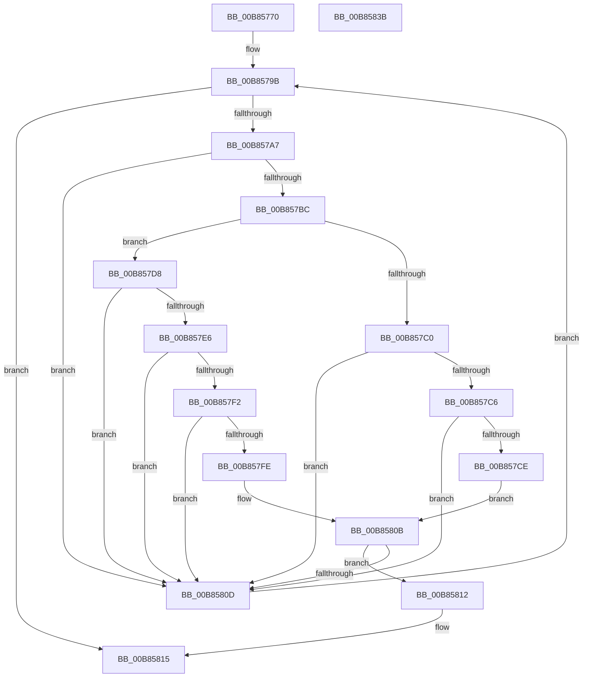

# HalpFindDevice

- RVA: `0x00B85770`–`0x00B8583C` (길이 `204` bytes)
- VA: `0x0000000140B85770`
- 실행 섹션: `PAGEKD`
- PDB 이름 있음: `예`; PDB Function 태그: `아니요`
- unwind 정보 RVA: `0x0005E6B4`
- 디코드: `59`개 명령, `204/204` bytes 표시
- 미해석 바이트: `0` (있으면 어셈블리에 `.byte`로 보존)

> 이 문서는 커널 이미지의 기계어와 PDB 기호를 분석해 생성했습니다. 4번과 5번은 함수 원형과 자료형을 바이너리 사용 방식에서 추정한 C 해석이며 원본 소스 복구 결과는 아닙니다.

## 1. Dependencies

- 직접 호출 지점: **1**; 고유 호출 대상: **1**
- 직접 호출자로 확인된 함수: **3**
- RIP 상대 이미지 참조: **1**

### Outgoing calls
- `0x00B85804` → [wcsncmp](../../text/50/wcsncmp_function_00501CA0.md) (function, `0x00501CA0`)

### Direct callers
- [HalpKdReleaseDebuggingDevice](HalpKdReleaseDebuggingDevice_function_00B85A20.md) at `0x00B85A32`
- [HalpKdSetupDebuggingDevice](HalpKdSetupDebuggingDevice_function_00B85A80.md) at `0x00B85B27`
- [HalpRegisterDeviceInUse](HalpRegisterDeviceInUse_function_00B85C94.md) at `0x00B85CCE`

### Static image references
- `0x00B85789` → RVA `0x00F8FB68` (`.data`; read)

## 2. Other-region calls and transfers

- 다른 실행 섹션으로 향하는 call: **1**
  - `0x00B85804` → [wcsncmp](../../text/50/wcsncmp_function_00501CA0.md) (`PAGEKD` → `.text`)
- 별도 외부 분기/꼬리 이동을 확인하지 못했습니다.

## 3. Assembly (complete function range)

```asm
00B85770  48 8B C4                        mov rax, rsp
00B85773  48 89 58 08                     mov qword ptr [rax + 8], rbx
00B85777  48 89 68 10                     mov qword ptr [rax + 0x10], rbp
00B8577B  48 89 70 18                     mov qword ptr [rax + 0x18], rsi
00B8577F  48 89 78 20                     mov qword ptr [rax + 0x20], rdi
00B85783  41 56                           push r14
00B85785  48 83 EC 20                     sub rsp, 0x20
00B85789  48 8B 35 D8 A3 40 00            mov rsi, qword ptr [rip + 0x40a3d8]
00B85790  33 DB                           xor ebx, ebx
00B85792  44 8B F3                        mov r14d, ebx
00B85795  40 8A EB                        mov bpl, bl
00B85798  48 8B F9                        mov rdi, rcx
00B8579B  48 8D 05 C6 A3 40 00            lea rax, [rip + 0x40a3c6]
00B857A2  48 3B F0                        cmp rsi, rax
00B857A5  74 6E                           je 0x140b85815
00B857A7  48 8B 4E 10                     mov rcx, qword ptr [rsi + 0x10]
00B857AB  4C 8B F6                        mov r14, rsi
00B857AE  8B 87 DC 00 00 00               mov eax, dword ptr [rdi + 0xdc]
00B857B4  39 81 DC 00 00 00               cmp dword ptr [rcx + 0xdc], eax
00B857BA  75 51                           jne 0x140b8580d
00B857BC  85 C0                           test eax, eax
00B857BE  75 18                           jne 0x140b857d8
00B857C0  8B 07                           mov eax, dword ptr [rdi]
00B857C2  39 01                           cmp dword ptr [rcx], eax
00B857C4  75 47                           jne 0x140b8580d
00B857C6  8B 47 04                        mov eax, dword ptr [rdi + 4]
00B857C9  39 41 04                        cmp dword ptr [rcx + 4], eax
00B857CC  75 3F                           jne 0x140b8580d
00B857CE  0F B7 47 08                     movzx eax, word ptr [rdi + 8]
00B857D2  66 39 41 08                     cmp word ptr [rcx + 8], ax
00B857D6  EB 33                           jmp 0x140b8580b
00B857D8  8B 87 E8 00 00 00               mov eax, dword ptr [rdi + 0xe8]
00B857DE  39 81 E8 00 00 00               cmp dword ptr [rcx + 0xe8], eax
00B857E4  75 27                           jne 0x140b8580d
00B857E6  4C 8B 8F E0 00 00 00            mov r9, qword ptr [rdi + 0xe0]
00B857ED  4D 85 C9                        test r9, r9
00B857F0  74 1B                           je 0x140b8580d
00B857F2  48 8B 91 E0 00 00 00            mov rdx, qword ptr [rcx + 0xe0]
00B857F9  48 85 D2                        test rdx, rdx
00B857FC  74 0F                           je 0x140b8580d
00B857FE  44 8B C0                        mov r8d, eax
00B85801  49 8B C9                        mov rcx, r9
00B85804  E8 97 C4 97 FF                  call 0x140501ca0
00B85809  85 C0                           test eax, eax
00B8580B  74 05                           je 0x140b85812
00B8580D  48 8B 36                        mov rsi, qword ptr [rsi]
00B85810  EB 89                           jmp 0x140b8579b
00B85812  40 B5 01                        mov bpl, 1
00B85815  48 8B 74 24 40                  mov rsi, qword ptr [rsp + 0x40]
00B8581A  40 80 FD 01                     cmp bpl, 1
00B8581E  48 8B 6C 24 38                  mov rbp, qword ptr [rsp + 0x38]
00B85823  48 8B 7C 24 48                  mov rdi, qword ptr [rsp + 0x48]
00B85828  49 0F 44 DE                     cmove rbx, r14
00B8582C  48 8B C3                        mov rax, rbx
00B8582F  48 8B 5C 24 30                  mov rbx, qword ptr [rsp + 0x30]
00B85834  48 83 C4 20                     add rsp, 0x20
00B85838  41 5E                           pop r14
00B8583A  C3                              ret
00B8583B  CC                              int3
```

## 4. C-style interpretation (structured pseudocode)

```c
__int64 __fastcall HalpFindDevice(__int64 a1)
{
    __int64 result;
    __int64 v_rbx;
    __int64 v_rsp;
    unsigned __int64 v_stack_p10;
    unsigned __int64 v_stack_p18;
    unsigned __int64 v_stack_p20;
    unsigned __int64 v_stack_p8;

    *(unsigned __int64 *)(v_rsp + 8) = v_rbx;
    *(unsigned __int64 *)(v_rsp + 16) = v_rbp;
    *(unsigned __int64 *)(v_rsp + 24) = v_rsi;
    *(unsigned __int64 *)(v_rsp + 32) = v_rdi;
    v_rsp = (v_rsp) - (32);
    v_rbx = 0;
loc_00B8579B:
    if ((*(unsigned __int64 *)(v_rip + 4236248)) == (v_rip + 4236230)) goto loc_00B85815;
    if ((*(unsigned int *)(*(unsigned __int64 *)(*(unsigned __int64 *)(v_rip + 4236248) + 16) + 220)) != ((unsigned int)((unsigned int)(*(unsigned int *)(a1 + 220))))) goto loc_00B8580D;
    if ((unsigned int)((unsigned int)(*(unsigned int *)(a1 + 220))) != 0) goto loc_00B857D8;
    if ((*(unsigned int *)(*(unsigned __int64 *)(*(unsigned __int64 *)(v_rip + 4236248) + 16))) != ((unsigned int)((unsigned int)(*(unsigned int *)(a1))))) goto loc_00B8580D;
    if ((*(unsigned int *)(*(unsigned __int64 *)(*(unsigned __int64 *)(v_rip + 4236248) + 16) + 4)) != ((unsigned int)((unsigned int)(*(unsigned int *)(a1 + 4))))) goto loc_00B8580D;
    goto loc_00B8580B;
loc_00B857D8:
    if ((*(unsigned int *)(*(unsigned __int64 *)(*(unsigned __int64 *)(v_rip + 4236248) + 16) + 232)) != ((unsigned int)((unsigned int)(*(unsigned int *)(a1 + 232))))) goto loc_00B8580D;
    if (*(unsigned __int64 *)(a1 + 224) == 0) goto loc_00B8580D;
    if (*(unsigned __int64 *)(*(unsigned __int64 *)(*(unsigned __int64 *)(v_rip + 4236248) + 16) + 224) == 0) goto loc_00B8580D;
    result = wcsncmp(*(unsigned __int64 *)(a1 + 224), *(unsigned __int64 *)(*(unsigned __int64 *)(*(unsigned __int64 *)(v_rip + 4236248) + 16) + 224), (unsigned int)((unsigned int)((unsigned int)(*(unsigned int *)(a1 + 232)))), *(unsigned __int64 *)(a1 + 224));
loc_00B8580B:
    if ((unsigned int)(result) == 0) goto loc_00B85812;
loc_00B8580D:
    goto loc_00B8579B;
loc_00B85812:
loc_00B85815:
    if (1 == 1) { v_rbx = *(unsigned __int64 *)(v_rip + 4236248); }
    v_rsp = (v_rsp) + (32);
    return v_rbx;
}
```

## 5. (Beta) C Style

```c
int64_t HalpFindDevice(void *Arg1)
{
    uint8_t *arg1 = (uint8_t *)Arg1;

    int64_t result;
    int64_t local_rbx;
    int64_t local_rsp;
    uint64_t v_stack_p10;
    uint64_t v_stack_p18;
    uint64_t v_stack_p20;
    uint64_t v_stack_p8;

    *(uint64_t *)(local_rsp + 0x8) = local_rbx;
    *(uint64_t *)(local_rsp + 0x10) = local_rbp;
    *(uint64_t *)(local_rsp + 0x18) = local_rsi;
    *(uint64_t *)(local_rsp + 0x20) = local_rdi;
    local_rsp = (local_rsp) - (32);
    local_rbx = 0;
loc_00B8579B:
    if ((*(uint64_t *)(v_rip + 0x40A3D8)) == (v_rip + 4236230)) goto loc_00B85815;
    if ((*(uint32_t *)(*(uint64_t *)(*(uint64_t *)(v_rip + 0x40A3D8) + 0x10) + 0xDC)) != ((uint32_t)((uint32_t)(*(uint32_t *)(arg1 + 0xDC))))) goto loc_00B8580D;
    if ((uint32_t)((uint32_t)(*(uint32_t *)(arg1 + 0xDC))) != 0) goto loc_00B857D8;
    if ((*(uint32_t *)(*(uint64_t *)(*(uint64_t *)(v_rip + 0x40A3D8) + 0x10))) != ((uint32_t)((uint32_t)(*(uint32_t *)(arg1))))) goto loc_00B8580D;
    if ((*(uint32_t *)(*(uint64_t *)(*(uint64_t *)(v_rip + 0x40A3D8) + 0x10) + 0x4)) != ((uint32_t)((uint32_t)(*(uint32_t *)(arg1 + 0x4))))) goto loc_00B8580D;
    goto loc_00B8580B;
loc_00B857D8:
    if ((*(uint32_t *)(*(uint64_t *)(*(uint64_t *)(v_rip + 0x40A3D8) + 0x10) + 0xE8)) != ((uint32_t)((uint32_t)(*(uint32_t *)(arg1 + 0xE8))))) goto loc_00B8580D;
    if (*(uint64_t *)(arg1 + 0xE0) == 0) goto loc_00B8580D;
    if (*(uint64_t *)(*(uint64_t *)(*(uint64_t *)(v_rip + 0x40A3D8) + 0x10) + 0xE0) == 0) goto loc_00B8580D;
    result = wcsncmp(*(uint64_t *)(arg1 + 0xE0), *(uint64_t *)(*(uint64_t *)(*(uint64_t *)(v_rip + 0x40A3D8) + 0x10) + 0xE0), (uint32_t)((uint32_t)((uint32_t)(*(uint32_t *)(arg1 + 0xE8)))), *(uint64_t *)(arg1 + 0xE0));
loc_00B8580B:
    if ((uint32_t)(result) == 0) goto loc_00B85812;
loc_00B8580D:
    goto loc_00B8579B;
loc_00B85812:
loc_00B85815:
    if (1 == 1) { local_rbx = *(uint64_t *)(v_rip + 0x40A3D8); }
    local_rsp = (local_rsp) + (32);
    return local_rbx;
}
```

### 관측된 메모리 오프셋

구조체 형식이 확인되지 않은 접근은 인자 기준의 오프셋으로만 기록했습니다.

| 기준 인자 | 오프셋 표현 | 폭 (bit) | 접근 |
|---|---:|---:|---|
| `Arg1` | `+ 0x0` | `32` | `R` |
| `Arg1` | `+ 0x4` | `32` | `R` |
| `Arg1` | `+ 0x8` | `16` | `R` |
| `Arg1` | `+ 0xDC` | `32` | `R` |
| `Arg1` | `+ 0xE0` | `64` | `R` |
| `Arg1` | `+ 0xE8` | `32` | `R` |

## 6. Execution-region graph

[열기: 2D/3D 그래프와 함수 탐색 컨트롤 패널](../../../control-panel.html?section=pagekd&rva=0x00B85770&view=graph)

- 2D 그래프는 위에서 아래로 흐르고, 3D 그래프는 빈 공간을 드래그해 회전합니다. Shift+드래그는 이동, 휠은 확대·축소, 함수 노드 선택은 대상 보고서 이동입니다.

### Static fallback


