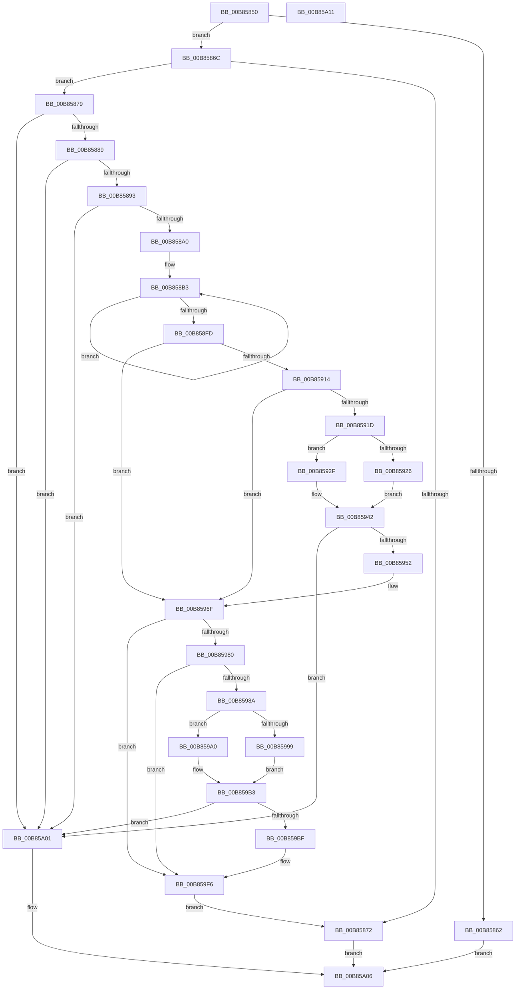

# HalpKdEnumerateDebuggingDevices

- RVA: `0x00B85850`–`0x00B85A12` (길이 `450` bytes)
- VA: `0x0000000140B85850`
- 실행 섹션: `PAGEKD`
- PDB 이름 있음: `예`; PDB Function 태그: `아니요`
- unwind 정보 RVA: `0x0005CAAC`
- 디코드: `108`개 명령, `450/450` bytes 표시
- 미해석 바이트: `0` (있으면 어셈블리에 `.byte`로 보존)

> 이 문서는 커널 이미지의 기계어와 PDB 기호를 분석해 생성했습니다. 4번과 5번은 함수 원형과 자료형을 바이너리 사용 방식에서 추정한 C 해석이며 원본 소스 복구 결과는 아닙니다.

## 1. Dependencies

- 직접 호출 지점: **8**; 고유 호출 대상: **6**
- 직접 호출자로 확인된 함수: **1**
- RIP 상대 이미지 참조: **2**

### Outgoing calls
- `0x00B85893` → [HalpDeviceEquals](HalpDeviceEquals_function_00B85580.md) (function, `0x00B85580`)
- `0x00B85928` → [HalpMmAllocateMemory](../../text/54/HalpMmAllocateMemory_function_00544974.md) (function, `0x00544974`)
- `0x00B8593D` → [ExAllocatePool2](../../poolcode/B8/ExAllocatePool2_function_00B820F0.md) (function, `0x00B820F0`)
- `0x00B8596A` → [memcpy](../../text/6C/memcpy_function_006C6840.md) (function, `0x006C6840`)
- `0x00B85999` → [HalpMmAllocateMemory](../../text/54/HalpMmAllocateMemory_function_00544974.md) (function, `0x00544974`)
- `0x00B859AE` → [ExAllocatePool2](../../poolcode/B8/ExAllocatePool2_function_00B820F0.md) (function, `0x00B820F0`)
- `0x00B859C7` → [memset](../../text/6C/memset_function_006C6C40.md) (function, `0x006C6C40`)
- `0x00B859F1` → [wcsncpy_s](../../text/50/wcsncpy_s_function_00506650.md) (function, `0x00506650`)

### Direct callers
- [HalpKdSetupDebuggingDevice](HalpKdSetupDebuggingDevice_function_00B85A80.md) at `0x00B85ACF`

### Static image references
- `0x00B85879` → RVA `0x00FC19A0` (`.data`; read)
- `0x00B8591D` → RVA `0x00E10230` (`.data`; read)

## 2. Other-region calls and transfers

- 다른 실행 섹션으로 향하는 call: **7**
  - `0x00B85928` → [HalpMmAllocateMemory](../../text/54/HalpMmAllocateMemory_function_00544974.md) (`PAGEKD` → `.text`)
  - `0x00B8593D` → [ExAllocatePool2](../../poolcode/B8/ExAllocatePool2_function_00B820F0.md) (`PAGEKD` → `POOLCODE`)
  - `0x00B8596A` → [memcpy](../../text/6C/memcpy_function_006C6840.md) (`PAGEKD` → `.text`)
  - `0x00B85999` → [HalpMmAllocateMemory](../../text/54/HalpMmAllocateMemory_function_00544974.md) (`PAGEKD` → `.text`)
  - `0x00B859AE` → [ExAllocatePool2](../../poolcode/B8/ExAllocatePool2_function_00B820F0.md) (`PAGEKD` → `POOLCODE`)
  - `0x00B859C7` → [memset](../../text/6C/memset_function_006C6C40.md) (`PAGEKD` → `.text`)
  - `0x00B859F1` → [wcsncpy_s](../../text/50/wcsncpy_s_function_00506650.md) (`PAGEKD` → `.text`)
- 별도 외부 분기/꼬리 이동을 확인하지 못했습니다.

## 3. Assembly (complete function range)

```asm
00B85850  48 89 5C 24 08                  mov qword ptr [rsp + 8], rbx
00B85855  57                              push rdi
00B85856  48 83 EC 20                     sub rsp, 0x20
00B8585A  48 8B DA                        mov rbx, rdx
00B8585D  48 85 D2                        test rdx, rdx
00B85860  75 0A                           jne 0x140b8586c
00B85862  B8 0D 00 00 C0                  mov eax, 0xc000000d
00B85867  E9 9A 01 00 00                  jmp 0x140b85a06
00B8586C  80 7A 13 00                     cmp byte ptr [rdx + 0x13], 0
00B85870  74 07                           je 0x140b85879
00B85872  33 C0                           xor eax, eax
00B85874  E9 8D 01 00 00                  jmp 0x140b85a06
00B85879  48 8B 05 20 C1 43 00            mov rax, qword ptr [rip + 0x43c120]
00B85880  48 85 C0                        test rax, rax
00B85883  0F 84 78 01 00 00               je 0x140b85a01
00B85889  80 78 13 00                     cmp byte ptr [rax + 0x13], 0
00B8588D  0F 84 6E 01 00 00               je 0x140b85a01
00B85893  E8 E8 FC FF FF                  call 0x140b85580
00B85898  84 C0                           test al, al
00B8589A  0F 84 61 01 00 00               je 0x140b85a01
00B858A0  48 8B 0D F9 C0 43 00            mov rcx, qword ptr [rip + 0x43c0f9]
00B858A7  BA 02 00 00 00                  mov edx, 2
00B858AC  48 8B C3                        mov rax, rbx
00B858AF  44 8D 42 7E                     lea r8d, [rdx + 0x7e]
00B858B3  0F 10 01                        movups xmm0, xmmword ptr [rcx]
00B858B6  0F 11 00                        movups xmmword ptr [rax], xmm0
00B858B9  0F 10 49 10                     movups xmm1, xmmword ptr [rcx + 0x10]
00B858BD  0F 11 48 10                     movups xmmword ptr [rax + 0x10], xmm1
00B858C1  0F 10 41 20                     movups xmm0, xmmword ptr [rcx + 0x20]
00B858C5  0F 11 40 20                     movups xmmword ptr [rax + 0x20], xmm0
00B858C9  0F 10 49 30                     movups xmm1, xmmword ptr [rcx + 0x30]
00B858CD  0F 11 48 30                     movups xmmword ptr [rax + 0x30], xmm1
00B858D1  0F 10 41 40                     movups xmm0, xmmword ptr [rcx + 0x40]
00B858D5  0F 11 40 40                     movups xmmword ptr [rax + 0x40], xmm0
00B858D9  0F 10 49 50                     movups xmm1, xmmword ptr [rcx + 0x50]
00B858DD  0F 11 48 50                     movups xmmword ptr [rax + 0x50], xmm1
00B858E1  0F 10 41 60                     movups xmm0, xmmword ptr [rcx + 0x60]
00B858E5  0F 11 40 60                     movups xmmword ptr [rax + 0x60], xmm0
00B858E9  49 03 C0                        add rax, r8
00B858EC  0F 10 49 70                     movups xmm1, xmmword ptr [rcx + 0x70]
00B858F0  49 03 C8                        add rcx, r8
00B858F3  0F 11 48 F0                     movups xmmword ptr [rax - 0x10], xmm1
00B858F7  48 83 EA 01                     sub rdx, 1
00B858FB  75 B6                           jne 0x140b858b3
00B858FD  0F 10 01                        movups xmm0, xmmword ptr [rcx]
00B85900  0F 11 00                        movups xmmword ptr [rax], xmm0
00B85903  48 8B 0D 96 C0 43 00            mov rcx, qword ptr [rip + 0x43c096]
00B8590A  8B 81 D8 00 00 00               mov eax, dword ptr [rcx + 0xd8]
00B85910  85 C0                           test eax, eax
00B85912  74 5B                           je 0x140b8596f
00B85914  48 39 91 D0 00 00 00            cmp qword ptr [rcx + 0xd0], rdx
00B8591B  74 52                           je 0x140b8596f
00B8591D  48 39 15 0C A9 28 00            cmp qword ptr [rip + 0x28a90c], rdx
00B85924  74 09                           je 0x140b8592f
00B85926  8B C8                           mov ecx, eax
00B85928  E8 47 F0 9B FF                  call 0x140544974
00B8592D  EB 13                           jmp 0x140b85942
00B8592F  48 8B D0                        mov rdx, rax
00B85932  B9 00 01 00 00                  mov ecx, 0x100
00B85937  41 B8 48 61 6C 64               mov r8d, 0x646c6148
00B8593D  E8 AE C7 FF FF                  call 0x140b820f0
00B85942  48 89 83 D0 00 00 00            mov qword ptr [rbx + 0xd0], rax
00B85949  48 85 C0                        test rax, rax
00B8594C  0F 84 AF 00 00 00               je 0x140b85a01
00B85952  48 8B 15 47 C0 43 00            mov rdx, qword ptr [rip + 0x43c047]
00B85959  48 8B C8                        mov rcx, rax
00B8595C  44 8B 82 D8 00 00 00            mov r8d, dword ptr [rdx + 0xd8]
00B85963  48 8B 92 D0 00 00 00            mov rdx, qword ptr [rdx + 0xd0]
00B8596A  E8 D1 0E B4 FF                  call 0x1406c6840
00B8596F  48 8B 05 2A C0 43 00            mov rax, qword ptr [rip + 0x43c02a]
00B85976  8B 88 E8 00 00 00               mov ecx, dword ptr [rax + 0xe8]
00B8597C  85 C9                           test ecx, ecx
00B8597E  74 76                           je 0x140b859f6
00B85980  48 83 B8 E0 00 00 00 00         cmp qword ptr [rax + 0xe0], 0
00B85988  74 6C                           je 0x140b859f6
00B8598A  83 C1 02                        add ecx, 2
00B8598D  48 83 3D 9B A8 28 00 00         cmp qword ptr [rip + 0x28a89b], 0
00B85995  8B F9                           mov edi, ecx
00B85997  74 07                           je 0x140b859a0
00B85999  E8 D6 EF 9B FF                  call 0x140544974
00B8599E  EB 13                           jmp 0x140b859b3
00B859A0  41 B8 48 61 6C 64               mov r8d, 0x646c6148
00B859A6  48 8B D7                        mov rdx, rdi
00B859A9  B9 00 01 00 00                  mov ecx, 0x100
00B859AE  E8 3D C7 FF FF                  call 0x140b820f0
00B859B3  48 89 83 E0 00 00 00            mov qword ptr [rbx + 0xe0], rax
00B859BA  48 85 C0                        test rax, rax
00B859BD  74 42                           je 0x140b85a01
00B859BF  4C 8B C7                        mov r8, rdi
00B859C2  33 D2                           xor edx, edx
00B859C4  48 8B C8                        mov rcx, rax
00B859C7  E8 74 12 B4 FF                  call 0x1406c6c40
00B859CC  4C 8B 05 CD BF 43 00            mov r8, qword ptr [rip + 0x43bfcd]
00B859D3  48 8B 8B E0 00 00 00            mov rcx, qword ptr [rbx + 0xe0]
00B859DA  48 D1 EF                        shr rdi, 1
00B859DD  48 8B D7                        mov rdx, rdi
00B859E0  45 8B 88 E8 00 00 00            mov r9d, dword ptr [r8 + 0xe8]
00B859E7  4D 8B 80 E0 00 00 00            mov r8, qword ptr [r8 + 0xe0]
00B859EE  49 D1 E9                        shr r9, 1
00B859F1  E8 5A 0C 98 FF                  call 0x140506650
00B859F6  66 C7 43 12 00 01               mov word ptr [rbx + 0x12], 0x100
00B859FC  E9 71 FE FF FF                  jmp 0x140b85872
00B85A01  B8 01 00 00 C0                  mov eax, 0xc0000001
00B85A06  48 8B 5C 24 30                  mov rbx, qword ptr [rsp + 0x30]
00B85A0B  48 83 C4 20                     add rsp, 0x20
00B85A0F  5F                              pop rdi
00B85A10  C3                              ret
00B85A11  CC                              int3
```

## 4. C-style interpretation (structured pseudocode)

```c
__int64 __fastcall HalpKdEnumerateDebuggingDevices(__int64 a1, __int64 a2)
{
    __int64 result;
    __int64 v_rdi;
    __int64 v_rsp;
    unsigned __int64 v_stack_p8;

    v_stack_p8 = v_rbx;
    v_rsp = (v_rsp) - (32);
    if (a2 != 0) goto loc_00B8586C;
    goto loc_00B85A06;
loc_00B8586C:
    if ((*(unsigned __int8 *)(a2 + 19)) == 0) goto loc_00B85879;
loc_00B85872:
    result = 0;
    goto loc_00B85A06;
loc_00B85879:
    if (*(unsigned __int64 *)(v_rip + 4440352) == 0) goto loc_00B85A01;
    if ((*(unsigned __int8 *)(*(unsigned __int64 *)(v_rip + 4440352) + 19)) == 0) goto loc_00B85A01;
    result = HalpDeviceEquals(a1, a2, a3, a4);
    if ((unsigned __int8)(result) == 0) goto loc_00B85A01;
loc_00B858B3:
    *(unsigned __int64 *)(a2) = v_xmm0;
    *(unsigned __int64 *)(a2 + 16) = v_xmm1;
    *(unsigned __int64 *)(a2 + 32) = v_xmm0;
    *(unsigned __int64 *)(a2 + 48) = v_xmm1;
    *(unsigned __int64 *)(a2 + 64) = v_xmm0;
    *(unsigned __int64 *)(a2 + 80) = v_xmm1;
    *(unsigned __int64 *)(a2 + 96) = v_xmm0;
    result = (a2) + (2 + 126);
    a1 = (*(unsigned __int64 *)(v_rip + 4440313)) + (2 + 126);
    *(unsigned __int64 *)(result - 16) = v_xmm1;
    a2 = (2) - (1);
    if (condition_is_not_equal) goto loc_00B858B3;
    *(unsigned __int64 *)(result) = v_xmm0;
    if ((unsigned int)((unsigned int)(*(unsigned int *)(*(unsigned __int64 *)(v_rip + 4440214) + 216))) == 0) goto loc_00B8596F;
    if ((*(unsigned __int64 *)(*(unsigned __int64 *)(v_rip + 4440214) + 208)) == a2) goto loc_00B8596F;
    if ((*(unsigned __int64 *)(v_rip + 2664716)) == a2) goto loc_00B8592F;
    result = HalpMmAllocateMemory((unsigned int)((unsigned int)((unsigned int)(*(unsigned int *)(*(unsigned __int64 *)(v_rip + 4440214) + 216)))), a2, 2 + 126, a4);
    goto loc_00B85942;
loc_00B8592F:
    result = ExAllocatePool2(256, result, (unsigned int)(0x646C6148ULL), a4);
loc_00B85942:
    *(unsigned __int64 *)(a2 + 208) = result;
    if (result == 0) goto loc_00B85A01;
    result = memcpy(result, *(unsigned __int64 *)(*(unsigned __int64 *)(v_rip + 4440135) + 208), (unsigned int)(*(unsigned int *)(*(unsigned __int64 *)(v_rip + 4440135) + 216)), a4);
loc_00B8596F:
    if ((unsigned int)((unsigned int)(*(unsigned int *)(*(unsigned __int64 *)(v_rip + 4440106) + 232))) == 0) goto loc_00B859F6;
    if ((*(unsigned __int64 *)(*(unsigned __int64 *)(v_rip + 4440106) + 224)) == 0) goto loc_00B859F6;
    a1 = (unsigned int)(((unsigned int)(*(unsigned int *)(*(unsigned __int64 *)(v_rip + 4440106) + 232))) + (2));
    if ((*(unsigned __int64 *)(v_rip + 2664603)) == 0) goto loc_00B859A0;
    result = HalpMmAllocateMemory(a1, *(unsigned __int64 *)(*(unsigned __int64 *)(v_rip + 4440135) + 208), (unsigned int)(*(unsigned int *)(*(unsigned __int64 *)(v_rip + 4440135) + 216)), a4);
    goto loc_00B859B3;
loc_00B859A0:
    result = ExAllocatePool2(256, (unsigned int)((unsigned int)(a1)), (unsigned int)(0x646C6148ULL), a4);
loc_00B859B3:
    *(unsigned __int64 *)(a2 + 224) = result;
    if (result == 0) goto loc_00B85A01;
    a2 = 0;
    result = memset(result, a2, (unsigned int)((unsigned int)(a1)), a4);
    v_rdi = ((unsigned int)((unsigned int)(a1))) >> (1);
    a4 = ((unsigned int)(*(unsigned int *)(*(unsigned __int64 *)(v_rip + 4440013) + 232))) >> (1);
    result = wcsncpy_s(*(unsigned __int64 *)(a2 + 224), v_rdi, *(unsigned __int64 *)(*(unsigned __int64 *)(v_rip + 4440013) + 224), a4);
loc_00B859F6:
    *(unsigned __int16 *)(a2 + 18) = 256;
    goto loc_00B85872;
loc_00B85A01:
loc_00B85A06:
    v_rsp = (v_rsp) + (32);
    return (unsigned int)(0xC0000001ULL);
}
```

## 5. (Beta) C Style

```c
int64_t HalpKdEnumerateDebuggingDevices(int64_t Arg1, void *Arg2)
{
    uint8_t *arg2 = (uint8_t *)Arg2;

    int64_t result;
    int64_t local_rdi;
    int64_t local_rsp;
    uint64_t v_stack_p8;

    v_stack_p8 = local_rbx;
    local_rsp = (local_rsp) - (32);
    if (Arg2 != NULL) goto loc_00B8586C;
    goto loc_00B85A06;
loc_00B8586C:
    if ((*(uint8_t *)(arg2 + 0x13)) == 0) goto loc_00B85879;
loc_00B85872:
    result = 0;
    goto loc_00B85A06;
loc_00B85879:
    if (*(uint64_t *)(v_rip + 0x43C120) == 0) goto loc_00B85A01;
    if ((*(uint8_t *)(*(uint64_t *)(v_rip + 0x43C120) + 0x13)) == 0) goto loc_00B85A01;
    result = HalpDeviceEquals(Arg1, Arg2, a3, a4);
    if ((uint8_t)(result) == 0) goto loc_00B85A01;
loc_00B858B3:
    *(uint64_t *)(arg2) = v_xmm0;
    *(uint64_t *)(arg2 + 0x10) = v_xmm1;
    *(uint64_t *)(arg2 + 0x20) = v_xmm0;
    *(uint64_t *)(arg2 + 0x30) = v_xmm1;
    *(uint64_t *)(arg2 + 0x40) = v_xmm0;
    *(uint64_t *)(arg2 + 0x50) = v_xmm1;
    *(uint64_t *)(arg2 + 0x60) = v_xmm0;
    result = (Arg2) + (2 + 126);
    Arg1 = (*(uint64_t *)(v_rip + 0x43C0F9)) + (2 + 126);
    *(uint64_t *)(result - 0x10) = v_xmm1;
    Arg2 = (2) - (1);
    if (condition_is_not_equal) goto loc_00B858B3;
    *(uint64_t *)(result) = v_xmm0;
    if ((uint32_t)((uint32_t)(*(uint32_t *)(*(uint64_t *)(v_rip + 0x43C096) + 0xD8))) == 0) goto loc_00B8596F;
    if ((*(uint64_t *)(*(uint64_t *)(v_rip + 0x43C096) + 0xD0)) == Arg2) goto loc_00B8596F;
    if ((*(uint64_t *)(v_rip + 0x28A90C)) == Arg2) goto loc_00B8592F;
    result = HalpMmAllocateMemory((uint32_t)((uint32_t)((uint32_t)(*(uint32_t *)(*(uint64_t *)(v_rip + 0x43C096) + 0xD8)))), Arg2, 2 + 126, a4);
    goto loc_00B85942;
loc_00B8592F:
    result = ExAllocatePool2(256, result, (uint32_t)(0x646C6148ULL), a4);
loc_00B85942:
    *(uint64_t *)(arg2 + 0xD0) = result;
    if (result == 0) goto loc_00B85A01;
    result = memcpy(result, *(uint64_t *)(*(uint64_t *)(v_rip + 0x43C047) + 0xD0), (uint32_t)(*(uint32_t *)(*(uint64_t *)(v_rip + 0x43C047) + 0xD8)), a4);
loc_00B8596F:
    if ((uint32_t)((uint32_t)(*(uint32_t *)(*(uint64_t *)(v_rip + 0x43C02A) + 0xE8))) == 0) goto loc_00B859F6;
    if ((*(uint64_t *)(*(uint64_t *)(v_rip + 0x43C02A) + 0xE0)) == 0) goto loc_00B859F6;
    Arg1 = (uint32_t)(((uint32_t)(*(uint32_t *)(*(uint64_t *)(v_rip + 0x43C02A) + 0xE8))) + (2));
    if ((*(uint64_t *)(v_rip + 0x28A89B)) == 0) goto loc_00B859A0;
    result = HalpMmAllocateMemory(Arg1, *(uint64_t *)(*(uint64_t *)(v_rip + 0x43C047) + 0xD0), (uint32_t)(*(uint32_t *)(*(uint64_t *)(v_rip + 0x43C047) + 0xD8)), a4);
    goto loc_00B859B3;
loc_00B859A0:
    result = ExAllocatePool2(256, (uint32_t)((uint32_t)(Arg1)), (uint32_t)(0x646C6148ULL), a4);
loc_00B859B3:
    *(uint64_t *)(arg2 + 0xE0) = result;
    if (result == 0) goto loc_00B85A01;
    Arg2 = 0;
    result = memset(result, Arg2, (uint32_t)((uint32_t)(Arg1)), a4);
    local_rdi = ((uint32_t)((uint32_t)(Arg1))) >> (1);
    a4 = ((uint32_t)(*(uint32_t *)(*(uint64_t *)(v_rip + 0x43BFCD) + 0xE8))) >> (1);
    result = wcsncpy_s(*(uint64_t *)(arg2 + 0xE0), local_rdi, *(uint64_t *)(*(uint64_t *)(v_rip + 0x43BFCD) + 0xE0), a4);
loc_00B859F6:
    *(uint16_t *)(arg2 + 0x12) = 256;
    goto loc_00B85872;
loc_00B85A01:
loc_00B85A06:
    local_rsp = (local_rsp) + (32);
    return (uint32_t)(0xC0000001ULL);
}
```

### 관측된 메모리 오프셋

구조체 형식이 확인되지 않은 접근은 인자 기준의 오프셋으로만 기록했습니다.

| 기준 인자 | 오프셋 표현 | 폭 (bit) | 접근 |
|---|---:|---:|---|
| `Arg2` | `- 0x10` | `128` | `R` |
| `Arg2` | `+ 0x0` | `128` | `R` |
| `Arg2` | `+ 0x10` | `128` | `R` |
| `Arg2` | `+ 0x12` | `16` | `W` |
| `Arg2` | `+ 0x20` | `128` | `R` |
| `Arg2` | `+ 0x30` | `128` | `R` |
| `Arg2` | `+ 0x40` | `128` | `R` |
| `Arg2` | `+ 0x50` | `128` | `R` |
| `Arg2` | `+ 0x60` | `128` | `R` |
| `Arg2` | `+ 0xD0` | `64` | `W` |
| `Arg2` | `+ 0xE0` | `64` | `R` |
| `Arg2` | `+ 0xE0` | `64` | `W` |

## 6. Execution-region graph

[열기: 2D/3D 그래프와 함수 탐색 컨트롤 패널](../../../control-panel.html?section=pagekd&rva=0x00B85850&view=graph)

- 2D 그래프는 위에서 아래로 흐르고, 3D 그래프는 빈 공간을 드래그해 회전합니다. Shift+드래그는 이동, 휠은 확대·축소, 함수 노드 선택은 대상 보고서 이동입니다.

### Static fallback


