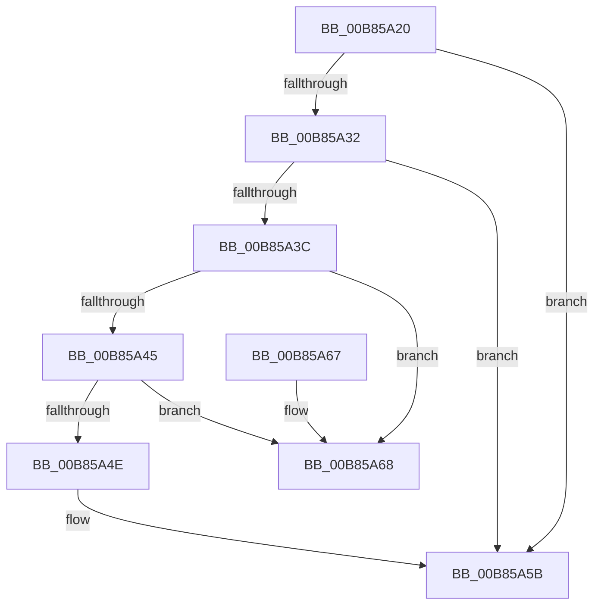

# HalpKdReleaseDebuggingDevice

- RVA: `0x00B85A20`–`0x00B85A6F` (길이 `79` bytes)
- VA: `0x0000000140B85A20`
- 실행 섹션: `PAGEKD`
- PDB 이름 있음: `예`; PDB Function 태그: `아니요`
- unwind 정보 RVA: `0x0005DAC8`
- 디코드: `25`개 명령, `79/79` bytes 표시
- 미해석 바이트: `0` (있으면 어셈블리에 `.byte`로 보존)

> 이 문서는 커널 이미지의 기계어와 PDB 기호를 분석해 생성했습니다. 4번과 5번은 함수 원형과 자료형을 바이너리 사용 방식에서 추정한 C 해석이며 원본 소스 복구 결과는 아닙니다.

## 1. Dependencies

- 직접 호출 지점: **1**; 고유 호출 대상: **1**
- 직접 호출자로 확인된 함수: **0**
- RIP 상대 이미지 참조: **1**

### Outgoing calls
- `0x00B85A32` → [HalpFindDevice](HalpFindDevice_function_00B85770.md) (function, `0x00B85770`)

### Direct callers
- 이 함수 시작 RVA로 연결되는 직접 call은 확인되지 않았습니다. 간접 호출은 완전히 역산할 수 없습니다.

### Static image references
- `0x00B85A55` → RVA `0x00F8FB60` (`.data`; read/write)

## 2. Other-region calls and transfers

- 다른 실행 섹션으로 향하는 call: **0**
- 별도 외부 분기/꼬리 이동을 확인하지 못했습니다.

## 3. Assembly (complete function range)

```asm
00B85A20  40 53                           push rbx
00B85A22  48 83 EC 20                     sub rsp, 0x20
00B85A26  83 B9 DC 00 00 00 03            cmp dword ptr [rcx + 0xdc], 3
00B85A2D  48 8B D9                        mov rbx, rcx
00B85A30  74 29                           je 0x140b85a5b
00B85A32  E8 39 FD FF FF                  call 0x140b85770
00B85A37  48 85 C0                        test rax, rax
00B85A3A  74 1F                           je 0x140b85a5b
00B85A3C  48 8B 10                        mov rdx, qword ptr [rax]
00B85A3F  48 39 42 08                     cmp qword ptr [rdx + 8], rax
00B85A43  75 23                           jne 0x140b85a68
00B85A45  48 8B 48 08                     mov rcx, qword ptr [rax + 8]
00B85A49  48 39 01                        cmp qword ptr [rcx], rax
00B85A4C  75 1A                           jne 0x140b85a68
00B85A4E  48 89 11                        mov qword ptr [rcx], rdx
00B85A51  48 89 4A 08                     mov qword ptr [rdx + 8], rcx
00B85A55  FF 0D 05 A1 40 00               dec dword ptr [rip + 0x40a105]
00B85A5B  C6 43 12 00                     mov byte ptr [rbx + 0x12], 0
00B85A5F  33 C0                           xor eax, eax
00B85A61  48 83 C4 20                     add rsp, 0x20
00B85A65  5B                              pop rbx
00B85A66  C3                              ret
00B85A67  CC                              int3
00B85A68  B9 03 00 00 00                  mov ecx, 3
00B85A6D  CD 29                           int 0x29
```

## 4. C-style interpretation (structured pseudocode)

```c
__int64 __fastcall HalpKdReleaseDebuggingDevice(__int64 a1)
{
    __int64 result;
    __int64 v_rsp;

    v_rsp = (v_rsp) - (32);
    if ((*(unsigned int *)(a1 + 220)) == 3) goto loc_00B85A5B;
    result = HalpFindDevice(a1, a2, a3, a4);
    if (result == 0) goto loc_00B85A5B;
    if ((*(unsigned __int64 *)(*(unsigned __int64 *)(result) + 8)) != result) goto loc_00B85A68;
    if ((*(unsigned __int64 *)(*(unsigned __int64 *)(result + 8))) != result) goto loc_00B85A68;
    *(unsigned __int64 *)(*(unsigned __int64 *)(result + 8)) = *(unsigned __int64 *)(result);
    *(unsigned __int64 *)(*(unsigned __int64 *)(result) + 8) = *(unsigned __int64 *)(result + 8);
loc_00B85A5B:
    *(unsigned __int8 *)(a1 + 18) = 0;
    result = 0;
    v_rsp = (v_rsp) + (32);
    return result;
loc_00B85A68:
    return result;
}
```

## 5. (Beta) C Style

```c
int64_t HalpKdReleaseDebuggingDevice(void *Arg1)
{
    uint8_t *arg1 = (uint8_t *)Arg1;

    int64_t result;
    int64_t local_rsp;

    local_rsp = (local_rsp) - (32);
    if ((*(uint32_t *)(arg1 + 0xDC)) == 3) goto loc_00B85A5B;
    result = HalpFindDevice(Arg1, a2, a3, a4);
    if (result == 0) goto loc_00B85A5B;
    if ((*(uint64_t *)(*(uint64_t *)(result) + 0x8)) != result) goto loc_00B85A68;
    if ((*(uint64_t *)(*(uint64_t *)(result + 0x8))) != result) goto loc_00B85A68;
    *(uint64_t *)(*(uint64_t *)(result + 0x8)) = *(uint64_t *)(result);
    *(uint64_t *)(*(uint64_t *)(result) + 0x8) = *(uint64_t *)(result + 0x8);
loc_00B85A5B:
    *(uint8_t *)(arg1 + 0x12) = 0;
    result = 0;
    local_rsp = (local_rsp) + (32);
    return result;
loc_00B85A68:
    return result;
}
```

### 관측된 메모리 오프셋

구조체 형식이 확인되지 않은 접근은 인자 기준의 오프셋으로만 기록했습니다.

| 기준 인자 | 오프셋 표현 | 폭 (bit) | 접근 |
|---|---:|---:|---|
| `Arg1` | `+ 0x12` | `8` | `W` |
| `Arg1` | `+ 0xDC` | `32` | `R` |

## 6. Execution-region graph

[열기: 2D/3D 그래프와 함수 탐색 컨트롤 패널](../../../control-panel.html?section=pagekd&rva=0x00B85A20&view=graph)

- 2D 그래프는 위에서 아래로 흐르고, 3D 그래프는 빈 공간을 드래그해 회전합니다. Shift+드래그는 이동, 휠은 확대·축소, 함수 노드 선택은 대상 보고서 이동입니다.

### Static fallback


