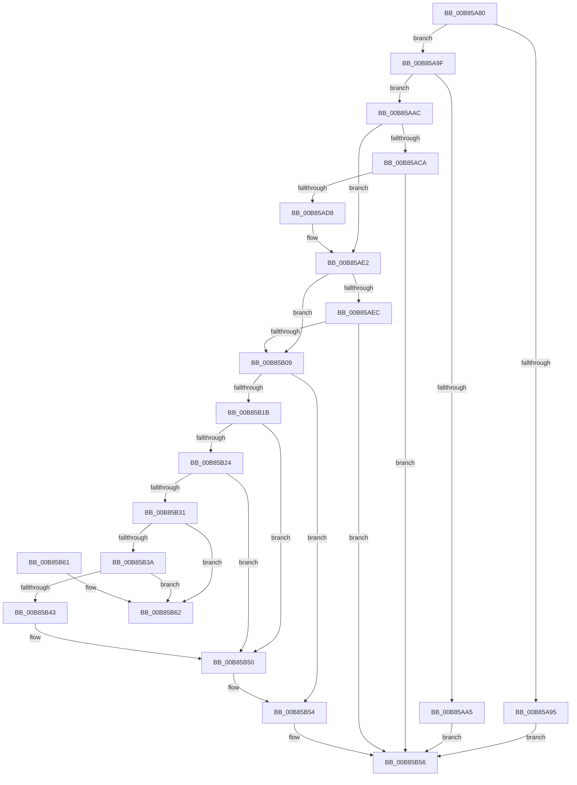

# HalpKdSetupDebuggingDevice

- RVA: `0x00B85A80`–`0x00B85B69` (길이 `233` bytes)
- VA: `0x0000000140B85A80`
- 실행 섹션: `PAGEKD`
- PDB 이름 있음: `예`; PDB Function 태그: `아니요`
- unwind 정보 RVA: `0x000A60F8`
- 디코드: `65`개 명령, `233/233` bytes 표시
- 미해석 바이트: `0` (있으면 어셈블리에 `.byte`로 보존)

> 이 문서는 커널 이미지의 기계어와 PDB 기호를 분석해 생성했습니다. 4번과 5번은 함수 원형과 자료형을 바이너리 사용 방식에서 추정한 C 해석이며 원본 소스 복구 결과는 아닙니다.

## 1. Dependencies

- 직접 호출 지점: **4**; 고유 호출 대상: **4**
- 직접 호출자로 확인된 함수: **0**
- RIP 상대 이미지 참조: **1**

### Outgoing calls
- `0x00B85ACF` → [HalpKdEnumerateDebuggingDevices](HalpKdEnumerateDebuggingDevices_function_00B85850.md) (function, `0x00B85850`)
- `0x00B85B00` → [HalpAllocateScratchMemory](HalpAllocateScratchMemory_function_00B854B0.md) (function, `0x00B854B0`)
- `0x00B85B10` → [HalpRegisterDeviceInUse](HalpRegisterDeviceInUse_function_00B85C94.md) (function, `0x00B85C94`)
- `0x00B85B27` → [HalpFindDevice](HalpFindDevice_function_00B85770.md) (function, `0x00B85770`)

### Direct callers
- 이 함수 시작 RVA로 연결되는 직접 call은 확인되지 않았습니다. 간접 호출은 완전히 역산할 수 없습니다.

### Static image references
- `0x00B85B4A` → RVA `0x00F8FB60` (`.data`; read/write)

## 2. Other-region calls and transfers

- 다른 실행 섹션으로 향하는 call: **0**
- 별도 외부 분기/꼬리 이동을 확인하지 못했습니다.

## 3. Assembly (complete function range)

```asm
00B85A80  48 89 5C 24 08                  mov qword ptr [rsp + 8], rbx
00B85A85  57                              push rdi
00B85A86  48 83 EC 40                     sub rsp, 0x40
00B85A8A  48 8B DA                        mov rbx, rdx
00B85A8D  48 8B F9                        mov rdi, rcx
00B85A90  48 85 D2                        test rdx, rdx
00B85A93  75 0A                           jne 0x140b85a9f
00B85A95  B8 0D 00 00 C0                  mov eax, 0xc000000d
00B85A9A  E9 B7 00 00 00                  jmp 0x140b85b56
00B85A9F  80 7A 12 00                     cmp byte ptr [rdx + 0x12], 0
00B85AA3  74 07                           je 0x140b85aac
00B85AA5  33 C0                           xor eax, eax
00B85AA7  E9 AA 00 00 00                  jmp 0x140b85b56
00B85AAC  80 7A 13 00                     cmp byte ptr [rdx + 0x13], 0
00B85AB0  0F 10 82 A8 00 00 00            movups xmm0, xmmword ptr [rdx + 0xa8]
00B85AB7  0F 10 8A B8 00 00 00            movups xmm1, xmmword ptr [rdx + 0xb8]
00B85ABE  0F 11 44 24 20                  movups xmmword ptr [rsp + 0x20], xmm0
00B85AC3  0F 11 4C 24 30                  movups xmmword ptr [rsp + 0x30], xmm1
00B85AC8  75 18                           jne 0x140b85ae2
00B85ACA  45 33 C0                        xor r8d, r8d
00B85ACD  33 C9                           xor ecx, ecx
00B85ACF  E8 7C FD FF FF                  call 0x140b85850
00B85AD4  85 C0                           test eax, eax
00B85AD6  78 7E                           js 0x140b85b56
00B85AD8  0F 10 44 24 20                  movups xmm0, xmmword ptr [rsp + 0x20]
00B85ADD  0F 10 4C 24 30                  movups xmm1, xmmword ptr [rsp + 0x30]
00B85AE2  48 83 BB B8 00 00 00 00         cmp qword ptr [rbx + 0xb8], 0
00B85AEA  75 1D                           jne 0x140b85b09
00B85AEC  0F 11 83 A8 00 00 00            movups xmmword ptr [rbx + 0xa8], xmm0
00B85AF3  48 8B D3                        mov rdx, rbx
00B85AF6  48 8B CF                        mov rcx, rdi
00B85AF9  0F 11 8B B8 00 00 00            movups xmmword ptr [rbx + 0xb8], xmm1
00B85B00  E8 AB F9 FF FF                  call 0x140b854b0
00B85B05  85 C0                           test eax, eax
00B85B07  78 4D                           js 0x140b85b56
00B85B09  48 8B CB                        mov rcx, rbx
00B85B0C  C6 43 12 01                     mov byte ptr [rbx + 0x12], 1
00B85B10  E8 7F 01 00 00                  call 0x140b85c94
00B85B15  8B F8                           mov edi, eax
00B85B17  85 C0                           test eax, eax
00B85B19  79 39                           jns 0x140b85b54
00B85B1B  83 BB DC 00 00 00 03            cmp dword ptr [rbx + 0xdc], 3
00B85B22  74 2C                           je 0x140b85b50
00B85B24  48 8B CB                        mov rcx, rbx
00B85B27  E8 44 FC FF FF                  call 0x140b85770
00B85B2C  48 85 C0                        test rax, rax
00B85B2F  74 1F                           je 0x140b85b50
00B85B31  48 8B 10                        mov rdx, qword ptr [rax]
00B85B34  48 39 42 08                     cmp qword ptr [rdx + 8], rax
00B85B38  75 28                           jne 0x140b85b62
00B85B3A  48 8B 48 08                     mov rcx, qword ptr [rax + 8]
00B85B3E  48 39 01                        cmp qword ptr [rcx], rax
00B85B41  75 1F                           jne 0x140b85b62
00B85B43  48 89 11                        mov qword ptr [rcx], rdx
00B85B46  48 89 4A 08                     mov qword ptr [rdx + 8], rcx
00B85B4A  FF 0D 10 A0 40 00               dec dword ptr [rip + 0x40a010]
00B85B50  C6 43 12 00                     mov byte ptr [rbx + 0x12], 0
00B85B54  8B C7                           mov eax, edi
00B85B56  48 8B 5C 24 50                  mov rbx, qword ptr [rsp + 0x50]
00B85B5B  48 83 C4 40                     add rsp, 0x40
00B85B5F  5F                              pop rdi
00B85B60  C3                              ret
00B85B61  CC                              int3
00B85B62  B9 03 00 00 00                  mov ecx, 3
00B85B67  CD 29                           int 0x29
```

## 4. C-style interpretation (structured pseudocode)

```c
__int64 __fastcall HalpKdSetupDebuggingDevice(__int64 a1, __int64 a2, int a3)
{
    __int64 result;
    __int64 v_rsp;
    unsigned __int64 v_stack_m18;
    unsigned __int64 v_stack_m28;
    unsigned __int64 v_stack_p8;

    v_stack_p8 = v_rbx;
    v_rsp = (v_rsp) - (64);
    if (a2 != 0) goto loc_00B85A9F;
    goto loc_00B85B56;
loc_00B85A9F:
    if ((*(unsigned __int8 *)(a2 + 18)) == 0) goto loc_00B85AAC;
    result = 0;
    goto loc_00B85B56;
loc_00B85AAC:
    v_stack_m28 = v_xmm0;
    v_stack_m18 = v_xmm1;
    if ((*(unsigned __int8 *)(a2 + 19)) != 0) goto loc_00B85AE2;
    a3 = 0;
    a1 = 0;
    result = HalpKdEnumerateDebuggingDevices(a1, a2, a3, a4);
    if (sign_flag) goto loc_00B85B56;
loc_00B85AE2:
    if ((*(unsigned __int64 *)(a2 + 184)) != 0) goto loc_00B85B09;
    *(unsigned __int64 *)(a2 + 168) = v_xmm0;
    *(unsigned __int64 *)(a2 + 184) = v_xmm1;
    result = HalpAllocateScratchMemory(0, a2, a3, a4);
    if (sign_flag) goto loc_00B85B56;
loc_00B85B09:
    *(unsigned __int8 *)(a2 + 18) = 1;
    result = HalpRegisterDeviceInUse(a2, a2, a3, a4);
    if (!sign_flag) goto loc_00B85B54;
    if ((*(unsigned int *)(a2 + 220)) == 3) goto loc_00B85B50;
    result = HalpFindDevice(a2, a2, a3, a4);
    if (result == 0) goto loc_00B85B50;
    if ((*(unsigned __int64 *)(*(unsigned __int64 *)(result) + 8)) != result) goto loc_00B85B62;
    if ((*(unsigned __int64 *)(*(unsigned __int64 *)(result + 8))) != result) goto loc_00B85B62;
    *(unsigned __int64 *)(*(unsigned __int64 *)(result + 8)) = *(unsigned __int64 *)(result);
    *(unsigned __int64 *)(*(unsigned __int64 *)(result) + 8) = *(unsigned __int64 *)(result + 8);
loc_00B85B50:
    *(unsigned __int8 *)(a2 + 18) = 0;
loc_00B85B54:
loc_00B85B56:
    v_rsp = (v_rsp) + (64);
    return (unsigned int)((unsigned int)((unsigned int)((unsigned int)(result))));
loc_00B85B62:
    return (unsigned int)((unsigned int)((unsigned int)((unsigned int)(result))));
}
```

## 5. (Beta) C Style

```c
int64_t HalpKdSetupDebuggingDevice(int64_t Arg1, void *Arg2, int32_t Arg3)
{
    uint8_t *arg2 = (uint8_t *)Arg2;

    int64_t result;
    int64_t local_rsp;
    uint64_t v_stack_m18;
    uint64_t v_stack_m28;
    uint64_t v_stack_p8;

    v_stack_p8 = local_rbx;
    local_rsp = (local_rsp) - (64);
    if (Arg2 != NULL) goto loc_00B85A9F;
    goto loc_00B85B56;
loc_00B85A9F:
    if ((*(uint8_t *)(arg2 + 0x12)) == 0) goto loc_00B85AAC;
    result = 0;
    goto loc_00B85B56;
loc_00B85AAC:
    v_stack_m28 = v_xmm0;
    v_stack_m18 = v_xmm1;
    if ((*(uint8_t *)(arg2 + 0x13)) != 0) goto loc_00B85AE2;
    Arg3 = 0;
    Arg1 = 0;
    result = HalpKdEnumerateDebuggingDevices(Arg1, Arg2, Arg3, a4);
    if (sign_flag) goto loc_00B85B56;
loc_00B85AE2:
    if ((*(uint64_t *)(arg2 + 0xB8)) != 0) goto loc_00B85B09;
    *(uint64_t *)(arg2 + 0xA8) = v_xmm0;
    *(uint64_t *)(arg2 + 0xB8) = v_xmm1;
    result = HalpAllocateScratchMemory(0, Arg2, Arg3, a4);
    if (sign_flag) goto loc_00B85B56;
loc_00B85B09:
    *(uint8_t *)(arg2 + 0x12) = 1;
    result = HalpRegisterDeviceInUse(Arg2, Arg2, Arg3, a4);
    if (!sign_flag) goto loc_00B85B54;
    if ((*(uint32_t *)(arg2 + 0xDC)) == 3) goto loc_00B85B50;
    result = HalpFindDevice(Arg2, Arg2, Arg3, a4);
    if (result == 0) goto loc_00B85B50;
    if ((*(uint64_t *)(*(uint64_t *)(result) + 0x8)) != result) goto loc_00B85B62;
    if ((*(uint64_t *)(*(uint64_t *)(result + 0x8))) != result) goto loc_00B85B62;
    *(uint64_t *)(*(uint64_t *)(result + 0x8)) = *(uint64_t *)(result);
    *(uint64_t *)(*(uint64_t *)(result) + 0x8) = *(uint64_t *)(result + 0x8);
loc_00B85B50:
    *(uint8_t *)(arg2 + 0x12) = 0;
loc_00B85B54:
loc_00B85B56:
    local_rsp = (local_rsp) + (64);
    return (uint32_t)((uint32_t)((uint32_t)((uint32_t)(result))));
loc_00B85B62:
    return (uint32_t)((uint32_t)((uint32_t)((uint32_t)(result))));
}
```

### 관측된 메모리 오프셋

구조체 형식이 확인되지 않은 접근은 인자 기준의 오프셋으로만 기록했습니다.

| 기준 인자 | 오프셋 표현 | 폭 (bit) | 접근 |
|---|---:|---:|---|
| `Arg2` | `+ 0x12` | `8` | `W` |
| `Arg2` | `+ 0xA8` | `128` | `R` |
| `Arg2` | `+ 0xB8` | `64` | `R` |
| `Arg2` | `+ 0xB8` | `128` | `R` |
| `Arg2` | `+ 0xDC` | `32` | `R` |

## 6. Execution-region graph

[열기: 2D/3D 그래프와 함수 탐색 컨트롤 패널](../../../control-panel.html?section=pagekd&rva=0x00B85A80&view=graph)

- 2D 그래프는 위에서 아래로 흐르고, 3D 그래프는 빈 공간을 드래그해 회전합니다. Shift+드래그는 이동, 휠은 확대·축소, 함수 노드 선택은 대상 보고서 이동입니다.

### Static fallback


