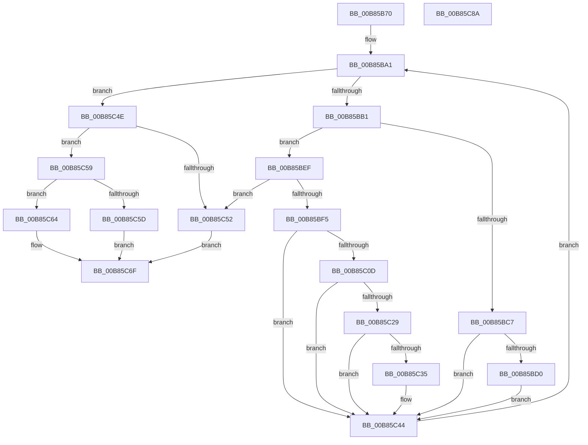

# HalpQueryDebuggerInformation

- RVA: `0x00B85B70`–`0x00B85C8B` (길이 `283` bytes)
- VA: `0x0000000140B85B70`
- 실행 섹션: `PAGEKD`
- PDB 이름 있음: `예`; PDB Function 태그: `아니요`
- unwind 정보 RVA: `0x0005E6B4`
- 디코드: `79`개 명령, `283/283` bytes 표시
- 미해석 바이트: `0` (있으면 어셈블리에 `.byte`로 보존)

> 이 문서는 커널 이미지의 기계어와 PDB 기호를 분석해 생성했습니다. 4번과 5번은 함수 원형과 자료형을 바이너리 사용 방식에서 추정한 C 해석이며 원본 소스 복구 결과는 아닙니다.

## 1. Dependencies

- 직접 호출 지점: **1**; 고유 호출 대상: **1**
- 직접 호출자로 확인된 함수: **1**
- RIP 상대 이미지 참조: **2**

### Outgoing calls
- `0x00B85C3F` → [wcscpy_s](../../text/50/wcscpy_s_function_005064B0.md) (function, `0x005064B0`)

### Direct callers
- [HaliQuerySystemInformation](../../pagelk/B7/HaliQuerySystemInformation_function_00B7A990.md) at `0x00B7AB97`

### Static image references
- `0x00B85B93` → RVA `0x00F8FB68` (`.data`; read)
- `0x00B85C64` → RVA `0x00F8FB60` (`.data`; read)

## 2. Other-region calls and transfers

- 다른 실행 섹션으로 향하는 call: **1**
  - `0x00B85C3F` → [wcscpy_s](../../text/50/wcscpy_s_function_005064B0.md) (`PAGEKD` → `.text`)
- 별도 외부 분기/꼬리 이동을 확인하지 못했습니다.

## 3. Assembly (complete function range)

```asm
00B85B70  48 8B C4                        mov rax, rsp
00B85B73  48 89 58 08                     mov qword ptr [rax + 8], rbx
00B85B77  48 89 68 10                     mov qword ptr [rax + 0x10], rbp
00B85B7B  48 89 70 18                     mov qword ptr [rax + 0x18], rsi
00B85B7F  48 89 78 20                     mov qword ptr [rax + 0x20], rdi
00B85B83  41 56                           push r14
00B85B85  48 83 EC 20                     sub rsp, 0x20
00B85B89  41 C7 00 04 00 00 00            mov dword ptr [r8], 4
00B85B90  49 8B D8                        mov rbx, r8
00B85B93  48 8B 3D CE 9F 40 00            mov rdi, qword ptr [rip + 0x409fce]
00B85B9A  8B EA                           mov ebp, edx
00B85B9C  4C 8B F1                        mov r14, rcx
00B85B9F  33 F6                           xor esi, esi
00B85BA1  48 8D 05 C0 9F 40 00            lea rax, [rip + 0x409fc0]
00B85BA8  48 3B F8                        cmp rdi, rax
00B85BAB  0F 84 9D 00 00 00               je 0x140b85c4e
00B85BB1  48 8B 57 10                     mov rdx, qword ptr [rdi + 0x10]
00B85BB5  8B 03                           mov eax, dword ptr [rbx]
00B85BB7  44 8B 82 DC 00 00 00            mov r8d, dword ptr [rdx + 0xdc]
00B85BBE  49 8D 0C 06                     lea rcx, [r14 + rax]
00B85BC2  45 85 C0                        test r8d, r8d
00B85BC5  75 28                           jne 0x140b85bef
00B85BC7  83 C0 14                        add eax, 0x14
00B85BCA  89 03                           mov dword ptr [rbx], eax
00B85BCC  3B C5                           cmp eax, ebp
00B85BCE  77 74                           ja 0x140b85c44
00B85BD0  44 21 01                        and dword ptr [rcx], r8d
00B85BD3  C7 41 04 14 00 00 00            mov dword ptr [rcx + 4], 0x14
00B85BDA  8B 02                           mov eax, dword ptr [rdx]
00B85BDC  89 41 0C                        mov dword ptr [rcx + 0xc], eax
00B85BDF  8B 42 04                        mov eax, dword ptr [rdx + 4]
00B85BE2  89 41 10                        mov dword ptr [rcx + 0x10], eax
00B85BE5  0F B7 42 08                     movzx eax, word ptr [rdx + 8]
00B85BE9  66 89 41 08                     mov word ptr [rcx + 8], ax
00B85BED  EB 55                           jmp 0x140b85c44
00B85BEF  41 83 F8 01                     cmp r8d, 1
00B85BF3  75 5D                           jne 0x140b85c52
00B85BF5  44 8B 8A E8 00 00 00            mov r9d, dword ptr [rdx + 0xe8]
00B85BFC  41 83 C1 02                     add r9d, 2
00B85C00  45 8D 41 14                     lea r8d, [r9 + 0x14]
00B85C04  41 03 C0                        add eax, r8d
00B85C07  89 03                           mov dword ptr [rbx], eax
00B85C09  3B C5                           cmp eax, ebp
00B85C0B  77 37                           ja 0x140b85c44
00B85C0D  C7 01 01 00 00 00               mov dword ptr [rcx], 1
00B85C13  44 89 41 04                     mov dword ptr [rcx + 4], r8d
00B85C17  8B 82 E8 00 00 00               mov eax, dword ptr [rdx + 0xe8]
00B85C1D  89 41 08                        mov dword ptr [rcx + 8], eax
00B85C20  83 BA E8 00 00 00 00            cmp dword ptr [rdx + 0xe8], 0
00B85C27  74 1B                           je 0x140b85c44
00B85C29  4C 8B 82 E0 00 00 00            mov r8, qword ptr [rdx + 0xe0]
00B85C30  4D 85 C0                        test r8, r8
00B85C33  74 0F                           je 0x140b85c44
00B85C35  41 8B D1                        mov edx, r9d
00B85C38  48 83 C1 0C                     add rcx, 0xc
00B85C3C  48 D1 EA                        shr rdx, 1
00B85C3F  E8 6C 08 98 FF                  call 0x1405064b0
00B85C44  48 8B 3F                        mov rdi, qword ptr [rdi]
00B85C47  FF C6                           inc esi
00B85C49  E9 53 FF FF FF                  jmp 0x140b85ba1
00B85C4E  85 F6                           test esi, esi
00B85C50  75 07                           jne 0x140b85c59
00B85C52  B8 01 00 00 C0                  mov eax, 0xc0000001
00B85C57  EB 16                           jmp 0x140b85c6f
00B85C59  39 2B                           cmp dword ptr [rbx], ebp
00B85C5B  76 07                           jbe 0x140b85c64
00B85C5D  B8 05 00 00 80                  mov eax, 0x80000005
00B85C62  EB 0B                           jmp 0x140b85c6f
00B85C64  8B 05 F6 9E 40 00               mov eax, dword ptr [rip + 0x409ef6]
00B85C6A  41 89 06                        mov dword ptr [r14], eax
00B85C6D  33 C0                           xor eax, eax
00B85C6F  48 8B 5C 24 30                  mov rbx, qword ptr [rsp + 0x30]
00B85C74  48 8B 6C 24 38                  mov rbp, qword ptr [rsp + 0x38]
00B85C79  48 8B 74 24 40                  mov rsi, qword ptr [rsp + 0x40]
00B85C7E  48 8B 7C 24 48                  mov rdi, qword ptr [rsp + 0x48]
00B85C83  48 83 C4 20                     add rsp, 0x20
00B85C87  41 5E                           pop r14
00B85C89  C3                              ret
00B85C8A  CC                              int3
```

## 4. C-style interpretation (structured pseudocode)

```c
__int64 __fastcall HalpQueryDebuggerInformation(__int64 a1, int a2, __int64 a3)
{
    __int64 result;
    __int64 v_rsi;
    __int64 v_rsp;
    unsigned __int64 v_stack_p10;
    unsigned __int64 v_stack_p18;
    unsigned __int64 v_stack_p20;
    unsigned __int64 v_stack_p8;

    *(unsigned __int64 *)(v_rsp + 8) = v_rbx;
    *(unsigned __int64 *)(v_rsp + 16) = v_rbp;
    *(unsigned __int64 *)(v_rsp + 24) = v_rsi;
    *(unsigned __int64 *)(v_rsp + 32) = v_rdi;
    v_rsp = (v_rsp) - (32);
    *(unsigned int *)(a3) = 4;
    v_rsi = 0;
loc_00B85BA1:
    if ((*(unsigned __int64 *)(v_rip + 4235214)) == (v_rip + 4235200)) goto loc_00B85C4E;
    if ((unsigned int)((unsigned int)(*(unsigned int *)(*(unsigned __int64 *)(*(unsigned __int64 *)(v_rip + 4235214) + 16) + 220))) != 0) goto loc_00B85BEF;
    result = (unsigned int)(((unsigned int)(*(unsigned int *)(a3))) + (20));
    *(unsigned int *)(a3) = (unsigned int)(result);
    if (((unsigned int)(result)) > ((unsigned int)((unsigned int)(a2)))) goto loc_00B85C44;
    *(unsigned int *)(a1 + (unsigned int)(*(unsigned int *)(a3)) * 1 + 4) = 20;
    *(unsigned int *)(a1 + (unsigned int)(*(unsigned int *)(a3)) * 1 + 12) = (unsigned int)((unsigned int)(*(unsigned int *)(*(unsigned __int64 *)(*(unsigned __int64 *)(v_rip + 4235214) + 16))));
    *(unsigned int *)(a1 + (unsigned int)(*(unsigned int *)(a3)) * 1 + 16) = (unsigned int)((unsigned int)(*(unsigned int *)(*(unsigned __int64 *)(*(unsigned __int64 *)(v_rip + 4235214) + 16) + 4)));
    *(unsigned __int16 *)(a1 + (unsigned int)(*(unsigned int *)(a3)) * 1 + 8) = (unsigned __int16)(*(unsigned __int16 *)(*(unsigned __int64 *)(*(unsigned __int64 *)(v_rip + 4235214) + 16) + 8));
    goto loc_00B85C44;
loc_00B85BEF:
    if (((unsigned int)((unsigned int)(*(unsigned int *)(*(unsigned __int64 *)(*(unsigned __int64 *)(v_rip + 4235214) + 16) + 220)))) != 1) goto loc_00B85C52;
    a4 = (unsigned int)(((unsigned int)(*(unsigned int *)(*(unsigned __int64 *)(*(unsigned __int64 *)(v_rip + 4235214) + 16) + 232))) + (2));
    result = (unsigned int)((*(unsigned __int16 *)(*(unsigned __int64 *)(*(unsigned __int64 *)(v_rip + 4235214) + 16) + 8)) + ((unsigned int)(a4 + 20)));
    *(unsigned int *)(a3) = (unsigned int)(result);
    if (((unsigned int)(result)) > ((unsigned int)((unsigned int)(a2)))) goto loc_00B85C44;
    *(unsigned int *)(a1 + (unsigned int)(*(unsigned int *)(a3)) * 1) = 1;
    *(unsigned int *)(a1 + (unsigned int)(*(unsigned int *)(a3)) * 1 + 4) = (unsigned int)(a4 + 20);
    *(unsigned int *)(a1 + (unsigned int)(*(unsigned int *)(a3)) * 1 + 8) = (unsigned int)((unsigned int)(*(unsigned int *)(*(unsigned __int64 *)(*(unsigned __int64 *)(v_rip + 4235214) + 16) + 232)));
    if ((*(unsigned int *)(*(unsigned __int64 *)(*(unsigned __int64 *)(v_rip + 4235214) + 16) + 232)) == 0) goto loc_00B85C44;
    result = (unsigned int)(*(unsigned int *)(*(unsigned __int64 *)(*(unsigned __int64 *)(v_rip + 4235214) + 16) + 232));
    if (*(unsigned __int64 *)(*(unsigned __int64 *)(*(unsigned __int64 *)(v_rip + 4235214) + 16) + 224) != 0) {
        a2 = (unsigned int)(a4);
        a1 = (a1 + (unsigned int)(*(unsigned int *)(a3)) * 1) + (12);
        a2 = (a2) >> (1);
        result = wcscpy_s(a1, a2, *(unsigned __int64 *)(*(unsigned __int64 *)(*(unsigned __int64 *)(v_rip + 4235214) + 16) + 224), a4);
    }
    v_rsi = (unsigned int)((v_rsi) + 1);
    goto loc_00B85BA1;
loc_00B85C4E:
    if ((unsigned int)(v_rsi) != 0) goto loc_00B85C59;
loc_00B85C52:
    goto loc_00B85C6F;
loc_00B85C59:
    if ((*(unsigned int *)(a3)) <= ((unsigned int)((unsigned int)(a2)))) goto loc_00B85C64;
    goto loc_00B85C6F;
loc_00B85C64:
    *(unsigned int *)(a1) = (unsigned int)((unsigned int)(*(unsigned int *)(v_rip + 4234998)));
    result = 0;
loc_00B85C6F:
    v_rsp = (v_rsp) + (32);
    return result;
}
```

## 5. (Beta) C Style

```c
int64_t HalpQueryDebuggerInformation(void *Arg1, int32_t Arg2, void *Arg3)
{
    uint8_t *arg1 = (uint8_t *)Arg1;
    uint8_t *arg3 = (uint8_t *)Arg3;

    int64_t result;
    int64_t local_rsi;
    int64_t local_rsp;
    uint64_t v_stack_p10;
    uint64_t v_stack_p18;
    uint64_t v_stack_p20;
    uint64_t v_stack_p8;

    *(uint64_t *)(local_rsp + 0x8) = local_rbx;
    *(uint64_t *)(local_rsp + 0x10) = local_rbp;
    *(uint64_t *)(local_rsp + 0x18) = local_rsi;
    *(uint64_t *)(local_rsp + 0x20) = local_rdi;
    local_rsp = (local_rsp) - (32);
    *(uint32_t *)(arg3) = 4;
    local_rsi = 0;
loc_00B85BA1:
    if ((*(uint64_t *)(v_rip + 0x409FCE)) == (v_rip + 4235200)) goto loc_00B85C4E;
    if ((uint32_t)((uint32_t)(*(uint32_t *)(*(uint64_t *)(*(uint64_t *)(v_rip + 0x409FCE) + 0x10) + 0xDC))) != 0) goto loc_00B85BEF;
    result = (uint32_t)(((uint32_t)(*(uint32_t *)(arg3))) + (20));
    *(uint32_t *)(arg3) = (uint32_t)(result);
    if (((uint32_t)(result)) > ((uint32_t)((uint32_t)(Arg2)))) goto loc_00B85C44;
    *(uint32_t *)(arg1 + (uint32_t)(*(uint32_t *)(arg3)) * 1 + 0x4) = 20;
    *(uint32_t *)(arg1 + (uint32_t)(*(uint32_t *)(arg3)) * 1 + 0xC) = (uint32_t)((uint32_t)(*(uint32_t *)(*(uint64_t *)(*(uint64_t *)(v_rip + 0x409FCE) + 0x10))));
    *(uint32_t *)(arg1 + (uint32_t)(*(uint32_t *)(arg3)) * 1 + 0x10) = (uint32_t)((uint32_t)(*(uint32_t *)(*(uint64_t *)(*(uint64_t *)(v_rip + 0x409FCE) + 0x10) + 0x4)));
    *(uint16_t *)(arg1 + (uint32_t)(*(uint32_t *)(arg3)) * 1 + 0x8) = (uint16_t)(*(uint16_t *)(*(uint64_t *)(*(uint64_t *)(v_rip + 0x409FCE) + 0x10) + 0x8));
    goto loc_00B85C44;
loc_00B85BEF:
    if (((uint32_t)((uint32_t)(*(uint32_t *)(*(uint64_t *)(*(uint64_t *)(v_rip + 0x409FCE) + 0x10) + 0xDC)))) != 1) goto loc_00B85C52;
    a4 = (uint32_t)(((uint32_t)(*(uint32_t *)(*(uint64_t *)(*(uint64_t *)(v_rip + 0x409FCE) + 0x10) + 0xE8))) + (2));
    result = (uint32_t)((*(uint16_t *)(*(uint64_t *)(*(uint64_t *)(v_rip + 0x409FCE) + 0x10) + 0x8)) + ((uint32_t)(a4 + 20)));
    *(uint32_t *)(arg3) = (uint32_t)(result);
    if (((uint32_t)(result)) > ((uint32_t)((uint32_t)(Arg2)))) goto loc_00B85C44;
    *(uint32_t *)(arg1 + (uint32_t)(*(uint32_t *)(arg3)) * 1) = 1;
    *(uint32_t *)(arg1 + (uint32_t)(*(uint32_t *)(arg3)) * 1 + 0x4) = (uint32_t)(a4 + 20);
    *(uint32_t *)(arg1 + (uint32_t)(*(uint32_t *)(arg3)) * 1 + 0x8) = (uint32_t)((uint32_t)(*(uint32_t *)(*(uint64_t *)(*(uint64_t *)(v_rip + 0x409FCE) + 0x10) + 0xE8)));
    if ((*(uint32_t *)(*(uint64_t *)(*(uint64_t *)(v_rip + 0x409FCE) + 0x10) + 0xE8)) == 0) goto loc_00B85C44;
    result = (uint32_t)(*(uint32_t *)(*(uint64_t *)(*(uint64_t *)(v_rip + 0x409FCE) + 0x10) + 0xE8));
    if (*(uint64_t *)(*(uint64_t *)(*(uint64_t *)(v_rip + 0x409FCE) + 0x10) + 0xE0) != 0) {
        Arg2 = (uint32_t)(a4);
        Arg1 = (Arg1 + (uint32_t)(*(uint32_t *)(arg3)) * 1) + (12);
        Arg2 = (Arg2) >> (1);
        result = wcscpy_s(Arg1, Arg2, *(uint64_t *)(*(uint64_t *)(*(uint64_t *)(v_rip + 0x409FCE) + 0x10) + 0xE0), a4);
    }
    local_rsi = (uint32_t)((local_rsi) + 1);
    goto loc_00B85BA1;
loc_00B85C4E:
    if ((uint32_t)(local_rsi) != 0) goto loc_00B85C59;
loc_00B85C52:
    goto loc_00B85C6F;
loc_00B85C59:
    if ((*(uint32_t *)(arg3)) <= ((uint32_t)((uint32_t)(Arg2)))) goto loc_00B85C64;
    goto loc_00B85C6F;
loc_00B85C64:
    *(uint32_t *)(arg1) = (uint32_t)((uint32_t)(*(uint32_t *)(v_rip + 0x409EF6)));
    result = 0;
loc_00B85C6F:
    local_rsp = (local_rsp) + (32);
    return result;
}
```

### 관측된 메모리 오프셋

구조체 형식이 확인되지 않은 접근은 인자 기준의 오프셋으로만 기록했습니다.

| 기준 인자 | 오프셋 표현 | 폭 (bit) | 접근 |
|---|---:|---:|---|
| `Arg1` | `+ 0x0` | `32` | `R/W` |
| `Arg1` | `+ 0x0` | `32` | `W` |
| `Arg1` | `+ 0x0 + rax*1` | `64` | `R` |
| `Arg1` | `+ 0x4` | `32` | `W` |
| `Arg1` | `+ 0x8` | `16` | `W` |
| `Arg1` | `+ 0x8` | `32` | `W` |
| `Arg1` | `+ 0xC` | `32` | `W` |
| `Arg1` | `+ 0x10` | `32` | `W` |
| `Arg3` | `+ 0x0` | `32` | `R` |
| `Arg3` | `+ 0x0` | `32` | `W` |

## 6. Execution-region graph

[열기: 2D/3D 그래프와 함수 탐색 컨트롤 패널](../../../control-panel.html?section=pagekd&rva=0x00B85B70&view=graph)

- 2D 그래프는 위에서 아래로 흐르고, 3D 그래프는 빈 공간을 드래그해 회전합니다. Shift+드래그는 이동, 휠은 확대·축소, 함수 노드 선택은 대상 보고서 이동입니다.

### Static fallback


