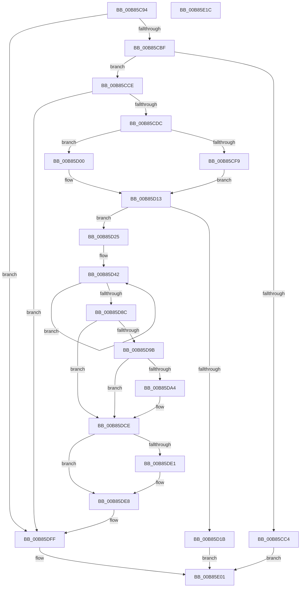

# HalpRegisterDeviceInUse

- RVA: `0x00B85C94`–`0x00B85E1D` (길이 `393` bytes)
- VA: `0x0000000140B85C94`
- 실행 섹션: `PAGEKD`
- PDB 이름 있음: `예`; PDB Function 태그: `아니요`
- unwind 정보 RVA: `0x0005E6B4`
- 디코드: `98`개 명령, `393/393` bytes 표시
- 미해석 바이트: `0` (있으면 어셈블리에 `.byte`로 보존)

> 이 문서는 커널 이미지의 기계어와 PDB 기호를 분석해 생성했습니다. 4번과 5번은 함수 원형과 자료형을 바이너리 사용 방식에서 추정한 C 해석이며 원본 소스 복구 결과는 아닙니다.

## 1. Dependencies

- 직접 호출 지점: **5**; 고유 호출 대상: **5**
- 직접 호출자로 확인된 함수: **1**
- RIP 상대 이미지 참조: **5**

### Outgoing calls
- `0x00B85CCE` → [HalpFindDevice](HalpFindDevice_function_00B85770.md) (function, `0x00B85770`)
- `0x00B85CF9` → [HalpMmAllocateMemory](../../text/54/HalpMmAllocateMemory_function_00544974.md) (function, `0x00544974`)
- `0x00B85D0E` → [ExAllocatePool2](../../poolcode/B8/ExAllocatePool2_function_00B820F0.md) (function, `0x00B820F0`)
- `0x00B85D2D` → [memset](../../text/6C/memset_function_006C6C40.md) (function, `0x006C6C40`)
- `0x00B85DC9` → [wcscpy_s](../../text/50/wcscpy_s_function_005064B0.md) (function, `0x005064B0`)

### Direct callers
- [HalpKdSetupDebuggingDevice](HalpKdSetupDebuggingDevice_function_00B85A80.md) at `0x00B85B10`

### Static image references
- `0x00B85CE7` → RVA `0x00E10230` (`.data`; read)
- `0x00B85DCE` → RVA `0x00F8FB70` (`.data`; read)
- `0x00B85DD5` → RVA `0x00F8FB68` (`.data`; read)
- `0x00B85DF2` → RVA `0x00F8FB60` (`.data`; read/write)
- `0x00B85DF8` → RVA `0x00F8FB70` (`.data`; write)

## 2. Other-region calls and transfers

- 다른 실행 섹션으로 향하는 call: **4**
  - `0x00B85CF9` → [HalpMmAllocateMemory](../../text/54/HalpMmAllocateMemory_function_00544974.md) (`PAGEKD` → `.text`)
  - `0x00B85D0E` → [ExAllocatePool2](../../poolcode/B8/ExAllocatePool2_function_00B820F0.md) (`PAGEKD` → `POOLCODE`)
  - `0x00B85D2D` → [memset](../../text/6C/memset_function_006C6C40.md) (`PAGEKD` → `.text`)
  - `0x00B85DC9` → [wcscpy_s](../../text/50/wcscpy_s_function_005064B0.md) (`PAGEKD` → `.text`)
- 별도 외부 분기/꼬리 이동을 확인하지 못했습니다.

## 3. Assembly (complete function range)

```asm
00B85C94  48 8B C4                        mov rax, rsp
00B85C97  48 89 58 08                     mov qword ptr [rax + 8], rbx
00B85C9B  48 89 68 10                     mov qword ptr [rax + 0x10], rbp
00B85C9F  48 89 70 18                     mov qword ptr [rax + 0x18], rsi
00B85CA3  48 89 78 20                     mov qword ptr [rax + 0x20], rdi
00B85CA7  41 56                           push r14
00B85CA9  48 83 EC 20                     sub rsp, 0x20
00B85CAD  8B 81 DC 00 00 00               mov eax, dword ptr [rcx + 0xdc]
00B85CB3  48 8B F9                        mov rdi, rcx
00B85CB6  83 F8 03                        cmp eax, 3
00B85CB9  0F 84 40 01 00 00               je 0x140b85dff
00B85CBF  83 F8 01                        cmp eax, 1
00B85CC2  76 0A                           jbe 0x140b85cce
00B85CC4  B8 0D 00 00 C0                  mov eax, 0xc000000d
00B85CC9  E9 33 01 00 00                  jmp 0x140b85e01
00B85CCE  E8 9D FA FF FF                  call 0x140b85770
00B85CD3  48 85 C0                        test rax, rax
00B85CD6  0F 85 23 01 00 00               jne 0x140b85dff
00B85CDC  8B B7 E8 00 00 00               mov esi, dword ptr [rdi + 0xe8]
00B85CE2  8D 68 02                        lea ebp, [rax + 2]
00B85CE5  03 F5                           add esi, ebp
00B85CE7  48 39 05 42 A5 28 00            cmp qword ptr [rip + 0x28a542], rax
00B85CEE  8D 8E 28 01 00 00               lea ecx, [rsi + 0x128]
00B85CF4  44 8B F1                        mov r14d, ecx
00B85CF7  74 07                           je 0x140b85d00
00B85CF9  E8 76 EC 9B FF                  call 0x140544974
00B85CFE  EB 13                           jmp 0x140b85d13
00B85D00  41 B8 48 61 6C 64               mov r8d, 0x646c6148
00B85D06  49 8B D6                        mov rdx, r14
00B85D09  B9 00 01 00 00                  mov ecx, 0x100
00B85D0E  E8 DD C3 FF FF                  call 0x140b820f0
00B85D13  48 8B D8                        mov rbx, rax
00B85D16  48 85 C0                        test rax, rax
00B85D19  75 0A                           jne 0x140b85d25
00B85D1B  B8 9A 00 00 C0                  mov eax, 0xc000009a
00B85D20  E9 DC 00 00 00                  jmp 0x140b85e01
00B85D25  4D 8B C6                        mov r8, r14
00B85D28  33 D2                           xor edx, edx
00B85D2A  48 8B CB                        mov rcx, rbx
00B85D2D  E8 0E 0F B4 FF                  call 0x1406c6c40
00B85D32  48 8D 43 18                     lea rax, [rbx + 0x18]
00B85D36  48 8B CF                        mov rcx, rdi
00B85D39  48 89 43 10                     mov qword ptr [rbx + 0x10], rax
00B85D3D  BA 80 00 00 00                  mov edx, 0x80
00B85D42  0F 10 01                        movups xmm0, xmmword ptr [rcx]
00B85D45  0F 11 00                        movups xmmword ptr [rax], xmm0
00B85D48  0F 10 49 10                     movups xmm1, xmmword ptr [rcx + 0x10]
00B85D4C  0F 11 48 10                     movups xmmword ptr [rax + 0x10], xmm1
00B85D50  0F 10 41 20                     movups xmm0, xmmword ptr [rcx + 0x20]
00B85D54  0F 11 40 20                     movups xmmword ptr [rax + 0x20], xmm0
00B85D58  0F 10 49 30                     movups xmm1, xmmword ptr [rcx + 0x30]
00B85D5C  0F 11 48 30                     movups xmmword ptr [rax + 0x30], xmm1
00B85D60  0F 10 41 40                     movups xmm0, xmmword ptr [rcx + 0x40]
00B85D64  0F 11 40 40                     movups xmmword ptr [rax + 0x40], xmm0
00B85D68  0F 10 49 50                     movups xmm1, xmmword ptr [rcx + 0x50]
00B85D6C  0F 11 48 50                     movups xmmword ptr [rax + 0x50], xmm1
00B85D70  0F 10 41 60                     movups xmm0, xmmword ptr [rcx + 0x60]
00B85D74  0F 11 40 60                     movups xmmword ptr [rax + 0x60], xmm0
00B85D78  48 03 C2                        add rax, rdx
00B85D7B  0F 10 49 70                     movups xmm1, xmmword ptr [rcx + 0x70]
00B85D7F  48 03 CA                        add rcx, rdx
00B85D82  0F 11 48 F0                     movups xmmword ptr [rax - 0x10], xmm1
00B85D86  48 83 ED 01                     sub rbp, 1
00B85D8A  75 B6                           jne 0x140b85d42
00B85D8C  0F 10 01                        movups xmm0, xmmword ptr [rcx]
00B85D8F  0F 11 00                        movups xmmword ptr [rax], xmm0
00B85D92  83 BF DC 00 00 00 01            cmp dword ptr [rdi + 0xdc], 1
00B85D99  75 33                           jne 0x140b85dce
00B85D9B  48 39 AF E0 00 00 00            cmp qword ptr [rdi + 0xe0], rbp
00B85DA2  74 2A                           je 0x140b85dce
00B85DA4  48 8D 83 28 01 00 00            lea rax, [rbx + 0x128]
00B85DAB  8B D6                           mov edx, esi
00B85DAD  48 89 83 F8 00 00 00            mov qword ptr [rbx + 0xf8], rax
00B85DB4  48 8B 4B 10                     mov rcx, qword ptr [rbx + 0x10]
00B85DB8  4C 8B 87 E0 00 00 00            mov r8, qword ptr [rdi + 0xe0]
00B85DBF  48 D1 EA                        shr rdx, 1
00B85DC2  48 8B 89 E0 00 00 00            mov rcx, qword ptr [rcx + 0xe0]
00B85DC9  E8 E2 06 98 FF                  call 0x1405064b0
00B85DCE  48 8B 05 9B 9D 40 00            mov rax, qword ptr [rip + 0x409d9b]
00B85DD5  48 8D 15 8C 9D 40 00            lea rdx, [rip + 0x409d8c]
00B85DDC  48 39 10                        cmp qword ptr [rax], rdx
00B85DDF  74 07                           je 0x140b85de8
00B85DE1  B9 03 00 00 00                  mov ecx, 3
00B85DE6  CD 29                           int 0x29
00B85DE8  48 89 13                        mov qword ptr [rbx], rdx
00B85DEB  48 89 43 08                     mov qword ptr [rbx + 8], rax
00B85DEF  48 89 18                        mov qword ptr [rax], rbx
00B85DF2  FF 05 68 9D 40 00               inc dword ptr [rip + 0x409d68]
00B85DF8  48 89 1D 71 9D 40 00            mov qword ptr [rip + 0x409d71], rbx
00B85DFF  33 C0                           xor eax, eax
00B85E01  48 8B 5C 24 30                  mov rbx, qword ptr [rsp + 0x30]
00B85E06  48 8B 6C 24 38                  mov rbp, qword ptr [rsp + 0x38]
00B85E0B  48 8B 74 24 40                  mov rsi, qword ptr [rsp + 0x40]
00B85E10  48 8B 7C 24 48                  mov rdi, qword ptr [rsp + 0x48]
00B85E15  48 83 C4 20                     add rsp, 0x20
00B85E19  41 5E                           pop r14
00B85E1B  C3                              ret
00B85E1C  CC                              int3
```

## 4. C-style interpretation (structured pseudocode)

```c
__int64 __fastcall HalpRegisterDeviceInUse(__int64 a1)
{
    __int64 result;
    __int64 v_rbp;
    __int64 v_rsi;
    __int64 v_rsp;
    unsigned __int64 v_stack_p10;
    unsigned __int64 v_stack_p18;
    unsigned __int64 v_stack_p20;
    unsigned __int64 v_stack_p8;

    *(unsigned __int64 *)(v_rsp + 8) = v_rbx;
    *(unsigned __int64 *)(v_rsp + 16) = v_rbp;
    *(unsigned __int64 *)(v_rsp + 24) = v_rsi;
    *(unsigned __int64 *)(v_rsp + 32) = v_rdi;
    v_rsp = (v_rsp) - (32);
    if (((unsigned int)((unsigned int)(*(unsigned int *)(a1 + 220)))) == 3) goto loc_00B85DFF;
    if (((unsigned int)((unsigned int)(*(unsigned int *)(a1 + 220)))) <= 1) goto loc_00B85CCE;
    goto loc_00B85E01;
loc_00B85CCE:
    result = HalpFindDevice(a1, a2, a3, a4);
    if (result != 0) goto loc_00B85DFF;
    v_rsi = (unsigned int)(((unsigned int)(*(unsigned int *)(a1 + 232))) + ((unsigned int)(result + 2)));
    if ((*(unsigned __int64 *)(v_rip + 2663746)) == result) goto loc_00B85D00;
    result = HalpMmAllocateMemory(v_rsi + 296, a2, a3, a4);
    goto loc_00B85D13;
loc_00B85D00:
    result = ExAllocatePool2(256, (unsigned int)((unsigned int)(v_rsi + 296)), (unsigned int)(0x646C6148ULL), a4);
loc_00B85D13:
    if (result != 0) goto loc_00B85D25;
    goto loc_00B85E01;
loc_00B85D25:
    a2 = 0;
    result = memset(result, a2, (unsigned int)((unsigned int)(v_rsi + 296)), a4);
    *(unsigned __int64 *)(result + 16) = result + 24;
loc_00B85D42:
    *(unsigned __int64 *)(result + 24) = v_xmm0;
    *(unsigned __int64 *)(result + 24 + 16) = v_xmm1;
    *(unsigned __int64 *)(result + 24 + 32) = v_xmm0;
    *(unsigned __int64 *)(result + 24 + 48) = v_xmm1;
    *(unsigned __int64 *)(result + 24 + 64) = v_xmm0;
    *(unsigned __int64 *)(result + 24 + 80) = v_xmm1;
    *(unsigned __int64 *)(result + 24 + 96) = v_xmm0;
    result = (result + 24) + (128);
    a1 = (a1) + (128);
    *(unsigned __int64 *)(result - 16) = v_xmm1;
    v_rbp = (result + 2) - (1);
    if (condition_is_not_equal) goto loc_00B85D42;
    *(unsigned __int64 *)(result) = v_xmm0;
    if ((*(unsigned int *)(a1 + 220)) != 1) goto loc_00B85DCE;
    if ((*(unsigned __int64 *)(a1 + 224)) != v_rbp) {
        result = result + 296;
        a2 = (unsigned int)(v_rsi);
        *(unsigned __int64 *)(result + 248) = result;
        a1 = *(unsigned __int64 *)(result + 16);
        a3 = *(unsigned __int64 *)(a1 + 224);
        a2 = (a2) >> (1);
        a1 = *(unsigned __int64 *)(a1 + 224);
        result = wcscpy_s(a1, a2, a3, a4);
    }
    if ((*(unsigned __int64 *)(*(unsigned __int64 *)(v_rip + 4234651))) != (v_rip + 4234636)) {
        a1 = 3;
    }
    *(unsigned __int64 *)(result) = v_rip + 4234636;
    *(unsigned __int64 *)(result + 8) = *(unsigned __int64 *)(v_rip + 4234651);
    *(unsigned __int64 *)(*(unsigned __int64 *)(v_rip + 4234651)) = result;
    *(unsigned __int64 *)(v_rip + 4234609) = result;
loc_00B85DFF:
    result = 0;
loc_00B85E01:
    v_rsp = (v_rsp) + (32);
    return result;
}
```

## 5. (Beta) C Style

```c
int64_t HalpRegisterDeviceInUse(void *Arg1)
{
    uint8_t *arg1 = (uint8_t *)Arg1;

    int64_t result;
    int64_t local_rbp;
    int64_t local_rsi;
    int64_t local_rsp;
    uint64_t v_stack_p10;
    uint64_t v_stack_p18;
    uint64_t v_stack_p20;
    uint64_t v_stack_p8;

    *(uint64_t *)(local_rsp + 0x8) = local_rbx;
    *(uint64_t *)(local_rsp + 0x10) = local_rbp;
    *(uint64_t *)(local_rsp + 0x18) = local_rsi;
    *(uint64_t *)(local_rsp + 0x20) = local_rdi;
    local_rsp = (local_rsp) - (32);
    if (((uint32_t)((uint32_t)(*(uint32_t *)(arg1 + 0xDC)))) == 3) goto loc_00B85DFF;
    if (((uint32_t)((uint32_t)(*(uint32_t *)(arg1 + 0xDC)))) <= 1) goto loc_00B85CCE;
    goto loc_00B85E01;
loc_00B85CCE:
    result = HalpFindDevice(Arg1, a2, a3, a4);
    if (result != 0) goto loc_00B85DFF;
    local_rsi = (uint32_t)(((uint32_t)(*(uint32_t *)(arg1 + 0xE8))) + ((uint32_t)(result + 2)));
    if ((*(uint64_t *)(v_rip + 0x28A542)) == result) goto loc_00B85D00;
    result = HalpMmAllocateMemory(local_rsi + 296, a2, a3, a4);
    goto loc_00B85D13;
loc_00B85D00:
    result = ExAllocatePool2(256, (uint32_t)((uint32_t)(local_rsi + 296)), (uint32_t)(0x646C6148ULL), a4);
loc_00B85D13:
    if (result != 0) goto loc_00B85D25;
    goto loc_00B85E01;
loc_00B85D25:
    a2 = 0;
    result = memset(result, a2, (uint32_t)((uint32_t)(local_rsi + 296)), a4);
    *(uint64_t *)(result + 0x10) = result + 24;
loc_00B85D42:
    *(uint64_t *)(result + 0x18) = v_xmm0;
    *(uint64_t *)(result + 0x18 + 0x10) = v_xmm1;
    *(uint64_t *)(result + 0x18 + 0x20) = v_xmm0;
    *(uint64_t *)(result + 0x18 + 0x30) = v_xmm1;
    *(uint64_t *)(result + 0x18 + 0x40) = v_xmm0;
    *(uint64_t *)(result + 0x18 + 0x50) = v_xmm1;
    *(uint64_t *)(result + 0x18 + 0x60) = v_xmm0;
    result = (result + 24) + (128);
    Arg1 = (Arg1) + (128);
    *(uint64_t *)(result - 0x10) = v_xmm1;
    local_rbp = (result + 2) - (1);
    if (condition_is_not_equal) goto loc_00B85D42;
    *(uint64_t *)(result) = v_xmm0;
    if ((*(uint32_t *)(arg1 + 0xDC)) != 1) goto loc_00B85DCE;
    if ((*(uint64_t *)(arg1 + 0xE0)) != local_rbp) {
        result = result + 296;
        a2 = (uint32_t)(local_rsi);
        *(uint64_t *)(result + 0xF8) = result;
        Arg1 = *(uint64_t *)(result + 0x10);
        a3 = *(uint64_t *)(arg1 + 0xE0);
        a2 = (a2) >> (1);
        Arg1 = *(uint64_t *)(arg1 + 0xE0);
        result = wcscpy_s(Arg1, a2, a3, a4);
    }
    if ((*(uint64_t *)(*(uint64_t *)(v_rip + 0x409D9B))) != (v_rip + 4234636)) {
        Arg1 = 3;
    }
    *(uint64_t *)(result) = v_rip + 4234636;
    *(uint64_t *)(result + 0x8) = *(uint64_t *)(v_rip + 0x409D9B);
    *(uint64_t *)(*(uint64_t *)(v_rip + 0x409D9B)) = result;
    *(uint64_t *)(v_rip + 0x409D71) = result;
loc_00B85DFF:
    result = 0;
loc_00B85E01:
    local_rsp = (local_rsp) + (32);
    return result;
}
```

### 관측된 메모리 오프셋

구조체 형식이 확인되지 않은 접근은 인자 기준의 오프셋으로만 기록했습니다.

| 기준 인자 | 오프셋 표현 | 폭 (bit) | 접근 |
|---|---:|---:|---|
| `Arg1` | `+ 0x0` | `128` | `R` |
| `Arg1` | `+ 0x10` | `128` | `R` |
| `Arg1` | `+ 0x20` | `128` | `R` |
| `Arg1` | `+ 0x30` | `128` | `R` |
| `Arg1` | `+ 0x40` | `128` | `R` |
| `Arg1` | `+ 0x50` | `128` | `R` |
| `Arg1` | `+ 0x60` | `128` | `R` |
| `Arg1` | `+ 0x70` | `128` | `R` |
| `Arg1` | `+ 0xDC` | `32` | `R` |
| `Arg1` | `+ 0xE0` | `64` | `R` |
| `Arg1` | `+ 0xE8` | `32` | `R` |

## 6. Execution-region graph

[열기: 2D/3D 그래프와 함수 탐색 컨트롤 패널](../../../control-panel.html?section=pagekd&rva=0x00B85C94&view=graph)

- 2D 그래프는 위에서 아래로 흐르고, 3D 그래프는 빈 공간을 드래그해 회전합니다. Shift+드래그는 이동, 휠은 확대·축소, 함수 노드 선택은 대상 보고서 이동입니다.

### Static fallback


