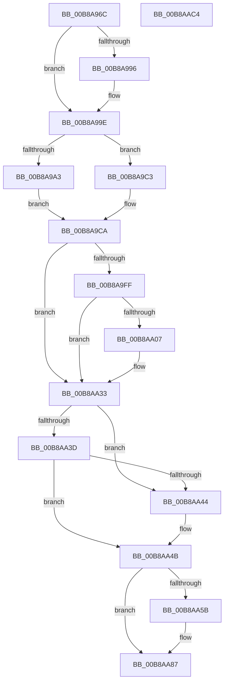

# KdEnterDebugger

- RVA: `0x00B8A96C`–`0x00B8AAC5` (길이 `345` bytes)
- VA: `0x0000000140B8A96C`
- 실행 섹션: `PAGEKD`
- PDB 이름 있음: `예`; PDB Function 태그: `아니요`
- unwind 정보 RVA: `0x0005E6B4`
- 디코드: `85`개 명령, `345/345` bytes 표시
- 미해석 바이트: `0` (있으면 어셈블리에 `.byte`로 보존)

> 이 문서는 커널 이미지의 기계어와 PDB 기호를 분석해 생성했습니다. 4번과 5번은 함수 원형과 자료형을 바이너리 사용 방식에서 추정한 C 해석이며 원본 소스 복구 결과는 아닙니다.

## 1. Dependencies

- 직접 호출 지점: **5**; 고유 호출 대상: **5**
- 직접 호출자로 확인된 함수: **12**
- RIP 상대 이미지 참조: **15**

### Outgoing calls
- `0x00B8A98B` → [VfIsVerifierEnabled](../../text/4C/VfIsVerifierEnabled_function_004C72F0.md) (function, `0x004C72F0`)
- `0x00B8A999` → [VfNotifyVerifierOfEvent](../../pagevrfy/B9/VfNotifyVerifierOfEvent_function_00B92E90.md) (function, `0x00B92E90`)
- `0x00B8A9D4` → [KeFreezeExecution](../../text/4D/KeFreezeExecution_function_004DFA40.md) (function, `0x004DFA40`)
- `0x00B8A9E3` → [guard_dispatch_icall](../../text/6B/guard_dispatch_icall_function_006BAAD0.md) (function, `0x006BAAD0`)
- `0x00B8AA2E` → [KeSaveSupervisorState](../../text/5B/KeSaveSupervisorState_function_005B9CB4.md) (function, `0x005B9CB4`)

### Direct callers
- [KdpReport](../../text/4D/KdpReport_function_004DF360.md) at `0x004DF3E0`
- [KiTpWriteMemory](../../text/5C/KiTpWriteMemory_function_005CAB94.md) at `0x005CAC32`
- [sub_006FC51A](../../text/6F/Unknown_function_006FC51A.md) at `0x006FC529`
- [KdpCloseRemoteFile](KdpCloseRemoteFile_function_00B866D0.md) at `0x00B86722`
- [KdpCreateRemoteFile](KdpCreateRemoteFile_function_00B86920.md) at `0x00B8699E`
- [KdpReadRemoteFile](KdpReadRemoteFile_function_00B86D18.md) at `0x00B86D73`
- [KdSendTraceData](KdSendTraceData_function_00B86F48.md) at `0x00B86FD1`
- [KdpCommandString](KdpCommandString_function_00B88E2C.md) at `0x00B88E6D`
- [KdpPrint](KdpPrint_function_00B88F08.md) at `0x00B8903A`
- [KdpPrompt](KdpPrompt_function_00B890AC.md) at `0x00B891B8`
- [KdpSymbol](KdpSymbol_function_00B89220.md) at `0x00B89266`
- [KdpSetOwedBreakpoints](KdpSetOwedBreakpoints_function_00B8A7DC.md) at `0x00B8A8AB`

### Static image references
- `0x00B8A9AC` → RVA `0x00F49B48` (`.data`; write)
- `0x00B8A9B3` → RVA `0x00F55CB8` (`.data`; read)
- `0x00B8A9BA` → RVA `0x00F49B40` (`.data`; write)
- `0x00B8A9DC` → RVA `0x00E00B28` (`.data`; read)
- `0x00B8A9F1` → RVA `0x00F4754C` (`.data`; read)
- `0x00B8A9FF` → RVA `0x00F0BD23` (`.data`; read)
- `0x00B8AA07` → RVA `0x00FC6C60` (`ALMOSTRO`; read)
- `0x00B8AA0E` → RVA `0x00F475C8` (`.data`; read)
- `0x00B8AA27` → RVA `0x00E5EE40` (`.data`; write)
- `0x00B8AA4B` → RVA `0x00F55CC0` (`.data`; read)
- `0x00B8AA73` → RVA `0x00F475DC` (`.data`; read)
- `0x00B8AA87` → RVA `0x00F475D8` (`.data`; read/write)
- `0x00B8AA90` → RVA `0x00E664AC` (`.data`; read)
- `0x00B8AAA3` → RVA `0x00F475D4` (`.data`; read/write)
- `0x00B8AAB3` → RVA `0x00F55BC4` (`.data`; write)

## 2. Other-region calls and transfers

- 다른 실행 섹션으로 향하는 call: **5**
  - `0x00B8A98B` → [VfIsVerifierEnabled](../../text/4C/VfIsVerifierEnabled_function_004C72F0.md) (`PAGEKD` → `.text`)
  - `0x00B8A999` → [VfNotifyVerifierOfEvent](../../pagevrfy/B9/VfNotifyVerifierOfEvent_function_00B92E90.md) (`PAGEKD` → `PAGEVRFY`)
  - `0x00B8A9D4` → [KeFreezeExecution](../../text/4D/KeFreezeExecution_function_004DFA40.md) (`PAGEKD` → `.text`)
  - `0x00B8A9E3` → [guard_dispatch_icall](../../text/6B/guard_dispatch_icall_function_006BAAD0.md) (`PAGEKD` → `.text`)
  - `0x00B8AA2E` → [KeSaveSupervisorState](../../text/5B/KeSaveSupervisorState_function_005B9CB4.md) (`PAGEKD` → `.text`)
- 별도 외부 분기/꼬리 이동을 확인하지 못했습니다.

## 3. Assembly (complete function range)

```asm
00B8A96C  48 8B C4                        mov rax, rsp
00B8A96F  48 89 58 08                     mov qword ptr [rax + 8], rbx
00B8A973  48 89 68 10                     mov qword ptr [rax + 0x10], rbp
00B8A977  48 89 70 18                     mov qword ptr [rax + 0x18], rsi
00B8A97B  48 89 78 20                     mov qword ptr [rax + 0x20], rdi
00B8A97F  41 56                           push r14
00B8A981  48 83 EC 20                     sub rsp, 0x20
00B8A985  48 8B F2                        mov rsi, rdx
00B8A988  48 8B F9                        mov rdi, rcx
00B8A98B  E8 60 C9 93 FF                  call 0x1404c72f0
00B8A990  33 DB                           xor ebx, ebx
00B8A992  85 C0                           test eax, eax
00B8A994  74 08                           je 0x140b8a99e
00B8A996  8D 4B 03                        lea ecx, [rbx + 3]
00B8A999  E8 F2 84 00 00                  call 0x140b92e90
00B8A99E  48 85 FF                        test rdi, rdi
00B8A9A1  74 20                           je 0x140b8a9c3
00B8A9A3  0F 31                           rdtsc
00B8A9A5  48 C1 E2 20                     shl rdx, 0x20
00B8A9A9  48 0B C2                        or rax, rdx
00B8A9AC  48 89 05 95 F1 3B 00            mov qword ptr [rip + 0x3bf195], rax
00B8A9B3  48 2B 05 FE B2 3C 00            sub rax, qword ptr [rip + 0x3cb2fe]
00B8A9BA  48 89 05 7F F1 3B 00            mov qword ptr [rip + 0x3bf17f], rax
00B8A9C1  EB 07                           jmp 0x140b8a9ca
00B8A9C3  48 89 1D 7E F1 3B 00            mov qword ptr [rip + 0x3bf17e], rbx
00B8A9CA  44 0F 20 C5                     mov rbp, cr8
00B8A9CE  48 8B D6                        mov rdx, rsi
00B8A9D1  48 8B CF                        mov rcx, rdi
00B8A9D4  E8 67 50 95 FF                  call 0x1404dfa40
00B8A9D9  44 8A F0                        mov r14b, al
00B8A9DC  48 8B 05 45 61 27 00            mov rax, qword ptr [rip + 0x276145]
00B8A9E3  E8 E8 00 B3 FF                  call 0x1406baad0
00B8A9E8  65 48 8B 3C 25 20 00 00 00      mov rdi, qword ptr gs:[0x20]
00B8A9F1  8B 0D 55 CB 3B 00               mov ecx, dword ptr [rip + 0x3bcb55]
00B8A9F7  8B 77 24                        mov esi, dword ptr [rdi + 0x24]
00B8A9FA  F6 C1 03                        test cl, 3
00B8A9FD  75 34                           jne 0x140b8aa33
00B8A9FF  38 1D 1E 13 38 00               cmp byte ptr [rip + 0x38131e], bl
00B8AA05  75 2C                           jne 0x140b8aa33
00B8AA07  48 8B 15 52 C2 43 00            mov rdx, qword ptr [rip + 0x43c252]
00B8AA0E  48 8B 05 B3 CB 3B 00            mov rax, qword ptr [rip + 0x3bcbb3]
00B8AA15  48 0F BA EA 08                  bts rdx, 8
00B8AA1A  48 8B 8F C0 06 00 00            mov rcx, qword ptr [rdi + 0x6c0]
00B8AA21  48 F7 D0                        not rax
00B8AA24  48 23 D0                        and rdx, rax
00B8AA27  48 89 15 12 44 2D 00            mov qword ptr [rip + 0x2d4412], rdx
00B8AA2E  E8 81 F2 A2 FF                  call 0x1405b9cb4
00B8AA33  8B 05 13 CB 3B 00               mov eax, dword ptr [rip + 0x3bcb13]
00B8AA39  A8 03                           test al, 3
00B8AA3B  74 07                           je 0x140b8aa44
00B8AA3D  C1 E8 04                        shr eax, 4
00B8AA40  3B C6                           cmp eax, esi
00B8AA42  74 07                           je 0x140b8aa4b
00B8AA44  40 88 AF 58 86 00 00            mov byte ptr [rdi + 0x8658], bpl
00B8AA4B  48 8D 15 6E B2 3C 00            lea rdx, [rip + 0x3cb26e]
00B8AA52  48 8B 14 F2                     mov rdx, qword ptr [rdx + rsi*8]
00B8AA56  48 85 D2                        test rdx, rdx
00B8AA59  74 2C                           je 0x140b8aa87
00B8AA5B  8B 0A                           mov ecx, dword ptr [rdx]
00B8AA5D  48 FF C1                        inc rcx
00B8AA60  48 C1 E1 04                     shl rcx, 4
00B8AA64  48 03 CA                        add rcx, rdx
00B8AA67  0F 31                           rdtsc
00B8AA69  48 C1 E2 20                     shl rdx, 0x20
00B8AA6D  48 0B C2                        or rax, rdx
00B8AA70  48 89 01                        mov qword ptr [rcx], rax
00B8AA73  0F B6 05 62 CB 3B 00            movzx eax, byte ptr [rip + 0x3bcb62]
00B8AA7A  83 E0 01                        and eax, 1
00B8AA7D  C1 E0 02                        shl eax, 2
00B8AA80  83 C8 01                        or eax, 1
00B8AA83  48 89 41 08                     mov qword ptr [rcx + 8], rax
00B8AA87  FF 05 4B CB 3B 00               inc dword ptr [rip + 0x3bcb4b]
00B8AA8D  41 8A C6                        mov al, r14b
00B8AA90  38 1D 16 BA 2D 00               cmp byte ptr [rip + 0x2dba16], bl
00B8AA96  48 8B 6C 24 38                  mov rbp, qword ptr [rsp + 0x38]
00B8AA9B  48 8B 74 24 40                  mov rsi, qword ptr [rsp + 0x40]
00B8AAA0  0F 94 C3                        sete bl
00B8AAA3  01 1D 2B CB 3B 00               add dword ptr [rip + 0x3bcb2b], ebx
00B8AAA9  48 8B 5C 24 30                  mov rbx, qword ptr [rsp + 0x30]
00B8AAAE  48 8B 7C 24 48                  mov rdi, qword ptr [rsp + 0x48]
00B8AAB3  C7 05 07 B1 3C 00 01 00 00 00   mov dword ptr [rip + 0x3cb107], 1
00B8AABD  48 83 C4 20                     add rsp, 0x20
00B8AAC1  41 5E                           pop r14
00B8AAC3  C3                              ret
00B8AAC4  CC                              int3
```

## 4. C-style interpretation (structured pseudocode)

```c
__int64 __fastcall KdEnterDebugger(__int64 a1, __int64 a2)
{
    __int64 result;
    __int64 v_rbx;
    __int64 v_rsp;
    unsigned __int64 v_stack_p10;
    unsigned __int64 v_stack_p18;
    unsigned __int64 v_stack_p20;
    unsigned __int64 v_stack_p8;

    *(unsigned __int64 *)(v_rsp + 8) = v_rbx;
    *(unsigned __int64 *)(v_rsp + 16) = v_rbp;
    *(unsigned __int64 *)(v_rsp + 24) = v_rsi;
    *(unsigned __int64 *)(v_rsp + 32) = v_rdi;
    v_rsp = (v_rsp) - (32);
    result = VfIsVerifierEnabled(a1, a2, a3, a4);
    v_rbx = 0;
    if ((unsigned int)(result) != 0) {
        a1 = v_rbx + 3;
        result = VfNotifyVerifierOfEvent(a1, a2, a3, a4);
    }
    if (a1 == 0) goto loc_00B8A9C3;
    a2 = (a2) << (32);
    result = (result) | (a2);
    *(unsigned __int64 *)(v_rip + 3928469) = result;
    result = (result) - (*(unsigned __int64 *)(v_rip + 3977982));
    *(unsigned __int64 *)(v_rip + 3928447) = result;
    goto loc_00B8A9CA;
loc_00B8A9C3:
    *(unsigned __int64 *)(v_rip + 3928446) = 0;
loc_00B8A9CA:
    result = KeFreezeExecution(a1, a2, a3, a4);
    result = guard_dispatch_icall(a1, a2, a3, a4);
    if ((((unsigned __int8)((unsigned int)(*(unsigned int *)(v_rip + 3918677)))) & (3)) != 0) goto loc_00B8AA33;
    if ((*(unsigned __int8 *)(v_rip + 3674910)) == 0) {
        a2 = *(unsigned __int64 *)(v_rip + 4440658);
        result = *(unsigned __int64 *)(v_rip + 3918771);
        a1 = *(unsigned __int64 *)(*(unsigned __int64 *)(gs_base + (0 + 32)) + 1728);
        result = ~(result);
        a2 = (a2) & (result);
        *(unsigned __int64 *)(v_rip + 2966546) = a2;
        result = KeSaveSupervisorState(a1, a2, a3, a4);
    }
    if ((((unsigned __int8)((unsigned int)(*(unsigned int *)(v_rip + 3918611)))) & (3)) == 0) goto loc_00B8AA44;
    result = (unsigned int)(((unsigned int)(*(unsigned int *)(v_rip + 3918611))) >> (4));
    if (((unsigned int)(result)) != ((unsigned int)((unsigned int)(*(unsigned int *)(*(unsigned __int64 *)(gs_base + (0 + 32)) + 36))))) {
        *(unsigned __int8 *)(*(unsigned __int64 *)(gs_base + (0 + 32)) + 34392) = (unsigned __int8)(v_cr8);
    }
    if (*(unsigned __int64 *)(v_rip + 3977838 + (unsigned int)(*(unsigned int *)(*(unsigned __int64 *)(gs_base + (0 + 32)) + 36)) * 8) != 0) {
        a1 = *(unsigned int *)(*(unsigned __int64 *)(v_rip + 3977838 + (unsigned int)(*(unsigned int *)(*(unsigned __int64 *)(gs_base + (0 + 32)) + 36)) * 8));
        a1 = (a1) + 1;
        a1 = (a1) << (4);
        a1 = (a1) + (*(unsigned __int64 *)(v_rip + 3977838 + (unsigned int)(*(unsigned int *)(*(unsigned __int64 *)(gs_base + (0 + 32)) + 36)) * 8));
        a2 = (*(unsigned __int64 *)(v_rip + 3977838 + (unsigned int)(*(unsigned int *)(*(unsigned __int64 *)(gs_base + (0 + 32)) + 36)) * 8)) << (32);
        result = (result) | (a2);
        *(unsigned __int64 *)(a1) = result;
        result = *(unsigned __int8 *)(v_rip + 3918690);
        result = (unsigned int)((result) & (1));
        result = (unsigned int)((result) << (2));
        result = (unsigned int)((result) | (1));
        *(unsigned __int64 *)(a1 + 8) = result;
    }
    v_rbx = ((*(unsigned __int8 *)(v_rip + 2996758)) == 0) ? 1 : 0;
    *(unsigned int *)(v_rip + 3977479) = 1;
    v_rsp = (v_rsp) + (32);
    return (unsigned __int8)((unsigned __int8)(result));
}
```

## 5. (Beta) C Style

```c
int64_t KdEnterDebugger(int64_t Arg1, int64_t Arg2)
{
    int64_t result;
    int64_t local_rbx;
    int64_t local_rsp;
    uint64_t v_stack_p10;
    uint64_t v_stack_p18;
    uint64_t v_stack_p20;
    uint64_t v_stack_p8;

    *(uint64_t *)(local_rsp + 0x8) = local_rbx;
    *(uint64_t *)(local_rsp + 0x10) = local_rbp;
    *(uint64_t *)(local_rsp + 0x18) = local_rsi;
    *(uint64_t *)(local_rsp + 0x20) = local_rdi;
    local_rsp = (local_rsp) - (32);
    result = VfIsVerifierEnabled(Arg1, Arg2, a3, a4);
    local_rbx = 0;
    if ((uint32_t)(result) != 0) {
        Arg1 = local_rbx + 3;
        result = VfNotifyVerifierOfEvent(Arg1, Arg2, a3, a4);
    }
    if (Arg1 == 0) goto loc_00B8A9C3;
    Arg2 = (Arg2) << (32);
    result = (result) | (Arg2);
    *(uint64_t *)(v_rip + 0x3BF195) = result;
    result = (result) - (*(uint64_t *)(v_rip + 0x3CB2FE));
    *(uint64_t *)(v_rip + 0x3BF17F) = result;
    goto loc_00B8A9CA;
loc_00B8A9C3:
    *(uint64_t *)(v_rip + 0x3BF17E) = 0;
loc_00B8A9CA:
    result = KeFreezeExecution(Arg1, Arg2, a3, a4);
    result = guard_dispatch_icall(Arg1, Arg2, a3, a4);
    if ((((uint8_t)((uint32_t)(*(uint32_t *)(v_rip + 0x3BCB55)))) & (3)) != 0) goto loc_00B8AA33;
    if ((*(uint8_t *)(v_rip + 0x38131E)) == 0) {
        Arg2 = *(uint64_t *)(v_rip + 0x43C252);
        result = *(uint64_t *)(v_rip + 0x3BCBB3);
        Arg1 = *(uint64_t *)(*(uint64_t *)(gs_base + (0 + 0x20)) + 0x6C0);
        result = ~(result);
        Arg2 = (Arg2) & (result);
        *(uint64_t *)(v_rip + 0x2D4412) = Arg2;
        result = KeSaveSupervisorState(Arg1, Arg2, a3, a4);
    }
    if ((((uint8_t)((uint32_t)(*(uint32_t *)(v_rip + 0x3BCB13)))) & (3)) == 0) goto loc_00B8AA44;
    result = (uint32_t)(((uint32_t)(*(uint32_t *)(v_rip + 0x3BCB13))) >> (4));
    if (((uint32_t)(result)) != ((uint32_t)((uint32_t)(*(uint32_t *)(*(uint64_t *)(gs_base + (0 + 0x20)) + 0x24))))) {
        *(uint8_t *)(*(uint64_t *)(gs_base + (0 + 0x20)) + 0x8658) = (uint8_t)(v_cr8);
    }
    if (*(uint64_t *)(v_rip + 0x3CB26E + (uint32_t)(*(uint32_t *)(*(uint64_t *)(gs_base + (0 + 0x20)) + 0x24)) * 8) != 0) {
        Arg1 = *(uint32_t *)(*(uint64_t *)(v_rip + 0x3CB26E + (uint32_t)(*(uint32_t *)(*(uint64_t *)(gs_base + (0 + 0x20)) + 0x24)) * 8));
        Arg1 = (Arg1) + 1;
        Arg1 = (Arg1) << (4);
        Arg1 = (Arg1) + (*(uint64_t *)(v_rip + 0x3CB26E + (uint32_t)(*(uint32_t *)(*(uint64_t *)(gs_base + (0 + 0x20)) + 0x24)) * 8));
        Arg2 = (*(uint64_t *)(v_rip + 0x3CB26E + (uint32_t)(*(uint32_t *)(*(uint64_t *)(gs_base + (0 + 0x20)) + 0x24)) * 8)) << (32);
        result = (result) | (Arg2);
        *(uint64_t *)(Arg1) = result;
        result = *(uint8_t *)(v_rip + 0x3BCB62);
        result = (uint32_t)((result) & (1));
        result = (uint32_t)((result) << (2));
        result = (uint32_t)((result) | (1));
        *(uint64_t *)(Arg1 + 0x8) = result;
    }
    local_rbx = ((*(uint8_t *)(v_rip + 0x2DBA16)) == 0) ? 1 : 0;
    *(uint32_t *)(v_rip + 0x3CB107) = 1;
    local_rsp = (local_rsp) + (32);
    return (uint8_t)((uint8_t)(result));
}
```

## 6. Execution-region graph

[열기: 2D/3D 그래프와 함수 탐색 컨트롤 패널](../../../control-panel.html?section=pagekd&rva=0x00B8A96C&view=graph)

- 2D 그래프는 위에서 아래로 흐르고, 3D 그래프는 빈 공간을 드래그해 회전합니다. Shift+드래그는 이동, 휠은 확대·축소, 함수 노드 선택은 대상 보고서 이동입니다.

### Static fallback


