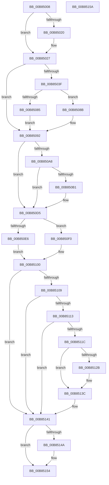

# KdExitDebugger

- RVA: `0x00B85008`–`0x00B8515B` (길이 `339` bytes)
- VA: `0x0000000140B85008`
- 실행 섹션: `PAGEKD`
- PDB 이름 있음: `예`; PDB Function 태그: `아니요`
- unwind 정보 RVA: `0x0005CF00`
- 디코드: `83`개 명령, `339/339` bytes 표시
- 미해석 바이트: `0` (있으면 어셈블리에 `.byte`로 보존)

> 이 문서는 커널 이미지의 기계어와 PDB 기호를 분석해 생성했습니다. 4번과 5번은 함수 원형과 자료형을 바이너리 사용 방식에서 추정한 C 해석이며 원본 소스 복구 결과는 아닙니다.

## 1. Dependencies

- 직접 호출 지점: **8**; 고유 호출 대상: **8**
- 직접 호출자로 확인된 함수: **13**
- RIP 상대 이미지 참조: **15**

### Outgoing calls
- `0x00B85099` → [guard_dispatch_icall](../../text/6B/guard_dispatch_icall_function_006BAAD0.md) (function, `0x006BAAD0`)
- `0x00B850C8` → [KeRestoreSupervisorState](../../text/5B/KeRestoreSupervisorState_function_005B9C30.md) (function, `0x005B9C30`)
- `0x00B850D7` → [KeThawExecution](../../text/4F/KeThawExecution_function_004F5240.md) (function, `0x004F5240`)
- `0x00B85100` → [PoIsHibernateInProgress](../../text/43/PoIsHibernateInProgress_function_004399E0.md) (function, `0x004399E0`)
- `0x00B85137` → [KeInsertQueueDpc](../../text/20/KeInsertQueueDpc_function_00207C50.md) (function, `0x00207C50`)
- `0x00B8513C` → [ExQueueDebuggerWorker](../../text/65/ExQueueDebuggerWorker_function_0065A358.md) (function, `0x0065A358`)
- `0x00B85141` → [VfIsVerifierEnabled](../../text/4C/VfIsVerifierEnabled_function_004C72F0.md) (function, `0x004C72F0`)
- `0x00B8514F` → [VfNotifyVerifierOfEvent](../../pagevrfy/B9/VfNotifyVerifierOfEvent_function_00B92E90.md) (function, `0x00B92E90`)

### Direct callers
- [KdpReport](../../text/4D/KdpReport_function_004DF360.md) at `0x004DF492`
- [KiTpWriteMemory](../../text/5C/KiTpWriteMemory_function_005CAB94.md) at `0x005CAC77`
- [sub_006FC51A](../../text/6F/Unknown_function_006FC51A.md) at `0x006FC544`
- [KdpCloseRemoteFile](KdpCloseRemoteFile_function_00B866D0.md) at `0x00B867F6`
- [KdpCreateRemoteFile](KdpCreateRemoteFile_function_00B86920.md) at `0x00B86B12`
- [KdpReadRemoteFile](KdpReadRemoteFile_function_00B86D18.md) at `0x00B86E8C`
- [KdSendTraceData](KdSendTraceData_function_00B86F48.md) at `0x00B8705E`
- [KdpCommandString](KdpCommandString_function_00B88E2C.md) at `0x00B88EE2`
- [KdpPrint](KdpPrint_function_00B88F08.md) at `0x00B89079`
- [KdpPrompt](KdpPrompt_function_00B890AC.md) at `0x00B891D2`
- [KdpSymbol](KdpSymbol_function_00B89220.md) at `0x00B892E0`
- [KdpSendWaitContinue](KdpSendWaitContinue_function_00B8A32C.md) at `0x00B8A5CC`
- [KdpSendWaitContinue](KdpSendWaitContinue_function_00B8A32C.md) at `0x00B8A6DD`
- [KdpSetOwedBreakpoints](KdpSetOwedBreakpoints_function_00B8A7DC.md) at `0x00B8A944`

### Static image references
- `0x00B8500E` → RVA `0x00F55BC4` (`.data`; read/write)
- `0x00B85017` → RVA `0x00F475DC` (`.data`; read)
- `0x00B85020` → RVA `0x00F475DD` (`.data`; write)
- `0x00B8502F` → RVA `0x00F55CC0` (`.data`; read)
- `0x00B85092` → RVA `0x00E00B18` (`.data`; read)
- `0x00B8509E` → RVA `0x00F4754C` (`.data`; read)
- `0x00B850A8` → RVA `0x00F0BD23` (`.data`; read)
- `0x00B850BA` → RVA `0x00E5EE40` (`.data`; read)
- `0x00B850CD` → RVA `0x00E5EE40` (`.data`; read/write)
- `0x00B850DC` → RVA `0x00F49B48` (`.data`; read)
- `0x00B850E6` → RVA `0x00F55CB8` (`.data`; read/write)
- `0x00B850F9` → RVA `0x00F55CB8` (`.data`; write)
- `0x00B85113` → RVA `0x00E66740` (`.data`; read)
- `0x00B85121` → RVA `0x00E0AA58` (`.data`; read/write)
- `0x00B8512E` → RVA `0x00E66400` (`.data`; read)

## 2. Other-region calls and transfers

- 다른 실행 섹션으로 향하는 call: **8**
  - `0x00B85099` → [guard_dispatch_icall](../../text/6B/guard_dispatch_icall_function_006BAAD0.md) (`PAGEKD` → `.text`)
  - `0x00B850C8` → [KeRestoreSupervisorState](../../text/5B/KeRestoreSupervisorState_function_005B9C30.md) (`PAGEKD` → `.text`)
  - `0x00B850D7` → [KeThawExecution](../../text/4F/KeThawExecution_function_004F5240.md) (`PAGEKD` → `.text`)
  - `0x00B85100` → [PoIsHibernateInProgress](../../text/43/PoIsHibernateInProgress_function_004399E0.md) (`PAGEKD` → `.text`)
  - `0x00B85137` → [KeInsertQueueDpc](../../text/20/KeInsertQueueDpc_function_00207C50.md) (`PAGEKD` → `.text`)
  - `0x00B8513C` → [ExQueueDebuggerWorker](../../text/65/ExQueueDebuggerWorker_function_0065A358.md) (`PAGEKD` → `.text`)
  - `0x00B85141` → [VfIsVerifierEnabled](../../text/4C/VfIsVerifierEnabled_function_004C72F0.md) (`PAGEKD` → `.text`)
  - `0x00B8514F` → [VfNotifyVerifierOfEvent](../../pagevrfy/B9/VfNotifyVerifierOfEvent_function_00B92E90.md) (`PAGEKD` → `PAGEVRFY`)
- 별도 외부 분기/꼬리 이동을 확인하지 못했습니다.

## 3. Assembly (complete function range)

```asm
00B85008  40 53                           push rbx
00B8500A  48 83 EC 20                     sub rsp, 0x20
00B8500E  83 25 AF 0B 3D 00 00            and dword ptr [rip + 0x3d0baf], 0
00B85015  8A D9                           mov bl, cl
00B85017  80 3D BE 25 3C 00 00            cmp byte ptr [rip + 0x3c25be], 0
00B8501E  75 07                           jne 0x140b85027
00B85020  C6 05 B6 25 3C 00 01            mov byte ptr [rip + 0x3c25b6], 1
00B85027  65 8B 04 25 A4 01 00 00         mov eax, dword ptr gs:[0x1a4]
00B8502F  4C 8D 0D 8A 0C 3D 00            lea r9, [rip + 0x3d0c8a]
00B85036  4D 8B 0C C1                     mov r9, qword ptr [r9 + rax*8]
00B8503A  4D 85 C9                        test r9, r9
00B8503D  74 53                           je 0x140b85092
00B8503F  45 8B 11                        mov r10d, dword ptr [r9]
00B85042  4D 8D 42 01                     lea r8, [r10 + 1]
00B85046  4D 03 C0                        add r8, r8
00B85049  0F 31                           rdtsc
00B8504B  0F B6 0D 8A 25 3C 00            movzx ecx, byte ptr [rip + 0x3c258a]
00B85052  83 E1 01                        and ecx, 1
00B85055  48 C1 E2 20                     shl rdx, 0x20
00B85059  03 C9                           add ecx, ecx
00B8505B  48 0B C2                        or rax, rdx
00B8505E  4B 2B 04 C1                     sub rax, qword ptr [r9 + r8*8]
00B85062  83 C9 01                        or ecx, 1
00B85065  48 83 E0 F1                     and rax, 0xfffffffffffffff1
00B85069  48 0B C1                        or rax, rcx
00B8506C  43 8B 4C C1 08                  mov ecx, dword ptr [r9 + r8*8 + 8]
00B85071  83 E1 04                        and ecx, 4
00B85074  48 0B C1                        or rax, rcx
00B85077  4B 89 44 C1 08                  mov qword ptr [r9 + r8*8 + 8], rax
00B8507C  41 81 FA FE 00 00 00            cmp r10d, 0xfe
00B85083  75 06                           jne 0x140b8508b
00B85085  41 83 21 00                     and dword ptr [r9], 0
00B85089  EB 07                           jmp 0x140b85092
00B8508B  41 8D 42 01                     lea eax, [r10 + 1]
00B8508F  41 89 01                        mov dword ptr [r9], eax
00B85092  48 8B 05 7F BA 27 00            mov rax, qword ptr [rip + 0x27ba7f]
00B85099  E8 32 5A B3 FF                  call 0x1406baad0
00B8509E  8B 05 A8 24 3C 00               mov eax, dword ptr [rip + 0x3c24a8]
00B850A4  A8 03                           test al, 3
00B850A6  75 2D                           jne 0x140b850d5
00B850A8  80 3D 74 6C 38 00 00            cmp byte ptr [rip + 0x386c74], 0
00B850AF  75 24                           jne 0x140b850d5
00B850B1  65 48 8B 0C 25 20 00 00 00      mov rcx, qword ptr gs:[0x20]
00B850BA  48 8B 15 7F 9D 2D 00            mov rdx, qword ptr [rip + 0x2d9d7f]
00B850C1  48 8B 89 C0 06 00 00            mov rcx, qword ptr [rcx + 0x6c0]
00B850C8  E8 63 4B A3 FF                  call 0x1405b9c30
00B850CD  48 83 25 6B 9D 2D 00 00         and qword ptr [rip + 0x2d9d6b], 0
00B850D5  8A CB                           mov cl, bl
00B850D7  E8 64 01 97 FF                  call 0x1404f5240
00B850DC  48 83 3D 64 4A 3C 00 00         cmp qword ptr [rip + 0x3c4a64], 0
00B850E4  75 0A                           jne 0x140b850f0
00B850E6  48 83 25 CA 0B 3D 00 00         and qword ptr [rip + 0x3d0bca], 0
00B850EE  EB 10                           jmp 0x140b85100
00B850F0  0F 31                           rdtsc
00B850F2  48 C1 E2 20                     shl rdx, 0x20
00B850F6  48 0B C2                        or rax, rdx
00B850F9  48 89 05 B8 0B 3D 00            mov qword ptr [rip + 0x3d0bb8], rax
00B85100  E8 DB 48 8B FF                  call 0x1404399e0
00B85105  84 C0                           test al, al
00B85107  75 38                           jne 0x140b85141
00B85109  8B 05 3D 24 3C 00               mov eax, dword ptr [rip + 0x3c243d]
00B8510F  A8 03                           test al, 3
00B85111  75 2E                           jne 0x140b85141
00B85113  80 3D 26 16 2E 00 00            cmp byte ptr [rip + 0x2e1626], 0
00B8511A  75 25                           jne 0x140b85141
00B8511C  B8 02 00 00 00                  mov eax, 2
00B85121  87 05 31 59 28 00               xchg dword ptr [rip + 0x285931], eax
00B85127  85 C0                           test eax, eax
00B85129  75 11                           jne 0x140b8513c
00B8512B  45 33 C0                        xor r8d, r8d
00B8512E  48 8D 0D CB 12 2E 00            lea rcx, [rip + 0x2e12cb]
00B85135  33 D2                           xor edx, edx
00B85137  E8 14 2B 68 FF                  call 0x140207c50
00B8513C  E8 17 52 AD FF                  call 0x14065a358
00B85141  E8 AA 21 94 FF                  call 0x1404c72f0
00B85146  85 C0                           test eax, eax
00B85148  74 0A                           je 0x140b85154
00B8514A  B9 04 00 00 00                  mov ecx, 4
00B8514F  E8 3C DD 00 00                  call 0x140b92e90
00B85154  48 83 C4 20                     add rsp, 0x20
00B85158  5B                              pop rbx
00B85159  C3                              ret
00B8515A  CC                              int3
```

## 4. C-style interpretation (structured pseudocode)

```c
__int64 __fastcall KdExitDebugger(unsigned __int8 a1, __int64 a2)
{
    __int64 result;
    __int64 v_rsp;

    v_rsp = (v_rsp) - (32);
    if ((*(unsigned __int8 *)(v_rip + 3941822)) == 0) {
        *(unsigned __int8 *)(v_rip + 3941814) = 1;
    }
    if (*(unsigned __int64 *)(v_rip + 4000906 + (unsigned int)(*(unsigned int *)(gs_base + (0 + 420))) * 8) == 0) goto loc_00B85092;
    a3 = ((unsigned int)(*(unsigned int *)(*(unsigned __int64 *)(v_rip + 4000906 + (unsigned int)(*(unsigned int *)(gs_base + (0 + 420))) * 8))) + 1) + ((unsigned int)(*(unsigned int *)(*(unsigned __int64 *)(v_rip + 4000906 + (unsigned int)(*(unsigned int *)(gs_base + (0 + 420))) * 8))) + 1);
    a1 = (unsigned int)((*(unsigned __int8 *)(v_rip + 3941770)) & (1));
    a2 = (a2) << (32);
    a1 = (unsigned int)((a1) + (a1));
    result = ((unsigned int)(*(unsigned int *)(gs_base + (0 + 420)))) | (a2);
    result = (result) - (*(unsigned __int64 *)(*(unsigned __int64 *)(v_rip + 4000906 + (unsigned int)(*(unsigned int *)(gs_base + (0 + 420))) * 8) + a3 * 8));
    a1 = (unsigned int)((a1) | (1));
    result = (result) & (-15);
    result = (result) | (a1);
    a1 = (unsigned int)(((unsigned int)(*(unsigned int *)(*(unsigned __int64 *)(v_rip + 4000906 + (unsigned int)(*(unsigned int *)(gs_base + (0 + 420))) * 8) + a3 * 8 + 8))) & (4));
    result = (result) | (a1);
    *(unsigned __int64 *)(*(unsigned __int64 *)(v_rip + 4000906 + (unsigned int)(*(unsigned int *)(gs_base + (0 + 420))) * 8) + a3 * 8 + 8) = result;
    if (((unsigned int)((unsigned int)(*(unsigned int *)(*(unsigned __int64 *)(v_rip + 4000906 + (unsigned int)(*(unsigned int *)(gs_base + (0 + 420))) * 8))))) != 254) goto loc_00B8508B;
    goto loc_00B85092;
loc_00B8508B:
    *(unsigned int *)(*(unsigned __int64 *)(v_rip + 4000906 + (unsigned int)(*(unsigned int *)(gs_base + (0 + 420))) * 8)) = (unsigned int)((unsigned int)(*(unsigned int *)(*(unsigned __int64 *)(v_rip + 4000906 + (unsigned int)(*(unsigned int *)(gs_base + (0 + 420))) * 8))) + 1);
loc_00B85092:
    result = guard_dispatch_icall(a1, a2, a3, *(unsigned __int64 *)(v_rip + 4000906 + (unsigned int)(*(unsigned int *)(gs_base + (0 + 420))) * 8));
    if ((((unsigned __int8)((unsigned int)(*(unsigned int *)(v_rip + 3941544)))) & (3)) != 0) goto loc_00B850D5;
    result = (unsigned int)(*(unsigned int *)(v_rip + 3941544));
    if ((*(unsigned __int8 *)(v_rip + 3697780)) == 0) {
        a1 = *(unsigned __int64 *)(gs_base + (0 + 32));
        a2 = *(unsigned __int64 *)(v_rip + 2989439);
        a1 = *(unsigned __int64 *)(a1 + 1728);
        result = KeRestoreSupervisorState(a1, a2, a3, *(unsigned __int64 *)(v_rip + 4000906 + (unsigned int)(*(unsigned int *)(gs_base + (0 + 420))) * 8));
    }
    result = KeThawExecution(a1, a2, a3, *(unsigned __int64 *)(v_rip + 4000906 + (unsigned int)(*(unsigned int *)(gs_base + (0 + 420))) * 8));
    if ((*(unsigned __int64 *)(v_rip + 3951204)) != 0) goto loc_00B850F0;
    goto loc_00B85100;
loc_00B850F0:
    a2 = (a2) << (32);
    result = (result) | (a2);
    *(unsigned __int64 *)(v_rip + 4000696) = result;
loc_00B85100:
    result = PoIsHibernateInProgress(a1, a2, a3, *(unsigned __int64 *)(v_rip + 4000906 + (unsigned int)(*(unsigned int *)(gs_base + (0 + 420))) * 8));
    if ((unsigned __int8)(result) != 0) goto loc_00B85141;
    if ((((unsigned __int8)((unsigned int)(*(unsigned int *)(v_rip + 3941437)))) & (3)) != 0) goto loc_00B85141;
    if ((*(unsigned __int8 *)(v_rip + 3020326)) != 0) goto loc_00B85141;
    result = 2;
    if (2 == 0) {
        a3 = 0;
        a1 = v_rip + 3019467;
        a2 = 0;
        result = KeInsertQueueDpc(a1, a2, a3, *(unsigned __int64 *)(v_rip + 4000906 + (unsigned int)(*(unsigned int *)(gs_base + (0 + 420))) * 8));
    }
    result = ExQueueDebuggerWorker(a1, a2, a3, *(unsigned __int64 *)(v_rip + 4000906 + (unsigned int)(*(unsigned int *)(gs_base + (0 + 420))) * 8));
loc_00B85141:
    result = VfIsVerifierEnabled(a1, a2, a3, *(unsigned __int64 *)(v_rip + 4000906 + (unsigned int)(*(unsigned int *)(gs_base + (0 + 420))) * 8));
    if ((unsigned int)(result) != 0) {
        a1 = 4;
        result = VfNotifyVerifierOfEvent(a1, a2, a3, *(unsigned __int64 *)(v_rip + 4000906 + (unsigned int)(*(unsigned int *)(gs_base + (0 + 420))) * 8));
    }
    v_rsp = (v_rsp) + (32);
    return result;
}
```

## 5. (Beta) C Style

```c
int64_t KdExitDebugger(uint8_t Arg1, int64_t Arg2)
{
    int64_t result;
    int64_t local_rsp;

    local_rsp = (local_rsp) - (32);
    if ((*(uint8_t *)(v_rip + 0x3C25BE)) == 0) {
        *(uint8_t *)(v_rip + 0x3C25B6) = 1;
    }
    if (*(uint64_t *)(v_rip + 0x3D0C8A + (uint32_t)(*(uint32_t *)(gs_base + (0 + 0x1A4))) * 8) == 0) goto loc_00B85092;
    a3 = ((uint32_t)(*(uint32_t *)(*(uint64_t *)(v_rip + 0x3D0C8A + (uint32_t)(*(uint32_t *)(gs_base + (0 + 0x1A4))) * 8))) + 1) + ((uint32_t)(*(uint32_t *)(*(uint64_t *)(v_rip + 0x3D0C8A + (uint32_t)(*(uint32_t *)(gs_base + (0 + 0x1A4))) * 8))) + 1);
    Arg1 = (uint32_t)((*(uint8_t *)(v_rip + 0x3C258A)) & (1));
    Arg2 = (Arg2) << (32);
    Arg1 = (uint32_t)((Arg1) + (Arg1));
    result = ((uint32_t)(*(uint32_t *)(gs_base + (0 + 0x1A4)))) | (Arg2);
    result = (result) - (*(uint64_t *)(*(uint64_t *)(v_rip + 0x3D0C8A + (uint32_t)(*(uint32_t *)(gs_base + (0 + 0x1A4))) * 8) + a3 * 8));
    Arg1 = (uint32_t)((Arg1) | (1));
    result = (result) & (-15);
    result = (result) | (Arg1);
    Arg1 = (uint32_t)(((uint32_t)(*(uint32_t *)(*(uint64_t *)(v_rip + 0x3D0C8A + (uint32_t)(*(uint32_t *)(gs_base + (0 + 0x1A4))) * 8) + a3 * 8 + 0x8))) & (4));
    result = (result) | (Arg1);
    *(uint64_t *)(*(uint64_t *)(v_rip + 0x3D0C8A + (uint32_t)(*(uint32_t *)(gs_base + (0 + 0x1A4))) * 8) + a3 * 8 + 0x8) = result;
    if (((uint32_t)((uint32_t)(*(uint32_t *)(*(uint64_t *)(v_rip + 0x3D0C8A + (uint32_t)(*(uint32_t *)(gs_base + (0 + 0x1A4))) * 8))))) != 254) goto loc_00B8508B;
    goto loc_00B85092;
loc_00B8508B:
    *(uint32_t *)(*(uint64_t *)(v_rip + 0x3D0C8A + (uint32_t)(*(uint32_t *)(gs_base + (0 + 0x1A4))) * 8)) = (uint32_t)((uint32_t)(*(uint32_t *)(*(uint64_t *)(v_rip + 0x3D0C8A + (uint32_t)(*(uint32_t *)(gs_base + (0 + 0x1A4))) * 8))) + 1);
loc_00B85092:
    result = guard_dispatch_icall(Arg1, Arg2, a3, *(uint64_t *)(v_rip + 0x3D0C8A + (uint32_t)(*(uint32_t *)(gs_base + (0 + 0x1A4))) * 8));
    if ((((uint8_t)((uint32_t)(*(uint32_t *)(v_rip + 0x3C24A8)))) & (3)) != 0) goto loc_00B850D5;
    result = (uint32_t)(*(uint32_t *)(v_rip + 0x3C24A8));
    if ((*(uint8_t *)(v_rip + 0x386C74)) == 0) {
        Arg1 = *(uint64_t *)(gs_base + (0 + 0x20));
        Arg2 = *(uint64_t *)(v_rip + 0x2D9D7F);
        Arg1 = *(uint64_t *)(Arg1 + 0x6C0);
        result = KeRestoreSupervisorState(Arg1, Arg2, a3, *(uint64_t *)(v_rip + 0x3D0C8A + (uint32_t)(*(uint32_t *)(gs_base + (0 + 0x1A4))) * 8));
    }
    result = KeThawExecution(Arg1, Arg2, a3, *(uint64_t *)(v_rip + 0x3D0C8A + (uint32_t)(*(uint32_t *)(gs_base + (0 + 0x1A4))) * 8));
    if ((*(uint64_t *)(v_rip + 0x3C4A64)) != 0) goto loc_00B850F0;
    goto loc_00B85100;
loc_00B850F0:
    Arg2 = (Arg2) << (32);
    result = (result) | (Arg2);
    *(uint64_t *)(v_rip + 0x3D0BB8) = result;
loc_00B85100:
    result = PoIsHibernateInProgress(Arg1, Arg2, a3, *(uint64_t *)(v_rip + 0x3D0C8A + (uint32_t)(*(uint32_t *)(gs_base + (0 + 0x1A4))) * 8));
    if ((uint8_t)(result) != 0) goto loc_00B85141;
    if ((((uint8_t)((uint32_t)(*(uint32_t *)(v_rip + 0x3C243D)))) & (3)) != 0) goto loc_00B85141;
    if ((*(uint8_t *)(v_rip + 0x2E1626)) != 0) goto loc_00B85141;
    result = 2;
    if (2 == 0) {
        a3 = 0;
        Arg1 = v_rip + 3019467;
        Arg2 = 0;
        result = KeInsertQueueDpc(Arg1, Arg2, a3, *(uint64_t *)(v_rip + 0x3D0C8A + (uint32_t)(*(uint32_t *)(gs_base + (0 + 0x1A4))) * 8));
    }
    result = ExQueueDebuggerWorker(Arg1, Arg2, a3, *(uint64_t *)(v_rip + 0x3D0C8A + (uint32_t)(*(uint32_t *)(gs_base + (0 + 0x1A4))) * 8));
loc_00B85141:
    result = VfIsVerifierEnabled(Arg1, Arg2, a3, *(uint64_t *)(v_rip + 0x3D0C8A + (uint32_t)(*(uint32_t *)(gs_base + (0 + 0x1A4))) * 8));
    if ((uint32_t)(result) != 0) {
        Arg1 = 4;
        result = VfNotifyVerifierOfEvent(Arg1, Arg2, a3, *(uint64_t *)(v_rip + 0x3D0C8A + (uint32_t)(*(uint32_t *)(gs_base + (0 + 0x1A4))) * 8));
    }
    local_rsp = (local_rsp) + (32);
    return result;
}
```

## 6. Execution-region graph

[열기: 2D/3D 그래프와 함수 탐색 컨트롤 패널](../../../control-panel.html?section=pagekd&rva=0x00B85008&view=graph)

- 2D 그래프는 위에서 아래로 흐르고, 3D 그래프는 빈 공간을 드래그해 회전합니다. Shift+드래그는 이동, 휠은 확대·축소, 함수 노드 선택은 대상 보고서 이동입니다.

### Static fallback


