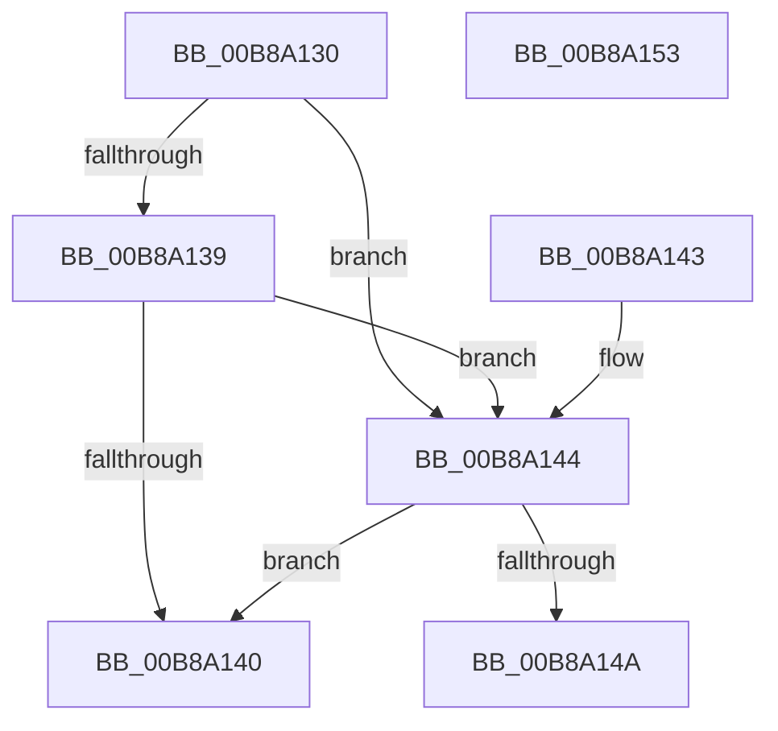

# KdIsThisAKdTrap

- RVA: `0x00B8A130`–`0x00B8A154` (길이 `36` bytes)
- VA: `0x0000000140B8A130`
- 실행 섹션: `PAGEKD`
- PDB 이름 있음: `예`; PDB Function 태그: `아니요`
- unwind 정보 RVA: `0x000DB714`
- 디코드: `14`개 명령, `36/36` bytes 표시
- 미해석 바이트: `0` (있으면 어셈블리에 `.byte`로 보존)

> 이 문서는 커널 이미지의 기계어와 PDB 기호를 분석해 생성했습니다. 4번과 5번은 함수 원형과 자료형을 바이너리 사용 방식에서 추정한 C 해석이며 원본 소스 복구 결과는 아닙니다.

## 1. Dependencies

- 직접 호출 지점: **0**; 고유 호출 대상: **0**
- 직접 호출자로 확인된 함수: **1**
- RIP 상대 이미지 참조: **0**

### Outgoing calls
- 직접 디코드된 call 명령이 없습니다.

### Direct callers
- [KiDispatchException](../../text/3D/KiDispatchException_function_003D7650.md) at `0x003D78B7`

### Static image references
- 디코드된 RIP-relative 메모리 참조가 없습니다.

## 2. Other-region calls and transfers

- 다른 실행 섹션으로 향하는 call: **0**
- 별도 외부 분기/꼬리 이동을 확인하지 못했습니다.

## 3. Assembly (complete function range)

```asm
00B8A130  8B 01                           mov eax, dword ptr [rcx]
00B8A132  3D 03 00 00 80                  cmp eax, 0x80000003
00B8A137  74 0B                           je 0x140b8a144
00B8A139  3D 1F 00 00 40                  cmp eax, 0x4000001f
00B8A13E  74 04                           je 0x140b8a144
00B8A140  32 C0                           xor al, al
00B8A142  C3                              ret
00B8A143  CC                              int3
00B8A144  83 79 18 00                     cmp dword ptr [rcx + 0x18], 0
00B8A148  76 F6                           jbe 0x140b8a140
00B8A14A  48 83 79 20 00                  cmp qword ptr [rcx + 0x20], 0
00B8A14F  0F 95 C0                        setne al
00B8A152  C3                              ret
00B8A153  CC                              int3
```

## 4. C-style interpretation (structured pseudocode)

```c
__int64 __fastcall KdIsThisAKdTrap(__int64 a1)
{
    __int64 result;

    if (((unsigned int)((unsigned int)(*(unsigned int *)(a1)))) == 0x80000003ULL) goto loc_00B8A144;
    if (((unsigned int)((unsigned int)(*(unsigned int *)(a1)))) == 0x4000001FULL) goto loc_00B8A144;
loc_00B8A140:
    result = 0;
    return result;
loc_00B8A144:
    if ((*(unsigned int *)(a1 + 24)) <= 0) goto loc_00B8A140;
    result = ((*(unsigned __int64 *)(a1 + 32)) != 0) ? 1 : 0;
    return result;
}
```

## 5. (Beta) C Style

```c
int64_t KdIsThisAKdTrap(void *Arg1)
{
    uint8_t *arg1 = (uint8_t *)Arg1;

    int64_t result;

    if (((uint32_t)((uint32_t)(*(uint32_t *)(arg1)))) == 0x80000003ULL) goto loc_00B8A144;
    if (((uint32_t)((uint32_t)(*(uint32_t *)(arg1)))) == 0x4000001FULL) goto loc_00B8A144;
loc_00B8A140:
    result = 0;
    return result;
loc_00B8A144:
    if ((*(uint32_t *)(arg1 + 0x18)) <= 0) goto loc_00B8A140;
    result = ((*(uint64_t *)(arg1 + 0x20)) != 0) ? 1 : 0;
    return result;
}
```

### 관측된 메모리 오프셋

구조체 형식이 확인되지 않은 접근은 인자 기준의 오프셋으로만 기록했습니다.

| 기준 인자 | 오프셋 표현 | 폭 (bit) | 접근 |
|---|---:|---:|---|
| `Arg1` | `+ 0x0` | `32` | `R` |
| `Arg1` | `+ 0x18` | `32` | `R` |
| `Arg1` | `+ 0x20` | `64` | `R` |

## 6. Execution-region graph

[열기: 2D/3D 그래프와 함수 탐색 컨트롤 패널](../../../control-panel.html?section=pagekd&rva=0x00B8A130&view=graph)

- 2D 그래프는 위에서 아래로 흐르고, 3D 그래프는 빈 공간을 드래그해 회전합니다. Shift+드래그는 이동, 휠은 확대·축소, 함수 노드 선택은 대상 보고서 이동입니다.

### Static fallback


