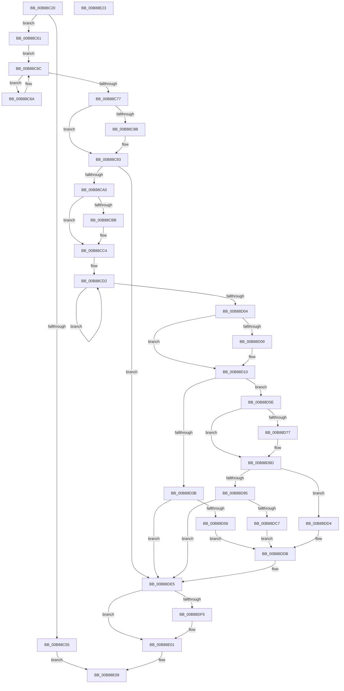

# KdLogDbgPrint

- RVA: `0x00B88C20`–`0x00B88E24` (길이 `516` bytes)
- VA: `0x0000000140B88C20`
- 실행 섹션: `PAGEKD`
- PDB 이름 있음: `예`; PDB Function 태그: `아니요`
- unwind 정보 RVA: `0x000C9AC8`
- 디코드: `133`개 명령, `516/516` bytes 표시
- 미해석 바이트: `0` (있으면 어셈블리에 `.byte`로 보존)

> 이 문서는 커널 이미지의 기계어와 PDB 기호를 분석해 생성했습니다. 4번과 5번은 함수 원형과 자료형을 바이너리 사용 방식에서 추정한 C 해석이며 원본 소스 복구 결과는 아닙니다.

## 1. Dependencies

- 직접 호출 지점: **7**; 고유 호출 대상: **4**
- 직접 호출자로 확인된 함수: **2**
- RIP 상대 이미지 참조: **10**

### Outgoing calls
- `0x00B88C8E` → [KiRaiseIrqlProcessIrqlFlags](../../text/4F/KiRaiseIrqlProcessIrqlFlags_function_004F56FC.md) (function, `0x004F56FC`)
- `0x00B88D45` → [KdpCopyMemoryChunks](KdpCopyMemoryChunks_function_00B8AACC.md) (function, `0x00B8AACC`)
- `0x00B88D6C` → [KdpCopyMemoryChunks](KdpCopyMemoryChunks_function_00B8AACC.md) (function, `0x00B8AACC`)
- `0x00B88D88` → [memset](../../text/6C/memset_function_006C6C40.md) (function, `0x006C6C40`)
- `0x00B88DBA` → [KdpCopyMemoryChunks](KdpCopyMemoryChunks_function_00B8AACC.md) (function, `0x00B8AACC`)
- `0x00B88DE0` → [memset](../../text/6C/memset_function_006C6C40.md) (function, `0x006C6C40`)
- `0x00B88DFC` → [KiLowerIrqlProcessIrqlFlags](../../text/4F/KiLowerIrqlProcessIrqlFlags_function_004F5698.md) (function, `0x004F5698`)

### Direct callers
- [KdpPrint](KdpPrint_function_00B88F08.md) at `0x00B89014`
- [KdpPrompt](KdpPrompt_function_00B890AC.md) at `0x00B891A5`

### Static image references
- `0x00B88C4C` → RVA `0x00E664C8` (`.data`; read)
- `0x00B88C55` → RVA `0x00F48600` (`.data`; read/write)
- `0x00B88C61` → RVA `0x00E664C4` (`.data`; read/write)
- `0x00B88C6D` → RVA `0x00E664C0` (`.data`; read)
- `0x00B88C82` → RVA `0x00FC6D20` (`ALMOSTRO`; read)
- `0x00B88C93` → RVA `0x00E07090` (`.data`; read)
- `0x00B88CA0` → RVA `0x00E0AA54` (`.data`; read)
- `0x00B88CBD` → RVA `0x00F48604` (`.data`; read/write)
- `0x00B88CC6` → RVA `0x00E07098` (`.data`; read)
- `0x00B88D09` → RVA `0x00F475FC` (`.data`; read/write)

## 2. Other-region calls and transfers

- 다른 실행 섹션으로 향하는 call: **4**
  - `0x00B88C8E` → [KiRaiseIrqlProcessIrqlFlags](../../text/4F/KiRaiseIrqlProcessIrqlFlags_function_004F56FC.md) (`PAGEKD` → `.text`)
  - `0x00B88D88` → [memset](../../text/6C/memset_function_006C6C40.md) (`PAGEKD` → `.text`)
  - `0x00B88DE0` → [memset](../../text/6C/memset_function_006C6C40.md) (`PAGEKD` → `.text`)
  - `0x00B88DFC` → [KiLowerIrqlProcessIrqlFlags](../../text/4F/KiLowerIrqlProcessIrqlFlags_function_004F5698.md) (`PAGEKD` → `.text`)
- 별도 외부 분기/꼬리 이동을 확인하지 못했습니다.

## 3. Assembly (complete function range)

```asm
00B88C20  48 8B C4                        mov rax, rsp
00B88C23  48 89 58 08                     mov qword ptr [rax + 8], rbx
00B88C27  48 89 70 18                     mov qword ptr [rax + 0x18], rsi
00B88C2B  48 89 78 20                     mov qword ptr [rax + 0x20], rdi
00B88C2F  41 54                           push r12
00B88C31  41 56                           push r14
00B88C33  41 57                           push r15
00B88C35  48 83 EC 30                     sub rsp, 0x30
00B88C39  45 33 E4                        xor r12d, r12d
00B88C3C  4C 8B F9                        mov r15, rcx
00B88C3F  44 89 60 10                     mov dword ptr [rax + 0x10], r12d
00B88C43  65 48 8B 04 25 20 00 00 00      mov rax, qword ptr gs:[0x20]
00B88C4C  48 39 05 75 D8 2D 00            cmp qword ptr [rip + 0x2dd875], rax
00B88C53  75 0C                           jne 0x140b88c61
00B88C55  F0 FF 05 A4 F9 3B 00            lock inc dword ptr [rip + 0x3bf9a4]
00B88C5C  E9 A8 01 00 00                  jmp 0x140b88e09
00B88C61  F0 FF 05 5C D8 2D 00            lock inc dword ptr [rip + 0x2dd85c]
00B88C68  EB 02                           jmp 0x140b88c6c
00B88C6A  F3 90                           pause
00B88C6C  90                              nop
00B88C6D  8B 05 4D D8 2D 00               mov eax, dword ptr [rip + 0x2dd84d]
00B88C73  85 C0                           test eax, eax
00B88C75  75 F3                           jne 0x140b88c6a
00B88C77  45 0F 20 C6                     mov r14, cr8
00B88C7B  8D 50 0F                        lea edx, [rax + 0xf]
00B88C7E  44 0F 22 C2                     mov cr8, rdx
00B88C82  44 39 25 97 E0 43 00            cmp dword ptr [rip + 0x43e097], r12d
00B88C89  74 08                           je 0x140b88c93
00B88C8B  41 8A CE                        mov cl, r14b
00B88C8E  E8 69 CA 96 FF                  call 0x1404f56fc
00B88C93  4C 39 25 F6 E3 27 00            cmp qword ptr [rip + 0x27e3f6], r12
00B88C9A  0F 84 45 01 00 00               je 0x140b88de5
00B88CA0  8B 05 AE 1D 28 00               mov eax, dword ptr [rip + 0x281dae]
00B88CA6  B9 00 02 00 00                  mov ecx, 0x200
00B88CAB  41 0F B7 1F                     movzx ebx, word ptr [r15]
00B88CAF  C1 E8 03                        shr eax, 3
00B88CB2  3B C1                           cmp eax, ecx
00B88CB4  0F 47 C1                        cmova eax, ecx
00B88CB7  3B D8                           cmp ebx, eax
00B88CB9  76 09                           jbe 0x140b88cc4
00B88CBB  8B D8                           mov ebx, eax
00B88CBD  F0 FF 05 40 F9 3B 00            lock inc dword ptr [rip + 0x3bf940]
00B88CC4  33 C0                           xor eax, eax
00B88CC6  F0 4C 0F B1 25 C9 E3 27 00      lock cmpxchg qword ptr [rip + 0x27e3c9], r12
00B88CCF  44 8B D3                        mov r10d, ebx
00B88CD2  8B 15 7C 1D 28 00               mov edx, dword ptr [rip + 0x281d7c]
00B88CD8  4D 8D 0C 02                     lea r9, [r10 + rax]
00B88CDC  4C 8B 05 AD E3 27 00            mov r8, qword ptr [rip + 0x27e3ad]
00B88CE3  49 8B C9                        mov rcx, r9
00B88CE6  48 2B CA                        sub rcx, rdx
00B88CE9  4C 03 C2                        add r8, rdx
00B88CEC  4D 3B C8                        cmp r9, r8
00B88CEF  48 8B F0                        mov rsi, rax
00B88CF2  49 0F 42 C9                     cmovb rcx, r9
00B88CF6  F0 48 0F B1 0D 99 E3 27 00      lock cmpxchg qword ptr [rip + 0x27e399], rcx
00B88CFF  48 3B C6                        cmp rax, rsi
00B88D02  75 CE                           jne 0x140b88cd2
00B88D04  48 3B CE                        cmp rcx, rsi
00B88D07  73 07                           jae 0x140b88d10
00B88D09  F0 FF 05 EC E8 3B 00            lock inc dword ptr [rip + 0x3be8ec]
00B88D10  8B 0D 3E 1D 28 00               mov ecx, dword ptr [rip + 0x281d3e]
00B88D16  48 8B D6                        mov rdx, rsi
00B88D19  48 8B 3D 70 E3 27 00            mov rdi, qword ptr [rip + 0x27e370]
00B88D20  48 8D 04 0F                     lea rax, [rdi + rcx]
00B88D24  4C 3B C8                        cmp r9, rax
00B88D27  48 8D 44 24 58                  lea rax, [rsp + 0x58]
00B88D2C  48 89 44 24 28                  mov qword ptr [rsp + 0x28], rax
00B88D31  C7 44 24 20 04 00 00 00         mov dword ptr [rsp + 0x20], 4
00B88D39  77 23                           ja 0x140b88d5e
00B88D3B  49 8B 4F 08                     mov rcx, qword ptr [r15 + 8]
00B88D3F  45 33 C9                        xor r9d, r9d
00B88D42  44 8B C3                        mov r8d, ebx
00B88D45  E8 82 1D 00 00                  call 0x140b8aacc
00B88D4A  8B 44 24 58                     mov eax, dword ptr [rsp + 0x58]
00B88D4E  3B C3                           cmp eax, ebx
00B88D50  0F 83 8F 00 00 00               jae 0x140b88de5
00B88D56  2B D8                           sub ebx, eax
00B88D58  48 8D 0C 06                     lea rcx, [rsi + rax]
00B88D5C  EB 7D                           jmp 0x140b88ddb
00B88D5E  2B FE                           sub edi, esi
00B88D60  45 33 C9                        xor r9d, r9d
00B88D63  03 F9                           add edi, ecx
00B88D65  49 8B 4F 08                     mov rcx, qword ptr [r15 + 8]
00B88D69  44 8B C7                        mov r8d, edi
00B88D6C  E8 5B 1D 00 00                  call 0x140b8aacc
00B88D71  39 7C 24 58                     cmp dword ptr [rsp + 0x58], edi
00B88D75  73 16                           jae 0x140b88d8d
00B88D77  8B 4C 24 58                     mov ecx, dword ptr [rsp + 0x58]
00B88D7B  44 8B C7                        mov r8d, edi
00B88D7E  44 2B 44 24 58                  sub r8d, dword ptr [rsp + 0x58]
00B88D83  48 03 CE                        add rcx, rsi
00B88D86  33 D2                           xor edx, edx
00B88D88  E8 B3 DE B3 FF                  call 0x1406c6c40
00B88D8D  2B DF                           sub ebx, edi
00B88D8F  39 7C 24 58                     cmp dword ptr [rsp + 0x58], edi
00B88D93  75 3F                           jne 0x140b88dd4
00B88D95  48 8B 15 F4 E2 27 00            mov rdx, qword ptr [rip + 0x27e2f4]
00B88D9C  48 8D 44 24 58                  lea rax, [rsp + 0x58]
00B88DA1  48 89 44 24 28                  mov qword ptr [rsp + 0x28], rax
00B88DA6  45 33 C9                        xor r9d, r9d
00B88DA9  8B CF                           mov ecx, edi
00B88DAB  44 8B C3                        mov r8d, ebx
00B88DAE  49 03 4F 08                     add rcx, qword ptr [r15 + 8]
00B88DB2  C7 44 24 20 04 00 00 00         mov dword ptr [rsp + 0x20], 4
00B88DBA  E8 0D 1D 00 00                  call 0x140b8aacc
00B88DBF  8B 44 24 58                     mov eax, dword ptr [rsp + 0x58]
00B88DC3  3B C3                           cmp eax, ebx
00B88DC5  73 1E                           jae 0x140b88de5
00B88DC7  2B D8                           sub ebx, eax
00B88DC9  8B C8                           mov ecx, eax
00B88DCB  48 03 0D BE E2 27 00            add rcx, qword ptr [rip + 0x27e2be]
00B88DD2  EB 07                           jmp 0x140b88ddb
00B88DD4  48 8B 0D B5 E2 27 00            mov rcx, qword ptr [rip + 0x27e2b5]
00B88DDB  44 8B C3                        mov r8d, ebx
00B88DDE  33 D2                           xor edx, edx
00B88DE0  E8 5B DE B3 FF                  call 0x1406c6c40
00B88DE5  F0 FF 0D D8 D6 2D 00            lock dec dword ptr [rip + 0x2dd6d8]
00B88DEC  44 39 25 2D DF 43 00            cmp dword ptr [rip + 0x43df2d], r12d
00B88DF3  74 0C                           je 0x140b88e01
00B88DF5  44 0F 20 C1                     mov rcx, cr8
00B88DF9  41 8A D6                        mov dl, r14b
00B88DFC  E8 97 C8 96 FF                  call 0x1404f5698
00B88E01  41 0F B6 C6                     movzx eax, r14b
00B88E05  44 0F 22 C0                     mov cr8, rax
00B88E09  48 8B 5C 24 50                  mov rbx, qword ptr [rsp + 0x50]
00B88E0E  48 8B 74 24 60                  mov rsi, qword ptr [rsp + 0x60]
00B88E13  48 8B 7C 24 68                  mov rdi, qword ptr [rsp + 0x68]
00B88E18  48 83 C4 30                     add rsp, 0x30
00B88E1C  41 5F                           pop r15
00B88E1E  41 5E                           pop r14
00B88E20  41 5C                           pop r12
00B88E22  C3                              ret
00B88E23  CC                              int3
```

## 4. C-style interpretation (structured pseudocode)

```c
__int64 __fastcall KdLogDbgPrint(__int64 a1)
{
    __int64 result;
    __int64 v_r12;
    __int64 v_rbx;
    __int64 v_rdi;
    __int64 v_rsp;
    unsigned __int64 v_stack_m20;
    unsigned int v_stack_m28;
    unsigned __int64 v_stack_p10;
    unsigned __int64 v_stack_p18;
    unsigned __int64 v_stack_p20;
    unsigned __int64 v_stack_p8;

    *(unsigned __int64 *)(v_rsp + 8) = v_rbx;
    *(unsigned __int64 *)(v_rsp + 24) = v_rsi;
    *(unsigned __int64 *)(v_rsp + 32) = v_rdi;
    v_rsp = (v_rsp) - (48);
    v_r12 = 0;
    *(unsigned int *)(v_rsp + 16) = 0;
    if ((*(unsigned __int64 *)(v_rip + 3004533)) != (*(unsigned __int64 *)(gs_base + (0 + 32)))) goto loc_00B88C61;
    goto loc_00B88E09;
loc_00B88C61:
    goto loc_00B88C6C;
loc_00B88C6A:
loc_00B88C6C:
    if ((unsigned int)((unsigned int)(*(unsigned int *)(v_rip + 3004493))) != 0) goto loc_00B88C6A;
    result = (unsigned int)(*(unsigned int *)(v_rip + 3004493));
    if ((*(unsigned int *)(v_rip + 4448407)) != 0) {
        a1 = (unsigned __int8)(v_cr8);
        result = KiRaiseIrqlProcessIrqlFlags(a1, (unsigned int)(*(unsigned int *)(v_rip + 3004493)) + 15, a3, a4);
    }
    if ((*(unsigned __int64 *)(v_rip + 2614262)) == 0) goto loc_00B88DE5;
    result = (unsigned int)(((unsigned int)(*(unsigned int *)(v_rip + 2629038))) >> (3));
    if (((unsigned int)(result)) > 512) { result = 512; }
    v_rbx = *(unsigned __int16 *)(a1);
    if (((unsigned int)(*(unsigned __int16 *)(a1))) >= = ((unsigned int)(result))) {
        v_rbx = (unsigned int)(result);
    }
    result = 0;
loc_00B88CD2:
    a1 = ((unsigned int)((unsigned int)(v_rbx)) + result * 1) - ((unsigned int)(*(unsigned int *)(v_rip + 2628988)));
    a3 = (*(unsigned __int64 *)(v_rip + 2614189)) + ((unsigned int)(*(unsigned int *)(v_rip + 2628988)));
    if (((unsigned int)((unsigned int)(v_rbx)) + result * 1) < a3) { a1 = (unsigned int)((unsigned int)(v_rbx)) + result * 1; }
    if (0 != 0) goto loc_00B88CD2;
    if (a1 < 0) {
    }
    v_stack_m20 = v_stack_p10;
    v_stack_m28 = 4;
    if (((unsigned int)((unsigned int)(v_rbx)) + result * 1) > (*(unsigned __int64 *)(v_rip + 2614128) + (unsigned int)(*(unsigned int *)(v_rip + 2628926)) * 1)) goto loc_00B88D5E;
    a4 = 0;
    result = KdpCopyMemoryChunks(*(unsigned __int64 *)(a1 + 8), 0, (unsigned int)((unsigned int)(v_rbx)), a4);
    if (((unsigned int)((unsigned int)(v_stack_p10))) >= ((unsigned int)(v_rbx))) goto loc_00B88DE5;
    v_rbx = (unsigned int)((v_rbx) - ((unsigned int)((unsigned int)(v_stack_p10))));
    goto loc_00B88DDB;
loc_00B88D5E:
    v_rdi = (unsigned int)((*(unsigned __int64 *)(v_rip + 2614128)) - (0));
    a4 = 0;
    v_rdi = (unsigned int)((v_rdi) + ((unsigned int)(0 + (unsigned int)(v_stack_p10) * 1)));
    result = KdpCopyMemoryChunks(*(unsigned __int64 *)(a1 + 8), 0, (unsigned int)((unsigned int)(v_rdi)), a4);
    if (v_stack_p10 < ((unsigned int)(v_rdi))) {
        a1 = v_stack_p10;
        a3 = (unsigned int)(v_rdi);
        a3 = (unsigned int)((a3) - (v_stack_p10));
        a1 = (a1) + (0);
        a2 = 0;
        result = memset(a1, a2, a3, a4);
    }
    v_rbx = (unsigned int)((v_rbx) - ((unsigned int)(v_rdi)));
    if (v_stack_p10 != ((unsigned int)(v_rdi))) goto loc_00B88DD4;
    v_stack_m20 = v_stack_p10;
    a4 = 0;
    a1 = ((unsigned int)((unsigned int)(v_rdi))) + (*(unsigned __int64 *)(a1 + 8));
    v_stack_m28 = 4;
    result = KdpCopyMemoryChunks(a1, *(unsigned __int64 *)(v_rip + 2614004), (unsigned int)((unsigned int)(v_rbx)), a4);
    if (((unsigned int)((unsigned int)(v_stack_p10))) >= ((unsigned int)(v_rbx))) goto loc_00B88DE5;
    v_rbx = (unsigned int)((v_rbx) - ((unsigned int)((unsigned int)(v_stack_p10))));
    a1 = ((unsigned int)((unsigned int)((unsigned int)(v_stack_p10)))) + (*(unsigned __int64 *)(v_rip + 2613950));
    goto loc_00B88DDB;
loc_00B88DD4:
loc_00B88DDB:
    a2 = 0;
    result = memset(*(unsigned __int64 *)(v_rip + 2613941), a2, (unsigned int)((unsigned int)(v_rbx)), a4);
loc_00B88DE5:
    if ((*(unsigned int *)(v_rip + 4448045)) != 0) {
        a1 = (unsigned int)(*(unsigned int *)(v_rip + 3004493)) + 15;
        a2 = (unsigned __int8)(v_cr8);
        result = KiLowerIrqlProcessIrqlFlags(a1, a2, (unsigned int)((unsigned int)(v_rbx)), a4);
    }
loc_00B88E09:
    v_rsp = (v_rsp) + (48);
    return (unsigned __int8)(v_cr8);
}
```

## 5. (Beta) C Style

```c
int64_t KdLogDbgPrint(void *Arg1)
{
    uint8_t *arg1 = (uint8_t *)Arg1;

    int64_t result;
    int64_t local_r12;
    int64_t local_rbx;
    int64_t local_rdi;
    int64_t local_rsp;
    uint64_t v_stack_m20;
    uint32_t v_stack_m28;
    uint64_t v_stack_p10;
    uint64_t v_stack_p18;
    uint64_t v_stack_p20;
    uint64_t v_stack_p8;

    *(uint64_t *)(local_rsp + 0x8) = local_rbx;
    *(uint64_t *)(local_rsp + 0x18) = local_rsi;
    *(uint64_t *)(local_rsp + 0x20) = local_rdi;
    local_rsp = (local_rsp) - (48);
    local_r12 = 0;
    *(uint32_t *)(local_rsp + 0x10) = 0;
    if ((*(uint64_t *)(v_rip + 0x2DD875)) != (*(uint64_t *)(gs_base + (0 + 0x20)))) goto loc_00B88C61;
    goto loc_00B88E09;
loc_00B88C61:
    goto loc_00B88C6C;
loc_00B88C6A:
loc_00B88C6C:
    if ((uint32_t)((uint32_t)(*(uint32_t *)(v_rip + 0x2DD84D))) != 0) goto loc_00B88C6A;
    result = (uint32_t)(*(uint32_t *)(v_rip + 0x2DD84D));
    if ((*(uint32_t *)(v_rip + 0x43E097)) != 0) {
        Arg1 = (uint8_t)(v_cr8);
        result = KiRaiseIrqlProcessIrqlFlags(Arg1, (uint32_t)(*(uint32_t *)(v_rip + 0x2DD84D)) + 15, a3, a4);
    }
    if ((*(uint64_t *)(v_rip + 0x27E3F6)) == 0) goto loc_00B88DE5;
    result = (uint32_t)(((uint32_t)(*(uint32_t *)(v_rip + 0x281DAE))) >> (3));
    if (((uint32_t)(result)) > 512) { result = 512; }
    local_rbx = *(uint16_t *)(arg1);
    if (((uint32_t)(*(uint16_t *)(arg1))) >= = ((uint32_t)(result))) {
        local_rbx = (uint32_t)(result);
    }
    result = 0;
loc_00B88CD2:
    Arg1 = ((uint32_t)((uint32_t)(local_rbx)) + result * 1) - ((uint32_t)(*(uint32_t *)(v_rip + 0x281D7C)));
    a3 = (*(uint64_t *)(v_rip + 0x27E3AD)) + ((uint32_t)(*(uint32_t *)(v_rip + 0x281D7C)));
    if (((uint32_t)((uint32_t)(local_rbx)) + result * 1) < a3) { Arg1 = (uint32_t)((uint32_t)(local_rbx)) + result * 1; }
    if (0 != 0) goto loc_00B88CD2;
    if (Arg1 < 0) {
    }
    v_stack_m20 = v_stack_p10;
    v_stack_m28 = 4;
    if (((uint32_t)((uint32_t)(local_rbx)) + result * 1) > (*(uint64_t *)(v_rip + 0x27E370) + (uint32_t)(*(uint32_t *)(v_rip + 0x281D3E)) * 1)) goto loc_00B88D5E;
    a4 = 0;
    result = KdpCopyMemoryChunks(*(uint64_t *)(arg1 + 0x8), 0, (uint32_t)((uint32_t)(local_rbx)), a4);
    if (((uint32_t)((uint32_t)(v_stack_p10))) >= ((uint32_t)(local_rbx))) goto loc_00B88DE5;
    local_rbx = (uint32_t)((local_rbx) - ((uint32_t)((uint32_t)(v_stack_p10))));
    goto loc_00B88DDB;
loc_00B88D5E:
    local_rdi = (uint32_t)((*(uint64_t *)(v_rip + 0x27E370)) - (0));
    a4 = 0;
    local_rdi = (uint32_t)((local_rdi) + ((uint32_t)(0 + (uint32_t)(v_stack_p10) * 1)));
    result = KdpCopyMemoryChunks(*(uint64_t *)(arg1 + 0x8), 0, (uint32_t)((uint32_t)(local_rdi)), a4);
    if (v_stack_p10 < ((uint32_t)(local_rdi))) {
        Arg1 = v_stack_p10;
        a3 = (uint32_t)(local_rdi);
        a3 = (uint32_t)((a3) - (v_stack_p10));
        Arg1 = (Arg1) + (0);
        a2 = 0;
        result = memset(Arg1, a2, a3, a4);
    }
    local_rbx = (uint32_t)((local_rbx) - ((uint32_t)(local_rdi)));
    if (v_stack_p10 != ((uint32_t)(local_rdi))) goto loc_00B88DD4;
    v_stack_m20 = v_stack_p10;
    a4 = 0;
    Arg1 = ((uint32_t)((uint32_t)(local_rdi))) + (*(uint64_t *)(arg1 + 0x8));
    v_stack_m28 = 4;
    result = KdpCopyMemoryChunks(Arg1, *(uint64_t *)(v_rip + 0x27E2F4), (uint32_t)((uint32_t)(local_rbx)), a4);
    if (((uint32_t)((uint32_t)(v_stack_p10))) >= ((uint32_t)(local_rbx))) goto loc_00B88DE5;
    local_rbx = (uint32_t)((local_rbx) - ((uint32_t)((uint32_t)(v_stack_p10))));
    Arg1 = ((uint32_t)((uint32_t)((uint32_t)(v_stack_p10)))) + (*(uint64_t *)(v_rip + 0x27E2BE));
    goto loc_00B88DDB;
loc_00B88DD4:
loc_00B88DDB:
    a2 = 0;
    result = memset(*(uint64_t *)(v_rip + 0x27E2B5), a2, (uint32_t)((uint32_t)(local_rbx)), a4);
loc_00B88DE5:
    if ((*(uint32_t *)(v_rip + 0x43DF2D)) != 0) {
        Arg1 = (uint32_t)(*(uint32_t *)(v_rip + 0x2DD84D)) + 15;
        a2 = (uint8_t)(v_cr8);
        result = KiLowerIrqlProcessIrqlFlags(Arg1, a2, (uint32_t)((uint32_t)(local_rbx)), a4);
    }
loc_00B88E09:
    local_rsp = (local_rsp) + (48);
    return (uint8_t)(v_cr8);
}
```

### 관측된 메모리 오프셋

구조체 형식이 확인되지 않은 접근은 인자 기준의 오프셋으로만 기록했습니다.

| 기준 인자 | 오프셋 표현 | 폭 (bit) | 접근 |
|---|---:|---:|---|
| `Arg1` | `+ 0x0` | `16` | `R` |
| `Arg1` | `+ 0x8` | `64` | `R` |

## 6. Execution-region graph

[열기: 2D/3D 그래프와 함수 탐색 컨트롤 패널](../../../control-panel.html?section=pagekd&rva=0x00B88C20&view=graph)

- 2D 그래프는 위에서 아래로 흐르고, 3D 그래프는 빈 공간을 드래그해 회전합니다. Shift+드래그는 이동, 휠은 확대·축소, 함수 노드 선택은 대상 보고서 이동입니다.

### Static fallback


