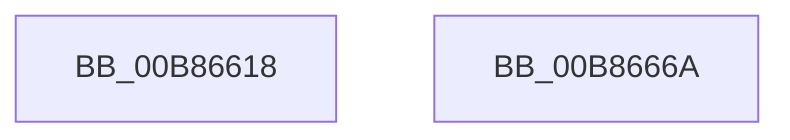

# KdPullRemoteFile

- RVA: `0x00B86618`–`0x00B8666B` (길이 `83` bytes)
- VA: `0x0000000140B86618`
- 실행 섹션: `PAGEKD`
- PDB 이름 있음: `예`; PDB Function 태그: `아니요`
- unwind 정보 RVA: `0x0005CC98`
- 디코드: `17`개 명령, `83/83` bytes 표시
- 미해석 바이트: `0` (있으면 어셈블리에 `.byte`로 보존)

> 이 문서는 커널 이미지의 기계어와 PDB 기호를 분석해 생성했습니다. 4번과 5번은 함수 원형과 자료형을 바이너리 사용 방식에서 추정한 C 해석이며 원본 소스 복구 결과는 아닙니다.

## 1. Dependencies

- 직접 호출 지점: **1**; 고유 호출 대상: **1**
- 직접 호출자로 확인된 함수: **2**
- RIP 상대 이미지 참조: **3**

### Outgoing calls
- `0x00B86660` → [KdpPullRemoteFile](KdpPullRemoteFile_function_00B86B48.md) (function, `0x00B86B48`)

### Direct callers
- [ExpKdPullRemoteFileForUser](../../page/7D/ExpKdPullRemoteFileForUser_function_007D15AC.md) at `0x007D1969`
- [MiCreateSectionForDriver](../../page/A2/MiCreateSectionForDriver_function_00A2477C.md) at `0x00A2491D`

### Static image references
- `0x00B86624` → RVA `0x00B86EC0` (`KdpWriteFileCallback`; read)
- `0x00B8662F` → RVA `0x00B86830` (`KdpCreateFileCallback`; read)
- `0x00B86654` → RVA `0x00B866B0` (`KdpCloseFileCallback`; read)

## 2. Other-region calls and transfers

- 다른 실행 섹션으로 향하는 call: **0**
- 별도 외부 분기/꼬리 이동을 확인하지 못했습니다.

## 3. Assembly (complete function range)

```asm
00B86618  48 8B C4                        mov rax, rsp
00B8661B  48 83 EC 58                     sub rsp, 0x58
00B8661F  48 83 60 E4 00                  and qword ptr [rax - 0x1c], 0
00B86624  4C 8D 0D 95 08 00 00            lea r9, [rip + 0x895]
00B8662B  83 60 EC 00                     and dword ptr [rax - 0x14], 0
00B8662F  4C 8D 05 FA 01 00 00            lea r8, [rip + 0x1fa]
00B86636  C7 40 D8 80 00 00 00            mov dword ptr [rax - 0x28], 0x80
00B8663D  C7 40 DC 05 00 00 00            mov dword ptr [rax - 0x24], 5
00B86644  C7 40 E0 20 00 00 00            mov dword ptr [rax - 0x20], 0x20
00B8664B  48 8D 40 D8                     lea rax, [rax - 0x28]
00B8664F  48 89 44 24 28                  mov qword ptr [rsp + 0x28], rax
00B86654  48 8D 05 55 00 00 00            lea rax, [rip + 0x55]
00B8665B  48 89 44 24 20                  mov qword ptr [rsp + 0x20], rax
00B86660  E8 E3 04 00 00                  call 0x140b86b48
00B86665  48 83 C4 58                     add rsp, 0x58
00B86669  C3                              ret
00B8666A  CC                              int3
```

## 4. C-style interpretation (structured pseudocode)

```c
__int64 __fastcall KdPullRemoteFile(void)
{
    __int64 result;
    __int64 v_rsp;
    unsigned __int64 v_stack_m30;
    unsigned __int64 v_stack_m38;

    v_rsp = (v_rsp) - (88);
    *(unsigned int *)(v_rsp - 40) = 128;
    *(unsigned int *)(v_rsp - 36) = 5;
    *(unsigned int *)(v_rsp - 32) = 32;
    v_stack_m30 = v_rsp - 40;
    v_stack_m38 = v_rip + 85;
    result = KdpPullRemoteFile(a1, a2, v_rip + 506, v_rip + 2197);
    v_rsp = (v_rsp) + (88);
    return result;
}
```

## 5. (Beta) C Style

```c
void KdPullRemoteFile(void)
{
    int64_t result;
    int64_t local_rsp;
    uint64_t v_stack_m30;
    uint64_t v_stack_m38;

    local_rsp = (local_rsp) - (88);
    *(uint32_t *)(local_rsp - 0x28) = 128;
    *(uint32_t *)(local_rsp - 0x24) = 5;
    *(uint32_t *)(local_rsp - 0x20) = 32;
    v_stack_m30 = local_rsp - 40;
    v_stack_m38 = v_rip + 85;
    result = KdpPullRemoteFile(a1, a2, v_rip + 506, v_rip + 2197);
    local_rsp = (local_rsp) + (88);
    return result;
}
```

## 6. Execution-region graph

[열기: 2D/3D 그래프와 함수 탐색 컨트롤 패널](../../../control-panel.html?section=pagekd&rva=0x00B86618&view=graph)

- 2D 그래프는 위에서 아래로 흐르고, 3D 그래프는 빈 공간을 드래그해 회전합니다. Shift+드래그는 이동, 휠은 확대·축소, 함수 노드 선택은 대상 보고서 이동입니다.

### Static fallback


