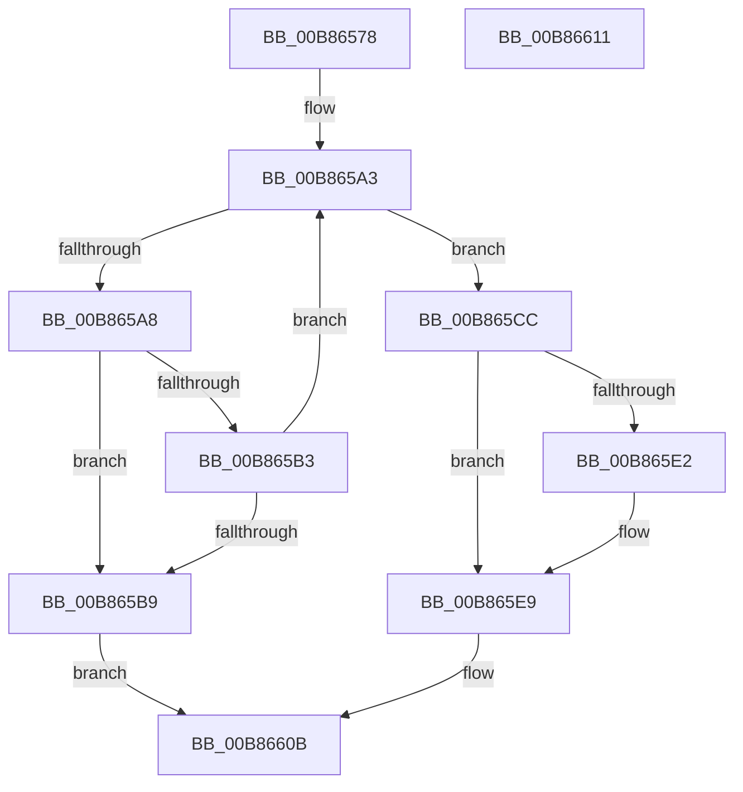

# KdRegisterDebuggerDataBlock

- RVA: `0x00B86578`–`0x00B86612` (길이 `154` bytes)
- VA: `0x0000000140B86578`
- 실행 섹션: `PAGEKD`
- PDB 이름 있음: `예`; PDB Function 태그: `아니요`
- unwind 정보 RVA: `0x0005CF00`
- 디코드: `41`개 명령, `154/154` bytes 표시
- 미해석 바이트: `0` (있으면 어셈블리에 `.byte`로 보존)

> 이 문서는 커널 이미지의 기계어와 PDB 기호를 분석해 생성했습니다. 4번과 5번은 함수 원형과 자료형을 바이너리 사용 방식에서 추정한 C 해석이며 원본 소스 복구 결과는 아닙니다.

## 1. Dependencies

- 직접 호출 지점: **3**; 고유 호출 대상: **2**
- 직접 호출자로 확인된 함수: **1**
- RIP 상대 이미지 참조: **4**

### Outgoing calls
- `0x00B86588` → [KeAcquireSpinLockRaiseToDpc](../../text/20/KeAcquireSpinLockRaiseToDpc_function_00208470.md) (function, `0x00208470`)
- `0x00B865C3` → [KeReleaseSpinLock](../../text/39/KeReleaseSpinLock_function_00392BA0.md) (function, `0x00392BA0`)
- `0x00B86604` → [KeReleaseSpinLock](../../text/39/KeReleaseSpinLock_function_00392BA0.md) (function, `0x00392BA0`)

### Direct callers
- [KdInitSystem](KdInitSystem_function_00B85E30.md) at `0x00B85F40`

### Static image references
- `0x00B8657E` → RVA `0x00E663F0` (`.data`; read)
- `0x00B8658D` → RVA `0x00F55C70` (`.data`; read)
- `0x00B865D6` → RVA `0x00F55C78` (`.data`; read)
- `0x00B865FD` → RVA `0x00F55C78` (`.data`; write)

## 2. Other-region calls and transfers

- 다른 실행 섹션으로 향하는 call: **3**
  - `0x00B86588` → [KeAcquireSpinLockRaiseToDpc](../../text/20/KeAcquireSpinLockRaiseToDpc_function_00208470.md) (`PAGEKD` → `.text`)
  - `0x00B865C3` → [KeReleaseSpinLock](../../text/39/KeReleaseSpinLock_function_00392BA0.md) (`PAGEKD` → `.text`)
  - `0x00B86604` → [KeReleaseSpinLock](../../text/39/KeReleaseSpinLock_function_00392BA0.md) (`PAGEKD` → `.text`)
- 별도 외부 분기/꼬리 이동을 확인하지 못했습니다.

## 3. Assembly (complete function range)

```asm
00B86578  40 53                           push rbx
00B8657A  48 83 EC 20                     sub rsp, 0x20
00B8657E  48 8D 0D 6B FE 2D 00            lea rcx, [rip + 0x2dfe6b]
00B86585  48 8B DA                        mov rbx, rdx
00B86588  E8 E3 1E 68 FF                  call 0x140208470
00B8658D  48 8B 15 DC F6 3C 00            mov rdx, qword ptr [rip + 0x3cf6dc]
00B86594  4C 8D 15 D5 F6 3C 00            lea r10, [rip + 0x3cf6d5]
00B8659B  44 8A C8                        mov r9b, al
00B8659E  B8 4B 44 42 47                  mov eax, 0x4742444b
00B865A3  49 3B D2                        cmp rdx, r10
00B865A6  74 24                           je 0x140b865cc
00B865A8  4C 8B C2                        mov r8, rdx
00B865AB  48 8B 12                        mov rdx, qword ptr [rdx]
00B865AE  4C 3B C3                        cmp r8, rbx
00B865B1  74 06                           je 0x140b865b9
00B865B3  41 39 40 10                     cmp dword ptr [r8 + 0x10], eax
00B865B7  75 EA                           jne 0x140b865a3
00B865B9  41 8A D1                        mov dl, r9b
00B865BC  48 8D 0D 2D FE 2D 00            lea rcx, [rip + 0x2dfe2d]
00B865C3  E8 D8 C5 80 FF                  call 0x140392ba0
00B865C8  32 C0                           xor al, al
00B865CA  EB 3F                           jmp 0x140b8660b
00B865CC  89 43 10                        mov dword ptr [rbx + 0x10], eax
00B865CF  C7 43 14 A0 03 00 00            mov dword ptr [rbx + 0x14], 0x3a0
00B865D6  48 8B 05 9B F6 3C 00            mov rax, qword ptr [rip + 0x3cf69b]
00B865DD  4C 39 10                        cmp qword ptr [rax], r10
00B865E0  74 07                           je 0x140b865e9
00B865E2  B9 03 00 00 00                  mov ecx, 3
00B865E7  CD 29                           int 0x29
00B865E9  4C 89 13                        mov qword ptr [rbx], r10
00B865EC  48 8D 0D FD FD 2D 00            lea rcx, [rip + 0x2dfdfd]
00B865F3  48 89 43 08                     mov qword ptr [rbx + 8], rax
00B865F7  41 8A D1                        mov dl, r9b
00B865FA  48 89 18                        mov qword ptr [rax], rbx
00B865FD  48 89 1D 74 F6 3C 00            mov qword ptr [rip + 0x3cf674], rbx
00B86604  E8 97 C5 80 FF                  call 0x140392ba0
00B86609  B0 01                           mov al, 1
00B8660B  48 83 C4 20                     add rsp, 0x20
00B8660F  5B                              pop rbx
00B86610  C3                              ret
00B86611  CC                              int3
```

## 4. C-style interpretation (structured pseudocode)

```c
__int64 __fastcall KdRegisterDebuggerDataBlock(__int64 a1, __int64 a2)
{
    __int64 result;
    __int64 v_rsp;

    v_rsp = (v_rsp) - (32);
    result = KeAcquireSpinLockRaiseToDpc(v_rip + 3014251, a2, a3, a4);
loc_00B865A3:
    if ((*(unsigned __int64 *)(v_rip + 3995356)) == (v_rip + 3995349)) goto loc_00B865CC;
    if ((*(unsigned __int64 *)(v_rip + 3995356)) == a2) goto loc_00B865B9;
    if ((*(unsigned int *)(*(unsigned __int64 *)(v_rip + 3995356) + 16)) != ((unsigned int)((unsigned int)(0x4742444BULL)))) goto loc_00B865A3;
loc_00B865B9:
    result = KeReleaseSpinLock(v_rip + 3014189, (unsigned __int8)((unsigned __int8)(result)), *(unsigned __int64 *)(v_rip + 3995356), (unsigned __int8)(result));
    result = 0;
    goto loc_00B8660B;
loc_00B865CC:
    *(unsigned int *)(a2 + 16) = 0;
    *(unsigned int *)(a2 + 20) = 928;
    if ((*(unsigned __int64 *)(*(unsigned __int64 *)(v_rip + 3995291))) != (v_rip + 3995349)) {
        a1 = 3;
    }
    *(unsigned __int64 *)(a2) = v_rip + 3995349;
    *(unsigned __int64 *)(a2 + 8) = *(unsigned __int64 *)(v_rip + 3995291);
    *(unsigned __int64 *)(*(unsigned __int64 *)(v_rip + 3995291)) = a2;
    *(unsigned __int64 *)(v_rip + 3995252) = a2;
    result = KeReleaseSpinLock(v_rip + 3014141, (unsigned __int8)((unsigned __int8)(result)), *(unsigned __int64 *)(v_rip + 3995356), (unsigned __int8)(result));
loc_00B8660B:
    v_rsp = (v_rsp) + (32);
    return 1;
}
```

## 5. (Beta) C Style

```c
int64_t KdRegisterDebuggerDataBlock(int64_t Arg1, void *Arg2)
{
    uint8_t *arg2 = (uint8_t *)Arg2;

    int64_t result;
    int64_t local_rsp;

    local_rsp = (local_rsp) - (32);
    result = KeAcquireSpinLockRaiseToDpc(v_rip + 3014251, Arg2, a3, a4);
loc_00B865A3:
    if ((*(uint64_t *)(v_rip + 0x3CF6DC)) == (v_rip + 3995349)) goto loc_00B865CC;
    if ((*(uint64_t *)(v_rip + 0x3CF6DC)) == Arg2) goto loc_00B865B9;
    if ((*(uint32_t *)(*(uint64_t *)(v_rip + 0x3CF6DC) + 0x10)) != ((uint32_t)((uint32_t)(0x4742444BULL)))) goto loc_00B865A3;
loc_00B865B9:
    result = KeReleaseSpinLock(v_rip + 3014189, (uint8_t)((uint8_t)(result)), *(uint64_t *)(v_rip + 0x3CF6DC), (uint8_t)(result));
    result = 0;
    goto loc_00B8660B;
loc_00B865CC:
    *(uint32_t *)(arg2 + 0x10) = 0;
    *(uint32_t *)(arg2 + 0x14) = 928;
    if ((*(uint64_t *)(*(uint64_t *)(v_rip + 0x3CF69B))) != (v_rip + 3995349)) {
        Arg1 = 3;
    }
    *(uint64_t *)(arg2) = v_rip + 3995349;
    *(uint64_t *)(arg2 + 0x8) = *(uint64_t *)(v_rip + 0x3CF69B);
    *(void **)(*(uint64_t *)(v_rip + 0x3CF69B)) = Arg2;
    *(void **)(v_rip + 0x3CF674) = Arg2;
    result = KeReleaseSpinLock(v_rip + 3014141, (uint8_t)((uint8_t)(result)), *(uint64_t *)(v_rip + 0x3CF6DC), (uint8_t)(result));
loc_00B8660B:
    local_rsp = (local_rsp) + (32);
    return 1;
}
```

### 관측된 메모리 오프셋

구조체 형식이 확인되지 않은 접근은 인자 기준의 오프셋으로만 기록했습니다.

| 기준 인자 | 오프셋 표현 | 폭 (bit) | 접근 |
|---|---:|---:|---|
| `Arg2` | `+ 0x0` | `64` | `W` |
| `Arg2` | `+ 0x8` | `64` | `W` |
| `Arg2` | `+ 0x10` | `32` | `W` |
| `Arg2` | `+ 0x14` | `32` | `W` |

## 6. Execution-region graph

[열기: 2D/3D 그래프와 함수 탐색 컨트롤 패널](../../../control-panel.html?section=pagekd&rva=0x00B86578&view=graph)

- 2D 그래프는 위에서 아래로 흐르고, 3D 그래프는 빈 공간을 드래그해 회전합니다. Shift+드래그는 이동, 휠은 확대·축소, 함수 노드 선택은 대상 보고서 이동입니다.

### Static fallback


