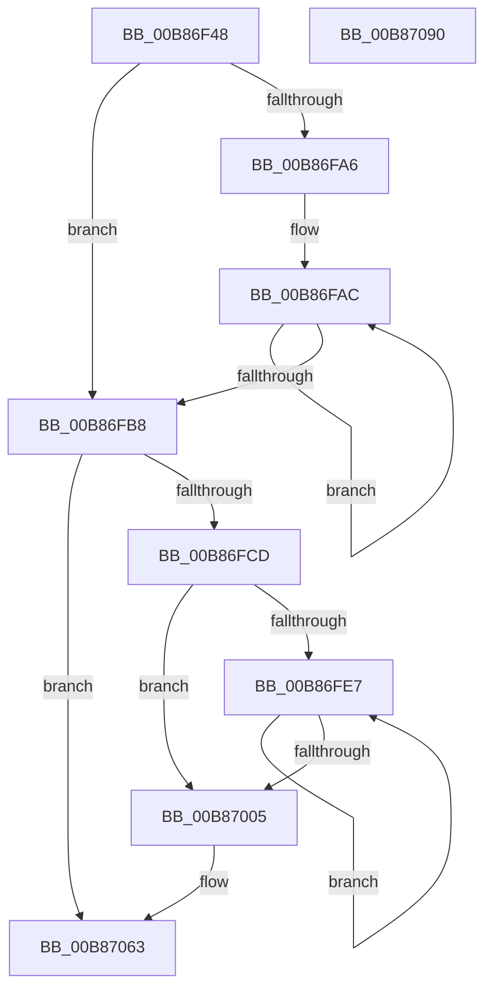

# KdSendTraceData

- RVA: `0x00B86F48`–`0x00B87091` (길이 `329` bytes)
- VA: `0x0000000140B86F48`
- 실행 섹션: `PAGEKD`
- PDB 이름 있음: `예`; PDB Function 태그: `아니요`
- unwind 정보 RVA: `0x000C98E4`
- 디코드: `90`개 명령, `329/329` bytes 표시
- 미해석 바이트: `0` (있으면 어셈블리에 `.byte`로 보존)

> 이 문서는 커널 이미지의 기계어와 PDB 기호를 분석해 생성했습니다. 4번과 5번은 함수 원형과 자료형을 바이너리 사용 방식에서 추정한 C 해석이며 원본 소스 복구 결과는 아닙니다.

## 1. Dependencies

- 직접 호출 지점: **6**; 고유 호출 대상: **6**
- 직접 호출자로 확인된 함수: **2**
- RIP 상대 이미지 참조: **6**

### Outgoing calls
- `0x00B86F9B` → [memset](../../text/6C/memset_function_006C6C40.md) (function, `0x006C6C40`)
- `0x00B86FD1` → [KdEnterDebugger](KdEnterDebugger_function_00B8A96C.md) (function, `0x00B8A96C`)
- `0x00B86FF1` → [memcpy](../../text/6C/memcpy_function_006C6840.md) (function, `0x006C6840`)
- `0x00B8704F` → `kdcom.dll!KdSendPacket` (import, 간접 대상; import `kdcom.dll!KdSendPacket`)
- `0x00B8705E` → [KdExitDebugger](KdExitDebugger_function_00B85008.md) (function, `0x00B85008`)
- `0x00B8706A` → [_security_check_cookie](../../text/6A/_security_check_cookie_function_006AC640.md) (function, `0x006AC640`)

### Direct callers
- [EtwpSendTraceEvent](../../text/4B/EtwpSendTraceEvent_function_004B6E10.md) at `0x004B6EE9`
- [EtwpSendBufferToDebugger](../../page/7B/EtwpSendBufferToDebugger_function_007BC0AC.md) at `0x007BC0FE`
- [EtwpSendBufferToDebugger](../../page/7B/EtwpSendBufferToDebugger_function_007BC0AC.md) at `0x007BC194`

### Static image references
- `0x00B86F6B` → RVA `0x00E0A740` (`.data`; read)
- `0x00B86FB8` → RVA `0x00E0AA48` (`.data`; read)
- `0x00B86FD6` → RVA `0x00E12710` (`.data`; read)
- `0x00B87005` → RVA `0x00FC6BE8` (`ALMOSTRO`; read)
- `0x00B8700C` → RVA `0x00F475E0` (`.data`; read)
- `0x00B8704F` → RVA `0x001516C0` (`kdcom.dll!KdSendPacket (IAT)`; read)

## 2. Other-region calls and transfers

- 다른 실행 섹션으로 향하는 call: **3**
  - `0x00B86F9B` → [memset](../../text/6C/memset_function_006C6C40.md) (`PAGEKD` → `.text`)
  - `0x00B86FF1` → [memcpy](../../text/6C/memcpy_function_006C6840.md) (`PAGEKD` → `.text`)
  - `0x00B8706A` → [_security_check_cookie](../../text/6A/_security_check_cookie_function_006AC640.md) (`PAGEKD` → `.text`)
- 별도 외부 분기/꼬리 이동을 확인하지 못했습니다.

## 3. Assembly (complete function range)

```asm
00B86F48  48 8B C4                        mov rax, rsp
00B86F4B  48 89 58 10                     mov qword ptr [rax + 0x10], rbx
00B86F4F  48 89 70 18                     mov qword ptr [rax + 0x18], rsi
00B86F53  48 89 78 20                     mov qword ptr [rax + 0x20], rdi
00B86F57  55                              push rbp
00B86F58  41 54                           push r12
00B86F5A  41 55                           push r13
00B86F5C  41 56                           push r14
00B86F5E  41 57                           push r15
00B86F60  48 8D 68 A1                     lea rbp, [rax - 0x5f]
00B86F64  48 81 EC 90 00 00 00            sub rsp, 0x90
00B86F6B  48 8B 05 CE 37 28 00            mov rax, qword ptr [rip + 0x2837ce]
00B86F72  48 33 C4                        xor rax, rsp
00B86F75  48 89 45 27                     mov qword ptr [rbp + 0x27], rax
00B86F79  8B F2                           mov esi, edx
00B86F7B  48 8B D9                        mov rbx, rcx
00B86F7E  0F 57 C0                        xorps xmm0, xmm0
00B86F81  48 8D 4D E7                     lea rcx, [rbp - 0x19]
00B86F85  0F 57 C9                        xorps xmm1, xmm1
00B86F88  41 BD 40 00 00 00               mov r13d, 0x40
00B86F8E  45 8B C5                        mov r8d, r13d
00B86F91  33 D2                           xor edx, edx
00B86F93  0F 11 45 C7                     movups xmmword ptr [rbp - 0x39], xmm0
00B86F97  0F 11 4D D7                     movups xmmword ptr [rbp - 0x29], xmm1
00B86F9B  E8 A0 FC B3 FF                  call 0x1406c6c40
00B86FA0  33 FF                           xor edi, edi
00B86FA2  85 F6                           test esi, esi
00B86FA4  74 12                           je 0x140b86fb8
00B86FA6  48 8D 43 08                     lea rax, [rbx + 8]
00B86FAA  8B CE                           mov ecx, esi
00B86FAC  03 38                           add edi, dword ptr [rax]
00B86FAE  48 8D 40 10                     lea rax, [rax + 0x10]
00B86FB2  48 83 E9 01                     sub rcx, 1
00B86FB6  75 F4                           jne 0x140b86fac
00B86FB8  8B 05 8A 3A 28 00               mov eax, dword ptr [rip + 0x283a8a]
00B86FBE  48 83 C3 08                     add rbx, 8
00B86FC2  83 C0 C0                        add eax, -0x40
00B86FC5  3B F8                           cmp edi, eax
00B86FC7  0F 87 96 00 00 00               ja 0x140b87063
00B86FCD  33 D2                           xor edx, edx
00B86FCF  33 C9                           xor ecx, ecx
00B86FD1  E8 96 39 00 00                  call 0x140b8a96c
00B86FD6  4C 8D 25 33 B7 28 00            lea r12, [rip + 0x28b733]
00B86FDD  44 8A F8                        mov r15b, al
00B86FE0  4D 8B F4                        mov r14, r12
00B86FE3  85 F6                           test esi, esi
00B86FE5  74 1E                           je 0x140b87005
00B86FE7  44 8B 03                        mov r8d, dword ptr [rbx]
00B86FEA  49 8B CE                        mov rcx, r14
00B86FED  48 8B 53 F8                     mov rdx, qword ptr [rbx - 8]
00B86FF1  E8 4A F8 B3 FF                  call 0x1406c6840
00B86FF6  8B 03                           mov eax, dword ptr [rbx]
00B86FF8  48 8D 5B 10                     lea rbx, [rbx + 0x10]
00B86FFC  4C 03 F0                        add r14, rax
00B86FFF  48 83 EE 01                     sub rsi, 1
00B87003  75 E2                           jne 0x140b86fe7
00B87005  0F B7 05 DC FB 43 00            movzx eax, word ptr [rip + 0x43fbdc]
00B8700C  4C 8D 0D CD 05 3C 00            lea r9, [rip + 0x3c05cd]
00B87013  66 89 45 EB                     mov word ptr [rbp - 0x15], ax
00B87017  4C 8D 45 C7                     lea r8, [rbp - 0x39]
00B8701B  C7 45 E7 30 33 00 00            mov dword ptr [rbp - 0x19], 0x3330
00B87022  48 8D 55 D7                     lea rdx, [rbp - 0x29]
00B87026  65 8B 04 25 A4 01 00 00         mov eax, dword ptr gs:[0x1a4]
00B8702E  B9 09 00 00 00                  mov ecx, 9
00B87033  66 89 45 ED                     mov word ptr [rbp - 0x13], ax
00B87037  48 8D 45 E7                     lea rax, [rbp - 0x19]
00B8703B  48 89 45 DF                     mov qword ptr [rbp - 0x21], rax
00B8703F  89 7D EF                        mov dword ptr [rbp - 0x11], edi
00B87042  66 44 89 6D D7                  mov word ptr [rbp - 0x29], r13w
00B87047  66 89 7D C7                     mov word ptr [rbp - 0x39], di
00B8704B  4C 89 65 CF                     mov qword ptr [rbp - 0x31], r12
00B8704F  48 FF 15 6A A6 5C FF            call qword ptr [rip - 0xa35996]
00B87056  0F 1F 44 00 00                  nop dword ptr [rax + rax]
00B8705B  41 8A CF                        mov cl, r15b
00B8705E  E8 A5 DF FF FF                  call 0x140b85008
00B87063  48 8B 4D 27                     mov rcx, qword ptr [rbp + 0x27]
00B87067  48 33 CC                        xor rcx, rsp
00B8706A  E8 D1 55 B2 FF                  call 0x1406ac640
00B8706F  4C 8D 9C 24 90 00 00 00         lea r11, [rsp + 0x90]
00B87077  49 8B 5B 38                     mov rbx, qword ptr [r11 + 0x38]
00B8707B  49 8B 73 40                     mov rsi, qword ptr [r11 + 0x40]
00B8707F  49 8B 7B 48                     mov rdi, qword ptr [r11 + 0x48]
00B87083  49 8B E3                        mov rsp, r11
00B87086  41 5F                           pop r15
00B87088  41 5E                           pop r14
00B8708A  41 5D                           pop r13
00B8708C  41 5C                           pop r12
00B8708E  5D                              pop rbp
00B8708F  C3                              ret
00B87090  CC                              int3
```

## 4. C-style interpretation (structured pseudocode)

```c
__int64 __fastcall KdSendTraceData(__int64 a1, int a2)
{
    __int64 result;
    __int64 v_r14;
    __int64 v_rbx;
    __int64 v_rdi;
    __int64 v_rsi;
    __int64 v_rsp;
    unsigned __int64 v_stack_m28;

    *(unsigned __int64 *)(v_rsp + 16) = v_rbx;
    *(unsigned __int64 *)(v_rsp + 24) = v_rsi;
    *(unsigned __int64 *)(v_rsp + 32) = v_rdi;
    v_rsp = (v_rsp) - (144);
    result = (*(unsigned __int64 *)(v_rip + 2635726)) ^ (v_rsp);
    *(unsigned __int64 *)(v_rsp - 95 + 39) = result;
    a2 = 0;
    *(unsigned __int64 *)(v_rsp - 95 - 57) = v_xmm0;
    *(unsigned __int64 *)(v_rsp - 95 - 41) = v_xmm1;
    result = memset(v_rsp - 95 - 25, a2, 64, a4);
    v_rdi = 0;
    if ((unsigned int)((unsigned int)(a2)) == 0) goto loc_00B86FB8;
loc_00B86FAC:
    v_rdi = (unsigned int)((v_rdi) + (*(unsigned int *)(a1 + 8)));
    a1 = ((unsigned int)((unsigned int)((unsigned int)(a2)))) - (1);
    if (condition_is_not_equal) goto loc_00B86FAC;
loc_00B86FB8:
    v_rbx = (a1) + (8);
    result = (unsigned int)(((unsigned int)(*(unsigned int *)(v_rip + 2636426))) + (-64));
    if (((unsigned int)(v_rdi)) > ((unsigned int)(result))) goto loc_00B87063;
    a2 = 0;
    a1 = 0;
    result = KdEnterDebugger(a1, a2, 64, a4);
    if ((unsigned int)((unsigned int)(a2)) == 0) goto loc_00B87005;
loc_00B86FE7:
    result = memcpy(v_rip + 2668339, *(unsigned __int64 *)(v_rbx - 8), (unsigned int)(*(unsigned int *)(v_rbx)), a4);
    v_r14 = (v_rip + 2668339) + ((unsigned int)(*(unsigned int *)(v_rbx)));
    v_rsi = ((unsigned int)(a2)) - (1);
    if (condition_is_not_equal) goto loc_00B86FE7;
loc_00B87005:
    *(unsigned __int16 *)(v_rsp - 95 - 21) = (unsigned __int16)(*(unsigned __int16 *)(v_rip + 4455388));
    *(unsigned int *)(v_rsp - 95 - 25) = 0x3330ULL;
    *(unsigned __int16 *)(v_rsp - 95 - 19) = (unsigned __int16)((unsigned int)(*(unsigned int *)(gs_base + (0 + 420))));
    *(unsigned __int64 *)(v_rsp - 95 - 33) = v_rsp - 95 - 25;
    *(unsigned int *)(v_rsp - 95 - 17) = (unsigned int)(v_rdi);
    *(unsigned __int16 *)(v_rsp - 95 - 41) = 64;
    *(unsigned __int16 *)(v_rsp - 95 - 57) = (unsigned __int16)(v_rdi);
    *(unsigned __int64 *)(v_rsp - 95 - 49) = v_rip + 2668339;
    result = kdcom_dll_KdSendPacket(9, v_rsp - 95 - 41, v_rsp - 95 - 57, v_rip + 3933645);
    result = KdExitDebugger((unsigned __int8)((unsigned __int8)(result)), v_rsp - 95 - 41, v_rsp - 95 - 57, v_rip + 3933645);
loc_00B87063:
    a1 = (*(unsigned __int64 *)(v_rsp - 95 + 39)) ^ (v_rsp);
    result = _security_check_cookie(a1, v_rsp - 95 - 41, v_rsp - 95 - 57, v_rip + 3933645);
    return result;
}
```

## 5. (Beta) C Style

```c
int64_t KdSendTraceData(void *Arg1, int32_t Arg2)
{
    uint8_t *arg1 = (uint8_t *)Arg1;

    int64_t result;
    int64_t local_r14;
    int64_t local_rbx;
    int64_t local_rdi;
    int64_t local_rsi;
    int64_t local_rsp;
    uint64_t v_stack_m28;

    *(uint64_t *)(local_rsp + 0x10) = local_rbx;
    *(uint64_t *)(local_rsp + 0x18) = local_rsi;
    *(uint64_t *)(local_rsp + 0x20) = local_rdi;
    local_rsp = (local_rsp) - (144);
    result = (*(uint64_t *)(v_rip + 0x2837CE)) ^ (local_rsp);
    *(uint64_t *)(local_rsp - 0x5F + 0x27) = result;
    Arg2 = 0;
    *(uint64_t *)(local_rsp - 0x5F - 0x39) = v_xmm0;
    *(uint64_t *)(local_rsp - 0x5F - 0x29) = v_xmm1;
    result = memset(local_rsp - 95 - 25, Arg2, 64, a4);
    local_rdi = 0;
    if ((uint32_t)((uint32_t)(Arg2)) == 0) goto loc_00B86FB8;
loc_00B86FAC:
    local_rdi = (uint32_t)((local_rdi) + (*(uint32_t *)(arg1 + 0x8)));
    Arg1 = ((uint32_t)((uint32_t)((uint32_t)(Arg2)))) - (1);
    if (condition_is_not_equal) goto loc_00B86FAC;
loc_00B86FB8:
    local_rbx = (Arg1) + (8);
    result = (uint32_t)(((uint32_t)(*(uint32_t *)(v_rip + 0x283A8A))) + (-64));
    if (((uint32_t)(local_rdi)) > ((uint32_t)(result))) goto loc_00B87063;
    Arg2 = 0;
    Arg1 = 0;
    result = KdEnterDebugger(Arg1, Arg2, 64, a4);
    if ((uint32_t)((uint32_t)(Arg2)) == 0) goto loc_00B87005;
loc_00B86FE7:
    result = memcpy(v_rip + 2668339, *(uint64_t *)(local_rbx - 0x8), (uint32_t)(*(uint32_t *)(local_rbx)), a4);
    local_r14 = (v_rip + 2668339) + ((uint32_t)(*(uint32_t *)(local_rbx)));
    local_rsi = ((uint32_t)(Arg2)) - (1);
    if (condition_is_not_equal) goto loc_00B86FE7;
loc_00B87005:
    *(uint16_t *)(local_rsp - 0x5F - 0x15) = (uint16_t)(*(uint16_t *)(v_rip + 0x43FBDC));
    *(uint32_t *)(local_rsp - 0x5F - 0x19) = 0x3330ULL;
    *(uint16_t *)(local_rsp - 0x5F - 0x13) = (uint16_t)((uint32_t)(*(uint32_t *)(gs_base + (0 + 0x1A4))));
    *(uint64_t *)(local_rsp - 0x5F - 0x21) = local_rsp - 95 - 25;
    *(uint32_t *)(local_rsp - 0x5F - 0x11) = (uint32_t)(local_rdi);
    *(uint16_t *)(local_rsp - 0x5F - 0x29) = 64;
    *(uint16_t *)(local_rsp - 0x5F - 0x39) = (uint16_t)(local_rdi);
    *(uint64_t *)(local_rsp - 0x5F - 0x31) = v_rip + 2668339;
    result = kernel_indirect_call(9, local_rsp - 95 - 41, local_rsp - 95 - 57, v_rip + 3933645);
    result = KdExitDebugger((uint8_t)((uint8_t)(result)), local_rsp - 95 - 41, local_rsp - 95 - 57, v_rip + 3933645);
loc_00B87063:
    Arg1 = (*(uint64_t *)(local_rsp - 0x5F + 0x27)) ^ (local_rsp);
    result = _security_check_cookie(Arg1, local_rsp - 95 - 41, local_rsp - 95 - 57, v_rip + 3933645);
    return result;
}
```

### 관측된 메모리 오프셋

구조체 형식이 확인되지 않은 접근은 인자 기준의 오프셋으로만 기록했습니다.

| 기준 인자 | 오프셋 표현 | 폭 (bit) | 접근 |
|---|---:|---:|---|
| `Arg1` | `- 0x8` | `64` | `R` |
| `Arg1` | `+ 0x0` | `32` | `R` |
| `Arg1` | `+ 0x8` | `64` | `R` |
| `Arg1` | `+ 0x10` | `64` | `R` |

## 6. Execution-region graph

[열기: 2D/3D 그래프와 함수 탐색 컨트롤 패널](../../../control-panel.html?section=pagekd&rva=0x00B86F48&view=graph)

- 2D 그래프는 위에서 아래로 흐르고, 3D 그래프는 빈 공간을 드래그해 회전합니다. Shift+드래그는 이동, 휠은 확대·축소, 함수 노드 선택은 대상 보고서 이동입니다.

### Static fallback


