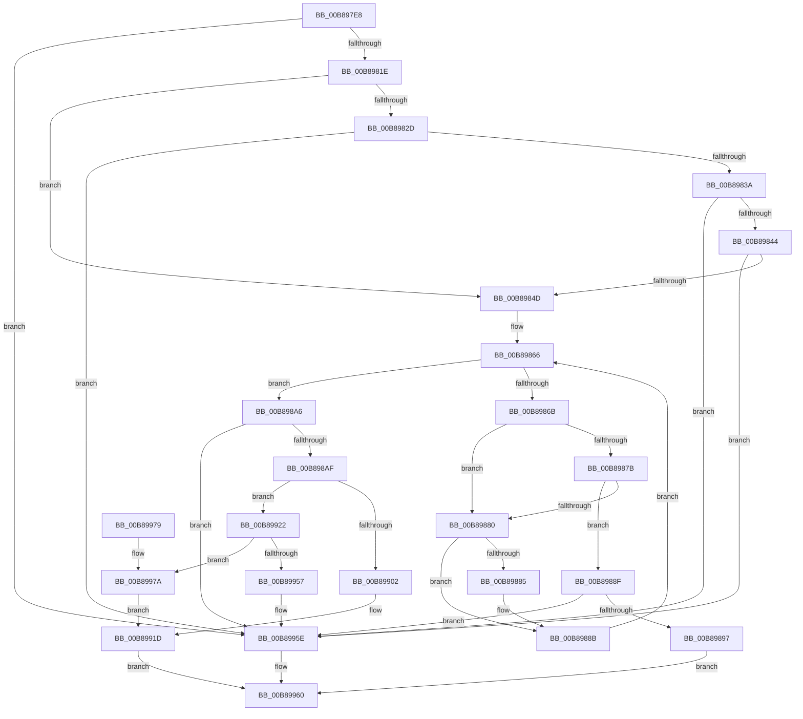

# KdpAddBreakpoint

- RVA: `0x00B897E8`–`0x00B8997F` (길이 `407` bytes)
- VA: `0x0000000140B897E8`
- 실행 섹션: `PAGEKD`
- PDB 이름 있음: `예`; PDB Function 태그: `아니요`
- unwind 정보 RVA: `0x000C9B48`
- 디코드: `106`개 명령, `407/407` bytes 표시
- 미해석 바이트: `0` (있으면 어셈블리에 `.byte`로 보존)

> 이 문서는 커널 이미지의 기계어와 PDB 기호를 분석해 생성했습니다. 4번과 5번은 함수 원형과 자료형을 바이너리 사용 방식에서 추정한 C 해석이며 원본 소스 복구 결과는 아닙니다.

## 1. Dependencies

- 직접 호출 지점: **2**; 고유 호출 대상: **2**
- 직접 호출자로 확인된 함수: **3**
- RIP 상대 이미지 참조: **5**

### Outgoing calls
- `0x00B898EA` → [KdpCopyCodeStream](KdpCopyCodeStream_function_00B8930C.md) (function, `0x00B8930C`)
- `0x00B8994E` → [KdpInsertBreakpoint](KdpInsertBreakpoint_function_00B899F0.md) (function, `0x00B899F0`)

### Direct callers
- [KdpWriteCustomBreakpoint](../../text/5B/KdpWriteCustomBreakpoint_function_005B0E9C.md) at `0x005B0ECC`
- [KdpWriteBreakPointEx](KdpWriteBreakPointEx_function_00B886D4.md) at `0x00B887CC`
- [KdpWriteBreakpoint](KdpWriteBreakpoint_function_00B88898.md) at `0x00B888C7`

### Static image references
- `0x00B8984D` → RVA `0x00F49620` (`.data`; read)
- `0x00B89853` → RVA `0x00F49640` (`.data`; read)
- `0x00B8985E` → RVA `0x00F49620` (`.data`; write)
- `0x00B89939` → RVA `0x00F55BC0` (`.data`; read)
- `0x00B89957` → RVA `0x00F55BC0` (`.data`; write)

## 2. Other-region calls and transfers

- 다른 실행 섹션으로 향하는 call: **0**
- 별도 외부 분기/꼬리 이동을 확인하지 못했습니다.

## 3. Assembly (complete function range)

```asm
00B897E8  48 8B C4                        mov rax, rsp
00B897EB  48 89 58 08                     mov qword ptr [rax + 8], rbx
00B897EF  48 89 68 10                     mov qword ptr [rax + 0x10], rbp
00B897F3  48 89 70 18                     mov qword ptr [rax + 0x18], rsi
00B897F7  57                              push rdi
00B897F8  41 56                           push r14
00B897FA  41 57                           push r15
00B897FC  48 83 EC 30                     sub rsp, 0x30
00B89800  48 83 60 D8 00                  and qword ptr [rax - 0x28], 0
00B89805  4C 8B FA                        mov r15, rdx
00B89808  41 0F B6 E8                     movzx ebp, r8b
00B8980C  48 8B F1                        mov rsi, rcx
00B8980F  45 0F B6 F1                     movzx r14d, r9b
00B89813  8D 45 FF                        lea eax, [rbp - 1]
00B89816  85 C5                           test ebp, eax
00B89818  0F 85 40 01 00 00               jne 0x140b8995e
00B8981E  48 B8 00 00 00 00 00 80 FF FF   movabs rax, 0xffff800000000000
00B89828  48 3B C8                        cmp rcx, rax
00B8982B  72 20                           jb 0x140b8984d
00B8982D  48 81 FA CC 00 00 00            cmp rdx, 0xcc
00B89834  0F 85 24 01 00 00               jne 0x140b8995e
00B8983A  40 80 FD 01                     cmp bpl, 1
00B8983E  0F 85 1A 01 00 00               jne 0x140b8995e
00B89844  45 84 C9                        test r9b, r9b
00B89847  0F 85 11 01 00 00               jne 0x140b8995e
00B8984D  8B 05 CD FD 3B 00               mov eax, dword ptr [rip + 0x3bfdcd]
00B89853  4C 8D 0D E6 FD 3B 00            lea r9, [rip + 0x3bfde6]
00B8985A  FF C0                           inc eax
00B8985C  33 DB                           xor ebx, ebx
00B8985E  89 05 BC FD 3B 00               mov dword ptr [rip + 0x3bfdbc], eax
00B89864  33 D2                           xor edx, edx
00B89866  83 FA 20                        cmp edx, 0x20
00B89869  73 3B                           jae 0x140b898a6
00B8986B  48 8D 0C 92                     lea rcx, [rdx + rdx*4]
00B8986F  4D 8D 04 C9                     lea r8, [r9 + rcx*8]
00B89873  41 8B 40 20                     mov eax, dword ptr [r8 + 0x20]
00B89877  A8 01                           test al, 1
00B89879  74 05                           je 0x140b89880
00B8987B  49 39 30                        cmp qword ptr [r8], rsi
00B8987E  74 0F                           je 0x140b8988f
00B89880  48 85 DB                        test rbx, rbx
00B89883  75 06                           jne 0x140b8988b
00B89885  85 C0                           test eax, eax
00B89887  49 0F 44 D8                     cmove rbx, r8
00B8988B  FF C2                           inc edx
00B8988D  EB D7                           jmp 0x140b89866
00B8988F  A8 08                           test al, 8
00B89891  0F 84 C7 00 00 00               je 0x140b8995e
00B89897  83 E0 F7                        and eax, 0xfffffff7
00B8989A  41 89 40 20                     mov dword ptr [r8 + 0x20], eax
00B8989E  8D 42 01                        lea eax, [rdx + 1]
00B898A1  E9 BA 00 00 00                  jmp 0x140b89960
00B898A6  48 85 DB                        test rbx, rbx
00B898A9  0F 84 AF 00 00 00               je 0x140b8995e
00B898AF  48 8B CB                        mov rcx, rbx
00B898B2  48 B8 67 66 66 66 66 66 66 66   movabs rax, 0x6666666666666667
00B898BC  49 2B C9                        sub rcx, r9
00B898BF  44 8B C5                        mov r8d, ebp
00B898C2  48 F7 E9                        imul rcx
00B898C5  49 8B CE                        mov rcx, r14
00B898C8  41 B9 04 00 00 00               mov r9d, 4
00B898CE  48 8B FA                        mov rdi, rdx
00B898D1  48 F7 D1                        not rcx
00B898D4  48 C1 FF 04                     sar rdi, 4
00B898D8  48 8D 54 24 20                  lea rdx, [rsp + 0x20]
00B898DD  48 8B C7                        mov rax, rdi
00B898E0  48 23 CE                        and rcx, rsi
00B898E3  48 C1 E8 3F                     shr rax, 0x3f
00B898E7  48 03 F8                        add rdi, rax
00B898EA  E8 1D FA FF FF                  call 0x140b8930c
00B898EF  48 89 33                        mov qword ptr [rbx], rsi
00B898F2  40 88 6B 24                     mov byte ptr [rbx + 0x24], bpl
00B898F6  44 88 73 25                     mov byte ptr [rbx + 0x25], r14b
00B898FA  4C 89 7B 10                     mov qword ptr [rbx + 0x10], r15
00B898FE  85 C0                           test eax, eax
00B89900  79 20                           jns 0x140b89922
00B89902  65 48 8B 04 25 88 01 00 00      mov rax, qword ptr gs:[0x188]
00B8990B  48 8B 88 B8 00 00 00            mov rcx, qword ptr [rax + 0xb8]
00B89912  48 89 4B 08                     mov qword ptr [rbx + 8], rcx
00B89916  C7 43 20 03 00 00 00            mov dword ptr [rbx + 0x20], 3
00B8991D  8D 47 01                        lea eax, [rdi + 1]
00B89920  EB 3E                           jmp 0x140b89960
00B89922  48 8B 44 24 20                  mov rax, qword ptr [rsp + 0x20]
00B89927  48 8D 54 24 20                  lea rdx, [rsp + 0x20]
00B8992C  48 89 43 18                     mov qword ptr [rbx + 0x18], rax
00B89930  65 48 8B 04 25 88 01 00 00      mov rax, qword ptr gs:[0x188]
00B89939  40 8A 35 80 C2 3C 00            mov sil, byte ptr [rip + 0x3cc280]
00B89940  48 8B 88 B8 00 00 00            mov rcx, qword ptr [rax + 0xb8]
00B89947  48 89 4B 08                     mov qword ptr [rbx + 8], rcx
00B8994B  48 8B CB                        mov rcx, rbx
00B8994E  E8 9D 00 00 00                  call 0x140b899f0
00B89953  85 C0                           test eax, eax
00B89955  75 23                           jne 0x140b8997a
00B89957  40 88 35 62 C2 3C 00            mov byte ptr [rip + 0x3cc262], sil
00B8995E  33 C0                           xor eax, eax
00B89960  48 8B 5C 24 50                  mov rbx, qword ptr [rsp + 0x50]
00B89965  48 8B 6C 24 58                  mov rbp, qword ptr [rsp + 0x58]
00B8996A  48 8B 74 24 60                  mov rsi, qword ptr [rsp + 0x60]
00B8996F  48 83 C4 30                     add rsp, 0x30
00B89973  41 5F                           pop r15
00B89975  41 5E                           pop r14
00B89977  5F                              pop rdi
00B89978  C3                              ret
00B89979  CC                              int3
00B8997A  89 43 20                        mov dword ptr [rbx + 0x20], eax
00B8997D  EB 9E                           jmp 0x140b8991d
```

## 4. C-style interpretation (structured pseudocode)

```c
__int64 __fastcall KdpAddBreakpoint(__int64 a1, __int64 a2, unsigned __int8 a3, unsigned __int8 a4)
{
    __int64 result;
    __int64 v_rbx;
    __int64 v_rdi;
    __int64 v_rsp;
    unsigned __int64 v_stack_m28;
    unsigned __int64 v_stack_p10;
    unsigned __int64 v_stack_p18;
    unsigned __int64 v_stack_p8;

    *(unsigned __int64 *)(v_rsp + 8) = v_rbx;
    *(unsigned __int64 *)(v_rsp + 16) = v_rbp;
    *(unsigned __int64 *)(v_rsp + 24) = v_rsi;
    v_rsp = (v_rsp) - (48);
    if (((a3) & ((unsigned int)(a3 - 1))) != 0) goto loc_00B8995E;
    if (a1 < (a3 - 1)) goto loc_00B8984D;
    if (a2 != 204) goto loc_00B8995E;
    if (a3 != 1) goto loc_00B8995E;
    if (a4 != 0) goto loc_00B8995E;
loc_00B8984D:
    result = (unsigned int)(((unsigned int)(*(unsigned int *)(v_rip + 3931597))) + 1);
    v_rbx = 0;
    *(unsigned int *)(v_rip + 3931580) = (unsigned int)(result);
    a2 = 0;
loc_00B89866:
    if (0 >= 32) goto loc_00B898A6;
    if ((((unsigned __int8)((unsigned int)(*(unsigned int *)(v_rip + 3931622 + a2 + a2 * 4 * 8 + 32)))) & (1)) == 0) goto loc_00B89880;
    if ((*(unsigned __int64 *)(v_rip + 3931622 + a2 + a2 * 4 * 8)) == a1) goto loc_00B8988F;
loc_00B89880:
    if (0 == 0) {
        if ((unsigned int)((unsigned int)(*(unsigned int *)(v_rip + 3931622 + a2 + a2 * 4 * 8 + 32))) == 0) { v_rbx = v_rip + 3931622 + a2 + a2 * 4 * 8; }
    }
    a2 = (unsigned int)((a2) + 1);
    goto loc_00B89866;
loc_00B8988F:
    if ((((unsigned __int8)((unsigned int)(*(unsigned int *)(v_rip + 3931622 + a2 + a2 * 4 * 8 + 32)))) & (8)) == 0) goto loc_00B8995E;
    result = (unsigned int)(((unsigned int)(*(unsigned int *)(v_rip + 3931622 + a2 + a2 * 4 * 8 + 32))) & (0xFFFFFFF7ULL));
    *(unsigned int *)(v_rip + 3931622 + a2 + a2 * 4 * 8 + 32) = (unsigned int)(result);
    goto loc_00B89960;
loc_00B898A6:
    if (v_rbx == 0) goto loc_00B8995E;
    a1 = (v_rbx) - (v_rip + 3931622);
    a1 = ~(a4);
    v_rdi = (a2) >> (4);
    a1 = (a1) & (a1);
    result = (v_rdi) >> (63);
    v_rdi = (v_rdi) + (result);
    result = KdpCopyCodeStream(a1, v_stack_m28, (unsigned int)(a3), 4);
    *(unsigned __int64 *)(v_rbx) = a1;
    *(unsigned __int8 *)(v_rbx + 36) = a3;
    *(unsigned __int8 *)(v_rbx + 37) = a4;
    *(unsigned __int64 *)(v_rbx + 16) = a2;
    if (!sign_flag) goto loc_00B89922;
    *(unsigned __int64 *)(v_rbx + 8) = *(unsigned __int64 *)(*(unsigned __int64 *)(gs_base + (0 + 392)) + 184);
    *(unsigned int *)(v_rbx + 32) = 3;
loc_00B8991D:
    goto loc_00B89960;
loc_00B89922:
    *(unsigned __int64 *)(v_rbx + 24) = v_stack_m28;
    *(unsigned __int64 *)(v_rbx + 8) = *(unsigned __int64 *)(*(unsigned __int64 *)(gs_base + (0 + 392)) + 184);
    result = KdpInsertBreakpoint(v_rbx, v_stack_m28, (unsigned int)(a3), 4);
    if ((unsigned int)(result) != 0) goto loc_00B8997A;
    *(unsigned __int8 *)(v_rip + 3981922) = (unsigned __int8)(*(unsigned __int8 *)(v_rip + 3981952));
loc_00B8995E:
    result = 0;
loc_00B89960:
    v_rsp = (v_rsp) + (48);
    return result;
loc_00B8997A:
    *(unsigned int *)(v_stack_p8 + 32) = 0;
    goto loc_00B8991D;
}
```

## 5. (Beta) C Style

```c
int64_t KdpAddBreakpoint(int64_t Arg1, int64_t Arg2, void *Arg3, uint8_t Arg4)
{
    uint8_t *arg3 = (uint8_t *)Arg3;

    int64_t result;
    int64_t local_rbx;
    int64_t local_rdi;
    int64_t local_rsp;
    uint64_t v_stack_m28;
    uint64_t v_stack_p10;
    uint64_t v_stack_p18;
    uint64_t v_stack_p8;

    *(uint64_t *)(local_rsp + 0x8) = local_rbx;
    *(uint64_t *)(local_rsp + 0x10) = local_rbp;
    *(uint64_t *)(local_rsp + 0x18) = local_rsi;
    local_rsp = (local_rsp) - (48);
    if (((Arg3) & ((uint32_t)(Arg3 - 1))) != 0) goto loc_00B8995E;
    if (Arg1 < (Arg3 - 1)) goto loc_00B8984D;
    if (Arg2 != 204) goto loc_00B8995E;
    if (Arg3 != 1) goto loc_00B8995E;
    if (Arg4 != 0) goto loc_00B8995E;
loc_00B8984D:
    result = (uint32_t)(((uint32_t)(*(uint32_t *)(v_rip + 0x3BFDCD))) + 1);
    local_rbx = 0;
    *(uint32_t *)(v_rip + 0x3BFDBC) = (uint32_t)(result);
    Arg2 = 0;
loc_00B89866:
    if (0 >= 32) goto loc_00B898A6;
    if ((((uint8_t)((uint32_t)(*(uint32_t *)(v_rip + 0x3BFDE6 + Arg2 + Arg2 * 4 * 8 + 0x20)))) & (1)) == 0) goto loc_00B89880;
    if ((*(uint64_t *)(v_rip + 0x3BFDE6 + Arg2 + Arg2 * 4 * 8)) == Arg1) goto loc_00B8988F;
loc_00B89880:
    if (0 == 0) {
        if ((uint32_t)((uint32_t)(*(uint32_t *)(v_rip + 0x3BFDE6 + Arg2 + Arg2 * 4 * 8 + 0x20))) == 0) { local_rbx = v_rip + 3931622 + Arg2 + Arg2 * 4 * 8; }
    }
    Arg2 = (uint32_t)((Arg2) + 1);
    goto loc_00B89866;
loc_00B8988F:
    if ((((uint8_t)((uint32_t)(*(uint32_t *)(v_rip + 0x3BFDE6 + Arg2 + Arg2 * 4 * 8 + 0x20)))) & (8)) == 0) goto loc_00B8995E;
    result = (uint32_t)(((uint32_t)(*(uint32_t *)(v_rip + 0x3BFDE6 + Arg2 + Arg2 * 4 * 8 + 0x20))) & (0xFFFFFFF7ULL));
    *(uint32_t *)(v_rip + 0x3BFDE6 + Arg2 + Arg2 * 4 * 8 + 0x20) = (uint32_t)(result);
    goto loc_00B89960;
loc_00B898A6:
    if (local_rbx == 0) goto loc_00B8995E;
    Arg1 = (local_rbx) - (v_rip + 3931622);
    Arg1 = ~(Arg4);
    local_rdi = (Arg2) >> (4);
    Arg1 = (Arg1) & (Arg1);
    result = (local_rdi) >> (63);
    local_rdi = (local_rdi) + (result);
    result = KdpCopyCodeStream(Arg1, v_stack_m28, (uint32_t)(Arg3), 4);
    *(uint64_t *)(local_rbx) = Arg1;
    *(uint8_t *)(local_rbx + 0x24) = Arg3;
    *(uint8_t *)(local_rbx + 0x25) = Arg4;
    *(uint64_t *)(local_rbx + 0x10) = Arg2;
    if (!sign_flag) goto loc_00B89922;
    *(uint64_t *)(local_rbx + 0x8) = *(uint64_t *)(*(uint64_t *)(gs_base + (0 + 0x188)) + 0xB8);
    *(uint32_t *)(local_rbx + 0x20) = 3;
loc_00B8991D:
    goto loc_00B89960;
loc_00B89922:
    *(uint64_t *)(local_rbx + 0x18) = v_stack_m28;
    *(uint64_t *)(local_rbx + 0x8) = *(uint64_t *)(*(uint64_t *)(gs_base + (0 + 0x188)) + 0xB8);
    result = KdpInsertBreakpoint(local_rbx, v_stack_m28, (uint32_t)(Arg3), 4);
    if ((uint32_t)(result) != 0) goto loc_00B8997A;
    *(uint8_t *)(v_rip + 0x3CC262) = (uint8_t)(*(uint8_t *)(v_rip + 0x3CC280));
loc_00B8995E:
    result = 0;
loc_00B89960:
    local_rsp = (local_rsp) + (48);
    return result;
loc_00B8997A:
    *(uint32_t *)(v_stack_p8 + 0x20) = 0;
    goto loc_00B8991D;
}
```

### 관측된 메모리 오프셋

구조체 형식이 확인되지 않은 접근은 인자 기준의 오프셋으로만 기록했습니다.

| 기준 인자 | 오프셋 표현 | 폭 (bit) | 접근 |
|---|---:|---:|---|
| `Arg3` | `- 0x1` | `32` | `R` |

## 6. Execution-region graph

[열기: 2D/3D 그래프와 함수 탐색 컨트롤 패널](../../../control-panel.html?section=pagekd&rva=0x00B897E8&view=graph)

- 2D 그래프는 위에서 아래로 흐르고, 3D 그래프는 빈 공간을 드래그해 회전합니다. Shift+드래그는 이동, 휠은 확대·축소, 함수 노드 선택은 대상 보고서 이동입니다.

### Static fallback


