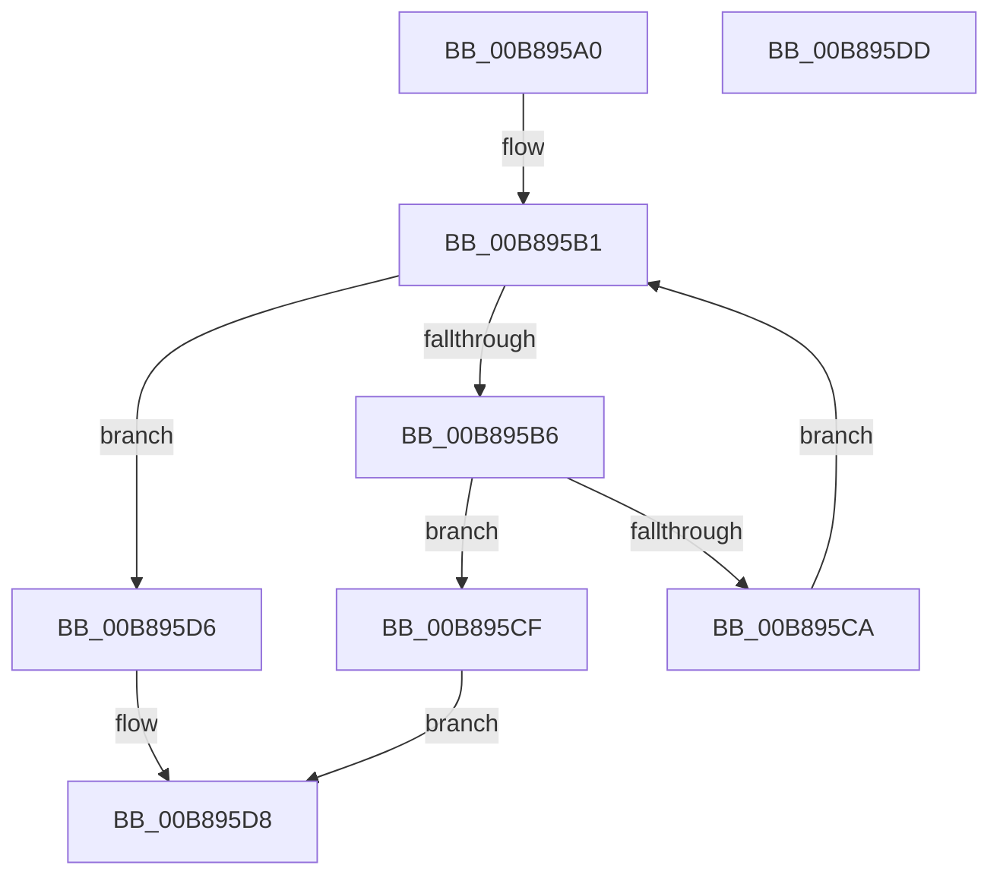

# KdpAllowDisable

- RVA: `0x00B895A0`–`0x00B895DE` (길이 `62` bytes)
- VA: `0x0000000140B895A0`
- 실행 섹션: `PAGEKD`
- PDB 이름 있음: `예`; PDB Function 태그: `아니요`
- unwind 정보 RVA: `0x0005C788`
- 디코드: `18`개 명령, `62/62` bytes 표시
- 미해석 바이트: `0` (있으면 어셈블리에 `.byte`로 보존)

> 이 문서는 커널 이미지의 기계어와 PDB 기호를 분석해 생성했습니다. 4번과 5번은 함수 원형과 자료형을 바이너리 사용 방식에서 추정한 C 해석이며 원본 소스 복구 결과는 아닙니다.

## 1. Dependencies

- 직접 호출 지점: **1**; 고유 호출 대상: **1**
- 직접 호출자로 확인된 함수: **1**
- RIP 상대 이미지 참조: **1**

### Outgoing calls
- `0x00B895A9` → [KeQueryActiveProcessorCountEx](../../text/24/KeQueryActiveProcessorCountEx_function_00249EF0.md) (function, `0x00249EF0`)

### Direct callers
- [KdDisableDebuggerWithLock](../../text/5B/KdDisableDebuggerWithLock_function_005B0918.md) at `0x005B098A`

### Static image references
- `0x00B895B6` → RVA `0x00FC8C40` (`ALMOSTRO`; read)

## 2. Other-region calls and transfers

- 다른 실행 섹션으로 향하는 call: **1**
  - `0x00B895A9` → [KeQueryActiveProcessorCountEx](../../text/24/KeQueryActiveProcessorCountEx_function_00249EF0.md) (`PAGEKD` → `.text`)
- 별도 외부 분기/꼬리 이동을 확인하지 못했습니다.

## 3. Assembly (complete function range)

```asm
00B895A0  48 83 EC 28                     sub rsp, 0x28
00B895A4  B9 FF FF 00 00                  mov ecx, 0xffff
00B895A9  E8 42 09 6C FF                  call 0x140249ef0
00B895AE  45 33 C0                        xor r8d, r8d
00B895B1  44 3B C0                        cmp r8d, eax
00B895B4  73 20                           jae 0x140b895d6
00B895B6  48 8D 15 83 F6 43 00            lea rdx, [rip + 0x43f683]
00B895BD  4A 8B 0C C2                     mov rcx, qword ptr [rdx + r8*8]
00B895C1  80 B9 48 01 00 00 00            cmp byte ptr [rcx + 0x148], 0
00B895C8  75 05                           jne 0x140b895cf
00B895CA  41 FF C0                        inc r8d
00B895CD  EB E2                           jmp 0x140b895b1
00B895CF  B8 22 00 00 C0                  mov eax, 0xc0000022
00B895D4  EB 02                           jmp 0x140b895d8
00B895D6  33 C0                           xor eax, eax
00B895D8  48 83 C4 28                     add rsp, 0x28
00B895DC  C3                              ret
00B895DD  CC                              int3
```

## 4. C-style interpretation (structured pseudocode)

```c
__int64 __fastcall KdpAllowDisable(__int64 a1, __int64 a2, int a3)
{
    __int64 result;
    __int64 v_rsp;

    v_rsp = (v_rsp) - (40);
    result = KeQueryActiveProcessorCountEx((unsigned int)(0xFFFFULL), a2, a3, a4);
    a3 = 0;
loc_00B895B1:
    if (0 >= ((unsigned int)(result))) goto loc_00B895D6;
    if ((*(unsigned __int8 *)(*(unsigned __int64 *)(v_rip + 4454019 + a3 * 8) + 328)) != 0) goto loc_00B895CF;
    a3 = (unsigned int)((a3) + 1);
    goto loc_00B895B1;
loc_00B895CF:
    goto loc_00B895D8;
loc_00B895D6:
    result = 0;
loc_00B895D8:
    v_rsp = (v_rsp) + (40);
    return result;
}
```

## 5. (Beta) C Style

```c
int64_t KdpAllowDisable(int64_t Arg1, int64_t Arg2, int32_t Arg3)
{
    int64_t result;
    int64_t local_rsp;

    local_rsp = (local_rsp) - (40);
    result = KeQueryActiveProcessorCountEx((uint32_t)(0xFFFFULL), Arg2, Arg3, a4);
    Arg3 = 0;
loc_00B895B1:
    if (0 >= ((uint32_t)(result))) goto loc_00B895D6;
    if ((*(uint8_t *)(*(uint64_t *)(v_rip + 0x43F683 + Arg3 * 8) + 0x148)) != 0) goto loc_00B895CF;
    Arg3 = (uint32_t)((Arg3) + 1);
    goto loc_00B895B1;
loc_00B895CF:
    goto loc_00B895D8;
loc_00B895D6:
    result = 0;
loc_00B895D8:
    local_rsp = (local_rsp) + (40);
    return result;
}
```

## 6. Execution-region graph

[열기: 2D/3D 그래프와 함수 탐색 컨트롤 패널](../../../control-panel.html?section=pagekd&rva=0x00B895A0&view=graph)

- 2D 그래프는 위에서 아래로 흐르고, 3D 그래프는 빈 공간을 드래그해 회전합니다. Shift+드래그는 이동, 휠은 확대·축소, 함수 노드 선택은 대상 보고서 이동입니다.

### Static fallback


